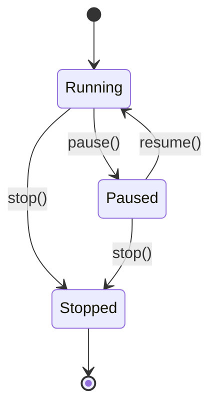
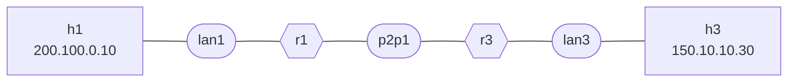
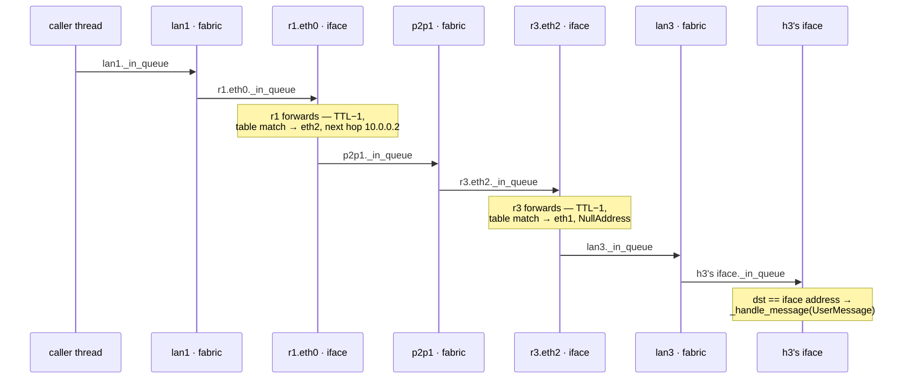

> 🌐 **English** · [Español](../es/architecture/concurrency.md)

# Concurrency

`loom` runs the simulator core on threads, not asyncio. The asyncio
event loop is reserved for the FastAPI server. This document explains the
thread inventory, the `PauseGate` primitive that holds them all together,
and the lifecycle of a single packet from `send_to` to delivery.

---

## Thread inventory

Per simulator process, on top of the asyncio loop:

| Owner | Count | Started by | Loop body |
|---|---|---|---|
| `Interface` | 1 per interface (host + router) | `Interface.__init__` | `_pkt_loop`: dequeue from `_in_queue`, then gate-check, dispatch to `_device.handle_packet` |
| `Network` / `Link` (`_FabricBase`) | 1 per fabric | `_FabricBase.__init__` | `_pkt_loop`: gate-check, dequeue from `_in_queue`, call `_dispatch_packet` |
| `LinkStateProtocol` | 1 per router | `LinkStateProtocol.__init__` | `_protocol_loop`: wait on `_wake_event`/`Scheduler`, dispatch hello/lsa-refresh/max-age-sweep |

All threads are daemons (`daemon=True`). Process exit kills them
unconditionally; clean shutdown goes through `AS.stop()` instead.

No worker thread holds the GIL for long. Every iteration either blocks
on a `queue.Queue.get`, on `gate.wait_or_stop` (inside `wait_for_gate`),
or on `_wake_event.wait`. The GIL is released across all three.

---

## The `PauseGate`

```python
class PauseGate:
    def __init__(self):
        self._running = threading.Event()
        self._running.set()           # default: running
        self._stopped = threading.Event()
```

A two-state gate (running/paused) plus an absorbing stop signal. Three
public methods drive transitions:

- `pause()`: clears `_running`.
- `resume()`: sets `_running`.
- `stop()`: sets `_stopped` and sets `_running` (so any thread
  blocked on `_running.wait` wakes up and can observe `_stopped`).

Workers do not call `gate.wait_or_stop()` directly. Instead they
call the module-level `wait_for_gate(gate, stop_event)` helper from
[`entities/clock.py`](../../src/entities/clock.py), a module-level
function, not a `PauseGate` method, because the gate may be absent:
`Interface` and `_FabricBase` both default `gate=None`, and
`wait_for_gate` returns `True` immediately in that case. A bound method
cannot be called on `None`, so every worker would otherwise have to spell
out the null check itself. It sits beside `PauseGate` (rather than in any
one caller) because its three callers
([`interface.py`](../../src/entities/interface.py),
[`_fabric.py`](../../src/entities/_fabric.py),
[`routing/protocol.py`](../../src/routing/protocol.py)) are unrelated to
each other, and because it shares `_PAUSE_POLL_INTERVAL` with the gate it polls:

```python
def wait_for_gate(gate, stop_event, poll=_PAUSE_POLL_INTERVAL) -> bool:
    """Block until the gate is RUNNING, or until the caller's stop event fires.

    Returns True  — gate is running (or absent): caller should proceed.
    Returns False — gate was stopped, or stop_event was set: caller should exit.

    When paused, polls every poll seconds and re-checks stop_event each time,
    so stop() is noticed within one poll interval rather than after the full
    join timeout.
    """
    if gate is None:
        return True
    while not stop_event.is_set():
        running, stopped = gate.wait_or_stop(timeout=poll)
        if stopped:
            return False        # AS gate stopped
        if running:
            return True         # gate resumed — proceed
        # (False, False): timeout while paused — re-check stop_event
    return False                # stop_event was set by caller's stop()
```

`wait_for_gate` is the canonical gate primitive for all packet workers and
for the protocol loop's gate check. `PauseGate.sleep` is not used by any
worker loop; its sole caller is the ping command's inter-probe wait
([`server/command/host.py`](../../src/server/command/host.py)), which sleeps
between probes.

Lifecycle map:



The `AS` owns exactly one `PauseGate`. Every worker thread in the AS
gates on the same instance. That's how `SimState.pause()` freezes the
*entire* simulation (data plane and routing protocol) atomically.

---

## Packet lifecycle

The walkthrough below follows a `UserMessage` from `h1` to `h3` on
[`samples/sample.yaml`](../../samples/sample.yaml), the same topology
[overview.md](overview.md) diagrams in full. `h3` sits on `lan3`, which
`h1`'s gateway `r1` is not attached to, so the message crosses two
routers:



Every hop above is a queue handoff between two daemon threads: no
call ever crosses a device boundary directly. Threads are the lanes;
`queue.Queue` handoffs are the arrows:



Step by step, with the work each thread actually does:

| # | Runs on | Work | Hands off by |
|---|---|---|---|
| 1 | caller thread (terminal / API) | `h1.send_message_to` builds the `Datagram`; the destination is off-link, so the L2 destination is the gateway. `Interface.send_to` wraps it in a `Frame` and broadcasts the `packet` event | `_out_queue.put(frame)`; an interface's out-queue *is* its fabric's `_in_queue` |
| 2 | `lan1` fabric thread | `wait_for_gate` → running, dequeue, `_dispatch_unicast` looks up the interface holding the L2 destination | `iface.receive(frame)` → `r1.eth0._in_queue` |
| 3 | `r1.eth0` iface thread | dequeue, *then* `wait_for_gate`; `r1.handle_packet` sees dst ≠ its own address → `_handle_forwarding`: `decrement_ttl`, `routing_table.match` | `eth2.send_to(...)` → `p2p1._in_queue` |
| 4 | `p2p1` fabric thread | `Link._dispatch_packet` delivers to whichever endpoint is not the frame's source; a link has no broadcast domain | `iface.receive(frame)` → `r3.eth2._in_queue` |
| 5 | `r3.eth2` iface thread | forwards again; this time the match returns `NullAddress` (destination directly connected), so the next hop becomes the packet's own destination | `eth1.send_to(...)` → `lan3._in_queue` |
| 6 | `lan3` fabric thread | `_dispatch_unicast` to h3's interface | `iface.receive(frame)` → h3's iface `_in_queue` |
| 7 | h3's iface thread | `h3.handle_packet` sees dst == its own address → `_handle_message(UserMessage)`, then `EventTracer.message_received` | delivered; no further handoff |

Each queue is an unbounded `queue.Queue`. Note the asymmetry in rows 2
and 3: the fabric gates *before* dequeuing, the interface dequeues
*before* gating (see [below](#interface-vs-fabric-loop-differences)).

NAT can rewrite addresses during either forwarding step (rows 3 and 5).
It adds no threads and no queues: the rewrite happens inline on the
interface thread that is already forwarding. Its only other concurrency
surface is the per-router NAT table, guarded by a single lock and keyed
on `payload.flow_key()` so two private hosts talking to the same public
destination cannot collide on one entry. The translation rules
themselves are in [nat.md](nat.md).

Pause behavior: if the gate flips to paused between any two threads
in this chain, the frame remains queued and the receiving thread blocks
on the next `wait_for_gate` call. No frames are lost; resume picks up
where pause left off.

There is one subtle re-queue in `_FabricBase._pkt_loop` to keep paused
frames visible in `_in_queue`:

```python
try:
    packet = self._in_queue.get(timeout=0.05)
except queue.Empty:
    continue
if packet is None:
    self._stopped = True
    continue
if self._gate is not None and not self._gate.is_running():
    # Gate flipped to paused between the wait_for_gate above and the dequeue:
    # put the packet back so it stays observable in the queue.
    self._in_queue.put(packet)
    continue
```

This makes the queue depth honest for tools that inspect it (e.g. tests).

### Interface vs fabric loop differences

`Interface._pkt_loop` and `_FabricBase._pkt_loop` use **opposite
gate/dequeue orderings**:

- `Interface._pkt_loop`, **dequeue-then-gate**: blocks on `queue.get()`
  first, then calls `wait_for_gate` before dispatching. No re-queue on
  pause; the dequeued frame is held in a local variable.
- `_FabricBase._pkt_loop`, **gate-then-dequeue**: calls `wait_for_gate`
  first, then does a short-timeout `queue.get`. On pause between the two,
  it puts the frame back to keep the queue depth accurate.

The rationale is what each queue means to an observer. A fabric's
`_in_queue` is the wire: its depth is how many frames are in flight on
that LAN or link, and tests and tooling read it. So a paused fabric must
leave its frames *in the queue*: dequeuing first would park a frame in a
local variable and show an empty wire while the simulation is frozen. It
gates first, and re-queues on the pause race for exactly that reason.

An interface's `_in_queue` is a private inbox; nobody measures its depth
to reason about the network, so holding one frame in a local across a
pause costs nothing.

The trade-off runs the other way: because the fabric loop has to return
and re-check the gate, it cannot block indefinitely, hence the 0.05s
`get` timeout and its small idle poll. The interface loop, which owes no
one an accurate depth, blocks on `get()` forever and is woken only by a
frame or by the `None` sentinel.

---

## Stop mechanisms

Every `Interface` and `_FabricBase` owns a **per-worker `_stop_event`**
(`threading.Event`) alongside the shared `PauseGate`. The two together
give workers three independent paths to exit:

1. **Gate stop signal**: `PauseGate.stop()` wakes `gate.wait_or_stop`
   inside `wait_for_gate`; the wrapper returns `False` and the loop exits.
2. **Per-worker `_stop_event`**: `wait_for_gate` polls `stop_event.is_set()`
   on every pause-poll cycle, so a *paused* worker notices `stop()` within
   one `_PAUSE_POLL_INTERVAL` (0.1 s) without the gate having to resume first.
3. `None` sentinel on the queue: `Interface.stop()` and
   `_FabricBase.stop()` put `None` on `_in_queue` to wake a worker
   blocked on `queue.get`.

Which path fires when. The first is *whole-simulation* scope and the
second is *one-worker* scope: `AS.stop()` trips the gate once and every
worker in the AS sees it, whereas a live edit that removes a single host,
router, or network calls `Interface.stop()` / `_FabricBase.stop()` on just
those workers while the rest of the simulation keeps running. `AS.stop()`
uses both: the gate for the broad signal, then per-worker `stop()` calls
as it walks the fabrics.

The third is not really a third *trigger* so much as the wake-up for the
other two. An interface worker blocks in `queue.get()` with no timeout, so
neither flag reaches it until something lands on the queue; the sentinel is
what lands. (A fabric worker's `get` has a 0.05s timeout and would notice
the flags on its own, but takes the sentinel path too, for uniformity.)

Critical ordering: `stop()` sets `_stop_event` before putting
the `None` sentinel:

```python
# Interface.stop() and _FabricBase.stop() both follow this pattern:
self._stop_event.set()          # (1) workers parked on wait_for_gate will see this
self._in_queue.put(None)        # (2) wakes workers blocked on queue.get
```

This ordering ensures a paused worker (blocked inside `wait_for_gate`)
sees the stop flag on its next poll rather than waiting for the gate to
resume first. Without it, `stop()` on a paused sim would hang until
`resume()` was called.

---

## Editor mutex and live-edit atomicity

`SimState` owns a `threading.Lock` called `_edit_lock` that serialises
topology mutations regardless of which thread or endpoint initiates them.

Three operations acquire `_edit_lock` before doing any work:

| Operation | State guard |
|---|---|
| `SimState.edit(patch)` (`POST /sim/edit`) | Requires `running`; errors `409` otherwise |
| `SimState.resume(patch)` (`POST /sim/resume`) | Requires `paused`; errors `409` otherwise |
| `SimState.stop()` (`POST /sim/stop`) | Any state → `idle` |

Within `edit` and `resume`, the acquire-before-validate ordering is:

```
_edit_lock acquired
  → validate every op (abort on first failure, release lock, return 400)
  → apply every op in sequence
_edit_lock released
  → broadcast topology_changed event
```

The broadcast is deliberately the last step, outside both locks:
subscriber callbacks run inline on the calling thread, so emitting under
`_lock` would run arbitrary subscriber code while topology readers are
blocked. The event carries the applied patch (`{"kind":
"topology_changed", "ops": patch}`) and reaches every `/ws/events`
subscriber through the `EventTracer` → `EventBus` bridge. Its purpose is
resync for observers that did not initiate the edit: an editor already
knows what it just sent, but a second viewer (another browser tab, a
test harness) learns the topology moved and can re-read it.

This is **validate-all-then-apply-all**: either the entire patch lands
or nothing lands. Two concurrent `POST /sim/edit` calls cannot interleave
their ops.

`resume` and `stop` also take `_edit_lock` before calling
`PauseGate.resume()` / `PauseGate.stop()`. The ordering is always
`_edit_lock` → `_lock` (the state-machine lock inside `SimState`): never
`_lock` → `_edit_lock`, or a deadlock is possible.

### Snapshot-on-read on the dispatch hot path

Both `Network` and `Link` dispatch paths iterate over attached interfaces
with:

```python
for iface in list(self._interfaces.values()):
    ...
```
The `list(...)` call takes a snapshot of the dict's values. A concurrent
`edit` that adds or removes an interface will therefore never trigger a
runtime error.

If the destination interface's thread has already stopped, nothing
raises. `Interface.receive` is a bare `_in_queue.put(...)`, and a
`queue.Queue` accepts writes whether or not anyone is reading, so the
frame lands in a queue with no consumer and is collected along with the
interface. The frame is lost silently; the dispatching fabric thread never
learns it, and no other worker is affected. That is the acceptable
transitional artifact.

The [detach-before-stop ordering](#removal-detach-ordering) below is what
keeps this rare rather than routine: once `remove_interface` has run, the
interface is gone from the snapshot the dispatch loop reads, so only a
frame dispatched in the window *between* the snapshot and the detach can
reach a dead consumer.

### Removal-detach ordering

`_apply_op` for `remove_host` and `remove_router` follows a strict
ordering:

**`remove_host`:**

1. Detach the interface from its fabric (`host.network().remove_interface(addr)`)
   before stopping the interface thread. This ensures the fabric's
   dispatch loop can no longer enqueue frames on the interface after
   the thread has been signalled to stop.
2. Stop the interface thread (`host.interface().stop()`).

**`remove_router`:**

1. Stop the routing-protocol thread first (`router.stop()`). This
   floods a withdrawal LSA so peers purge the router immediately, and
   stops the protocol thread before any interfaces are detached.
2. **Per interface: detach from its fabric, then stop the interface
   thread.** `iface.network().remove_interface(iface.address())` ensures
   the fabric's dispatch loop can no longer enqueue frames on that
   interface; `iface.stop()` then signals the thread to exit.
3. Delete the router from the AS dict.

**`remove_network`:**

`remove_network` is only allowed when the network has no attached
interfaces (enforced by `_validate_op`). It therefore just stops the
fabric thread and deletes: nothing to detach.

The key invariant is **detach-before-stop-interface-thread**: removing
an interface from its fabric before stopping the interface thread ensures
the dispatch loop cannot enqueue an orphaned frame onto a queue whose
consumer has already exited.

---

## Shutdown

`AS.stop()` is the orderly path:

1. `self._gate.stop()`: sets `_stopped` and `_running`. Any worker
   blocked on `_running.wait` (inside `wait_for_gate`) wakes up and
   observes stop on its next check.
2. For each network: `Network.stop()` → for each interface attached:
   `Interface.stop()` (which sets `_stop_event` then puts `None` on the
   interface's `_in_queue`) → put `None` on the fabric's `_in_queue`.
3. For each link: same as for networks.
4. For each router: `LinkStateProtocol.stop()` sets `_stop_event`, sets
   `_wake_event` (waking a parked protocol loop immediately), and joins
   the protocol thread.

The `None` sentinel is the universal "drain and exit" signal for queue
consumers. Combined with the per-worker `_stop_event` and the gate's
stop signal, it gives three independent ways for a worker to learn it's
time to leave (important because a worker may be blocked on the queue,
on `wait_for_gate`, or sleeping inside `_wake_event.wait` at any given
moment).

---

## Protocol loop and `_wake_event`

`LinkStateProtocol._protocol_loop` does not use `gate.sleep` or a
periodic `keepalive` attribute. Instead it drives three named timers via
a `Scheduler` and blocks on a per-instance `_wake_event`:

```python
def _protocol_loop(self):
    gate = self._router.gate()
    # Initial tick: hello + LSA at t≈0 (unjittered).
    now = time.monotonic()
    if not wait_for_gate(gate, self._stop_event):
        return
    self._safe_tick_initial(now)
    self._schedule_initial_deadlines()

    while not self._stopped:
        now = time.monotonic()
        wait_for = max(0.0, self._scheduler.next_deadline() - now)
        self._wake_event.wait(timeout=wait_for)
        self._wake_event.clear()
        if self._stopped:
            break
        if not wait_for_gate(gate, self._stop_event):
            break
        now = time.monotonic()
        for name in self._scheduler.elapsed(now):
            self._dispatch(name, now)
```

On each iteration the loop sleeps until the next scheduled timer fires,
or until `_wake_event` is set early. Two callers set `_wake_event`:

- **`set_timers()`**, so a live timer-config change takes effect on the
  next loop iteration rather than after the old timer fires.
- **`stop()`**, so a parked loop exits immediately rather than sleeping
  until the next deadline.

`_dispatch` routes each elapsed timer name to one of three handlers:

| Timer name | Handler | What it does                                                               |
|---|---|----------------------------------------------------------------------------|
| `hello` | `_emit_hello_on_up_interfaces` | Broadcast Hello on every up interface                                      |
| `lsa_refresh` | `_emit_lsa_on_up_interfaces` | Emit local + outbound LSA on every up interface                            |
| `maxage_check` | `_sweep_dead_and_expired` | Purge dead neighbors and expired LSAs; recompute shortest paths if changed |

After the initial unjittered tick, each timer reschedules with per-tick
jitter in `[0.75·T, 1.25·T]` via the `Scheduler`.

---

## Threads and asyncio

The simulator core uses threads throughout. Each `Interface` and each
`Network` is conceptually an autonomous moving piece, and `queue.Queue` +
`threading.Event` gave the right primitives without an event loop.

When the web UI was added, the asyncio loop entered the picture **only for
the network boundary**. The bridge is
[`server/events.py`](../../src/server/events.py):

```python
self._loop.call_soon_threadsafe(self._enqueue, q, event)
```

Worker threads emit events, the asyncio loop fans them out to
WebSockets. Adding async to the simulator core would
require rewriting `PauseGate` and every `_pkt_loop`; there is no benefit
at the simulator's scale.

`call_soon_threadsafe` is the only asyncio API in this bridge that may be
called from outside the loop, which is what makes the direction safe.
Note what `EventBus` does not use: there is no `asyncio.Lock`
anywhere in the codebase. `EventBus._lock` is a plain `threading.Lock`,
because `emit()` runs on arbitrary worker threads and an `asyncio.Lock`
is neither thread-safe nor acquirable outside the loop: it can only be
`await`ed from a coroutine. The asyncio side contributes the per-
subscriber `asyncio.Queue`, which is only ever touched from inside the
loop by `_enqueue`.

---

## Scaling Characteristics

`loom` is built for teaching, not load. The threaded architecture is
honest at small scale and predictable in how it degrades at large
scale. Thread count grows linearly with topology size:

```
threads ≈ H + R·K + N + L + R + 1
```

| Term | One per | Thread |
|---|---|---|
| `H` | host | its single interface's `_pkt_loop` (a host has exactly one interface) |
| `R·K` | router interface | that interface's `_pkt_loop`; `K` = interfaces on the router |
| `N` | network | the fabric's `_pkt_loop` |
| `L` | link | the fabric's `_pkt_loop` |
| `R` | router | `LinkStateProtocol._protocol_loop` |
| `1` | process | the asyncio event loop serving HTTP + WebSockets |

Most threads are I/O-bound and release the GIL on `queue.Queue.get()`
or `threading.Event.wait()`, so idle threads cost almost nothing. The
bottleneck is not thread count itself; it's serialization, and it comes
from two independent sources:

- **Shared locks.** Threads that need the same lock take turns.
  `EventTracer._broadcast` and `EventBus.emit` each take a lock to
  snapshot their subscriber set, and every `queue.Queue` has its own
  internal lock. Adding threads that contend for one of these adds
  waiting, not throughput.
- **The GIL.** CPython runs Python bytecode under one global lock, so
  Python-level work, `handle_packet`, `RoutingTable.match`, timeshares
  a single core no matter how many threads or cores exist. This is also
  why the point above about idle threads holds: a thread blocked in
  `queue.get()` has released the GIL and is not competing for it.

### Practical ceilings

Rough thresholds on Linux with a default CPython build (`loom` requires
3.11+), with the routing protocol at the default 10s hello interval:

| Topology size | Threads | What works | What starts to bite |
|---|---|---|---|
| ≤100 routers | ≤1000 | Convergence in seconds | Nothing |
| ~500 routers (~25 sample-scale ASes) | ~2500 | Sim still runs | `EventTracer._broadcast` and `EventBus.emit` saturate under their subscriber / queue locks; WebSocket consumers see lag |
| ~1000+ routers | >5000 | Routing protocol still converges, slowly | WebSocket JSON serialization pins one CPU |
| ~5000+ routers | >25000 | Not viable on threads + GIL | Dispatch loops would need to move to asyncio |

These are upper-bound estimates. Dropping the hello interval to
1s roughly halves the useful topology size at every tier (the
protocol chatter, which dominates packet traffic, scales inversely
with the interval).

### Bottleneck order

As topology size grows, the choke points appear in this order:

1. **Event-bus fan-out.** `EventTracer._broadcast` holds a brief
   instance lock to snapshot subscribers, then releases before fan-out.
   `EventBus.emit` similarly holds its lock only to snapshot the queue
   set. At hundreds of packet events per second × every WebSocket
   subscriber, the snapshot + per-queue enqueue work serializes. In
   practice the subscriber count is small: `EventBus.subscribe()` is
   called once per `/ws/events` connection, and today the SPA is the only
   client, so the multiplier is the number of open browser tabs (plus
   any connected test or tool), not a fleet of consumers. The per-event
   cost of the snapshot itself is paid whether or not anyone is listening.
2. **Per-fabric queue contention.** Each `_FabricBase._in_queue` is a
   single `queue.Queue` shared by every attached interface. On a busy
   LAN with many devices, the queue's lock becomes hot.
3. **GIL on dispatch.** `device.handle_packet` and `RoutingTable.match`
   are Python-bytecode work. At a few thousand packets per second
   aggregated across all routers, CPython can't keep up on a single
   core.
4. **Raw thread count.** Linux pthread + CPython tolerate ~10k threads
   comfortably; beyond that, `pthread_create` itself slows down.

---

## Code references

| Concern | File | Symbol |
|---|---|---|
| Pause / stop gate | [`src/entities/clock.py`](../../src/entities/clock.py) | `PauseGate`, `wait_for_gate` |
| Interface worker loop | [`src/entities/interface.py`](../../src/entities/interface.py) | `Interface._pkt_loop`, `Interface.stop` |
| Fabric worker loop | [`src/entities/_fabric.py`](../../src/entities/_fabric.py) | `_FabricBase._pkt_loop`, `_FabricBase.stop` |
| LAN dispatch | [`src/entities/network.py`](../../src/entities/network.py) | `Network._dispatch_unicast`, `_dispatch_broadcast` |
| Link dispatch | [`src/entities/link.py`](../../src/entities/link.py) | `Link._dispatch_packet` |
| AS-wide shutdown | [`src/entities/system.py`](../../src/entities/system.py) | `AS.stop` |
| Event fan-out | [`src/entities/event.py`](../../src/entities/event.py) | `EventTracer._broadcast` |
| Protocol loop + timers | [`src/routing/protocol.py`](../../src/routing/protocol.py) | `LinkStateProtocol._protocol_loop` |
| Timer deadlines + jitter | [`src/routing/scheduler.py`](../../src/routing/scheduler.py) | `Scheduler.elapsed` |
| Editor mutex + patch atomicity | [`src/server/state.py`](../../src/server/state.py) | `SimState.edit`, `SimState._apply_patch` |
| Thread → asyncio bridge | [`src/server/events.py`](../../src/server/events.py) | `EventBus.emit`, `EventBus._enqueue` |
| WebSocket subscriber | [`src/server/routes/ws.py`](../../src/server/routes/ws.py) | `events` |
