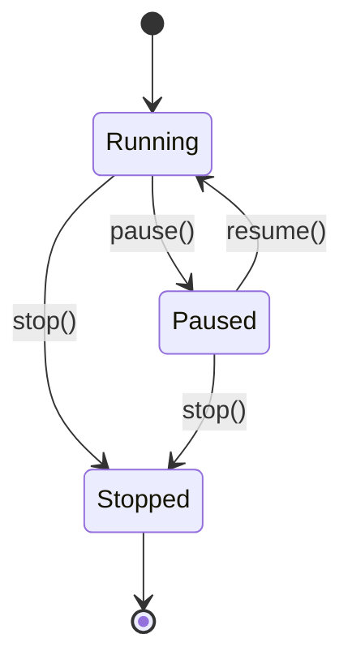

# Concurrency

`loom` runs the simulator core on **threads**, not asyncio. The asyncio
event loop is reserved for the FastAPI server. This document explains the
thread inventory, the `PauseGate` primitive that holds them all together,
and the lifecycle of a single packet from `send_to` to delivery.

---

## Thread inventory

Per simulator process, on top of the asyncio loop:

| Owner | Count | Started by | Loop body |
|---|---|---|---|
| `Interface` | 1 per interface (host + router) | `Interface.__init__` | `_pkt_loop` — dequeue from `_in_queue`, then gate-check, dispatch to `_device.handle_packet` |
| `Network` / `Link` (`_FabricBase`) | 1 per fabric | `_FabricBase.__init__` | `_pkt_loop` — gate-check, dequeue from `_in_queue`, call `_dispatch_packet` |
| `LinkStateProtocol` | 1 per router | `LinkStateProtocol.__init__` | `_protocol_loop` — wait on `_wake_event`/`Scheduler`, dispatch hello/lsa-refresh/max-age-sweep |

All threads are **daemons** (`daemon=True`). Process exit kills them
unconditionally; clean shutdown goes through `AS.stop()` instead.

No worker thread holds the GIL for long. Every iteration either blocks
on a `queue.Queue.get`, on `gate.wait_or_stop` (inside `wait_for_gate`),
or on `_wake_event.wait`. The GIL is released across all three.

---

## The `PauseGate`

```python
class PauseGate:
    def __init__(self):
        self._running = threading.Event()
        self._running.set()           # default: running
        self._stopped = threading.Event()
```

A two-state gate (running/paused) plus an absorbing stop signal. Three
public methods drive transitions:

- `pause()` — clears `_running`.
- `resume()` — sets `_running`.
- `stop()` — sets `_stopped` **and** sets `_running` (so any thread
  blocked on `_running.wait` wakes up and can observe `_stopped`).

Workers do **not** call `gate.wait_or_stop()` directly. Instead they
call the module-level `wait_for_gate(gate, stop_event)` helper from
`entities/clock.py`:

```python
def wait_for_gate(gate, stop_event, poll=_PAUSE_POLL_INTERVAL) -> bool:
    """Block until the gate is RUNNING, or until the caller's stop event fires.

    Returns True  — gate is running (or absent): caller should proceed.
    Returns False — gate was stopped, or stop_event was set: caller should exit.

    When paused, polls every poll seconds and re-checks stop_event each time,
    so stop() is noticed within one poll interval rather than after the full
    join timeout.
    """
    if gate is None:
        return True
    while not stop_event.is_set():
        running, stopped = gate.wait_or_stop(timeout=poll)
        if stopped:
            return False        # AS gate stopped
        if running:
            return True         # gate resumed — proceed
        # (False, False): timeout while paused — re-check stop_event
    return False                # stop_event was set by caller's stop()
```

`wait_for_gate` is the canonical gate primitive for all packet workers
and for the protocol loop's gate check. `PauseGate.sleep` is not used by
any worker loop; its sole caller is the ping command's inter-probe wait
(`server/command/host.py`), which sleeps between probes.

Lifecycle map:



The `AS` owns exactly one `PauseGate`. Every worker thread in the AS
gates on the same instance. That's how `SimState.pause()` freezes the
*entire* simulation — data plane and routing protocol — atomically.

---

## Packet lifecycle

A `UserMessage` sent from `h1` to `h3` flows through queues and threads
as follows. Color codes: `[q]` = queue boundary, `[t]` = thread switch.

```
Caller thread                                  Per-interface / per-fabric daemons
─────────────                                  ──────────────────────────────────

h1.send_message_to(msg, h3.address)
    │ packet = Datagram(src=h1, dst=h3, payload=msg)
    │ dst_addr = gateway  (off-link destination)
    │
    ▼
h1.iface.send_to(packet, dst=gw)
    │ frame = Frame(src=h1.iface, dst=gw, payload=packet)
    │ EventTracer._broadcast({"kind":"packet", ...})
    │ self._out_queue.put(frame)          ← [q] frame -> lan1._in_queue
    │
[t]─────────────────────────────────────►  lan1._pkt_loop wakes
                                              │ wait_for_gate(...) → running
                                              │ self._dispatch_unicast(frame, dst=gw)
                                              │ self._interfaces[gw].receive(frame)
                                              │   self._in_queue.put(frame)   ← [q] frame -> r1.eth0._in_queue
                                              │
[t]─────────────────────────────────────►  r1.eth0._pkt_loop wakes
                                              │ dequeued frame; wait_for_gate(...) → running
                                              │ r1.handle_packet(payload, self)
                                              │   dst != iface.address → _handle_forwarding(packet)
                                              │   packet.decrement_ttl()
                                              │   match = routing_table.match(h3.address)
                                              │   out_iface, next_hop = match.interface(), match.next_hop()
                                              │   if next_hop is NullAddress: next_hop = packet.destination()
                                              │   out_iface.send_to(packet, next_hop)
                                              │     frame' = Frame(src=r1.eth1, dst=h3, payload=packet)
                                              │     self._out_queue.put(frame')   ← [q] frame' -> lan2._in_queue
                                              │
[t]─────────────────────────────────────►  lan2._pkt_loop wakes  → h3.iface._in_queue
[t]─────────────────────────────────────►  h3.iface._pkt_loop wakes
                                              │ h3.handle_packet(payload, self)
                                              │   dst == iface.address → _handle_message(UserMessage)
                                              │   EventTracer.message_received(...)
```

Three queues sit on the path: `h1.iface→lan1`, `lan1→r1.eth0`,
`r1.eth1→lan2`, `lan2→h3.iface`. Each is a `queue.Queue` (unbounded).
The flow involves four thread switches and one routing-table lookup.

**NAT interposition:** when a router sits at the boundary between a
private and a public network, NAT may rewrite addresses during the
forwarding step — no additional threads are involved. On the outbound
path, if the source address is private and the chosen egress interface
is public, the source is rewritten to the router's public address and
the translation is registered in the router's NAT table. On the inbound
path, before the usual destination check, if the incoming destination
matches a recorded translation the destination is rewritten back to the
original private host and the packet re-enters forwarding normally. The
NAT table is per-router and protected by a single lock; when it reaches
capacity, the least-recently-used entry is evicted — there is no
time-based expiration. The translation key uses the **conversation flow
key** (`payload.flow_key()` — a UUID stable across NAT rewrites) so
concurrent flows from two private hosts with colliding seqs don't
collide on the NAT entry — see [nat.md](nat.md).

**Pause behavior:** if the gate flips to paused between any two threads
in this chain, the frame remains queued and the receiving thread blocks
on the next `wait_for_gate` call. No frames are lost; no `packet`
events are emitted while paused; resume picks up where pause left off.

There is one subtle re-queue in `_FabricBase._pkt_loop` to keep paused
frames visible in `_in_queue`:

```python
try:
    packet = self._in_queue.get(timeout=0.05)
except queue.Empty:
    continue
if packet is None:
    self._stopped = True
    continue
if self._gate is not None and not self._gate.is_running():
    # Gate flipped to paused between the wait_for_gate above and the dequeue:
    # put the packet back so it stays observable in the queue.
    self._in_queue.put(packet)
    continue
```

This makes the queue depth honest for tools that inspect it (e.g. tests).

### Interface vs fabric loop differences

`Interface._pkt_loop` and `_FabricBase._pkt_loop` use **opposite
gate/dequeue orderings**:

- `Interface._pkt_loop` — **dequeue-then-gate**: blocks on `queue.get()`
  first, then calls `wait_for_gate` before dispatching. No re-queue on
  pause; the dequeued frame is held in a local variable.
- `_FabricBase._pkt_loop` — **gate-then-dequeue**: calls `wait_for_gate`
  first, then does a short-timeout `queue.get`. On pause between the two,
  it puts the frame back to keep the queue depth accurate.

---

## Per-worker stop event and stop-before-sentinel ordering

Every `Interface` and `_FabricBase` owns a **per-worker `_stop_event`**
(`threading.Event`) alongside the shared `PauseGate`. The two together
give workers three independent paths to exit:

1. **Gate stop signal** — `PauseGate.stop()` wakes `gate.wait_or_stop`
   inside `wait_for_gate`; the wrapper returns `False` and the loop exits.
2. **Per-worker `_stop_event`** — `wait_for_gate` polls `stop_event.is_set()`
   on every pause-poll cycle, so a *paused* worker notices `stop()` within
   one `_PAUSE_POLL_INTERVAL` (0.1 s) without the gate having to resume first.
3. **`None` sentinel on the queue** — `Interface.stop()` and
   `_FabricBase.stop()` put `None` on `_in_queue` to wake a worker
   blocked on `queue.get`.

**Critical ordering:** `stop()` sets `_stop_event` **before** putting
the `None` sentinel:

```python
# Interface.stop() and _FabricBase.stop() both follow this pattern:
self._stop_event.set()          # (1) workers parked on wait_for_gate will see this
self._in_queue.put(None)        # (2) wakes workers blocked on queue.get
```

This ordering ensures a paused worker (blocked inside `wait_for_gate`)
sees the stop flag on its next poll rather than waiting for the gate to
resume first. Without it, `stop()` on a paused sim would hang until
`resume()` was called.

---

## Editor mutex and live-edit atomicity

`SimState` owns a `threading.Lock` called `_edit_lock` that serialises
topology mutations regardless of which thread or endpoint initiates them.

Three operations acquire `_edit_lock` before doing any work:

| Operation | State guard |
|---|---|
| `SimState.edit(patch)` (`POST /sim/edit`) | Requires `running`; errors `409` otherwise |
| `SimState.resume(patch)` (`POST /sim/resume`) | Requires `paused`; errors `409` otherwise |
| `SimState.stop()` (`POST /sim/stop`) | Any state → `idle` |

Within `edit` and `resume`, the acquire-before-validate ordering is:

```
_edit_lock acquired
  → validate every op (abort on first failure, release lock, return 400)
  → apply every op in sequence
  → broadcast topology_changed event
_edit_lock released
```

This is **validate-all-then-apply-all**: either the entire patch lands
or nothing lands. Two concurrent `POST /sim/edit` calls cannot interleave
their ops.

`resume` and `stop` also take `_edit_lock` before calling
`PauseGate.resume()` / `PauseGate.stop()`. The ordering is always
`_edit_lock` → `_lock` (the state-machine lock inside `SimState`): never
`_lock` → `_edit_lock`, or a deadlock is possible.

### Snapshot-on-read on the dispatch hot path

Both `Network` and `Link` dispatch paths iterate over attached interfaces
with:

```python
for iface in list(self._interfaces.values()):
    ...
```

The `list(...)` call takes a snapshot of the dict's values. A concurrent
`edit` that adds or removes an interface will therefore never trigger a
`RuntimeError: dictionary changed size during iteration`. Frames in
transit to an interface that is concurrently removed are simply dropped at
their destination — an acceptable transitional artifact.

The snapshot works because `list()` is implemented in C and drains the
values view in a single, uninterrupted C-level pass before returning. A
Python-level `for x in d.values():` loop does not have this protection:
CPython raises `RuntimeError` whenever a dict's internal version changes
between two successive `__next__` calls on the same iterator, regardless
of dict size. The `list(...)` wrapper is therefore load-bearing, not
cosmetic.

### Removal-detach ordering

`_apply_op` for `remove_host` and `remove_router` follows a strict
ordering:

**`remove_host`:**

1. **Detach the interface from its fabric** (`host.network().remove_interface(addr)`)
   before stopping the interface thread. This ensures the fabric's
   dispatch loop can no longer enqueue frames on the interface after
   the thread has been signalled to stop.
2. **Stop the interface thread** (`host.interface().stop()`).

**`remove_router`:**

1. **Stop the routing-protocol thread first** (`router.stop()`). This
   floods a withdrawal LSA so peers purge the router immediately, and
   stops the protocol thread before any interfaces are detached.
2. **Per interface: detach from its fabric, then stop the interface
   thread.** `iface.network().remove_interface(iface.address())` ensures
   the fabric's dispatch loop can no longer enqueue frames on that
   interface; `iface.stop()` then signals the thread to exit.
3. **Delete the router from the AS dict.**

**`remove_network`:**

`remove_network` is only allowed when the network has no attached
interfaces (enforced by `_validate_op`). It therefore just stops the
fabric thread and deletes — nothing to detach.

The key invariant is **detach-before-stop-interface-thread**: removing
an interface from its fabric before stopping the interface thread ensures
the dispatch loop cannot enqueue an orphaned frame onto a queue whose
consumer has already exited.

---

## Shutdown

`AS.stop()` is the orderly path:

1. `self._gate.stop()` — sets `_stopped` and `_running`. Any worker
   blocked on `_running.wait` (inside `wait_for_gate`) wakes up and
   observes stop on its next check.
2. For each network: `Network.stop()` → for each interface attached:
   `Interface.stop()` (which sets `_stop_event` then puts `None` on the
   interface's `_in_queue`) → put `None` on the fabric's `_in_queue`.
3. For each link: same as for networks.
4. For each router: `LinkStateProtocol.stop()` sets `_stop_event`, sets
   `_wake_event` (waking a parked protocol loop immediately), and joins
   the protocol thread.

The `None` sentinel is the universal "drain and exit" signal for queue
consumers. Combined with the per-worker `_stop_event` and the gate's
stop signal, it gives three independent ways for a worker to learn it's
time to leave — important because a worker may be blocked on the queue,
on `wait_for_gate`, or sleeping inside `_wake_event.wait` at any given
moment.

---

## Protocol loop and `_wake_event`

`LinkStateProtocol._protocol_loop` does not use `gate.sleep` or a
periodic `keepalive` attribute. Instead it drives three named timers via
a `Scheduler` and blocks on a per-instance `_wake_event`:

```python
def _protocol_loop(self):
    gate = self._router.gate()
    # Initial tick: hello + LSA at t≈0 (unjittered).
    now = time.monotonic()
    if not wait_for_gate(gate, self._stop_event):
        return
    self._safe_tick_initial(now)
    self._schedule_initial_deadlines()

    while not self._stopped:
        now = time.monotonic()
        wait_for = max(0.0, self._scheduler.next_deadline() - now)
        self._wake_event.wait(timeout=wait_for)
        self._wake_event.clear()
        if self._stopped:
            break
        if not wait_for_gate(gate, self._stop_event):
            break
        now = time.monotonic()
        for name in self._scheduler.elapsed(now):
            self._dispatch(name, now)
```

On each iteration the loop sleeps until the next scheduled timer fires,
or until `_wake_event` is set early. Two callers set `_wake_event`:

- **`set_timers()`** — so a live timer-config change takes effect on the
  next loop iteration rather than after the old timer fires.
- **`stop()`** — so a parked loop exits immediately rather than sleeping
  until the next deadline.

`_dispatch` routes each elapsed timer name to one of three handlers:

| Timer name | Handler | What it does |
|---|---|---|
| `hello` | `_emit_hello_on_up_interfaces` | Broadcast Hello on every up interface |
| `lsa_refresh` | `_emit_lsa_on_up_interfaces` | Emit local + outbound LSA on every up interface |
| `maxage_check` | `_sweep_dead_and_expired` | Purge dead neighbors and expired LSAs; recompute SPF if changed |

After the initial unjittered tick, each timer reschedules with per-tick
jitter in `[0.75·T, 1.25·T]` via the `Scheduler`.

---

## Idempotent restarts

`LinkStateProtocol.start` is idempotent on a running thread and
explicitly clears both `_stopped` and `_stop_event` before re-starting:

```python
self._stopped = False
self._stop_event.clear()
if self._protocol_thread is not None and self._protocol_thread.is_alive():
    return                            # idempotent on running
self._protocol_thread = threading.Thread(...)
self._protocol_thread.start()
```

The clear-before-check matters: the SimState load/start cycle (Parser
builds routers → `load_from_session` stops them → `/sim/start` starts
them) goes through this path every time, and without the clear, the
thread would observe stale `_stopped=True` on its next `_wake_event`
return and exit silently.

This is a real bug class the project hit and fixed; the comment in
`LinkStateProtocol.start` explains the trap.

---

## Why threads, not asyncio?

The simulator core uses threads throughout. Each `Interface` and each
`Network` is conceptually an autonomous moving piece, and `queue.Queue` +
`threading.Event` gave the right primitives without an event loop.

When the web UI was added, the asyncio loop entered the picture **only
for the network boundary**. The bridge is `server/events.py`:

```python
self._loop.call_soon_threadsafe(self._enqueue, q, event)
```

Worker threads emit events, the asyncio loop fans them out to
WebSockets. There is no async simulator code, no `asyncio.Lock`, no
`asyncio.run_in_executor`. Adding async to the simulator core would
require rewriting `PauseGate` and every `_pkt_loop`; there is no benefit
at the simulator's scale.

The downside of threads is that **a misbehaving subscriber or a stuck
queue can hang the whole AS**. The defensive layers are:

- `EventTracer._broadcast_instance` snapshots subscribers under a brief
  instance lock (`_sub_lock`), releases the lock, then fans out — one
  bad subscriber cannot stop the broadcast, and the lock is not held
  during fan-out.
- `EventBus.emit` similarly snapshots `_queues` under its instance lock
  before releasing and iterating — the lock is not held while enqueuing
  to individual WebSocket queues.
- `_FabricBase._pkt_loop` and `Interface._pkt_loop` wrap the dispatch
  in `try/except Exception` + logging — a buggy handler doesn't kill
  the worker.
- The `EventBus` enforces a per-queue 1000-event cap; on overflow it
  drops the oldest event and increments `overflow_count`. A slow
  WebSocket consumer won't pin memory.

---

## Scaling Characteristics

`loom` is built for teaching, not load. The threaded architecture is
honest at small scale and predictable in how it degrades at large
scale. Thread count grows linearly with topology size:

```
threads ≈ H + R·K + N + L + R + 1
        (host)  (router)  (fabric)  (protocol thread)  (asyncio loop)
```

Most threads are I/O-bound and release the GIL on `queue.Queue.get()`
or `threading.Event.wait()`, so idle threads cost almost nothing —
about 8 KB of stack each on Linux. The bottleneck is **not thread
count itself**; it's serialization through shared locks and CPython's
single-threaded Python-bytecode execution.

### Practical ceilings

Rough thresholds against CPython 3.11 on Linux, with the routing
protocol at the default 10 s hello interval:

| Topology size | Threads | What works | What starts to bite |
|---|---|---|---|
| ≤100 routers | ≤1000 | Convergence in seconds | Nothing |
| ~500 routers (~25 sample-scale ASes) | ~2500 | Sim still runs | `EventTracer._broadcast` and `EventBus.emit` saturate under their subscriber / queue locks; WebSocket consumers see lag |
| ~1000+ routers | >5000 | Routing protocol still converges, slowly | WebSocket JSON serialization pins one CPU |
| ~5000+ routers | >25000 | Not viable on threads + GIL | Dispatch loops would need to move to asyncio |

These are upper-bound estimates. Dropping the hello interval to
1 s roughly halves the useful topology size at every tier — the
protocol chatter (which dominates packet traffic) scales inversely
with the interval.

### Bottleneck order

As topology size grows, the choke points appear in this order:

1. **Event-bus fan-out.** `EventTracer._broadcast` holds a brief
   instance lock to snapshot subscribers, then releases before fan-out.
   `EventBus.emit` similarly holds its lock only to snapshot the queue
   set. At hundreds of packet events per second × every WebSocket
   subscriber, the snapshot + per-queue enqueue work serializes.
2. **Per-fabric queue contention.** Each `_FabricBase._in_queue` is a
   single `queue.Queue` shared by every attached interface. On a busy
   LAN with many devices, the queue's lock becomes hot.
3. **GIL on dispatch.** `device.handle_packet` and `RoutingTable.match`
   are Python-bytecode work. At a few thousand packets per second
   aggregated across all routers, CPython can't keep up on a single
   core.
4. **Raw thread count.** Linux pthread + CPython tolerate ~10k threads
   comfortably; beyond that, `pthread_create` itself slows down.
