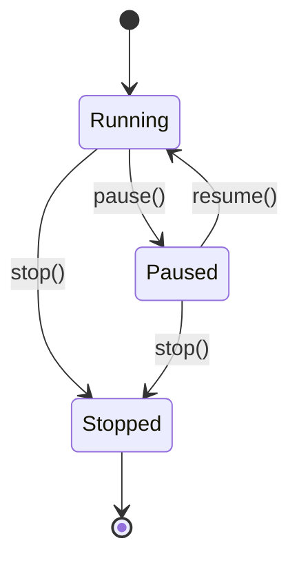

# Concurrency

`loom` runs the simulator core on **threads**, not asyncio. The asyncio
event loop is reserved for the FastAPI server. This document explains the
thread inventory, the `PauseGate` primitive that holds them all together,
and the lifecycle of a single packet from `send_to` to delivery.

---

## Thread inventory

Per simulator process, on top of the asyncio loop:

| Owner | Count | Started by | Loop body |
|---|---|---|---|
| `Interface` | 1 per interface (host + router) | `Interface.__init__` | `_pkt_loop` — drain `_in_queue`, dispatch to `_device.handle_packet` |
| `Network` / `Link` (`_FabricBase`) | 1 per fabric | `_FabricBase.__init__` | `_pkt_loop` — drain `_in_queue`, call `_dispatch_packet` |
| `RoutingProtocol` | 1 per router | `RoutingProtocol.start` | `_keepalive_loop` — periodic `_handle_update` |

All threads are **daemons** (`daemon=True`). Process exit kills them
unconditionally; clean shutdown goes through `AS.stop()` instead.

No worker thread holds the GIL for long. Every iteration either blocks
on a `queue.Queue.get`, on `gate.wait_or_stop`, or on `gate.sleep`. The
GIL is released across all three.

---

## The `PauseGate`

```python
class PauseGate:
    def __init__(self):
        self._running = threading.Event()
        self._running.set()           # default: running
        self._stopped = threading.Event()
```

A two-state gate (running/paused) plus an absorbing stop signal. Three
public methods drive transitions:

- `pause()` — clears `_running`.
- `resume()` — sets `_running`.
- `stop()` — sets `_stopped` **and** sets `_running` (so any thread
  blocked on `_running.wait` wakes up and can observe `_stopped`).

And two methods workers use to block:

```python
def wait_or_stop(self, timeout=None) -> tuple[bool, bool]:
    """Block until running, stopped, or timeout. Returns (running, stopped)."""
    woken = self._running.wait(timeout=timeout)
    if self._stopped.is_set():
        return (False, True)
    return (woken, False)

def sleep(self, duration: float) -> tuple[bool, bool]:
    """Sleep for `duration`, returning early only if stopped."""
    interrupted = self._stopped.wait(timeout=duration)
    if interrupted:
        return (False, True)
    return (True, False)
```

The return tuples carry both signals so workers don't need a separate
`is_stopped` check after the wait. Idioms:

```python
# Packet workers (Interface, _FabricBase):
running, stopped = self._gate.wait_or_stop()
if stopped: break
# ...proceed

# Periodic workers (RoutingProtocol.keepalive):
timed_out, stopped = self._gate.sleep(interval)
if stopped: break
running, stopped = self._gate.wait_or_stop()
if stopped: break
if not running: continue        # paused mid-sleep
self._safe_tick()
```

Lifecycle map:



The `AS` owns exactly one `PauseGate`. Every worker thread in the AS
gates on the same instance. That's how `SimState.pause()` freezes the
*entire* simulation — data plane and routing protocol — atomically.

---

## Packet lifecycle

A `UserMessage` sent from `h1` to `h3` flows through queues and threads
as follows. Color codes: `[q]` = queue boundary, `[t]` = thread switch.

```
Caller thread                                  Per-interface / per-fabric daemons
─────────────                                  ──────────────────────────────────

h1.send_message_to(msg, h3.address)
    │ packet = Datagram(src=h1, dst=h3, payload=msg)
    │ dst_addr = gateway  (off-link destination)
    │
    ▼
h1.iface.send_to(packet, dst=gw)
    │ frame = Frame(src=h1.iface, dst=gw, payload=packet)
    │ EventTracer._broadcast({"kind":"packet", ...})
    │ self._out_queue.put(frame)          ← [q] frame -> lan1._in_queue
    │
[t]─────────────────────────────────────►  lan1._pkt_loop wakes
                                              │ gate.wait_or_stop() → running
                                              │ self._dispatch_unicast(frame, dst=gw)
                                              │ self._interfaces[gw].receive(frame)
                                              │   self._in_queue.put(frame)   ← [q] frame -> r1.eth0._in_queue
                                              │
[t]─────────────────────────────────────►  r1.eth0._pkt_loop wakes
                                              │ gate.wait_or_stop() → running
                                              │ r1.handle_packet(payload, self)
                                              │   dst != iface.address → _handle_forwarding(packet)
                                              │   packet.decrement_ttl()
                                              │   match = routing_table.match(h3.address)
                                              │   out_iface, next_hop = match.interface(), match.next_hop()
                                              │   if next_hop is NullAddress: next_hop = packet.destination()
                                              │   out_iface.send_to(packet, next_hop)
                                              │     frame' = Frame(src=r1.eth1, dst=h3, payload=packet)
                                              │     self._out_queue.put(frame')   ← [q] frame' -> lan2._in_queue
                                              │
[t]─────────────────────────────────────►  lan2._pkt_loop wakes  → h3.iface._in_queue
[t]─────────────────────────────────────►  h3.iface._pkt_loop wakes
                                              │ h3.handle_packet(payload, self)
                                              │   dst == iface.address → _handle_message(UserMessage)
                                              │   EventTracer.message_received(...)
```

Three queues sit on the path: `h1.iface→lan1`, `lan1→r1.eth0`,
`r1.eth1→lan2`, `lan2→h3.iface`. Each is a `queue.Queue` (unbounded).
The flow involves four thread switches and one routing-table lookup.

**Pause behavior:** if the gate flips to paused between any two threads
in this chain, the frame remains queued and the receiving thread blocks
on its next `wait_or_stop`. No frames are lost; nothing animates in the
SPA; resume picks up where pause left off.

There is one subtle re-queue in `_FabricBase._pkt_loop` to keep paused
frames visible in `_in_queue`:

```python
try:
    packet = self._in_queue.get(timeout=0.05)
except queue.Empty:
    continue
if packet is None:
    self._stopped = True
    continue
if self._gate is not None and not self._gate.is_running():
    # Gate flipped to paused between the wait_or_stop above and the dequeue:
    # put the packet back so it stays observable in the queue.
    self._in_queue.put(packet)
    continue
```

This makes the queue depth honest for tools that inspect it (e.g. tests).

---

## Shutdown

`AS.stop()` is the orderly path:

1. `self._gate.stop()` — sets `_stopped` and `_running`. Any worker
   blocked on `_running.wait` wakes up and observes stop on its next
   check.
2. For each network: `Network.stop()` → for each interface attached:
   `Interface.stop()` (which puts `None` on the interface's `_in_queue`)
   → put `None` on the fabric's `_in_queue`.
3. For each link: same as for networks.
4. For each router: `RoutingProtocol.stop()` sets `_stopped`. The
   keepalive thread observes it on its next `gate.sleep` or
   `wait_or_stop` return.

The `None` sentinel is the universal "drain and exit" signal for queue
consumers. Combined with the gate's stop signal, it gives two
independent ways for a worker to learn it's time to leave — important
because a worker may be blocked on either the queue *or* the gate at any
given moment.

---

## Idempotent restarts

`RoutingProtocol.start` is idempotent on a running thread and explicitly
clears `_stopped` before re-starting:

```python
self._stopped = False
if self._keepalive_thread is not None and self._keepalive_thread.is_alive():
    return                            # idempotent on running
self._keepalive_thread = threading.Thread(...)
self._keepalive_thread.start()
```

The clear-before-check matters: the SimState load/start cycle (Parser
starts routers → `load_from_session` stops them → `/sim/start` starts
them) goes through this path every time, and without the clear, the
thread would observe stale `_stopped=True` on its next sleep return and
exit silently.

This is a real bug class the project hit and fixed; the comment in
`RoutingProtocol.start` explains the trap.

---

## Why threads, not asyncio?

The simulator core was originally a `cmd.Cmd` shell program. Threads
were the natural fit: each `Interface` and each `Network` is conceptually
an autonomous moving piece, and `queue.Queue` + `threading.Event` gave
the right primitives without an event loop.

When the web UI was added, the asyncio loop entered the picture **only
for the network boundary**. The bridge is `server/events.py`:

```python
self._loop.call_soon_threadsafe(self._enqueue, q, event)
```

Worker threads emit events, the asyncio loop fans them out to
WebSockets. There is no async simulator code, no `asyncio.Lock`, no
`asyncio.run_in_executor`. Adding async to the simulator core would
require rewriting `PauseGate` and every `_pkt_loop`; there is no benefit
at the simulator's scale.

The downside of threads is that **a misbehaving subscriber or a stuck
queue can hang the whole AS**. The defensive layers are:

- `EventTracer._broadcast` wraps each subscriber call in `try/except`
  and logs exceptions — one bad subscriber cannot stop the broadcast.
- `_FabricBase._pkt_loop` and `Interface._pkt_loop` wrap the dispatch
  in `try/except Exception` + `traceback.print_exc()` — a buggy handler
  doesn't kill the worker.
- The `EventBus` enforces a per-queue 1000-event cap; on overflow it
  drops the oldest event and increments `overflow_count`. A slow
  WebSocket consumer won't pin memory.

---

## Scaling Characteristics

`loom` is built for teaching, not load. The threaded architecture is
honest at small scale and predictable in how it degrades at large
scale. Thread count grows linearly with topology size:

```
threads ≈ H + R·K + N + L + R + 1
        (host)  (router)  (fabric)  (keepalive)  (asyncio loop)
```

Most threads are I/O-bound and release the GIL on `queue.Queue.get()`
or `PauseGate.wait_or_stop()`, so idle threads cost almost nothing —
about 8 KB of stack each on Linux. The bottleneck is **not thread
count itself**; it's serialization through shared locks and CPython's
single-threaded Python-bytecode execution.

### Practical ceilings

Rough thresholds against CPython 3.11 on Linux, with the routing
protocol at the default 10 s keepalive interval:

| Topology size | Threads | What works | What starts to bite |
|---|---|---|---|
| ≤100 routers | ≤1000 | Convergence in seconds, animations crisp | Nothing |
| ~500 routers (~25 sample-scale ASes) | ~2500 | Sim still runs | `EventTracer._broadcast` and `EventBus.emit` saturate under their class-level / instance locks; WebSocket consumers see lag |
| ~1000+ routers | >5000 | Routing protocol still converges, slowly | WebSocket JSON serialization pins one CPU; packet animations skip frames |
| ~5000+ routers | >25000 | Not viable on threads + GIL | Dispatch loops would need to move to asyncio |

These are upper-bound estimates. Dropping the keepalive interval to
1 s roughly halves the useful topology size at every tier — the
protocol chatter (which dominates packet traffic) scales inversely
with the interval.

### Bottleneck order

As topology size grows, the choke points appear in this order:

1. **Event-bus fan-out.** `EventTracer._broadcast` and `EventBus.emit`
   each hold a class-level / instance lock during fan-out. At hundreds
   of packet events per second × every WebSocket subscriber, this
   serializes.
2. **Per-fabric queue contention.** Each `_FabricBase._in_queue` is a
   single `queue.Queue` shared by every attached interface. On a busy
   LAN with many devices, the queue's lock becomes hot.
3. **GIL on dispatch.** `device.handle_packet` and `RoutingTable.match`
   are Python-bytecode work. At a few thousand packets per second
   aggregated across all routers, CPython can't keep up on a single
   core.
4. **Raw thread count.** Linux pthread + CPython tolerate ~10k threads
   comfortably; beyond that, `pthread_create` itself slows down.
