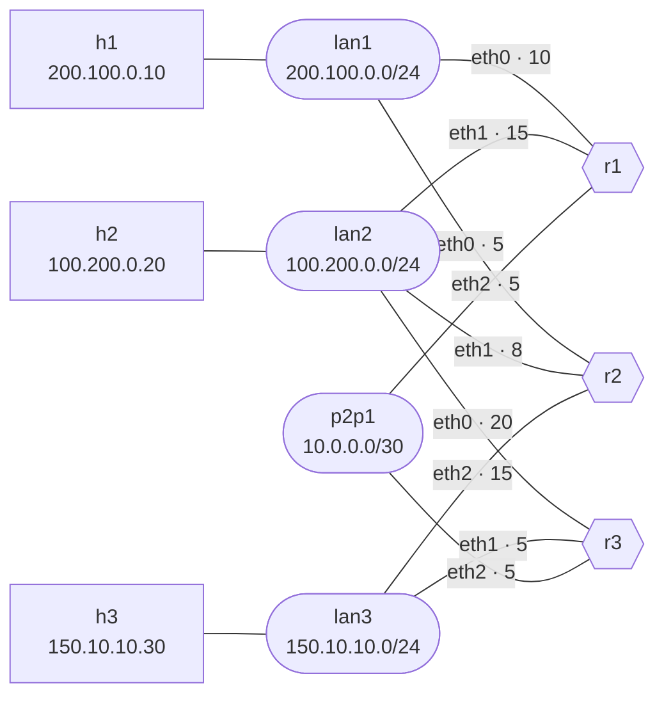
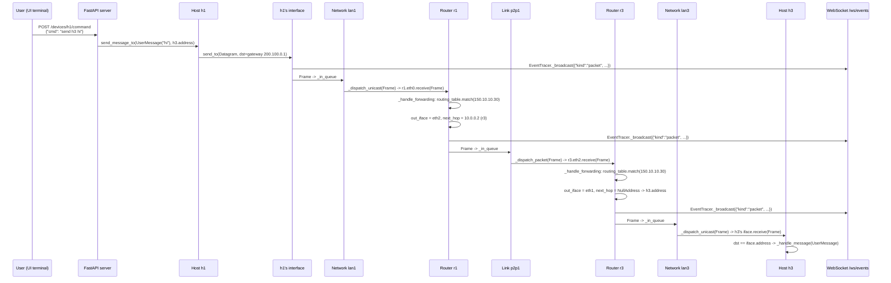
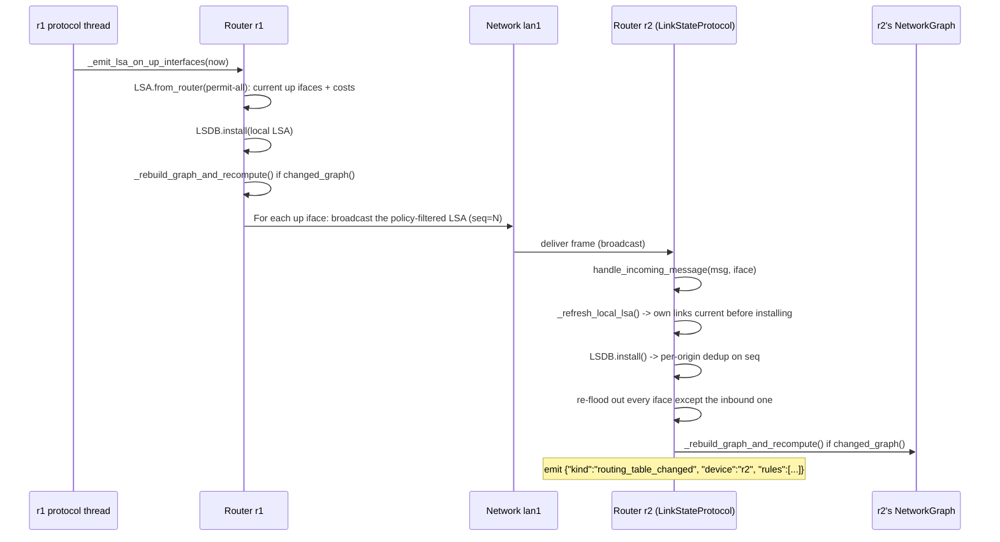
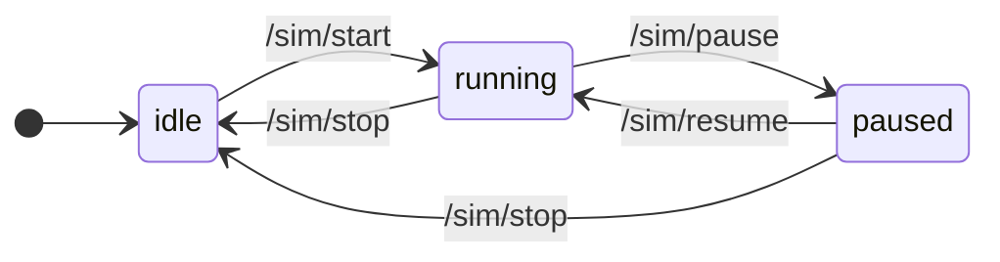
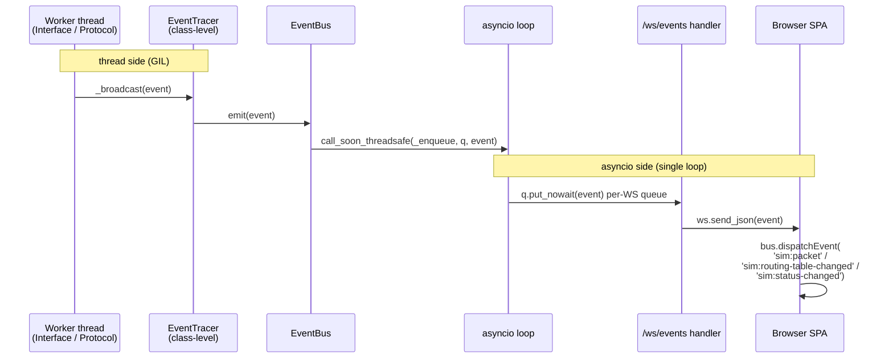

> 🌐 **English** · [Español](../es/architecture/overview.md)

# Architecture Overview

> **Scope:** loom is deliberately L3-only. There is no L2 (MAC/ARP)
> and no L4 (TCP/UDP). The simulator exists to make routing
> convergence and forwarding observable, not to model a full network
> stack.

`loom` is split into four cooperating layers, each with a clear
responsibility and a narrow API to its neighbors.

```
┌─────────────────────────────────────────────────────────────────┐
│                Web SPA  (web/, native ES modules)               │
│                                                                 │
│  app.js · state.js · canvas.js · inspector.js · terminals.js    │
│  packets.js · packetstore.js · packetspanel.js · sim.js         │
│  yaml-io.js · utils.js · (see web-spa.md for the full map)      │
│                                                                 │
│  State + cross-component events flow through a bus              │
│  (EventTarget singleton in state.js).                           │
└──────────────────────────────▲──────────────────────────────────┘
                               │   HTTP requests down, replies up
                               │   (REST: /sim, /topology, /devices)
                               │   WebSocket: events up (server → SPA)
┌──────────────────────────────▼──────────────────────────────────┐
│             FastAPI server (src/server/, async)                 │
│                                                                 │
│  routes/     sim.py · topology.py · devices.py · files.py       │
│              ws.py                                              │
│  command/    dispatch.py · host.py · router.py                  │
│  state.py    SimState (idle/running/paused) — owns the AS       │
│  events.py   EventBus — bridges worker threads to asyncio       │
│  persistence.py   session clone of the topology source          │
└──────────────────────────────▲──────────────────────────────────┘
                               │   down: Python calls (synchronous,
                               │         cross-thread via PauseGate)
                               │   up:   EventTracer events
┌──────────────────────────────▼──────────────────────────────────┐
│        Simulator core (src/entities/, src/routing/, threaded)   │
│                                                                 │
│  AS  Router  Host  Network  Link  Interface  Address  Packet    │
│  PauseGate   EventTracer   NATTable   RoutingPolicy             │
│  LinkStateProtocol (loom-OSPF; abstract base: RoutingProtocol)  │
│  LSDB → NetworkGraph (Dijkstra)   Scheduler (jittered timers)   │
│                                                                 │
│  One daemon thread per Interface, one per Network/Link, one     │
│  protocol thread per Router. All gate on PauseGate.             │
└──────────────────────────────▲──────────────────────────────────┘
                               │   builds the AS object graph
┌──────────────────────────────┴──────────────────────────────────┐
│                Parser + Validator (src/parser/)                 │
│                                                                 │
│  Parser.parse()  →  AS  (or raises ParsingException)            │
│  SystemValidator: address, network, link, device, host          │
└──────────────────────────────▲──────────────────────────────────┘
                               │   parses + validates
                       topology YAML  (session clone of
                       LOOM_TOPOLOGY — see persistence.py)
```

The topology file at the bottom is never the one you edited on disk. The
server clones `LOOM_TOPOLOGY` (default
[`samples/sample.yaml`](../../samples/sample.yaml)) into a session copy
under a temp dir and parses *that*, so live edits and imports never write
back to the source. See [`server-api.md`](server-api.md) for the session
path and the reset endpoint.

## Process / Thread Model

There is one Python process. Inside it:

- One asyncio event loop (Uvicorn + FastAPI). Handles all HTTP and
  WebSocket I/O.
- One **`PauseGate`** owned by the `AS` instance. Every simulator worker
  thread blocks on it once per loop iteration.
- Daemon threads created by the simulator core:

  | Owner | Count | Purpose                                              |
  |---|---|------------------------------------------------------|
  | `Interface` | 1 per interface | Drain inbound frames, dispatch to its device         |
  | `Network` / `Link` (`_FabricBase`) | 1 per fabric | Drain frames sent into the fabric, dispatch to peers |
  | `LinkStateProtocol` | 1 per router | Periodic hello/LSA flood + shortest-paths recompute  |

The thread fan-out for a topology with H hosts, R routers, N LANs, L
links, and an average of K interfaces per router is roughly:

```
threads ≈ H                           (one Interface thread per host)
        + R · K                       (Interface threads on routers)
        + N + L                       (one fabric thread per network and link)
        + R                           (one protocol thread per router)
        + 1                           (asyncio loop)
```

For the [sample topology](../../samples/sample.yaml) (H=3, R=3, K=3, N=3,
L=1): about 19 worker threads plus the asyncio loop. See
[`concurrency.md`](concurrency.md#scaling-characteristics) for an analysis
on how this scales.

## Data flow: sending a message

Every example below runs on
[`samples/sample.yaml`](../../samples/sample.yaml) — three LANs, one
point-to-point link, three routers, three hosts. Edge labels are the
router-side interface and its cost:



`h1`'s gateway is `r1`, and `h3` sits on `lan3`, which `r1` is not attached
to — so a `UserMessage` from `h1` to `h3` takes two router hops. Only the
router→fabric direction costs anything (see
[`routing-protocol.md`](routing-protocol.md)), so Dijkstra puts the path
over the point-to-point link at 10 (`r1.eth2` = 5 onto `p2p1`, then
`r3.eth1` = 5 onto `lan3`) against 20 through `lan2` and 25 through `lan1`.
`r1` therefore forwards out `eth2`, and the message crosses every layer on
the way:



Two things to notice:

1. **Every packet event hits the WebSocket**, even when the SPA only cares
   about a subset. Each `send_to` calls `EventTracer._broadcast`, which
   runs its subscribers inline on the calling worker thread and swallows
   (and logs) their exceptions, so one bad subscriber can't kill the rest.
   The `EventBus` subscriber hands the event straight to the asyncio loop,
   so a slow WebSocket client never stalls a simulator thread.
2. **The forwarding decision happens entirely inside `Router`**. The
   fabric (`Network`/`Link`) only knows how to dispatch a frame to its
   peers; it does no routing. `Router._handle_forwarding` — the self-arrow
   above — decrements the TTL, runs longest-prefix match against its
   `RoutingTable`, and hands the next frame to the chosen interface.
   `NullAddress` as the next hop means "directly connected": the frame
   goes to the packet's final destination, which is why only the last hop
   shows it.

Nothing is emitted when `h3` finally consumes the message: delivery is
reported through `EventTracer.message_received`, a per-message callback
that does *not* reach the WebSocket (see
[below](#whats-not-in-this-diagram)).

See [`packets.md`](packets.md) for the packet types, and
[`routing-protocol.md`](routing-protocol.md) for how the routing table
gets populated in the first place.

## Data Flow: Routing Convergence

When the simulation starts (or any router boots),
`LinkStateProtocol._protocol_loop` ticks once immediately, then drives
three independent jittered timers: `hello` (10 s), `lsa_refresh` (30 s),
and `maxage_check` (same cadence as the refresh). Only the first two are
live-tunable from the toolbar — `dead = 3 × hello` and
`max_age = 2 × refresh` are derived from them (see
[`routing-protocol.md`](routing-protocol.md) for details):



`_emit_lsa_on_up_interfaces` rebuilds the local LSA from scratch on every
tick: it walks the router's interfaces, skips the down ones, and reads
`iface.cost()` as it goes. So yes — a cost that changed since the last tick
(or an interface that went up or down) is exactly what makes the freshly
built LSA differ from the installed one, which is what
`InstallResult.changed_graph()` reports and what triggers the local SPF
recompute. A tick that finds nothing changed installs an LSA with a new
sequence number and recomputes nothing. Cost edits don't wait for the next
tick either: `local_links_changed()` calls `_emit_lsa_on_up_interfaces`
immediately and pushes the periodic deadline back.

The flood is **receiver-side deduplicated** per origin router: `LSDB.install()`
tracks the last seen sequence number for each origin and drops messages with
`seq <= last_seen_seq`. New messages are re-flooded out of **every interface
except** the one they arrived on.

Convergence in the other direction — a router that stops advertising —
needs no message at all. That is what the third timer is for:
`maxage_check` runs `_sweep_dead_and_expired`, which drops neighbors not
heard from within `dead` and purges LSAs older than `max_age`, recomputing
if either removed something. A crashed router floods no withdrawal, so
this sweep is the only thing that retires it from its peers' graphs; a
graceful halt merely gets there sooner by flooding one.

Routing tables are only recomputed when the graph actually changes — every
caller guards its `_rebuild_graph_and_recompute()` call on
`InstallResult.changed_graph()` (`_rebuild_graph_and_recompute` itself
always recomputes once entered). **Preserve that guard** when editing the
protocol; without it routing tables churn on every protocol tick.

## State Machine: SimState

The web layer adds a lifecycle on top of the simulator core. It lives in
`src/server/state.py`:



(Three endpoints leave the state unchanged and so don't appear above:
`/topology` and `/topology/reset`, accepted only while idle, and
`/sim/edit`, accepted only while running.)

Rules enforced by `SimState`:

- **`load_from_session`** stops the previous AS (if any) and parses the
  session file with `start_routing=False`, so routers exist but their
  protocol threads are not started — they wait for `start()`.
- **`start`** resumes the gate and starts every router's protocol thread.
- **`pause`** pauses the gate. In-flight frames remain queued; threads
  block on `wait_or_stop`. No frames are lost.
- **`resume`** applies an optional patch (`add_*` / `remove_*` /
  `update_cost`) atomically — two phases, **validate all → apply all** —
  and re-resumes the gate.
- **`edit`** applies the same kind of patch to a *running* sim, under the
  same two phases. It is the only one of the two that emits
  `topology_changed`: a patch handed to `resume` is applied and persisted
  but announces nothing, so subscribers learn about it only from the next
  `GET /topology`.
- **`stop`** drops the AS entirely and goes back to `idle`. The next
  `start` requires a topology load.

See [`server-api.md`](server-api.md) for the wire format and
[`concurrency.md`](concurrency.md) for what `PauseGate.pause()` actually
does to the worker threads.

## Event Plumbing

Events flow **out** of the simulator core via the `EventTracer`
class-level pub/sub bus:



The two halves are joined by a single line in the app's lifespan handler:
`EventTracer.subscribe(app.state.event_bus.emit)`. The `EventBus` is
nothing more than one `EventTracer` subscriber, registered at startup and
unsubscribed at shutdown — which is what lets the simulator core stay
unaware that a web layer exists. (`sim_state` is the one kind that skips
this path: the `/sim/*` handlers already run on the loop, so they put it
straight onto the bus.)

`EventBus` is a thread-safe fan-out: every WebSocket connection has its
own `asyncio.Queue`, capped at 1000 events. On overflow the **oldest**
event is dropped and `overflow_count` increments. The bus is created at
app startup and shared across the lifespan of the process.

Event kinds currently emitted:

- `packet` — every frame leaving an interface (`Interface.send_to`)
- `routing_table_changed` — every recompute (`LinkStateProtocol._recompute_routing_table`)
- `sim_state` — every state transition (emitted by the `/sim/*` route
  handlers after `SimState` accepts the transition, not by `SimState` itself)
- `device_state_changed` — router halted or resumed (`Router.halt` / `Router.resume`)
- `interface_state_changed` — interface brought up or down (`Interface._emit_state`)
- `lsdb_changed` — the link-state protocol rewrote its view of the routing
  table (`LinkStateProtocol._emit_rule_change_events`, alongside
  `routing_table_changed`); emitted but currently unconsumed by the SPA
- `neighbor_state_changed` — adjacency state changed (`LinkStateProtocol._broadcast_neighbor_state_changed`)
- `ping_result` — one ICMP echo reply or timeout (`Host.ping`)
- `topology_changed` — topology mutated via a live edit (`SimState.edit`)
- `nat` — a router performed source or destination NAT (`Router._apply_source_nat` / `_reverse_inbound_nat`)
- `nat_table_changed` — a router's NAT table was mutated (`Router._apply_source_nat`)
- `router_intercept` — a router answered an ICMP echo addressed to one of its own IPs (`Router._reply_to_ping`)

## What's Not in This Diagram

A few things deliberately don't appear above because they don't fit a
layer cleanly:

- **`EventTracer.register_message_event`** lets a caller observe a single
  message's lifecycle (`on_sent` / `on_received` / `on_forwarded`) by
  registering callbacks keyed by message identity. `Host.send_message_to`
  and `Host._handle_message` call into it via `EventTracer.message_sent` /
  `message_received`, which fire *only* the callbacks registered for that
  exact message and broadcast nothing. Today its only consumers are the
  tests (`test_packet_handling.py`, `test_forwarding.py`), which use it to
  assert on one message end-to-end without subscribing to the whole event
  stream; anything wanting a broadcast stream uses the WebSocket event bus
  instead.
- **`Host.ping`** does its own thread synchronization: one
  `threading.Event` per outstanding echo request in a `_pending_pings`
  dict, woken by the matching `PingReply`. The key is
  `(destination address, sequence number)`, so a host can have several
  requests in flight to the same or different destinations and each reply
  wakes only its own waiter. RTT comes back as
  `time.monotonic() - request_ts`. Note this is a narrower notion than the
  "flow" NAT keys on — `NATTable` uses the payload's `flow_key()`, which is
  stable across a NAT rewrite and shared by a request and its reply (see
  [`nat.md`](nat.md)).
- **`Router._handle_forwarding`** does **not** raise on TTL expiry — it
  logs a warning and returns `None`, silently dropping the packet.

For the deep dives, jump to:

- [`entities.md`](entities.md) — every class in `src/entities/`.
- [`packets.md`](packets.md) — `Frame`, `Datagram`, and the `Message` family.
- [`routing-protocol.md`](routing-protocol.md) — flooding + Dijkstra.
- [`policy.md`](policy.md) — what an LSA advertises, and to whom.
- [`nat.md`](nat.md) — translation at the private↔public boundary.
- [`concurrency.md`](concurrency.md) — threads, gates, queues.
- [`parser.md`](parser.md) — YAML → AS.
- [`server-api.md`](server-api.md) — HTTP / WS reference.
- [`web-spa.md`](web-spa.md) — the SPA module map.
