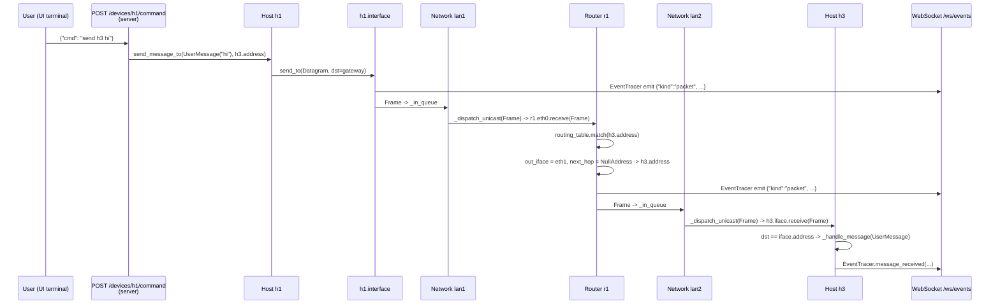
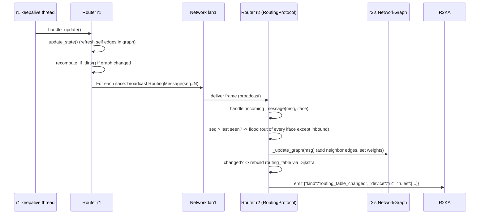
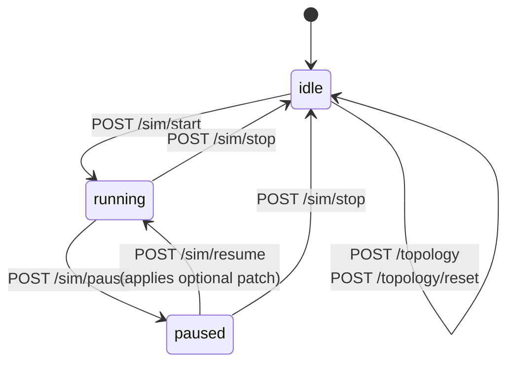

# Architecture Overview

`loom` is split into four cooperating layers, each with a clear
responsibility and a narrow seam to its neighbors.

```
┌─────────────────────────────────────────────────────────────────┐
│                Web SPA  (web/, native ES modules)               │
│                                                                 │
│  app.js · state.js · canvas.js · inspector.js · terminals.js    │
│  packets.js · sim.js · yaml-io.js · utils.js                    │
│                                                                 │
│  State + cross-component events flow through `bus`              │
│  (EventTarget singleton in state.js).                           │
└──────────────────────────────┬──────────────────────────────────┘
                               │   HTTP (REST: /sim, /topology,
                               │             /devices)
                               │   WebSocket (events from server)
┌──────────────────────────────▼──────────────────────────────────┐
│             FastAPI server (src/server/, async)                 │
│                                                                 │
│  routes/    sim.py · topology.py · devices.py · ws.py           │
│  command/   dispatch.py · host.py · router.py                   │
│  state.py   SimState (idle/running/paused) — owns the AS        │
│  events.py  EventBus — bridges worker threads to asyncio        │
│  persistence.py  source.yaml → source.session.yaml clone        │
└──────────────────────────────┬──────────────────────────────────┘
                               │   Python calls (synchronous,
                               │     cross-thread via PauseGate)
┌──────────────────────────────▼──────────────────────────────────┐
│        Simulator core (src/entities/, src/routing/, threaded)   │
│                                                                 │
│  AS  Router  Host  Network  Link  Interface  Address  Packet    │
│  PauseGate   EventTracer                                        │
│  RoutingProtocol (link-state) + NetworkGraph (Dijkstra)         │
│                                                                 │
│  One daemon thread per Interface, one per Network/Link, one     │
│  keepalive thread per Router. All gate on PauseGate.            │
└──────────────────────────────┬──────────────────────────────────┘
                               │   parses, validates
┌──────────────────────────────▼──────────────────────────────────┐
│                Parser + Validator (src/parser/)                 │
│                                                                 │
│  Parser.parse()  →  AS  (or raises ParsingException)            │
│  SystemValidator: address, network, link, device, host          │
└─────────────────────────────────────────────────────────────────┘
                               ▲
                               │ reads
                       samples/sample.yaml
                       (or LOOM_TOPOLOGY)
```

## Process / Thread Model

There is one Python process. Inside it:

- One asyncio event loop (Uvicorn + FastAPI). Handles all HTTP and
  WebSocket I/O.
- One **`PauseGate`** owned by the `AS` instance. Every simulator worker
  thread blocks on it once per loop iteration.
- Daemon threads created by the simulator core:

  | Owner | Count | Purpose |
  |---|---|---|
  | `Interface` | 1 per interface | Drain inbound frames, dispatch to its device |
  | `Network` / `Link` (`_FabricBase`) | 1 per fabric | Drain frames sent into the fabric, dispatch to peers |
  | `RoutingProtocol` | 1 per router | Periodic keepalive flood + state recompute |

The thread fan-out for a topology with H hosts, R routers, N LANs, L
links, and an average of K interfaces per router is roughly:

```
threads ≈ H                           (one Interface thread per host)
        + R · K                       (Interface threads on routers)
        + N + L                       (one fabric thread per network and link)
        + R                           (one keepalive thread per router)
        + 1                           (asyncio loop)
```

For the sample topology (H=3, R=3, K=3, N=3, L=1): about 19 threads plus
the asyncio loop. Fine.

## Data Flow: A Host Sends a Message

When `h1` sends a `UserMessage` to `h3` (sample topology), the message
crosses every layer:



Two things to notice:

1. **Every packet event hits the WebSocket**, even when the SPA only cares
   about a subset. `EventTracer._broadcast` is non-blocking — subscribers
   exceptions are swallowed and logged so one bad subscriber can't kill
   the rest.
2. **The forwarding decision happens entirely inside `Router`**. The
   fabric (`Network`/`Link`) only knows how to dispatch a frame to its
   peers; it does no routing. `Router._handle_forwarding` runs longest-
   prefix match against its `RoutingTable`, decrements the TTL, and hands
   the next frame to the chosen interface.

See [`packets.md`](packets.md) for the packet types, and
[`routing-protocol.md`](routing-protocol.md) for how the routing table
gets populated in the first place.

## Data Flow: Routing Convergence

When the simulation starts (or any router boots), `RoutingProtocol._keepalive_loop`
ticks once immediately, then every `keepalive_interval` (default 10s,
live-tunable via the toolbar's refresh field):



The flood is **receiver-side deduplicated** by `(src_address, seq)`. Each
router maintains `_seqs_by_address[src] = last_seen_seq`; an incoming
message with `seq <= last_seen_seq` is dropped. New messages are
re-flooded out of **every interface except** the one they arrived on.

Routing tables are only recomputed when the graph actually changes — the
`_graph_updated` flag is set inside `update_state`, `_update_graph`, and
`add_edge` calls, and `_recompute_if_dirty` is a no-op otherwise.
**Preserve that guard** when editing the protocol; without it routing
tables churn on every keepalive.

## State Machine: SimState

The web layer adds a lifecycle on top of the simulator core. It lives in
`src/server/state.py`:



Rules enforced by `SimState`:

- **`load_from_session`** stops the previous AS (if any), parses the
  session file, and **stops the routers again** — `Parser.parse()` starts
  routers itself, so the lifecycle layer wants them parked at `idle`
  semantics until `start()`.
- **`start`** resumes the gate and starts every router's keepalive.
- **`pause`** pauses the gate. In-flight frames remain queued; threads
  block on `wait_or_stop`. No frames are lost.
- **`resume`** applies an optional patch (`add_*` / `remove_*` /
  `update_cost`) atomically — two phases, **validate all → apply all** —
  and re-resumes the gate.
- **`stop`** drops the AS entirely and goes back to `idle`. The next
  `start` requires a topology load.

See [`server-api.md`](server-api.md) for the wire format and
[`concurrency.md`](concurrency.md) for what `PauseGate.pause()` actually
does to the worker threads.

## Event Plumbing

Events flow **out** of the simulator core via the `EventTracer`
class-level pub/sub bus:

```
Simulator thread                          asyncio loop                  Browser
─────────────────                         ────────────                  ───────
EventTracer._broadcast(event)
    │
    ├─► EventBus.emit(event)
    │       │
    │       └─► loop.call_soon_threadsafe(
    │               _enqueue, q, event)
    │                                      asyncio.Queue.put_nowait
    │                                              │
    │                                              └─► ws.send_json(event)
    │                                                          │
    │                                                          └─► SPA WS handler
    │                                                                  │
    │                                                                  └─► bus.dispatchEvent(
    │                                                                          'sim:packet' / 'sim:routing-table-changed' / 'sim:status-changed')
```

`EventBus` is a thread-safe fan-out: every WebSocket connection has its
own `asyncio.Queue`, capped at 1000 events. On overflow the **oldest**
event is dropped and `overflow_count` increments. The bus is created at
app startup and shared across the lifespan of the process.

Event kinds currently emitted:

- `packet` — every frame leaving an interface (`Interface.send_to`)
- `routing_table_changed` — every recompute (`RoutingProtocol._recompute_if_dirty`)
- `sim_state` — every state transition (`SimState.start/pause/resume/stop`)

## What's Not in This Diagram

A few things deliberately don't appear above because they don't fit a
layer cleanly:

- **`EventTracer.register_message_event`** lets the legacy shell observe a
  single message's lifecycle (`on_sent` / `on_received` / `on_forwarded`)
  by registering callbacks keyed by message identity. The web UI doesn't
  use it — it consumes the broadcast stream instead.
- **`Host.ping`** does its own thread synchronization: a per-flow
  `threading.Event` plus a `_pending_pings` dict, woken by the matching
  `PingReply`. RTT comes back as `time.monotonic() - request_ts`.
- **`Router._handle_forwarding`** does **not** raise on TTL expiry — it
  drops to stderr and returns `None`. The packet animation simply ends.

For the deep dives, jump to:

- [`entities.md`](entities.md) — every class in `src/entities/`.
- [`routing-protocol.md`](routing-protocol.md) — flooding + Dijkstra.
- [`concurrency.md`](concurrency.md) — threads, gates, queues.
- [`parser.md`](parser.md) — YAML → AS.
- [`server-api.md`](server-api.md) — HTTP / WS reference.
- [`web-spa.md`](web-spa.md) — the SPA module map.
