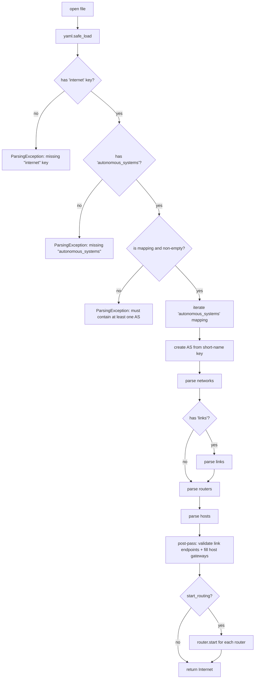

# Parser & Validator

The YAML loader and the structural validator live in `src/parser/`. They
are the only path from on-disk topology to a live `Internet` instance —
everything else in the codebase assumes the topology is already well-formed.

```
parser/
├── parser.py      # Parser — Parser(filename).parse() -> Internet
├── validator.py   # SystemValidator (address, network, link, device, host)
├── exception.py   # ParsingException
└── __init__.py
```

## Top-level shape

The parser expects a YAML document with one mandatory key, `internet:`.
Inside it, an optional `name:` field labels the internet instance, and
`autonomous_systems:` is a mapping where each key is the AS short name.
The literal layout:

```yaml
internet:
  name: loom                 # optional; defaults to 'loom'
  autonomous_systems:
    main:                    # AS short name — the mapping key
      asn: 65000             # optional; reserved for BGP, ignored today
      networks:              # required, may be empty {} (but rarely is)
        lan1: "10.0.0.0/24"
      links:                 # optional
        p2p1: "10.0.0.0/30"
      routers:               # optional (no routers = no routing)
        r1:
          interfaces:
            eth0:
              network: lan1
              address: "10.0.0.1"
              cost: 5
      hosts:                 # optional
        h1:
          network: lan1
          address: "10.0.0.10"
          gateway: "10.0.0.1"
```

The `internet:` wrapper exists so YAML files for the simulator are
immediately distinguishable from arbitrary YAML and so future extensions
(inter-AS links, BGP peering) can add new top-level siblings without
breaking parsers. The AS short name is the mapping key under
`autonomous_systems:` — there is no separate `name:` field inside each
AS block. Any future emitter must produce the same shape.

## Optional `config:` blocks

Two optional config blocks extend the top-level schema:

### `internet.config`

An arbitrary mapping placed directly under `internet:`:

```yaml
internet:
  config:
    packet_duration_ms: 2400
    theme: dark
  autonomous_systems: ...
```

The parser validates that the value is a mapping (`dict`), then calls
`internet.set_config(config)` to store it verbatim on the `Internet`
object. The backend does not interpret the keys — they are stored
opaquely and re-emitted unchanged on serialization. Any consumer of the
topology may define its own keys here.

### `<as>.config.protocol`

A per-AS block that sets the link-state protocol timers for every router
in that AS:

```yaml
autonomous_systems:
  main:
    config:
      protocol:
        hello_interval: 5           # seconds; positive number
        lsa_refresh_interval: 15    # seconds; positive number
    networks: ...
```

Parsing rules (enforced by `_parse_protocol_config`):

- `config:` and `config.protocol:` must each be a mapping when present.
- `hello_interval` and `lsa_refresh_interval` are both required when
  either is given — specifying only one raises `ParsingException`.
- Both values must be positive numbers (int or float); booleans are
  rejected explicitly.
- If present, `_parse_protocol_config` returns the validated config dict,
  which `_parse_single_as` stores on the `AS` via
  `system.set_protocol_config(protocol_config)`. After `_parse_routers`
  completes, `_parse_single_as` calls
  `router.protocol().set_timers(**protocol_config)` for each router.
  This happens regardless of the `start_routing` flag.
- `dead_interval` (3 × hello) and `max_age` (2 × refresh) remain derived
  from the timers and are not read from or written to YAML.

## `Parser.parse()` flow

`Parser(filename).parse()` returns an **`Internet`** instance containing
one or more `AS` objects. (Not a bare `AS` — the `Internet` wrapper holds
the gate, the config, and the multi-AS container.)



A failure at any step raises `ParsingException` with a descriptive
message. The topology is **partially constructed** at that point — threads
have already been spawned for networks/links — but the caller (the FastAPI
`SimState`) is expected to call `internet.stop()` and discard it.
There is no in-parser rollback.

Three notes:

1. **`Parser.parse(start_routing=True)` starts each router's protocol** by
   default. The server layer opts out: it calls
   `Parser(...).parse(start_routing=False)` because `idle` semantics demand
   that routers wait for an explicit `/sim/start` before broadcasting their
   first Hello. Starting then stopping would race the initial tick and
   leak `packet` events on the event bus while the sim is still `idle`.
   (`load_from_session` also passes `start_routing=False` for the same reason —
   routers are built but their protocol threads are not started.)
2. **Hosts on a link** are parsed *after* the link itself, but the link's
   peer may not be attached yet (in the case of two hosts on the same
   link). The parser collects `hosts_on_links = [(host, explicit_gw_or_None), ...]`
   during the host pass, then resolves gateways in `_post_pass_links`
   once every endpoint is attached.
3. **Cost defaults to 1.** Omitting `cost:` on a router interface yields
   `cost=1`; an explicit `cost:` must be a **positive** integer (≥1) —
   `0` and non-integers are rejected. The validator does not require costs
   to be unique or distinct.

## Address parsing

Every address-shaped field is parsed by `_parse_net_address` (for
prefixes) or directly by `Address(...)` (for hosts), with
`SystemValidator.validate_address` enforcing dotted-quad syntax and
octet ranges before the `Address` constructor runs.

A `NetworkAddress("10.1.2.3/24")` is **canonicalized** at construction —
the parser receives `10.1.2.0/24` back, regardless of what the user
typed. This makes prefix equality (`==`) and prefix-in-prefix tests
correct even when the user accidentally writes a host bit set.

## Networks

`_parse_networks` walks the `networks:` mapping. For each entry:

1. Parse and validate the CIDR address.
2. Construct a `Network(name, address, gate=system.gate())` — this
   already spawns the fabric's daemon thread.
3. Validate uniqueness (no duplicate name, no duplicate address).
4. Register on the AS.

A failed validation aborts the parse via `ParsingException`. The already-
spawned thread will be cleaned up by `internet.stop()` on the caller's side.

## Links

`_parse_links` mirrors networks, with one extra check: `Link.__init__`
rejects masks other than `/30` and `/31`, raising `ValueError`. The
parser catches the `ValueError` and re-raises as `ParsingException` for
a uniform error type.

Validator-side rules (`LinkValidator`):

- Mask must be `/30` or `/31` (same check as the constructor — belt and
  suspenders).
- Name must not collide with a network's name.
- Name must not collide with another link's name.

The post-pass (`_post_pass_links`) then enforces **exactly two
endpoints** per link, raising if a link is left with 0 or 1 interfaces
after the parse completes.

## Routers

`_parse_routers` iterates the `routers:` mapping. For each router:

1. Require an `interfaces:` block (no implicit zero-interface routers).
2. For each interface:
   - Mutually exclusive `network:` / `link:` (must have exactly one).
   - Resolve to the actual `Network` / `Link` instance (raise if not
     found).
   - Validate the address.
   - Parse the optional `cost:` (default 1, must be a positive int ≥1).
   - Construct an `Interface(...)`, attach to the fabric, attach to the
     router.
3. Validate the assembled router via `DeviceValidator`:
   - Each interface's address must be valid for its fabric via
     `net.is_valid_host_address(addr)` — rejects the network address,
     the broadcast address, and any address outside the prefix.
   - No two interfaces of any router/host share an address on the same
     fabric.

## Hosts

`_parse_hosts` is similar but split into two phases:

**Phase 1 — straight parse and partial validation** (per host):

1. Mutually exclusive `network:` / `link:`.
2. Resolve the fabric; validate the address.
3. Parse optional `gateway:`:
   - On a `Network`: apply immediately as `Address(gw_str)`.
   - On a `Link`: store the literal string; the post-pass will validate
     against the link peer.
4. Address-in-fabric checks:
   - On a `Link`: address must satisfy both `link.contains_address(addr)` and
     `link.is_valid_host_address(addr)`.
   - On a `Network`: `network.contains_address(addr)`, plus
     `HostValidator.validate` for the gateway-in-network check.
5. Construct the `Host`, attach its interface to the fabric, register on
   the AS.

**Phase 2 — link post-pass** (`_post_pass_links`):

1. Assert every link has exactly two endpoints.
2. For each host-on-link:
   - Find the peer interface via `link.peer_of(host.interface())`.
   - If the user supplied an explicit `gateway:`, it **must** match the
     peer's IP, else `ParsingException`.
   - Set the host's gateway to the peer's address.

This is why host-on-link declarations work without specifying a gateway
— the parser fills it in once the peer is known. An explicit gateway is
allowed (and validated) for clarity but is never required on a link.

## Validators

`SystemValidator` is a thin facade over five concrete validators. Each
returns a `ValidationResult` (`valid()` or `invalid(reason)`):

| Validator | What it checks |
|---|---|
| `AddressValidator` | Dotted-quad syntax, octet range `[0, 255]`, no leading-zero octets |
| `NetworkValidator` | No duplicate name; no duplicate public CIDR (private CIDRs may repeat for NAT); no prefix-containment overlap with any existing network |
| `LinkValidator` | `/30` or `/31` mask; no name collision with networks or other links; no prefix-containment overlap with any existing fabric |
| `DeviceValidator` | Each interface address passes `net.is_valid_host_address` (rejects network + broadcast); no two interfaces share an address on the same fabric |
| `HostValidator` | Inherits `DeviceValidator`, then checks `gateway in network` |

### Additional validations

Beyond the validator table, the parser enforces several rules directly:

- **`asn` type-check** (`_parse_single_as`): if `asn:` is present it
  must be a non-negative integer; booleans are explicitly rejected.
  Omitting `asn:` is allowed (defaults silently).
- **Duplicate device names** (`_check_no_duplicate_device_names`): a
  host name that duplicates a router name raises `ParsingException`
  because `AS.device()` resolves hosts first, making the router
  unreachable by name.
- **`autonomous_systems` guards**: `autonomous_systems:` must be present
  in the `internet:` block, must be a mapping, and must contain at least
  one AS.
- **Host-bits-set rejection** (`_parse_net_address`): a network CIDR
  where the host portion is non-zero (e.g. `10.0.0.5/24`) is rejected.
  `NetworkAddress` silently clears host bits internally, so the parser
  compares the canonical form against the raw input and raises if they
  differ.
- **Leading-zero octet rejection** (`AddressValidator`): octets with
  leading zeros (e.g. `010.0.0.1`) are rejected as non-canonical and
  potentially ambiguous.
- **Subnet-overlap containment check + private-duplicate exemption**
  (`NetworkValidator._overlap_checks`): a strict prefix-containment
  overlap (A ⊂ B or B ⊂ A, excluding exact duplicates) is always
  rejected — it is ambiguous for longest-prefix-match routing. Exact
  duplicates (`A == B`) follow separate logic: they are permitted for
  private CIDRs (supporting the NAT multi-tenant pattern where two
  internal networks reuse the same RFC 1918 block) but rejected for
  public CIDRs.

`DeviceValidator._addr_already_used` walks every router and every host
to check for duplicate addresses on the same fabric. At a few hundred
devices this is fast enough in practice; it is proportional to the
number of devices in the AS per validation call.

## Errors and fixtures

Failures all surface as `ParsingException` with a message that includes
the offending entity name and the underlying reason — e.g.
`r1: eth0: address already in use by r2`, `lan2: invalid netmask 99`,
`p2p1: link CIDR must be /30 or /31, got /28`.

The test suite drives `Parser.parse()` against **deliberately invalid
YAML fixtures** under `test/resources/`:

- `invalid_address.yaml`, `invalid_netmask.yaml`,
  `invalid_router_address.yaml`, ... — assert the matching validator
  message.
- `link_three_endpoints.yaml`, `link_one_endpoint.yaml`,
  `link_no_endpoints.yaml`, `link_too_wide.yaml`, ... — assert
  link-specific failures.
- `missing_as.yaml`, `missing_networks.yaml` — assert structural
  failures.

**Most fixtures under `test/resources/` are intentionally broken** —
they exist to assert the parser rejects them with the right message.
Don't "fix" them. New parser/validator failure modes belong as
additional fixtures referenced from `test/test_parser.py`.

## Where the parser is called

| Caller | What it does next |
|---|---|
| `src/server/state.py:load_from_session` | Parses the session file with `start_routing=False` — routers are built but their protocol threads are not started, enforcing `idle` semantics until `/sim/start` is called |
| `src/server/state.py:load_from_text` | Parses incoming YAML into a temp file; on success atomically replaces the session file and swaps the live topology |
| `src/server/state.py:reset_session` | Re-clones the source file, then re-parses with `start_routing=False` |

Nothing else parses YAML. `GET /topology` returns re-serialized live
state via `SimState._dump_yaml()` when a topology is loaded, or the
raw session file when not.
