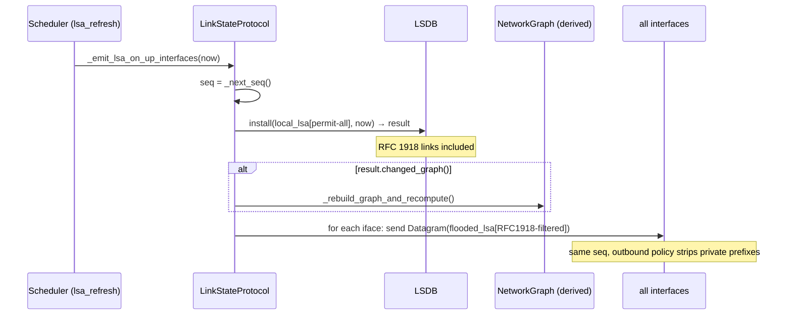
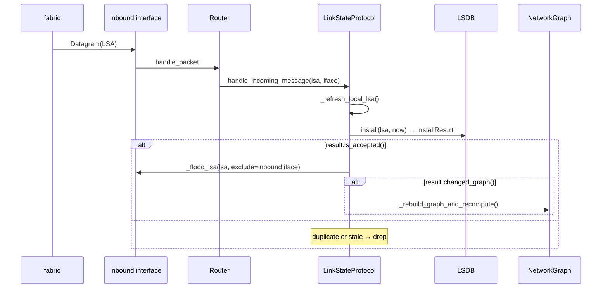

> 🌐 **English** · [Español](../es/architecture/routing-protocol.md)

# loom-OSPF — simplified link-state routing

`loom` implements a link-state routing protocol deliberately modelled after
OSPF's core mechanics while shedding the protocol machinery that does not make
sense in a single-area, broadcast-free simulator. The protocol lives in
`src/routing/`; the core protocol modules are `lsa.py`, `lsdb.py`,
`hello.py`, `neighbor.py`, `scheduler.py`, and `protocol.py` (the package
also contains `messages.py`, `graph.py`, `policy.py`, and `exception.py`).

---

## Overview

The protocol is named **loom-OSPF** to signal the inheritance. What it models:

- Per-router **Link-State Advertisements (LSAs)** describing directly-connected
  networks and their costs.
- **Sequence-numbered flooding** to propagate LSAs across the AS.
- A **Hello protocol** for bidirectional liveness detection between adjacent
  routers on a shared fabric.
- An **LSDB** (link-state database) as the canonical view of topology; the
  `NetworkGraph` and routing tables are both derived from it.
- **LSA age + max-age purge** for implicit failure detection (no keepalive →
  stale LSA → graph pruned).
- **Graceful withdrawal** on shutdown: a zero-link LSA floods peers before the
  router exits so they purge it immediately rather than waiting for max-age.
- **Timer jitter** to avoid synchronised floods on restart.

What it deliberately does **not** model (see [What's deliberately deferred](#whats-deliberately-deferred)):

- Areas, ABRs, virtual links, stub/NSSA areas.
- DR/BDR election on broadcast networks.
- OSPFv3 / IPv6.
- Full OSPF adjacency states — loom-OSPF's terminal state is `TWO_WAY`.
- DBD/LSR/LSU LSDB-synchronisation handshake.
- External LSAs (Type 5).
- ECMP / multipath, authentication.

---

## Wire protocol

All protocol messages are subclasses of `RoutingMessage` (in `lsa.py`), which
itself subclasses `entities.packet.Message`. Two concrete message types exist:

### `LSA`

An LSA carries one router's signed view of its own directly-connected links.
Fields:

| Field | Type | Purpose |
|---|---|---|
| `_origin` | `Router` | The router that originated this advertisement |
| `_seq` | `int` | Monotonically increasing per-router sequence counter |
| `_links` | `dict[NetworkAddress, int]` | Prefix → cost for each advertised link |
| `_is_withdrawal` | `bool` | If `True`, this is a zero-link withdrawal LSA |

Key methods: `is_newer_than(other)` (seq comparison), `has_same_links_as(other)`
(link-dict equality), `LSA.withdrawal(router, seq)` (constructor for shutdown
LSA).

### `Hello`

A Hello carries liveness from one interface, listing all non-DOWN neighbors
currently heard on that fabric. Fields:

| Field | Type | Purpose |
|---|---|---|
| `_originator` | `Router` | The router sending the Hello |
| `_neighbors_heard` | `list[Router]` | Routers heard on this fabric in the last dead interval |

Hellos are **built per-interface** and are not shared across interfaces.

### `Datagram`

Both LSAs and Hellos are transported inside a `Datagram` (in `messages.py`).
`Datagram` is a `Packet` (carrier frame), not a `RoutingMessage`; it adds a
per-emission source and destination address (fabric broadcast). The same `LSA`
object may be carried by many `Datagram`s — one per outbound interface — without
mutation.

---

## Sequence-number model

loom-OSPF uses a **single monotone counter per router** (`LinkStateProtocol._seq`,
incremented by `_next_seq()`). Every LSA emission — refresh cycle or re-flood
— carries the current value. There is no per-interface counter; the old
per-interface scheme was a design debt and has been removed.

The LSDB's `install()` method is the acceptance gate. It compares against a
**persistent per-origin high-water mark** (`_last_seq[origin]`), not against the
currently-stored LSA:

```python
if last_seq is not None and lsa.seq() <= last_seq:
    return InstallResult.rejected()
```

Ties and replays are rejected, so a router can never roll back its sequence
number in-flight. The high-water mark is retained even after an origin's LSA is
**purged** (by a withdrawal or max-age expiry) — this is what makes withdrawals
idempotent. Without it, a withdrawal removes the very entry it would otherwise be
compared against, so each re-flooded copy looks brand-new and is re-flooded
forever; on a topology with parallel paths between two routers, a withdrawal and
the subsequent re-announcement then circulate indefinitely (an LSA storm).

A router also drops any incoming LSA that names **itself** as origin
(`_handle_incoming_lsa` returns early when `lsa.origin() is self._router`): such
an LSA is an echo of the router's own flood reflected back over another network,
and installing/re-flooding it would feed the same storm. The local LSA is owned
exclusively by the refresh/announce path.

`has_same_links_as` is a dict-equality check on the `_links` maps. The LSDB
uses it to decide whether an accepted LSA actually changed the graph:
- Accepted + same links → `InstallResult.accepted(changed_graph=False)` → no
  SPF recompute, no routing-table rebuild. This keeps a steady-state network
  quiet even though every router floods at the refresh interval.
- Accepted + different links → `InstallResult.accepted(changed_graph=True)` →
  triggers SPF recompute.

---

## Originating an LSA flood

`_emit_lsa_on_up_interfaces` runs on every LSA-refresh timer tick. It uses
**two LSA instances at the same sequence number** in one atomic lock section:



The two-LSA pattern exists because local routing through RFC 1918 networks
must work (a router forwards its own packets to directly-connected private LANs
using the local graph), but those private prefixes must not leak to peers. The
`local_lsa` is built with a permit-all policy so all directly-connected
networks appear in the LSDB and graph; the `flooded_lsa` is built with
`RFC1918_OUTBOUND` (strips 10.0.0.0/8, 172.16.0.0/12, 192.168.0.0/16) before
it is sent out any interface.

At start, `_protocol_loop` calls `_safe_tick_initial` before the first timer
fires (t ≈ 0), so neighboring routers learn about each other immediately
instead of waiting one full refresh interval.

---

## Hello protocol

`_emit_hello_on_up_interfaces` runs on every hello-timer tick. For each
up interface it builds a `Hello` listing all non-DOWN neighbors currently heard
on that fabric, then sends it as a broadcast Datagram.

### Neighbor state machine

Each `(interface, peer)` pair has a `NeighborState`:

```
         heard Hello         peer listed us
  DOWN ──────────────► INIT ───────────────► TWO_WAY
         (any)                (bidirectional)
                                │
         dead interval expires  │
  DOWN ◄────────────────────────┘ (or last hello too old)
```

| State | Meaning |
|---|---|
| `DOWN` | No recent Hello from peer (or never heard) |
| `INIT` | Heard peer's Hello; peer has not yet included us in its neighbors list |
| `TWO_WAY` | Heard peer's Hello; peer listed us → bidirectional adjacency confirmed |

State is derived (not stored) from timestamps in `Neighbor.state()`:
- `_last_hello_at` is refreshed on every received Hello from this peer.
- `_peer_acked_at` is refreshed when a received Hello lists us in its
  `neighbors_heard`.
- Both must be more recent than `dead_interval` seconds ago for `TWO_WAY`.

`NeighborTable.record_hello` returns a `NeighborTransition` when the state
changes, or `None` when it is stable. A transition to `DOWN` immediately purges
that peer's LSA from the LSDB and triggers an SPF recompute.

Hellos support **multiple peers per interface** — a single fabric can have
several routers, each tracked independently under its own `(iface_name, peer)`
key in `NeighborTable`.

---

## LSDB and graph

`LSDB` is the canonical topology store. Each origin's current LSA is held as
`(lsa, installed_at)` pair in `_by_origin`. `NetworkGraph` is always a derived
view:

```python
graph = lsdb.build_graph(eligible_origins)
```

`build_graph` always includes the local router's own LSA (if present), then
adds each origin in `eligible_origins`.

### Cost model (OSPF pseudonode)

Interface costs are **outgoing-only**: an interface cost `N` on router R's
iface `eth_i` means "sending a packet out of `eth_i` onto its attached subnet
S costs N." There is no corresponding incoming cost.

`build_graph` encodes this with two directed edges per LSA link:

- `R → S` at weight = R's advertised interface cost
- `S → R` at weight = 0

The zero-weight reverse edge models the OSPF "pseudonode": once a packet is on
a multi-access subnet, reaching any router attached to that subnet is free —
the cost was already paid by whoever put the frame on the wire. Without this,
a single hop `R₁ → S → R₂` would double-count (`R₁`'s outgoing + `R₂`'s
outgoing) and asymmetric link costs would behave incorrectly.

A consequence worth knowing: with **symmetric** link costs (both ends set to
the same value), changing only one side of a link changes the cost from that
direction only. Changing v's iface cost from 4 to 6 affects `v → t` (now 6)
but not `t → v` (still 4). To raise the cost symmetrically, update both
endpoints.

### Local-link change propagation

`Router.update_interface(name, cost)` mutates the interface cost and then
calls `proto.local_links_changed()` on every protocol. `LinkStateProtocol`
overrides this to re-emit a fresh LSA, install it locally (recomputing SPF
if links actually changed), and flood it out every interface immediately —
the same actions a scheduled `lsa_refresh` tick would take, but without
waiting for the timer. Without this, a user-driven cost change would only
propagate at the next periodic refresh (up to `lsa_refresh_interval + jitter`
later — up to 1.25 × `lsa_refresh_interval` ≈ 37.5 s with defaults).

The periodic `lsa_refresh` deadline is reset to `now + lsa_refresh_interval`
after a manual emission, so a burst of edits collapses into one refresh
cadence rather than a tail of identical periodic floods.

### Graph eligibility filter

The eligibility set is computed by `_rebuild_graph_and_recompute` in
`protocol.py` using a three-state classifier based on the Hello-layer view of
each origin:

| Origin classification | Eligibility | Rationale |
|---|---|---|
| TWO_WAY-direct (in `bidirectional_peers`) | Always eligible | Confirmed bidirectional adjacency |
| Direct-non-TWO_WAY (in `_neighbor_table.all()` ∖ `bidirectional_peers`) | Excluded | Direct neighbor but not yet fully adjacent — asymmetric, INIT-stuck |
| Non-direct (never observed a Hello from this origin) | Eligible iff ≥1 TWO_WAY adjacency exists | Multi-hop LSA flooded by a trusted peer |

The "non-direct" branch is the critical one for multi-hop convergence: if r1
has a TWO_WAY adjacency with r2, and r2 floods r3's LSA to r1, r1 will include
r3 in its graph even though it has never exchanged a Hello with r3 directly.
Without this extension, only directly-adjacent routers would contribute to the
graph and a chain r1—r2—r3 would never converge fully at r1.

If no TWO_WAY adjacency exists at all (empty `bidi` set), `eligible_origins`
is empty — no remote LSA is trusted until at least one adjacency is verified.

**Deviation from RFC 2328.** Real OSPF uses flooder-based admission: an LSA
is installed when a `Full`-state neighbor (the flooder) delivers it, regardless
of the origin's own adjacency status. loom-OSPF does the inverse — it classifies
by origin rather than by flooder. This is more permissive, but acceptable
because the simulator has no adversarial LSA-injection threat, the simulation
scale is small (a transient stale graph is corrected by the next genuine flood),
and the per-origin approach naturally handles loom-OSPF's absence of an
ExStart/Exchange/Loading/Full handshake.

---

## Receiving an LSA



Key points:

- `_refresh_local_lsa()` is called first to ensure the local router's own
  links are in the LSDB before any eligibility calculation.
- Re-flood happens on `is_accepted()` — including accepted-but-same-links LSAs.
  The LSA's `seq` has advanced, so peers downstream will accept it; without
  re-flooding a bump they would never receive the new sequence number, and their
  LSDB entries would expire.
- SPF recompute happens only on `changed_graph()`, keeping a steady-state
  network quiet.
- `_flood_lsa` re-sends the **same LSA object** (origin + seq + links intact)
  out every interface except the one it arrived on. This is what makes flood
  deduplication work: every downstream router sees the same `(origin, seq)`
  pair and rejects it after the first acceptance.

---

## LSA age and max-age purge

loom-OSPF does not implement OSPF's in-LSA per-second age field. Instead the
LSDB stores a `wall_clock` timestamp (`installed_at`) at install time.

**Max-age sweep** runs on the `maxage_check` timer (same cadence as
`lsa_refresh`). `_sweep_dead_and_expired` calls `lsdb.expired_origins(max_age,
now)`:

```python
[
    origin for origin, (_, installed_at) in _by_origin.items()
    if now - installed_at > max_age
]
```

Any non-local origin whose last LSA is older than `max_age = 2 × refresh` is
purged and the graph is rebuilt. The local router's own entry is exempt from
purge (it refreshes itself on every `lsa_refresh` tick).

**How liveness maps to max-age**: if a router stops flooding (crash, network
partition, or graceful stop without withdrawal), its LSA ages out within
`max_age`. The default `max_age = 60s` (with `refresh = 30s`) means a failed
router is detected within two refresh cycles.

The **dead interval** is a separate (shorter) signal at the Hello layer:
`dead_interval = 3 × hello_interval = 30s` by default. A neighbor that stops
sending Hellos is moved to `DOWN` within `dead_interval`, its LSA is purged
from the LSDB, and the graph is rebuilt — well before max-age would fire.
Together, Hello-based dead detection is the fast path; max-age is the safety net.

---

## Graceful shutdown withdrawal

`LinkStateProtocol.stop()` calls `_flood_withdrawal()` before setting the stop
flag:

```python
lsa = LSA.withdrawal(self._router, seq=self._next_seq())
# flood out every interface
```

A withdrawal LSA has `is_withdrawal=True` and carries no links. It carries a
sequence number like any other LSA and is subject to the same acceptance gate:
a withdrawal whose seq is not newer than the origin's high-water mark is
rejected (and not re-flooded). When a withdrawal *is* accepted, `lsdb.install`
pops the origin from `_by_origin` and records the withdrawal's seq as the new
high-water mark. The `InstallResult` returns `accepted(changed_graph=True)` if
the origin was present, triggering an immediate SPF recompute on every
receiving router. The flood propagates normally through `_flood_lsa`.

Compared to waiting for max-age (up to 60s), withdrawal gives peers near-instant
convergence after a clean shutdown.

---

## Administrative down and crash

loom-OSPF distinguishes two ways a router or interface can become unavailable:
graceful (admin-initiated) and crash (silent failure). Both converge to the
same down-state; they differ only in how peers learn about it.

### Graceful: interface disable and router halt

**Interface disable** (`disable_interface(name, graceful=True)`) sets the
interface's `is_up()` flag to `False`. A down interface drops traffic in both
directions (neither `_pkt_loop` nor the fabric will forward frames through it)
and is excluded from the outbound LSA. The protocol immediately re-emits a
fresh LSA via `local_links_changed()`, so peers receive an updated link list
within milliseconds — no wait for the next scheduled refresh.

**Router halt** calls `disable_interface` on every interface (setting each
`is_up()` to `False`) and then floods a withdrawal LSA (identical to graceful
shutdown: `is_withdrawal=True`, no links). Receiving routers purge the origin
from the LSDB and recompute SPF immediately.

**Resume** re-enables all interfaces (sets `is_up()` back to `True`) and
re-announces the router's links via a fresh Hello + LSA flood (`announce()`).
Because the peer's Hellos were dropped while the router was down, any adjacency
the router still tracks on a re-enabled interface is stale; `announce()` first
**forgets those neighbor records** (`NeighborTable.clear_on`) so the peer's
returning Hello drives a genuine `DOWN→…→TWO_WAY` transition. That transition is
what retriggers the SPF recompute once the adjacency re-establishes — without it
a stale `TWO_WAY` record would silently absorb the returning Hello and the
resumed router's own routing table would never reconverge. The protocol thread
**never stops** during halt or resume — only the `is_up()` flags change. This
means there is no restart-jitter overhead; the router re-enters the topology
at the next flood cycle.

### Crash (silent failure)

A crash (`POST /devices/{name}/fail`, optionally scoped to one interface)
sets `is_up()` to `False` without any LSA announcement. Peers cannot
distinguish this from a network partition at the moment it occurs.

Two detection mechanisms fire independently:

- **Hello dead interval** (`dead_interval = 3 × hello_interval`, default 30s):
  a neighbor that stops sending Hellos transitions to `DOWN`, its LSA is purged
  from the LSDB, and SPF is recomputed.
- **LSA max-age** (`max_age = 2 × lsa_refresh_interval`, default 60s): the
  crashed router's LSA ages out during the max-age sweep, triggering the same
  LSDB purge and SPF recompute.

The dead interval fires first (assuming default ratios), making the Hello layer
the fast path for crash detection.

### Crash vs graceful: key invariants

| Property | Graceful | Crash |
|---|---|---|
| `is_up()` flag cleared | Yes | Yes |
| Withdrawal LSA flooded | Yes (halt) / partial LSA (iface disable) | No |
| Protocol thread stopped | Never | Never |
| Down-state serialized | No (runtime-only) | No (runtime-only) |
| Peer convergence trigger | Immediate (on LSA receipt) | Dead interval / max-age |

The protocol thread never stops in either case — this is an explicit design
choice so that `resume` requires no thread restart, and so that the protocol
can re-announce links the moment `is_up()` flips back.

Crash and graceful are **transition-time forks**, not stored states. Once a
router is down, the LSDB and routing tables look identical regardless of how
it got there.

---

## Timer model and jitter

`_protocol_loop` drives three independent timers via a `Scheduler` instance.
The loop parks on `_wake_event.wait(timeout=time_to_next_deadline)` and
dispatches whichever timers have elapsed when it wakes:

| Timer name | Default interval | Derived from | Purpose |
|---|---|---|---|
| `hello` | 10s | production default | Emit Hellos; sweep dead neighbors |
| `lsa_refresh` | 30s | production default | Emit LSA flood; refresh own LSDB entry |
| `maxage_check` | 30s | `= lsa_refresh` | Purge expired remote LSAs |

Derived relations (fixed ratios, not tunable separately):

```
dead_interval   = 3 × hello_interval
max_age         = 2 × lsa_refresh_interval
```

**Jitter**: `Scheduler.elapsed` reschedules each fired timer by drawing the
next deadline from `[0.75 × base, 1.25 × base]` (the IS-IS convention). This
desynchronises routers that start at the same instant, avoiding simultaneous
floods on large topologies.

For tests requiring deterministic timing, `Scheduler` accepts
`jitter_range=(1.0, 1.0)`.

The `POST /sim/protocol_config` endpoint exposes
`hello_interval` and `lsa_refresh_interval` as the two tuneable knobs. The
`set_timers` method recomputes all derived values and wakes the protocol loop
immediately so the new cadence takes effect without waiting for the old deadline
to expire.

---

## Pause / resume

`_protocol_loop` respects the AS-wide `PauseGate` before each tick:

```python
running, stopped = gate.wait_or_stop()
if stopped:
    break
if not running:
    continue          # paused — re-park without ticking
```

Pausing the simulation freezes Hellos, LSA floods, dead-neighbor sweeps, and
max-age checks. No bursts of catchup activity occur on resume; the next timer
tick is simply the first event after unpausing.

---

## Where to look in the code

| Concern | File | Symbol |
|---|---|---|
| Wire message types | `src/routing/lsa.py` | `RoutingMessage`, `LSA` |
| Hello message | `src/routing/hello.py` | `Hello` |
| Datagram carrier | `src/routing/messages.py` | `Datagram` |
| LSDB install + purge | `src/routing/lsdb.py` | `LSDB.install`, `LSDB.expired_origins` |
| LSDB → graph | `src/routing/lsdb.py` | `LSDB.build_graph` |
| Neighbor state machine | `src/routing/neighbor.py` | `Neighbor.state`, `NeighborTable` |
| Timer deadlines + jitter | `src/routing/scheduler.py` | `Scheduler` |
| Protocol loop | `src/routing/protocol.py` | `LinkStateProtocol._protocol_loop` |
| LSA origination | `src/routing/protocol.py` | `_emit_lsa_on_up_interfaces` |
| Hello origination | `src/routing/protocol.py` | `_emit_hello_on_up_interfaces` |
| LSA reception | `src/routing/protocol.py` | `_handle_incoming_lsa` |
| Hello reception | `src/routing/protocol.py` | `_handle_incoming_hello` |
| Eligibility filter | `src/routing/protocol.py` | `_rebuild_graph_and_recompute` |
| SPF + routing table | `src/routing/protocol.py` | `_recompute_routing_table` |
| Withdrawal flood | `src/routing/protocol.py` | `_flood_withdrawal` |
| Dijkstra | `src/routing/graph.py` | `NetworkGraph._shortest_paths` |

---

## What's deliberately deferred

loom-OSPF is a faithful simplification, not a full RFC 2328 implementation. The
following are out of scope and are not planned without a concrete use case:

- **OSPF areas / ABRs / hierarchical routing** — the whole AS is one flat area.
- **DR / BDR election** — loom networks are point-to-point (`/30` or `/31`
  Links) or small LAN fabrics where an election adds no value.
- **OSPFv3 / IPv6** — loom models IPv4 only.
- **Full adjacency state (ExStart / Exchange / Loading / Full)** — loom-OSPF
  has no DBD/LSR/LSU LSDB-synchronisation handshake. `TWO_WAY` is the terminal
  state.
- **External LSAs (Type 5)** — cross-AS reachability belongs in a future BGP
  component.
- **ECMP / multipath** — the routing table stores one rule per destination
  prefix; multiple equal-cost paths are not tracked.
- **Authentication** — MD5/HMAC-SHA message authentication is not implemented.
- **Virtual links** — loom has no backbone area; virtual links are meaningless.
- **In-LSA per-second age field** — loom uses wall-clock timestamps at install
  time, not OSPF's per-second in-place age. The observable difference is that
  loom cannot propagate remaining age across hops the way OSPF does, but this
  matters only for very large networks where inter-router propagation delay is
  significant compared to max-age.
