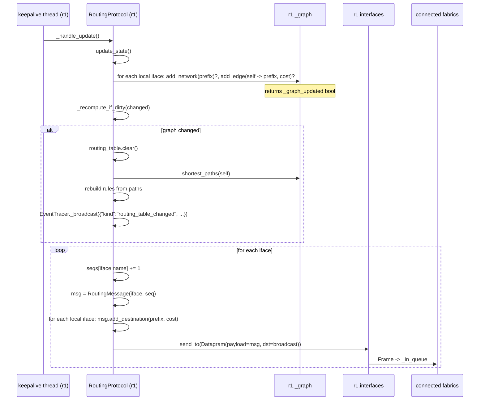
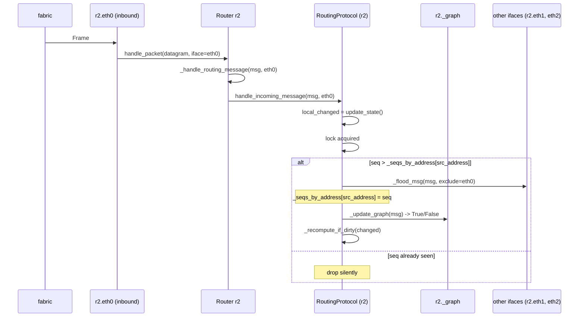

# Routing Protocol

`loom` implements a **link-state** routing protocol with sequence-numbered
flooding and Dijkstra shortest-path computation. The protocol lives in
`src/routing/protocol.py`; the underlying graph (and the Dijkstra
implementation) lives in `src/routing/graph.py`.

This document describes both, with sequence diagrams for the two paths
that matter: keepalive flooding and convergence after a topology change.

---

## Overview

Every router runs a `RoutingProtocol` instance, accessed as
`router._protocol`. The protocol owns:

- A **`NetworkGraph`** — the router's local view of the AS topology
  (routers + networks + weighted edges).
- A **keepalive thread** that floods a `RoutingMessage` from every
  interface every `_keepalive_interval` seconds (default 10s,
  live-tunable via the toolbar).
- Two sequence-number tables, both `collections.defaultdict`:
  - `_seqs_by_address[src_address] = last_seen_seq` — receiver-side
    flood deduplication.
  - `_seqs[iface_name] = current_seq` — sender-side per-interface
    monotonic counters.
- A dirty flag (`_graph_updated`) that gates `_recompute_if_dirty`. The
  routing table is only rebuilt when the graph actually changed.

The receiver-side dedup is keyed on the **source interface's IP**, not
on the source router. When router R floods from each of its K interfaces,
every peer keeps K separate `(last-seen-seq)` entries — one per source
interface address — even though all K floods originate from the same
router R. So don't conflate `src_router` (used to add a node to the
graph) with `src_address` (used to dedup floods); the protocol uses
both, for different purposes.

---

## Originating a flood

`_handle_update` runs on every keepalive tick. It floods the router's
local view to every neighbor:



Three subtleties:

1. `update_state()` is called **before** the recompute and the send.
   That ensures a fresh local edge (e.g. after `update_interface`)
   is in the graph *before* the new advertisement goes out.
2. The recompute is **inside** the same critical section as the
   send. There is no observable interval where the routing table
   is stale relative to what the router is announcing.
3. The first tick happens at `t ≈ 0`, not after one full interval —
   `_keepalive_loop` does an initial `_safe_tick` before its first
   `gate.sleep`. Neighbors learn about a new router immediately
   instead of waiting up to 10 seconds.

---

## Receiving a flood

`handle_incoming_message` runs on the **inbound interface's packet
thread** — not on the protocol's own keepalive thread, despite living
in `RoutingProtocol`. The class boundary doesn't match the thread
boundary: only `_keepalive_loop` (and the `_handle_update` it calls)
runs on the keepalive thread; everything else in `RoutingProtocol` is
invoked synchronously from whichever thread happened to call it. The
inbound call chain:

```
Interface._pkt_loop  (per-interface daemon)
  → device.handle_packet
    → Router._handle_message
      → Router._handle_routing_message
        → RoutingProtocol.handle_incoming_message  ← runs here
```

So in this sequence:



The dedup test is the bedrock of flooding correctness:

```python
if seq > self._seqs_by_address[src_addr]:
    self._flood_msg(msg, interface)
    self._seqs_by_address[src_addr] = seq
    changed = self._update_graph(msg) or local_changed
    self._recompute_if_dirty(changed)
```

`_seqs_by_address` defaults to `-1` (via `defaultdict(lambda: -1)`), so
the first message from any source is always accepted (it has `seq=1` at
minimum).

`_flood_msg(msg, interface)` re-sends the message out of every interface
**except** the one it arrived on:

```python
for name, iface in self._router.interfaces().items():
    if name == interface.name():
        continue
    net_broadcast = iface.network().broadcast_address()
    datagram = Datagram(src_addr=iface.address(),
                        dst_addr=net_broadcast,
                        payload=msg)
    iface.send_to(datagram, dst_addr=net_broadcast)
```

Note that **the same `msg` object is reused**. Its `seq`, `src_address`,
and `destinations` survive the bounce intact — which is what makes
flood-dedup possible (the next router sees the same `(src_address, seq)`
pair and drops it).

---

## Graph updates

`_update_graph(msg)`:

```python
src_router = msg.src_router()

if src_router not in self._graph:
    self._graph.add_router(src_router)
    self._graph_updated = True

for prefix, cost in msg.destinations().items():
    if prefix not in self._graph:
        self._graph.add_network(prefix)
        self._graph_updated = True

    current_cost = self._graph.weight(src=src_router, dst=prefix)
    if current_cost != cost:
        self._graph.add_edge(src=src_router, dst=prefix, weight=cost)
        self._graph_updated = True

return self._graph_updated
```

Three flag-flips, only one of which triggers a recompute:

| Condition | What it means | Triggers recompute? |
|---|---|---|
| `src_router not in self._graph` | Heard from a new neighbor | Yes |
| `prefix not in self._graph` | New network discovered | Yes |
| `current_cost != cost` | A known link's cost changed | Yes |
| Same router, same prefix, same cost | Re-advertisement, no news | **No** |

The "no" case is what keeps a steady-state network quiet: every router
floods every interval, but no router rebuilds its routing table once
things have converged.

---

## Rebuilding the routing table

`_recompute_if_dirty(changed)` is the routing-table writer:

```python
if not changed:
    return

routing_table = self._router.routing_table()
routing_table.clear()
paths = self._graph.shortest_paths(self._router)

for prefix in self._graph.networks():
    path = paths.get(prefix, list())
    if len(path) < 2:
        continue                         # ourselves or unreachable
    next_hop_network = path[1]
    next_hop_address = NullAddress       # default: directly connected
    if len(path) > 2:
        # Find the IP of the next router on the next-hop network.
        next_hop = path[2]
        for _, iface in next_hop.interfaces().items():
            if iface.network().address() == next_hop_network:
                next_hop_address = iface.address()
                break

    # Find which of *our* interfaces is on the next-hop network.
    for _, iface in self._router.interfaces().items():
        if iface.network().address() == next_hop_network:
            routing_table.add_rule(prefix, next_hop_address, iface)
            break
```

The shape of a path from `r1` to `lan3` in the sample topology might be:

```
[r1, lan1, r2, lan3]
 ^   ^     ^   ^
 |   |     |   destination prefix (the network we're routing to)
 |   |     next-hop router (its IP on lan1 becomes the next_hop_address)
 |   next-hop network (the interface on lan1 is our out_iface)
 ourselves
```

If the path is just `[r1, lanX]` (length 2), the destination is directly
connected: `next_hop_address` stays at `NullAddress`, and
`Router._handle_forwarding` will substitute `packet.destination()` at
forwarding time.

After rebuilding the table, the protocol emits a
`routing_table_changed` event so the SPA can re-render the inspector's
routing-table section.

---

## The Dijkstra algorithm

`NetworkGraph._shortest_paths` is a standard textbook Dijkstra with one
twist: it uses **lazy deletion** of stale heap entries instead of an
in-place decrease-key. Pushing a fresh `HeapItem(new_dist, node)` for
every relaxation is cheaper than fingerprint-tracking heap positions, and
the `visited` set skips re-pops:

```python
while len(costs) > 0:
    item = heapq.heappop(costs)
    current_dist = item.weight()
    current = item.data()

    if current in visited:
        continue                          # stale entry — skip
    visited.add(current)

    for neighbor, weight in self.neighbors(current).items():
        if neighbor in visited:
            continue
        new_neighbor_dist = current_dist + weight
        if neighbor not in distances or new_neighbor_dist < distances[neighbor]:
            distances[neighbor] = new_neighbor_dist
            previous[neighbor] = current
            heapq.heappush(costs, HeapItem(new_neighbor_dist, neighbor))
```

Complexity: **O((V + E) log V)** in the worst case (each edge can cause
at most one heap push).

`shortest_paths(src)` post-processes the distance/`previous` maps into
the explicit path list expected by `_recompute_if_dirty`:

```python
for node in self._costs.keys():
    path = [node]
    current = node
    while current != src:
        if current not in previous:
            break                          # node unreachable
        current = previous[current]
        path.insert(0, current)
    paths[node] = path
```

`previous` is missing for unreachable nodes — those produce a
single-element `path = [node]` which `_recompute_if_dirty` filters out
via `len(path) < 2`.

---

## Sequence numbers and origination

Each interface has its own monotonically increasing sequence counter
(`_seqs[iface_name]`). That means the same router emits **multiple**
parallel streams, one per interface. The receiving end dedups per
`src_address`, so this is by design — each stream is independent.

There is a `# TODO: same seq` comment in `_handle_update` noting that we
probably *should* use a single seq per router rather than per interface,
because today an attacker (or a bug) that resets `_seqs["eth0"]` without
resetting `_seqs["eth1"]` would leave one stream stale. The code works
because no current path resets seqs mid-flight. Don't touch this without
adding tests.

---

## Pause / resume semantics

`_keepalive_loop` waits on the AS-wide `PauseGate`:

```python
while not self._stopped:
    if gate is not None:
        timed_out, stopped = gate.sleep(self._keepalive_interval)
        if stopped:
            break
        running, stopped = gate.wait_or_stop()
        if stopped:
            break
        if not running:
            continue                       # paused; loop again without ticking
    else:
        time.sleep(self._keepalive_interval)
    self._safe_tick()
```

`gate.sleep` returns `(True, False)` when the full interval elapses — the
caller then checks `wait_or_stop` to ensure the gate is still running
*at tick time* (it may have flipped to paused during the sleep). If
paused, the loop continues without ticking; if stopped, it breaks.

Consequence: pausing the simulation **freezes the routing protocol** as
well as the data plane. No floods originate, no graph updates accept, no
recomputes fire. On resume, the next interval-timer tick is the first
event — there is no "catch-up burst."

---

## Liveness and convergence

The protocol is **periodic**, not event-driven for liveness. Costs are
recomputed when a router receives news, but the news only flows on
keepalive ticks. So:

- A new interface cost takes effect on the **next keepalive** of the
  router whose interface changed, plus one flood-propagation latency.
- A new router takes effect within **one keepalive** for direct
  neighbors, plus N keepalives to reach a router N hops away (each hop
  re-floods on its own schedule).
- A removed link is **not** detected actively. There is no failure
  detection in this simulator — if you remove a router via the patch
  API, the others will only stop hearing it. Their graphs still
  reference the dead router until something else changes; eventually,
  if you reset, they re-converge.

Tuning the keepalive interval lower (the toolbar exposes 1–300 s)
trades off network chatter for faster convergence. The lower bound of 1
second is enforced server-side (`POST /sim/refresh_interval`).

---

## Where to look in the code

| Concern | File | Symbol |
|---|---|---|
| Keepalive loop | `src/routing/protocol.py` | `_keepalive_loop` |
| Originate a flood | `src/routing/protocol.py` | `_handle_update` |
| Receive a flood | `src/routing/protocol.py` | `handle_incoming_message` |
| Dedup + re-flood | `src/routing/protocol.py` | `_flood_msg` |
| Apply incoming advertisement | `src/routing/protocol.py` | `_update_graph` |
| Rebuild routing table | `src/routing/protocol.py` | `_recompute_if_dirty` |
| Dijkstra | `src/routing/graph.py` | `NetworkGraph._shortest_paths` |
| Path post-process | `src/routing/graph.py` | `NetworkGraph.shortest_paths` |
| Longest-prefix match | `src/entities/router.py` | `RoutingTable.match` |
