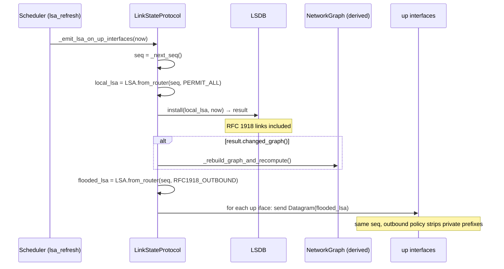
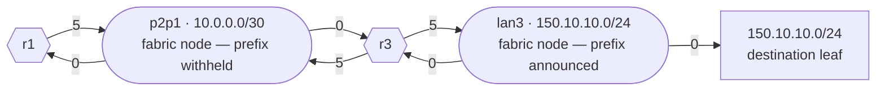
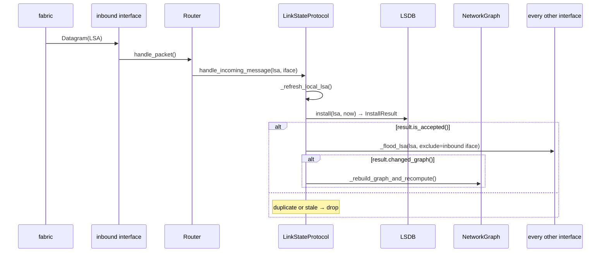

> 🌐 **English** · [Español](../es/architecture/routing-protocol.md)

# loom-OSPF — simplified link-state routing

`loom` implements a link-state routing protocol deliberately modelled after
OSPF's core mechanics while shedding the protocol machinery that does not
make sense in a single-area, broadcast-free simulator. The protocol lives in
[`src/routing/`](../../src/routing); the core protocol modules are
[`lsa.py`](../../src/routing/lsa.py),
[`lsdb.py`](../../src/routing/lsdb.py),
[`hello.py`](../../src/routing/hello.py),
[`neighbor.py`](../../src/routing/neighbor.py),
[`scheduler.py`](../../src/routing/scheduler.py), and
[`protocol.py`](../../src/routing/protocol.py) (the package also contains
[`messages.py`](../../src/routing/messages.py),
[`graph.py`](../../src/routing/graph.py),
[`policy.py`](../../src/routing/policy.py), and
[`exception.py`](../../src/routing/exception.py)).

---

## Overview

The protocol is named **loom-OSPF** to signal the inheritance. What it models:

- Per-router **Link-State Advertisements (LSAs)** describing directly-connected
  networks and their costs.
- **Sequence-numbered flooding** to propagate LSAs across the AS.
- A **Hello protocol** for bidirectional liveness detection between adjacent
  routers on a shared fabric.
- An **LSDB** (link-state database) as the canonical view of topology; the
  `NetworkGraph` and routing tables are both derived from it.
- **LSA age + max-age purge** for implicit failure detection (no keepalive →
  stale LSA → graph pruned).
- **Graceful withdrawal** on shutdown: a zero-link LSA floods peers before the
  router exits so they purge it immediately rather than waiting for max-age.
- **Timer jitter** to avoid synchronised floods on restart.

What it deliberately does **not** model:

- Areas, ABRs, virtual links, stub/NSSA areas.
- Designated Router / Backup DR election on broadcast networks.
- OSPFv3 / IPv6.
- Full OSPF adjacency states — loom-OSPF's terminal state is `TWO_WAY`.
- DBD/LSR/LSU LSDB-synchronisation handshake.
- External LSAs (Type 5).
- ECMP / multipath, authentication.

---

## Wire protocol

Two layers meet on the wire, and only the inner one is a protocol message.

`RoutingMessage` (in [`lsa.py`](../../src/routing/lsa.py), itself a subclass
of `entities.packet.Message`) is the base of the protocol-message family, and
it has exactly two concrete types: `LSA` and `Hello`. Neither travels on its
own — each is wrapped in a `Datagram` for every emission. `Datagram` is a
`Packet`, **not** a `RoutingMessage`: it is the envelope rather than a third
kind of message, and is described below once both messages are covered.

### `LSA`

An LSA carries one router's own view of its directly-connected links — origin-
tagged, never interface-tagged, and unauthenticated (message authentication is
one of the deferred items above). Fields:

| Field | Type | Purpose |
|---|---|---|
| `_origin` | `Router` | The router that originated this advertisement |
| `_seq` | `int` | Monotonically increasing per-router sequence counter |
| `_attachments` | `dict[fabric, Attachment]` | Fabric → `(cost, prefix or None)`: one entry per attached LAN or link |
| `_is_withdrawal` | `bool` | If `True`, this is an empty withdrawal LSA |

**Topology and reachability are separate, deliberately.** An `Attachment`
says two things at once, and only one of them is negotiable:

- *topology* — "I am attached to this fabric at this cost". Always
  advertised. This is what places the router in everyone's graph.
- *reachability* — "and its range is `prefix`". Advertised only when the
  outbound policy permits, so `prefix` is `None` for an RFC 1918 fabric.

A private LAN or `/30` therefore carries transit traffic while remaining
unreachable as a destination: peers can compute paths *through* it, but
nobody installs a route *to* it.

**Attachments key on the fabric, not on its prefix.** Two LANs may legally
carry the same private CIDR inside one AS, so prefix-keyed nodes would fuse
unrelated LANs into one and invent adjacency between routers that share no
wire. Identity keeps them apart — the fabric object plays the role of OSPF's
*pseudonode*: the one graph vertex that stands for a whole segment, so every
router on it attaches to a shared node instead of to each peer pairwise. The
[cost model](#cost-model-ospf-pseudonode) below covers the edges that vertex
carries.

#### Key methods

Both constructors are classmethods.

| Method | Returns | Purpose |
|---|---|---|
| `LSA.from_router(router, seq, policy)` | `LSA` | Build an advertisement from the router's **up** interfaces; `policy` decides per fabric whether its prefix is announced |
| `LSA.withdrawal(router, seq)` | `LSA` | Build the empty shutdown LSA — `is_withdrawal=True`, no attachments |
| `add_attachment(fabric, cost, prefix=None)` | — | Advertise one fabric, optionally announcing its prefix |
| `add_link(prefix, cost)` | — | Convenience for callers that think in prefixes: resolves the origin's fabric carrying `prefix`, so a hand-built LSA keys the same node a policy-built one would |
| `attachments()` | `dict[fabric, Attachment]` | The full advertised view — topology *and* reachability |
| `links()` | `dict[prefix, cost]` | The announced-destinations view that the rest of the protocol and its tests read. Attachments whose prefix policy withheld are absent |
| `has_same_links_as(other)` | `bool` | Dict equality over attachments, so a fabric appearing or leaving counts even when no announced prefix moved. This is what `LSDB.install` uses to set `changed_graph` |
| `is_newer_than(other)` | `bool` | Plain `seq` comparison. **Not** the dedup path — acceptance runs off the LSDB's per-origin high-water mark (next section); this method exists for tests |

### `Hello`

A Hello carries liveness from one interface, listing all non-DOWN neighbors
currently heard on that fabric. Fields:

| Field | Type | Purpose |
|---|---|---|
| `_originator` | `Router` | The router sending the Hello |
| `_neighbors_heard` | `list[Router]` | Routers heard on this fabric in the last dead interval |

Hellos are **built per-interface** and are not shared across interfaces.

### The `Datagram` carrier

Both message types above travel inside a `Datagram` (in
[`messages.py`](../../src/routing/messages.py)), which adds what a message
itself does not carry: a per-emission source and destination address (the
fabric's broadcast address) plus a TTL. Because those live on the envelope,
the same `LSA` object can be carried by many `Datagram`s — one per outbound
interface, one per re-flood hop — without ever being mutated.

---

## Sequence-number model

loom-OSPF uses a **single monotone counter per router**
(`LinkStateProtocol._seq`, incremented by `_next_seq()`). Every LSA emission —
refresh cycle or re-flood — carries the current value.

The LSDB's `install()` method is the acceptance gate. It compares against a
**persistent per-origin high-water mark** (`_last_seq[origin]`), not against the
currently-stored LSA:

```python
if last_seq is not None and lsa.seq() <= last_seq:
    return InstallResult.rejected()
```

Ties and replays are rejected, so a router can never roll back its sequence
number in-flight. The high-water mark is retained even after an origin's LSA is
**purged** (by a withdrawal or max-age expiry) — this is what makes withdrawals
idempotent. Without it, a withdrawal removes the very entry it would otherwise
be compared against, so each re-flooded copy looks brand-new and is re-flooded
forever; on a topology with parallel paths between two routers, a withdrawal and
the subsequent re-announcement then circulate indefinitely (an LSA storm).

A router also drops any incoming LSA that names **itself** as origin
(`_handle_incoming_lsa` returns early when `lsa.origin() is self._router`): such
an LSA is an echo of the router's own flood reflected back over another network,
and installing/re-flooding it would feed the same storm. The local LSA is owned
exclusively by the refresh/announce path.

`has_same_links_as` is a dict-equality check over the `_attachments` map — a
fabric coming or going is a graph change even when no announced prefix moved,
which is exactly the case for a private LAN or link. The LSDB uses it to
decide whether an accepted LSA actually changed the graph:
- Accepted + same links → `InstallResult.accepted(changed_graph=False)` → no
  shortest-paths recompute, no routing-table rebuild. This keeps a steady-state
  network quiet even though every router floods at the refresh interval.
- Accepted + different links → `InstallResult.accepted(changed_graph=True)` →
  triggers shortest-paths recompute.

---

## Originating an LSA flood

`_emit_lsa_on_up_interfaces` runs on every LSA-refresh timer tick. It uses
**two LSA instances at the same sequence number** in one atomic lock section.

Both are built by the protocol itself, immediately after it draws the sequence
number, through the `LSA.from_router(router, seq, policy)` classmethod in
[`lsa.py`](../../src/routing/lsa.py). That classmethod walks the origin's
interfaces, skips any that are down, and asks the policy about each remaining
one's attached fabric: permitted → the attachment carries the prefix; denied →
it carries `None`. The `policy` argument is the only difference between the two
instances, which is what lets them share a `seq`.



The two-LSA pattern exists because local routing through RFC 1918 networks
must work (a router forwards its own packets to directly-connected private LANs
using the local graph), but those private prefixes must not leak to peers. The
`local_lsa` is built with a permit-all policy so all directly-connected
networks appear in the LSDB and graph; the `flooded_lsa` is built with
`RFC1918_OUTBOUND` (strips 10.0.0.0/8, 172.16.0.0/12, 192.168.0.0/16) before
it is sent out any interface.

At start, `_protocol_loop` calls `_safe_tick_initial` before the first timer
fires (t ≈ 0), so neighboring routers learn about each other immediately
instead of waiting one full refresh interval.

---

## Hello protocol

`_emit_hello_on_up_interfaces` runs on every hello-timer tick. For each
up interface it builds a `Hello` listing all non-DOWN neighbors currently heard
on that fabric, then sends it as a broadcast Datagram.

### Neighbor state machine

Each `(interface, peer)` pair has a `NeighborState`:

```
         heard Hello         peer listed us
  DOWN ──────────────► INIT ───────────────► TWO_WAY
         (any)                (bidirectional)
                                │
         dead interval expires  │
  DOWN ◄────────────────────────┘ (or last hello too old)
```

| State | Meaning |
|---|---|
| `DOWN` | No recent Hello from peer (or never heard) |
| `INIT` | Heard peer's Hello; peer has not yet included us in its neighbors list |
| `TWO_WAY` | Heard peer's Hello; peer listed us → bidirectional adjacency confirmed |

State is derived (not stored) from timestamps in `Neighbor.state()`:
- `_last_hello_at` is refreshed on every received Hello from this peer.
- `_peer_acked_at` is refreshed when a received Hello lists us in its
  `neighbors_heard`.
- Both must be more recent than `dead_interval` seconds ago for `TWO_WAY`.

`NeighborTable.record_hello` returns a `NeighborTransition` when the state
changes, or `None` when it is stable. A transition to `DOWN` immediately purges
that peer's LSA from the LSDB and triggers a shortest-paths recompute.

Hellos support **multiple peers per interface** — a single fabric can have
several routers, each tracked independently under its own `(iface_name, peer)`
key in `NeighborTable`.

---

## LSDB and graph

`LSDB` is the canonical topology store. Each origin's current LSA is held as
`(lsa, installed_at)` pair in `_by_origin`. `NetworkGraph` is always a derived
view:

```python
graph = lsdb.build_graph(eligible_origins)
```

`build_graph` always includes the local router's own LSA (if present), then
adds each origin in `eligible_origins`.

### Cost model (OSPF pseudonode)

Interface costs are **outgoing-only**: an interface cost `N` on router R's
iface `eth_i` means "sending a packet out of `eth_i` onto its attached subnet
S costs N." There is no corresponding incoming cost.

`build_graph` encodes this with two directed edges per LSA link:

- `R → S` at weight = R's advertised interface cost
- `S → R` at weight = 0

The zero-weight reverse edge models the OSPF "pseudonode": once a packet is on
a multi-access subnet, reaching any router attached to that subnet is free —
the cost was already paid by whoever put the frame on the wire. Without this,
a single hop `R₁ → S → R₂` would double-count (`R₁`'s outgoing + `R₂`'s
outgoing) and asymmetric link costs would behave incorrectly.

A consequence worth knowing: with **symmetric** link costs (both ends set to
the same value), changing only one side of a link changes the cost from that
direction only. Changing v's iface cost from 4 to 6 affects `v → t` (now 6)
but not `t → v` (still 4). To raise the cost symmetrically, update both
endpoints.
**Transit nodes are fabrics; destinations are leaves.** The graph holds three
kinds of node — routers (`R`), fabrics (`F`), and announced prefixes (`P`) —
and each attachment in an LSA contributes `R → F` at the advertised cost plus
`F → R` at 0. When the attachment also announces a prefix, that prefix joins
as a leaf under its fabric: `F → P` at 0, with no edge back out, because a
destination is never something traffic passes *through*.

Two fabrics from the sample topology show both halves — the private `/30` link
`p2p1` and the public LAN `lan3`. Everything below is contributed by the LSAs
r1 and r3 flood, so every router in the AS derives this same sub-graph:



`p2p1` is a full node carrying both its router edges, so paths cross it
normally: r1 reaches `150.10.10.0/24` by
`r1 → p2p1 → r3 → lan3 → 150.10.10.0/24` at 5 + 0 + 5 + 0 = 10, which is the
figure the [overview](overview.md) walkthrough quotes for that route.

What no flooded LSA contributes is a `10.0.0.0/30` leaf — policy withheld the
prefix. For r2, which is not attached to `p2p1`, this sub-graph is the *whole*
story about that link: it can compute paths across it, but there is no node to
route *to*, and `r2.routing_table()` has no match for `10.0.0.1` at all. r1 and
r3 are the exception, and only because each installs its own local LSA under
[permit-all](policy.md), which adds the leaf to their own graphs. A
directly-connected private prefix is reachable from the routers standing on it
and from nowhere else.

That is the whole point of the split. A fabric's node and both its router
edges exist regardless of policy, so the shortest-path search always has
something to cross; the prefix leaf is the only part policy can remove.
Point-to-point links and multi-access LANs behave identically here — a `Link`
is just a fabric whose node happens to have exactly two routers on it.

Bidirectionality falls out of the same structure rather than needing a rule
of its own: a fabric is traversable only while both ends advertise it. If one
router's interface goes down it stops advertising the attachment, the
`F → R` edge disappears, and no path crosses to that router — the black-hole
OSPF avoids with its explicit reverse-link check in RFC 2328 §16.1.

### Local-link change propagation

`Router.update_interface(name, cost)` mutates the interface cost and then
calls `proto.local_links_changed()` on every protocol. `LinkStateProtocol`
overrides this to re-emit a fresh LSA, install it locally (recomputing
shortest paths if links actually changed), and flood it out every interface
immediately — the same actions a scheduled `lsa_refresh` tick would take, but
without waiting for the timer. Without this, a user-driven cost change would
only propagate at the next periodic refresh (up to
`lsa_refresh_interval + jitter` later, which is ≈ 37.5 s with defaults).

The periodic `lsa_refresh` deadline is reset to `now + lsa_refresh_interval`
after a manual emission, so a burst of edits collapses into one refresh
cadence rather than a tail of identical periodic floods.

### Graph eligibility filter

**Eligible** means: this origin's LSA is allowed to contribute nodes and edges
to the graph this router runs Dijkstra over. It is a second filter, separate
from acceptance — the LSDB stores every LSA it accepts, eligible or not — and
it is recomputed from scratch on every graph rebuild, so an origin can gain or
lose eligibility without any new LSA arriving. The local router's own LSA is
never subject to it; `build_graph` always includes it.

The eligibility set is computed by `_rebuild_graph_and_recompute` in
[`protocol.py`](../../src/routing/protocol.py) using a three-state
classifier based on the Hello-layer view of each origin:

| Origin classification | Eligibility | Rationale |
|---|---|---|
| TWO_WAY-direct (in `bidirectional_peers`) | Always eligible | Confirmed bidirectional adjacency |
| Direct-non-TWO_WAY (in `_neighbor_table.all()` ∖ `bidirectional_peers`) | Excluded | Direct neighbor but not yet fully adjacent — asymmetric, INIT-stuck |
| Non-direct (never observed a Hello from this origin) | Eligible iff ≥1 TWO_WAY adjacency exists | Multi-hop LSA — trusted once this router has any verified adjacency, whoever flooded it |

**Eligibility is decided by the origin, never by the flooder.** Nothing in
`install` or `_handle_incoming_lsa` records *which* neighbor handed over an
LSA, so the classifier cannot ask. It asks two questions about the **origin**
instead: have we ever heard a Hello from it directly, and — separately — does
this router hold at least one confirmed adjacency of any kind?

So the non-direct rule is not "this LSA arrived over a TWO_WAY adjacency". It
is a bootstrap gate on the receiving router as a whole: *once it has verified
any adjacency at all*, it trusts LSAs from origins it has never met. If r1 has
a TWO_WAY adjacency with r2, and r2 floods r3's LSA to r1, then r1 includes r3
in its graph even though it has never exchanged a Hello with r3 — and it would
still include r3 if that LSA had arrived by some other path. Without this
branch only directly-adjacent routers would contribute to the graph, and a
chain r1—r2—r3 would never converge fully at r1.

Real OSPF admits on the flooder instead: an LSA is installed when a
`Full`-state neighbor delivers it, whatever the origin's own adjacency status.
Classifying by origin is more permissive, which is acceptable here — the
simulator has no LSA-injection threat model, and loom-OSPF has no
ExStart/Exchange/Loading/Full handshake with which to classify a flooder.

If no TWO_WAY adjacency exists at all — `bidi`, the local name in
`_rebuild_graph_and_recompute` for what `NeighborTable.bidirectional_peers`
returns, is empty — then `eligible_origins` is empty too: no remote LSA is
trusted until at least one adjacency is verified.

---

## Receiving an LSA



Key points:

- `_refresh_local_lsa()` is called first to ensure the local router's own
  links are in the LSDB before any eligibility calculation.
- **Accepted but same links** is the steady state, and it is the case worth
  naming: the LSA cleared the sequence gate — its `seq` is above the origin's
  high-water mark — while its attachments are exactly what the LSDB already
  held. That is what every router's periodic refresh looks like on a network
  where nothing is moving. `InstallResult.is_accepted()` is `True` and
  `changed_graph()` is `False`.
- Re-flood happens on `is_accepted()`, that case included. The `seq` has
  advanced, so routers further downstream still need the bump; without
  re-flooding it they would never see the new sequence number and their LSDB
  entries would age out at max-age even though the origin is alive and well.
- Shortest-paths recompute happens only on `changed_graph()`, keeping a
  steady-state network quiet.
- `_flood_lsa` re-sends the **same LSA object** (origin + seq + links intact)
  out every interface except the one it arrived on. This is what makes flood
  deduplication work: every downstream router sees the same `(origin, seq)`
  pair and rejects it after the first acceptance.

---

## LSA age and max-age purge

The LSDB stores a wall-clock timestamp (`installed_at`) on each LSA, at install
time.

The max-age sweep runs on the `maxage_check` timer (same cadence as
`lsa_refresh`), where `_sweep_dead_and_expired` calls
`lsdb.expired_origins(max_age, now)`:

```python
[
    origin for origin, (_, installed_at) in _by_origin.items()
    if now - installed_at > max_age
]
```

Any non-local origin whose last LSA is older than `max_age = 2 × refresh` is
purged and the graph is rebuilt. The local router's own entry is exempt from
purge (it refreshes itself on every `lsa_refresh` tick).

**How liveness maps to max-age**: if a router stops flooding (crash, network
partition, or graceful stop without withdrawal), its LSAs age out within
`max_age`. The default `max_age = 60s` (with `refresh = 30s`) means a failed
router is detected within two refresh cycles.

The **dead interval** is a separate, shorter signal at the Hello layer:
`dead_interval = 3 × hello_interval = 30s` by default. A neighbor that stops
sending Hellos is moved to `DOWN` within `dead_interval`, its LSA is purged
from the LSDB, and the graph is rebuilt.

**Beyond the first hop, max-age is not a backstop — it is the only mechanism.**
The dead interval sees direct neighbors and nothing else: `NeighborTable` holds
records only for peers whose Hellos arrive on this router's own interfaces. Nor
does a purge propagate. When r2 detects r3 dead and drops it from its LSDB, r2
floods nothing to say so, and r2's own LSA is unchanged — r2's interface onto
the r2—r3 fabric is still up, so its attachments still read the same. Meanwhile
r3's last LSA sits in r1's LSDB two hops away, still advertising r3's end of
that fabric, which is precisely what keeps the fabric traversable and r3's
prefixes reachable in r1's graph. Nothing dislodges it until r1's own max-age
sweep expires it.

So the two timers divide the work rather than one merely covering for the
other: for a **direct** neighbor, Hello dead detection is the fast path and
max-age the safety net behind it; for an origin **past** the first hop, max-age
is the whole story, and `max_age = 2 × lsa_refresh` is the bound on how long a
distant router's ghost can keep attracting traffic.

---

## Going down: withdrawal, admin-down, and crash

loom-OSPF distinguishes two ways a router or interface can become unavailable:
graceful (admin-initiated) and crash (silent failure). Both converge to the
same down-state; they differ only in how peers learn about it. The withdrawal
LSA is the mechanism every graceful path shares, so it comes first.

### The withdrawal LSA

`LinkStateProtocol.stop()` calls `_flood_withdrawal()` before setting the stop
flag:

```python
lsa = LSA.withdrawal(self._router, seq=self._next_seq())
# flood out every interface
```

A withdrawal LSA has `is_withdrawal=True` and carries no attachments. It still
carries a sequence number like any other LSA and faces the same acceptance
gate: a withdrawal whose seq is not newer than the origin's high-water mark is
rejected, and not re-flooded. When a withdrawal *is* accepted, `lsdb.install`
pops the origin from `_by_origin` and records the withdrawal's seq as the new
high-water mark, then returns `InstallResult.accepted(changed_graph=True)` if
the origin was present — triggering an immediate shortest-paths recompute on
every receiving router. The flood propagates normally through `_flood_lsa`.

(`accepted` is a classmethod factory on `InstallResult` in
[`lsdb.py`](../../src/routing/lsdb.py), paired with `rejected()`; between them
they build the small result object every `install` call returns. Callers never
read its fields — they ask `is_accepted()` and `changed_graph()`.)

Compared to waiting for max-age (up to 60s), a withdrawal gives peers
near-instant convergence after a clean shutdown.

`stop()` is the only path that also stops the protocol thread. `Router.halt()`
below reaches the same flood through `proto.withdraw()`, which calls
`_flood_withdrawal()` and nothing else — the thread keeps running.

### Graceful: interface disable and router halt

**Interface disable** (`disable_interface(name, graceful=True)`) sets the
interface's `is_up()` flag to `False`. A down interface drops traffic in both
directions (neither `_pkt_loop` nor the fabric will forward frames through it)
and is excluded from the outbound LSA. The protocol immediately re-emits a
fresh LSA via `local_links_changed()`, so peers receive an updated link list
within milliseconds — no wait for the next scheduled refresh.

**Router halt** (`halt(graceful=True)`) floods the withdrawal **first**, through
`proto.withdraw()`, and only then walks the interfaces calling `iface.disable()`
on each. The order is load-bearing: a withdrawal flooded after the interfaces
were down would have nothing to transmit on. Note it disables the interfaces
directly rather than through `disable_interface`, so there is no per-interface
`local_links_changed()` reflood chasing the withdrawal out. Receiving routers
purge the origin from the LSDB and recompute shortest paths immediately.

**Resume** re-enables all interfaces (sets `is_up()` back to `True`) and
re-announces the router's links via a fresh Hello + LSA flood (`announce()`).
Because the peer's Hellos were dropped while the router was down, any adjacency
the router still tracks on a re-enabled interface is stale; `announce()` first
**forgets those neighbor records** (`NeighborTable.clear_on`) so the peer's
returning Hello drives a genuine `DOWN→…→TWO_WAY` transition, and each step of
that transition recomputes eligibility and the shortest paths.

Incoming LSAs are an independent second route back to convergence: an LSA that
changes the graph triggers a recompute whatever the neighbor state says, so
`clear_on` is not the only thing standing between a resumed router and a
correct table. What it buys is that reconvergence is driven by the Hello
cadence (≤ `hello_interval`) and happens deterministically. Without it, a stale
`TWO_WAY` record absorbs the returning Hello silently — no transition, so no
recompute — and the router falls back on waiting for that peer's next
*graph-changing* LSA: up to a full `lsa_refresh` interval away, and not
guaranteed at all if the peer's links have not moved in the meantime.

The protocol thread **never stops** during halt or resume — only the `is_up()`
flags change. This means there is no restart-jitter overhead; the router
re-enters the topology at the next flood cycle.

### Crash (silent failure)

A crash (`POST /devices/{name}/fail`, optionally scoped to one interface)
sets `is_up()` to `False` without any LSA announcement. Peers cannot
distinguish this from a network partition at the moment it occurs.

Two detection mechanisms fire independently:

- **Hello dead interval** (`dead_interval = 3 × hello_interval`, default 30s):
  a neighbor that stops sending Hellos transitions to `DOWN`, its LSA is purged
  from the LSDB, and shortest paths are recomputed.
- **LSA max-age** (`max_age = 2 × lsa_refresh_interval`, default 60s): the
  crashed router's LSA ages out during the max-age sweep, triggering the same
  LSDB purge and shortest-paths recompute.

The dead interval fires first (assuming default ratios), making the Hello layer
the fast path for crash detection.

### Crash vs graceful: key invariants

| Property | Graceful (halt / iface disable) | Crash |
|---|---|---|
| `is_up()` flag cleared | Yes | Yes |
| Withdrawal LSA flooded | Yes (halt) / partial LSA (iface disable) | No |
| Protocol thread stopped | Never (only `stop()` does that) | Never |
| Down-state serialized | No (runtime-only) | No (runtime-only) |
| Peer convergence trigger | Immediate (on LSA receipt) | Dead interval / max-age |

The protocol thread never stops in either case — this is an explicit design
choice so that `resume` requires no thread restart, and so that the protocol
can re-announce links the moment `is_up()` flips back.

Crash and graceful are **transition-time forks**, not stored states. Once a
router is down, the LSDB and routing tables look identical regardless of how
it got there.

---

## Timer model and jitter

`_protocol_loop` drives three independent timers via a `Scheduler` instance.
The loop parks on `_wake_event.wait(timeout=time_to_next_deadline)` and
dispatches whichever timers have elapsed when it wakes:

| Timer name | Default interval | Derived from | Purpose |
|---|---|---|---|
| `hello` | 10s | production default | Emit Hellos; sweep dead neighbors |
| `lsa_refresh` | 30s | production default | Emit LSA flood; refresh own LSDB entry |
| `maxage_check` | 30s | `= lsa_refresh` | Purge expired remote LSAs |

Derived relations (fixed ratios, not tunable separately):

```
dead_interval   = 3 × hello_interval
max_age         = 2 × lsa_refresh_interval
```

**Jitter**: `Scheduler.elapsed` reschedules each fired timer by drawing the
next deadline from `[0.75 × base, 1.25 × base]`. This desynchronises routers
that start at the same instant, avoiding simultaneous floods on large
topologies.

For tests requiring deterministic timing, `Scheduler` accepts
`jitter_range=(1.0, 1.0)`.

The `POST /sim/protocol_config` endpoint exposes
`hello_interval` and `lsa_refresh_interval` as the two tuneable knobs. The
`set_timers` method recomputes all derived values and wakes the protocol loop
immediately so the new cadence takes effect without waiting for the old deadline
to expire.

---

## Pause / resume

`_protocol_loop` clears the AS-wide `PauseGate` before every tick — once ahead
of the initial tick, then again on each wake, after parking on `_wake_event`
until the next deadline and before dispatching any elapsed timer:

```python
if not wait_for_gate(gate, self._stop_event):
    break          # gate stopped, or this protocol was stopped
```

`wait_for_gate` ([`clock.py`](../../src/entities/clock.py)) is the shared
helper every gated worker uses; it collapses the gate's three-way answer into
one bool. Underneath it polls `PauseGate.wait_or_stop(timeout=0.1)`, and that
is where the threading events live: the gate holds a `_running` event (set
while the simulation runs, cleared by `pause()`) and a `_stopped` event.
`wait_or_stop` blocks on `_running.wait(timeout)` and reports a
`(running, stopped)` pair:

| Return | Meaning | What `wait_for_gate` does |
|---|---|---|
| `(True, False)` | Running | Return `True` — proceed with the tick |
| `(False, True)` | `PauseGate.stop()` was signalled | Return `False` — leave the loop |
| `(False, False)` | Timed out while still paused | Re-check the caller's own `_stop_event`, then poll again |

The third row is the reason for the timeout at all. A bare `_running.wait()`
would park a paused worker indefinitely, so a protocol-level `stop()` — which
sets `_stop_event`, a different event that the gate knows nothing about — would
go unnoticed until the 2s join gave up. Polling every 0.1s bounds that to one
poll interval. In the other direction, `PauseGate.stop()` sets `_running` on
its way out, so workers parked on the gate itself wake at once instead of
waiting out a poll.

Pausing the simulation freezes Hellos, LSA floods, dead-neighbor sweeps, and
max-age checks. Nothing accumulates while paused: `Scheduler.elapsed` reports
each overdue timer once and reschedules it from the current instant, so a long
pause costs one tick per timer on resume, not one per interval missed.

---

## Code references

| Concern | File | Symbol |
|---|---|---|
| Wire message types | [`src/routing/lsa.py`](../../src/routing/lsa.py) | `RoutingMessage`, `LSA` |
| Hello message | [`src/routing/hello.py`](../../src/routing/hello.py) | `Hello` |
| Datagram carrier | [`src/routing/messages.py`](../../src/routing/messages.py) | `Datagram` |
| LSDB install + purge | [`src/routing/lsdb.py`](../../src/routing/lsdb.py) | `LSDB.install`, `LSDB.expired_origins` |
| LSDB → graph | [`src/routing/lsdb.py`](../../src/routing/lsdb.py) | `LSDB.build_graph` |
| Neighbor state machine | [`src/routing/neighbor.py`](../../src/routing/neighbor.py) | `Neighbor.state`, `NeighborTable` |
| Timer deadlines + jitter | [`src/routing/scheduler.py`](../../src/routing/scheduler.py) | `Scheduler` |
| Protocol loop | [`src/routing/protocol.py`](../../src/routing/protocol.py) | `LinkStateProtocol._protocol_loop` |
| LSA origination | [`src/routing/protocol.py`](../../src/routing/protocol.py) | `_emit_lsa_on_up_interfaces` |
| Hello origination | [`src/routing/protocol.py`](../../src/routing/protocol.py) | `_emit_hello_on_up_interfaces` |
| LSA reception | [`src/routing/protocol.py`](../../src/routing/protocol.py) | `_handle_incoming_lsa` |
| Hello reception | [`src/routing/protocol.py`](../../src/routing/protocol.py) | `_handle_incoming_hello` |
| Eligibility filter | [`src/routing/protocol.py`](../../src/routing/protocol.py) | `_rebuild_graph_and_recompute` |
| Shortest paths + routing table | [`src/routing/protocol.py`](../../src/routing/protocol.py) | `_recompute_routing_table` |
| Withdrawal flood | [`src/routing/protocol.py`](../../src/routing/protocol.py) | `_flood_withdrawal` |
| Dijkstra | [`src/routing/graph.py`](../../src/routing/graph.py) | `NetworkGraph._shortest_paths` |
