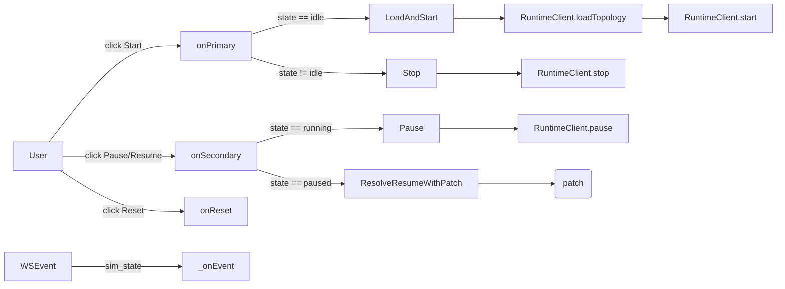

> 🌐 **English** · [Español](../es/architecture/web-spa.md)

# Web SPA

The SPA is plain ES modules — no framework, no bundler. The whole client
is shipped from `web/` as static assets and loaded by `index.html`.

```
web/
├── index.html           # ~355 lines of markup + <script type="module" src="app.js">
├── styles.css           # all CSS
├── favicon.svg
├── app.js               # entrypoint: imports, wire(), init(), DOMContentLoaded
├── state.js             # state object + persistence + EventTarget bus + sample
├── canvas.js            # SVG rendering, drag, pan/zoom, theme, layout
├── inspector.js         # left nav + right pane, rename/duplicate/delete, context menu
├── terminals.js         # per-device terminal popups
├── packets.js           # packet animation + tooltips
├── packetstore.js       # PacketStore — in-flight registry, hop history, NAT cache, #N counters
├── packetspanel.js      # Packets panel — toolbar button, mounts inside #inspector, row rendering, hover halo
├── packettypes.js       # packet-type constants (USER_TYPES, CHATTER_TYPES, type→label map)
├── sim.js               # Sim state machine + RuntimeClient + WS dispatcher
├── yaml-io.js           # YAML import / export
├── preflight.js         # validateTopology() — pre-Start completeness check
├── modal.js             # confirmModal() — promise-based confirm dialog
├── protocolpopover.js   # Protocol timer config popover (hello/lsa_refresh inputs + Apply)
├── file-picker.js       # Import file-picker dialog (drag-and-drop + browse)
└── utils.js             # DOM helpers (el, escapeHtml, toast, ...)
```

The intent of the split is one module per concern, with cross-component
coordination flowing through the `bus` (see below) rather than direct
inter-module render calls.

## The event bus

`state.js` exports a singleton:

```js
export const bus = new EventTarget();
```

Every cross-component reaction flows through it. The contract has two
sides:

- **State mutations + cross-component re-renders → bus.** When `inspector.js`
  renames a device, it mutates `state` and dispatches
  `state:topology-changed`; `canvas.js` and the inspector both
  re-render in response.
- **Synchronous queries + DOM helpers → direct imports.** `canvas.lookupDeviceNode`,
  `utils.el`, `utils.escapeHtml` are imported directly because they're
  read-only and have no side effects.

The contract is enforced by convention, not by tooling. Don't reintroduce
module-to-module direct render calls.

The SPA is a **consumer** of the backend's broadcast facts. The `sim:*`
events listed below are translated from backend WS event kinds
(`interface_state_changed`, `device_state_changed`, `ping_result`, etc.)
by `sim.js _onEvent`. Naming backend wire shapes inside the SPA is fine
and expected — the SPA is the primary subscriber of those facts.

### Event kinds

| Event | Emitted by | Consumed by | Trigger |
|---|---|---|---|
| `state:topology-changed` | `inspector`, `state`, `app` | `canvas`, `inspector` | Any mutation to networks/links/hosts/routers/display |
| `state:topology-loaded` | `state` (loadSample/clearTopology), `yaml-io` (importYaml) | `canvas` (fitView), `inspector` | Wholesale topology replacement |
| `state:selection-changed` | `canvas`, `inspector`, context menu | `inspector` | User selected a node |
| `sim:status-changed` | `sim` | `inspector`, `terminals`, `packets`, `packetstore` | Sim transitioned (idle/running/paused). Detail: `{status}`. |
| `sim:packet` | `sim` (from WS) | `packets` | Server emitted a packet event |
| `sim:routing-table-changed` | `sim` (from WS) | `inspector` (re-fetch routes if selected) | Server emitted a route change |
| `sim:interface-state-changed` | `sim` (from WS `interface_state_changed`) | `canvas` (gray-out edge), `inspector` (re-render interface buttons) | A router interface was brought up or down. Detail: `{device, iface, up}`. |
| `sim:device-state-changed` | `sim` (from WS `device_state_changed`) | `canvas` (gray-out node) | A router was halted or resumed. Detail: `{device, up}`. |
| `sim:ping-result` | `sim` (from WS `ping_result`) | `terminals` (stream line to sender's terminal) | One ICMP echo reply (or timeout) arrived. Detail: `{device, dst, seq, rtt_ms}`. `rtt_ms` is `null` on timeout. |
| `sim:nat` | `sim` (from WS) | packet tooltip renderer | A router performed source or destination NAT on a packet. Outbound carries `{router, direction, original_src, rewritten_src, dst, flow_id, payload_id}`; inbound carries `{router, direction, rewritten_dst, original_dst, src, flow_id, payload_id}`. `flow_id` is the conversation UUID (same value as `flow` on the `packet` event, and same value the router's NAT table is keyed on). |
| `sim:nat-table-changed` | `sim` (from WS) | `inspector` (NAT table panel) | A router's NAT table was mutated. Carries `{device}` in detail; the full snapshot is mirrored into `state.natTables[device]` for the inspector to render. |
| `sim:neighbor-state-changed` | `state` (`applyNeighborStateChanged`, called from `sim._onEvent`) | `inspector` (Neighbors section re-render) | A router's neighbor adjacency state changed. Detail: `{device, iface, peer, state}`. |
| `sim:router-intercept` | `sim` (from WS `router_intercept`) | `packets` (tooltip decoration) | A router answered an ICMP echo addressed to one of its own IPs. Detail: the raw WS event. Fired just before the matching reply packet so `packets.js` can cache by `payload_id` and annotate the reply tooltip. |
| `sim:topology-changed` | `sim` (from WS `topology_changed`) | `sim` (self-listener triggers resync via `sim:topology-import-requested`) | A topology mutation was confirmed by the server. Detail: `{ops}`. Distinct from `state:topology-changed`, which reflects local mutations. |
| `sim:packet-arrived` | `packets` (animation finish) | `packetstore` | A packet animation completed at its destination device. Detail: `{payloadId, device}`. Drives last-hop promotion in the store. |
| `packets:list-changed` | `packetstore` (debounced ~50ms) | `packetspanel` | The store's in-flight or recent set mutated. Panel re-renders on receipt. |
| `packets:chatter-badges-changed` | `packetspanel` | `packets` | The chatter group's expand state flipped; live chatter dots add/remove their `#R*` badges. |
| `packets:dot-appeared` | `packets` (after appendChild) | `packetstore` | A new packet dot was appended to the canvas layer. Detail: `{payloadId}`. Drives the panel's visibility filter — rows stay hidden until their dot is on screen. |
| `packets:chatter-pin` | `packets` (on commit to animate) | `packetstore` | This chatter emission will animate, so its row's fallback timer is cancelled and its `sim:packet-arrived` owns cleanup. Detail: `{key}` (composite chatter key). |
| `canvas:terminal-requested` | `canvas` (double-click on a device node) | `terminals` | User double-clicked a device; open or focus its terminal popup. Detail: `{name}`. |
| `canvas:contextmenu-requested` | `canvas` (right-click on a node or canvas background) | `inspector` | Open the context menu at the pointer position. Detail: `{clientX, clientY, target, world}`. |
| `canvas:contextmenu-close-requested` | `canvas` (pointerdown on background) | `inspector` | Dismiss the open context menu. |
| `ui:import-requested` | `inspector` (Import toolbar button) | `app.js` | User clicked Import; `app.js` opens the file-picker dialog. |
| `sim:yaml-export-requested` | `sim.onPrimary` | `app.js` | Sim needs current YAML to load before starting |
| `sim:topology-import-requested` | `sim.onReset` | `app.js` | Sim received reset; refresh canvas from server YAML |
| `view:changed` | `canvas` | (none currently — kept for future) | Pan/zoom |

The `sim:yaml-export-requested` event uses a synchronous request/response
pattern: the listener mutates `event.detail.yaml` before the dispatch
returns. This is a temporary bridge to module-local `exportYaml`/
`importYaml` until those are fully decoupled from the canvas.

## State shape (`web/state.js`)

```js
export const state = {
  asName: 'test_as',
  asn: 65000,                 // AS number (persisted)
  networks: { /* name -> { cidr, x, y, w? } */ },
  links:    { /* name -> { cidr, x, y } */ },
  hosts:    { /* name -> { network?, link?, address, gateway?, x, y } */ },
  routers:  { /* name -> { x, y, interfaces: { ifn -> { network?, link?, address, cost } } } */ },
  selection: { kind, name } | null,
  view: { x, y, k },        // pan + zoom
  display: { showCosts, showIfaces },
  ui: { packetsPanelOpen, showChatter },  // persisted panel/toggle state
  config: { packet_duration_ms },         // persisted; round-tripped via internet.config
  protocol: { hello_interval, lsa_refresh_interval }, // persisted; via AS config.protocol
  sourceName: null,           // basename of the last-imported YAML file (persisted)
  // transient — not persisted
  downInterfaces: { /* device -> Set<ifaceName> */ },
  haltedDevices:  { /* device -> true */ },
  natTables:      { /* device -> NatEntry[] */ },       // from nat_table_changed WS events
  neighborsByDevice: { /* device -> { iface -> { peer -> {state,…} } } */ }, // from neighbor_state_changed
};
```

Notes:

- A host has **either `network:` or `link:`**, never both. Same on every
  router interface. The constraint mirrors the YAML schema and the parser.
- Network coordinates `(x, y)` mark the LAN rail's center; the rail's
  main-axis length is `w` (defaults to `RAIL_DEFAULT_WIDTH = 180`).
- Persistence is `localStorage[STORAGE_KEY = 'loom.topology.v5']` —
  serialised on a 200 ms debounce after any `markDirty()` call.
- `asn`, `ui`, `config`, `protocol`, and `sourceName` are persisted.
- The bundled `SAMPLE` is the SPA's first-run fallback when local storage
  is empty.
- `downInterfaces`, `haltedDevices`, `natTables`, and `neighborsByDevice`
  are **transient** — they are never written to `localStorage`.
  See [Admin-down / crash state cache](#admin-down--crash-state-cache) below.

## The Sim state machine (`web/sim.js`)

The SPA mirrors the server's `idle / running / paused` machine. Two
write paths:



`Sim.patch` accumulates operations while paused. When the user clicks
**Resume**, `reconcilePatch(patch)` rewrites the queued `add_*` ops to
pick up the **latest** values from `state` (so a network that was added
then renamed lands in the patch with its current name), and drops any op
whose target was deleted before resume. The reconciled list is sent to
`POST /sim/resume`.

When the WebSocket reports a `sim_state` change, the SPA mirrors it
locally and fires `sim:status-changed` so the canvas and inspector can
update lock states.

## Live topology editing (`applyEdit`)

`inspector.js` routes topology mutations through `applyEdit(op)`, which
behaves differently depending on the current sim state:

- **Running** — `applyEdit` POSTs the op immediately to `POST /sim/edit`
  as a single-op patch. On success the server broadcasts a
  `topology_changed` event; on failure the SPA resyncs from the server
  (GET `/topology`) to heal any divergence. Deleting an in-use LAN while
  running is blocked locally with a toast before the POST is even
  attempted.
- **Paused** — `applyEdit` accumulates the op in `Sim.patch` as before
  (unchanged). The patch is applied atomically on Resume via
  `POST /sim/resume`.
- **Idle** — mutations go directly to local `state`; no server call
  until the next Start.

The **+ Add LAN / Host / Router** toolbar buttons remain enabled while
running, so new entities can be dropped onto the canvas mid-sim.

### Deferred-pending adds

A newly added entity (network, link, host, or router) may have an
incomplete or invalid address/CIDR when it first appears on the canvas.
In that case `applyEdit` withholds the `POST /sim/edit` call and leaves
the entity in a **pending** state — locally visible but not yet committed
to the running AS. The commit fires automatically as soon as the
address/CIDR becomes valid, using the same validators that the inspector
uses for field highlighting:

- **`validateAddressOnFabric(addr, fabricKind, fabricName, selfRef, st)`** for
  host and router-interface addresses.
- **`isValidNetworkCidr(cidr)`** and **`isValidLinkCidr(cidr)`** for
  fabric CIDRs.

These functions live in `utils.js` and are shared between the inspector's
real-time field highlighting and the live-edit commit gate — so "valid
enough to highlight green" and "valid enough to commit" are the same
predicate.

### Topology-changed resync

When the WebSocket delivers a `topology_changed` event (from any
successful edit, whether local or from another client), the SPA calls
`importYaml` against a freshly fetched `GET /topology` response. The
resync preserves:

- **Node positions** — coordinates in `state.networks`, `state.hosts`,
  and `state.routers` are merged back onto the imported topology, so the
  canvas does not jump.
- **Selection** — `state.selection` is restored if the selected entity
  still exists after the resync.
- **Viewport** — `state.view` (pan + zoom) is unchanged.

A rejected live edit (HTTP 400 from `POST /sim/edit`) triggers the same
resync path to ensure the local state stays consistent with the server.

Note: interface re-addressing and host/network reassignment are **not**
supported via live edit; those operations require a full Stop → edit →
Start cycle.

## Canvas (`web/canvas.js`)

SVG-based, with three coordinate systems:

- **World** — the canonical coordinates stored in `state` (every node
  has `x, y`).
- **View** — world coordinates with `state.view` (pan + zoom) applied;
  this is what the user sees.
- **Screen** — view coordinates translated by the SVG's bounding
  rectangle (for mouse-event math).

Helpers: `screenToWorld`, `worldToView`, `applyView`. The pan/zoom
handlers in `wireCanvas` keep the focused world coordinate fixed under
the cursor while zooming.

Drag works in two modes:

- **Single-node drag** — the focused node's `(x, y)` is updated on every
  pointermove; `markDirty()` debounces persistence. This is a **client-only
  operation**: position changes are never sent to the server and the running
  AS is unaffected. Single-node drag is therefore allowed in all sim states
  (idle, running, paused). P2P link midpoint labels follow the same rule
  and are also draggable in all states.
  - **Reassignment guard (running only):** if the pointer is released over a
    *different* fabric (a network or link the device is not currently attached
    to) while the sim is running, the canvas shows a red/dashed blocked cue
    on the target fabric and the node snaps back to its last valid position.
    Reassigning a device to a different network or link requires a full
    Stop → edit → Start cycle.
- **Pan** — `state.view.x / y` is updated; `applyView()` re-applies the
  transform without re-rendering nodes.

The `state.display.showCosts` and `showIfaces` toggles change what
labels render around router interfaces. Both are persisted in
`localStorage`.

P2P links render as direct edges between devices (the link's midpoint
label is a draggable indicator). LANs render as a rail with end caps and
ticks at each attached interface; the rail's length is editable via a
handle on each end.

## Inspector (`web/inspector.js`)

The right pane renders a single editable panel per selected node — no
tabs. For routers the panel includes both the interfaces list and the
current routing table; for hosts it includes the network/link
membership and the default gateway; for networks and links it shows
just the name and CIDR.

The routing table fetches via `GET /devices/{name}/routes` on
selection and re-fetches on `sim:routing-table-changed` if this device
is currently selected.

For a selected router, the panel also renders:

- **Neighbors** (`renderNeighborSection`) — shows adjacency state per
  interface/peer, sourced from `state.neighborsByDevice`. Updated
  incrementally on `sim:neighbor-state-changed` without re-rendering
  the whole panel.
- **NAT** (`Inspector.refreshNAT`) — shows the current NAT table fetched
  from `GET /devices/{name}/nat-table`, rendered on selection and
  re-fetched on `sim:nat-table-changed` for the selected router. Also
  refreshed on `sim:status-changed` while a router is selected.

The context menu (right-click on any node) lets you rename, duplicate,
or delete the target with the appropriate prompts. While the sim is
`running`, mutations are blocked with a toast — the user must pause first.

## Terminals (`web/terminals.js`)

A double-click on a host or router opens a floating terminal popup.
Each terminal:

- POSTs to `/devices/{name}/command`.
- Renders the response (`ok` / `error`) line-by-line.
- Supports `Ctrl+L` to clear and `Ctrl+D` to close when the prompt is
  empty.
- Persists position and size in `localStorage` (per-device).

Multiple terminals can be open at once; the simulator emits `packet`
events identically for any caller, so a `ping` from a terminal shows up
on the canvas as the expected animations.

## Packets (`web/packets.js`)

Listens for `sim:packet` events and schedules per-frame SVG animations.
The `PacketAnim.DURATION_MS` (toolbar-tunable, 200–5000 ms) controls per-
hop animation time. The `chatter` toggle (`PacketAnim.muted = true`)
filters `type === "routing_flood"` out of the animation queue.

Each in-flight animation resolves its endpoint positions by device name on
every animation frame (`rAF`), so dots follow their source and destination
nodes as they are dragged. This applies to routing chatter (Hello/LSA
floods on LANs) and user traffic alike — moving a node mid-animation does
not strand or misplace the dot.

The packet color/icon comes from the `type` field of the event:

| Type | Visual |
|---|---|
| `user_datagram` | Solid dot (default color) |
| `routing_flood` | Hollow dot (chatter color) |
| `ping_request` | Solid dot with outgoing-arrow icon |
| `ping_reply` | Solid dot with incoming-arrow icon |
| `unknown` | Solid dot, gray |

Each packet animation also creates a small `<text class="packet-badge">` element sibling to the dot, displaying the numeric id (`#N` for user traffic, `#R*` for routing chatter) assigned by `packetstore.js`. The badge rides with the dot via the same `setPacketAnchor` write-step and is removed on `finish()`. Chatter badges only render when `<body data-chatter-badges="on">` is set, which the panel toggles on chatter-group expand/collapse and signals via `packets:chatter-badges-changed`.

### LSA flooding is sequenced per hop

The simulator processes `LSA-receive → re-flood` with effectively zero wire latency, so without sequencing the origin dot and every downstream re-flood would ride the wires concurrently — visually confusing on anything larger than two routers. `PacketAnim` keeps the flooding tree visible by holding back each re-flood until its inbound hop has visually arrived at the re-flooder:

- The `originator` field on the `packet` event's `payload` (added in `_summarize_payload`) lets the SPA classify each emission as origin (`evt.src.device === payload.originator`) vs re-flood.
- Origin emissions play immediately.
- Re-floods are queued in `PacketAnim._lsaPending` keyed by `"payload_id|sender"`.
- When an LSA dot's `finish()` runs, `_markLSAArrivedOnFabric` walks every router listening on the dot's fabric (excluding the sender), marks `"payload_id|listener"` in `_lsaArrivedAt`, and drains the matching pending queue.
- A re-flood whose listener already arrived (because the dot finished before the re-flood event was dispatched) plays immediately on dispatch.
- Each queued re-flood also arms a bounded fallback (`_scheduleRefloodFallback`, ~3× the per-hop duration). If the inbound that should release it is dropped (muted, or geometry it never animated over) and no arrival ever fires, the fallback force-renders it so it still animates and its store row is cleaned up, instead of stranding in `_lsaPending`.
- The arrival/pending sets clear on `sim:status-changed` → `idle` so a fresh sim run starts clean.

Two supporting rules keep this honest:

- **The chatter animation throttle keys on message identity, not just `(device, network)`.** `_chatterAllowed` keys on `"device:network:payload_id"` so a router re-flooding several *distinct* LSAs out one interface in a convergence burst animates each one; only true repeats of the *same* message (the protocol's self-reflood back through the origin iface) are collapsed.
- **Going idle clears the canvas.** The `sim:status-changed → idle` handler bumps `PacketAnim._gen`, resets the sequencer/throttle maps, and empties `#packet-layer`. The generation bump matters because a multi-phase broadcast fan-out in flight at stop time captures the generation when it starts and aborts its later phases if it changed — otherwise it would spawn fresh clones onto the just-cleared layer and leave them dangling.

The NAT cache previously kept here moved to `packetstore.js` so the tooltip and the panel query the same source.

## Packet store (`web/packetstore.js`)

A singleton registry of packets the simulator is currently animating, plus a small ring of recently delivered ones. Subscribes to `sim:packet`, `sim:packet-arrived`, `sim:nat`, `sim:status-changed`, `packets:chatter-pin`, and `packets:dot-appeared`. Emits `packets:list-changed` (debounced ~50 ms) so the Packets panel can re-render after bursts.

Shape:

```js
export const PacketStore = {
  inFlight:      Map<payload_id, PacketRow>,                         // user traffic (datagrams, pings)
  chatter:       Map<"pid|dev|iface|net", ChatterRow>,               // routing floods, composite key
  recent:        PacketRow[],                                        // FIFO cap 10, user traffic only
  natByPayload:  Map<payload_id, NatHop[]>,                          // relocated from packets.js (was _natByPayloadId)
  _nextUserId:   1,                                                  // monotonic; reset on sim stop
  _nextChatterId: 1,                                                 // independent monotonic
};
```

- A user-traffic row moves from `inFlight` → `recent` when the matching `sim:packet-arrived` fires for the final hop (`evt.dst.address === payload_dst`). A `sim:packet-arrived` with `device: null` signals a transit drop; the row gets `status = 'dropped'` and is evicted to `recent` immediately.
- Chatter rows are keyed by a composite `"payload_id|srcDev|srcIface|network"` string so that N emissions of the same `RoutingMessage` (one per router interface) each get a distinct store row, badge, and hover-halo hit-target. A chatter row leaves the `chatter` map on its `sim:packet-arrived` and doesn't enter `recent`. Its lifetime is owned by the animation: when `PacketAnim` commits to animating an emission it dispatches `packets:chatter-pin`, which cancels the row's fallback timer so a re-flood deferred for several hops (rendering well past a fixed budget) keeps its `#R` id and panel row until it actually arrives. The fallback timer only reclaims rows whose packet never animates (e.g. muted) — a pin that arrives before the row is created is remembered so the timer is never started.
- Counters reset to 1 on `sim:status-changed → idle`. They persist across pause/resume.
- While paused, `_scheduleEmit()` is suppressed and chatter TTL deletions are deferred to `_pendingChatterDeletes`; both are flushed on resume so the panel stays frozen during a pause.
- The NAT cache lives here so both the panel and the `packets.js` tooltip query the same source. `PacketStore.natFor(payloadId)` returns the list (or `[]`).
- `PacketStore.idFor(evt)` resolves the numeric id used as the on-canvas badge text.

## Packets panel (`web/packetspanel.js`)

The panel listing in-flight packets and recent activity. Wires the `tb-packets` toolbar button and mounts the panel inside the `#inspector` slot. When open, sets `data-packets-open` on the inspector host; a CSS rule (`#inspector[data-packets-open] > *:not(#packets-panel) { display: none }`) hides every non-panel child — including children inserted by a later inspector re-render. Because `inspector.js` uses `innerHTML =` to re-render on `state:selection-changed` and `state:topology-changed` (which destroys the `#packets-panel` child), `packetspanel.js` subscribes to those same events and re-appends the panel when it is open. Open/closed state is persisted under `state.ui.packetsPanelOpen`.

Three sections, rendered from `PacketStore`:

- **In flight — user traffic.** One row per `payload_id`. Expand for hop history + NAT lines.
- **In flight — routing chatter.** Collapsed summary by default. Expanding flips `<body data-chatter-badges="on">` and dispatches `packets:chatter-badges-changed`, so `packets.js` adds `#R*` text labels to chatter dots that are already mid-tween. Collapsing reverses it. Each row in the expanded list represents one logical `RoutingMessage` (one `payload_id`), aggregated across all of its N interface emissions via `PacketStore.visibleChatterGroups()`. The emission count is shown as `×N`. Canvas dots retain their unique composite keys (`payload_id|dev|iface|net`); the group row carries `data-emission-keys` (space-separated list of composite keys) so hover halos every dot belonging to the group.
- **Recent.** Last ten delivered user-traffic rows, FIFO. Routing chatter is excluded from this section to keep it readable.

Hovering a row adds class `halo` to the corresponding canvas dot (matched by `dot.dataset.payloadId`). For chatter group rows, all emission dots (listed in `data-emission-keys`) are haloed simultaneously.

The panel re-renders on every `packets:list-changed` event; expensive layout is avoided by re-rendering the entire body innerHTML on each tick (the panel is small).

## Admin-down / crash state cache

### The cache

`state.js` maintains two transient fields tracking which routers and
interfaces the backend has reported as non-operational:

```js
state.downInterfaces  // { [device]: Set<ifaceName> }
state.haltedDevices   // { [device]: true }
```

These are populated by two functions called directly by `sim.js _onEvent`:

- **`applyInterfaceStateChanged(ev)`** — receives the translated
  `interface_state_changed` WS event (`{device, interface, up}`). Adds
  the iface name to `downInterfaces[device]` when `up` is false; removes
  it when `up` is true.
- **`applyDeviceStateChanged(ev)`** — receives the translated
  `device_state_changed` WS event (`{device, up}`). Sets
  `haltedDevices[device] = true` when `up` is false; deletes the key when
  `up` is true.

Consumers query the cache through two exported predicates:

```js
isInterfaceDown(device, iface)  // → boolean
isDeviceHalted(device)          // → boolean
```

The cache is **not persisted** to `localStorage` — it lives only in
memory for the duration of the running SPA. On sim idle or reset,
`resetDownState()` clears both maps. On page reload or WS reconnect the
cache is re-derived via `recoverDownState()` (see below).

### Reload recovery (`recoverDownState` + `recoverNATState`)

Because WS events cannot be replayed, a fresh page load or a WS
reconnect would leave the cache empty and the canvas un-grayed even
though some devices may be halted or have down interfaces. `sim.js`
exports `recoverDownState()`, which is called fire-and-forget from
`Sim.refreshState()` whenever the sim is found to be running:

1. Iterates every router in `state.routers`.
2. For each, calls `GET /devices/{name}/interfaces` (via
   `RuntimeClient.deviceInterfaces`), which returns `{halted, interfaces: [{name, up}, …]}`.
3. Calls `applyDeviceStateChanged` and `applyInterfaceStateChanged` for
   each result, populating the cache as if the WS events had arrived
   normally.

Transient errors (device gone, network blip) are silently skipped so a
single unreachable device doesn't abort the sweep.

`sim.js` also exports `recoverNATState()`, called alongside
`recoverDownState()` from `Sim.refreshState()`. It iterates every
router, fetches `GET /devices/{name}/nat-table`, and applies the result
via `_applyNATTableChange` — the same path used by live `nat_table_changed`
WS events — so the inspector NAT panel is up-to-date after a reconnect.
Per-router fetch errors are silently skipped.

### Canvas gray-out

`canvas.js` applies a `.down` CSS class to dim halted devices and
downed interfaces in two ways:

- **On full render** (`renderCanvas`): `isDeviceHalted` / `isInterfaceDown`
  are queried from the cache for every node and edge; a truthy result
  adds `.down` to the element's class list before it is appended.
  LAN spoke edges gray if the interface is down; P2P link edges gray if
  either endpoint interface is down.
- **Incrementally**, via two bus listeners:
  - `sim:device-state-changed` → toggles `.down` on the router's SVG
    node via `lookupDeviceNode(device).classList.toggle('down', !up)`.
  - `sim:interface-state-changed` → finds the edge SVG element for the
    affected `(device, iface)` pair and toggles `.down` on it.

The CSS rules in `styles.css`:

```css
.canvas .node.down { opacity: .45; filter: grayscale(1); }
.canvas .edge.down { opacity: .35; stroke-dasharray: 4 4; }
```

A halted router icon fades to grayscale; a down interface's edge
becomes a faint dashed line.

## Router admin controls

### Context menu (Halt / Crash / Resume)

When the sim is running and the user right-clicks a router node,
`inspector.js` adds admin actions to the context menu:

- **Halt router (graceful)** — POSTs `halt` via
  `RuntimeClient.deviceCommand(name, 'halt')`, which sends
  `POST /devices/{name}/command { cmd: "halt" }`. The router quiesces
  cleanly before going down.
- **Crash router** — POSTs to `POST /devices/{name}/fail` (no interface
  argument) via `RuntimeClient.fail(name)`. Simulates an abrupt failure
  with no graceful teardown.
- **Resume router** — shown instead of Halt/Crash when
  `isDeviceHalted(name)` is true. POSTs `resume` via
  `RuntimeClient.deviceCommand(name, 'resume')`.

The three items are mutually exclusive: a non-halted router shows Halt +
Crash; a halted router shows only Resume.

### Inspector per-interface controls (Disable / Fail / Enable)

For a selected router while the sim is running (`isTopologyLocked()`),
each interface row in the inspector shows action buttons whose label
depends on the current down-state:

- Interface **up**: **Disable** + **Fail** buttons.
  - **Disable** — sends `ifconfig <iface> down` via
    `RuntimeClient.deviceCommand(name, 'ifconfig <iface> down')`, which
    brings the interface down gracefully (a clean admin shutdown).
  - **Fail** — calls `RuntimeClient.fail(name, iface)`, which POSTs to
    `POST /devices/{name}/fail { interface: "<iface>" }`. Simulates a
    hard interface failure.
- Interface **down**: **Enable** button only.
  - **Enable** — sends `ifconfig <iface> up`, restoring the interface.

The inspector panel re-renders on `sim:interface-state-changed` for the
currently selected router, so the Disable ↔ Enable toggle is immediate.

## Terminal ping streaming

When a `ping` command runs in a device terminal, the backend emits one
`ping_result` WS event per ICMP echo reply (or timeout). `sim.js
_onEvent` translates each into a `sim:ping-result` bus event
(`{device, dst, seq, rtt_ms}`).

`terminals.js` subscribes to `sim:ping-result` and appends one text
line per result to the **sender's** open terminal output area:

```
seq=1 10.1.0.2: time=1.23 ms
seq=2 10.1.0.2: timeout
```

The line is appended live as results arrive, before the `ping` command
itself has returned its summary — this gives step-by-step feedback for
long-running pings. If the sender's terminal is not open, the event is
silently ignored. The final command-response summary (total sent/
received/RTT stats) still prints at the end through the normal
`POST /devices/{name}/command` response path.

## YAML I/O (`web/yaml-io.js`)

Exports two functions:

- `exportYaml()` — serializes `state` to the YAML shape the parser
  expects. Used by the **Export** button and by `Sim.onPrimary` when
  loading-then-starting.
- `importYaml(text, hooks)` — parses YAML into the SPA's state shape and
  refreshes the canvas via `hooks` (`ensurePositions`, `fitView`,
  `renderAll`). Used by the **Import** button and by `Sim.onReset`.

The hooks parameter exists because `yaml-io.js` is intentionally
DOM-free — it can be unit-tested without happy-dom. The hooks are
injected by `app.js`.

## Testing (vitest)

Each module has a co-located `*.test.js` exercising its public seams:

- `utils.test.js` — `el`, `escapeHtml`, `toast`.
- `state.test.js` — persistence, sample loading, mutation events.
- `sim.test.js` — `RuntimeClient` (mocked fetch + WS), `Sim` state
  transitions, `reconcilePatch` edge cases.
- `canvas.test.js`, `inspector.test.js`, `packets.test.js` — DOM-level
  tests under happy-dom.
- `packetstore.test.js` — store lifecycle, hop tracking, FIFO cap, chatter counter, NAT cache, debounced emission (uses `vi.useFakeTimers()` for the debounce check).
- `packetspanel.test.js` — toolbar toggle + persistence, in-flight rendering, chatter section expand/collapse, recent section, hover halo.

End-to-end tests under `e2e/spa.spec.js` run against a real Chromium and
a real FastAPI server (booted by Playwright's `webServer`).
