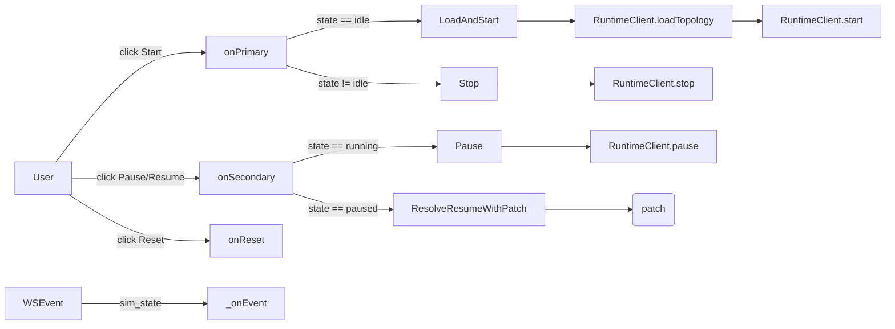

# Web SPA

The SPA is plain ES modules — no framework, no bundler. The whole client
is shipped from `web/` as static assets and loaded by `index.html`.

```
web/
├── index.html           # ~280 lines of markup + <script type="module" src="app.js">
├── styles.css           # all CSS
├── favicon.svg
├── app.js               # entrypoint: imports, wire(), init(), DOMContentLoaded
├── state.js             # state object + persistence + EventTarget bus + sample
├── canvas.js            # SVG rendering, drag, pan/zoom, theme, layout
├── inspector.js         # left nav + right pane, rename/duplicate/delete, context menu
├── terminals.js         # per-device terminal popups
├── packets.js           # packet animation + tooltips
├── packetstore.js       # PacketStore — in-flight registry, hop history, NAT cache, #N counters
├── packetspanel.js      # Packets panel — toolbar button, mounts inside #inspector, row rendering, hover halo
├── sim.js               # Sim state machine + RuntimeClient + WS dispatcher
├── yaml-io.js           # YAML import / export
└── utils.js             # DOM helpers (el, escapeHtml, toast, ...)
```

The intent of the split is one module per concern, with cross-component
coordination flowing through the `bus` (see below) rather than direct
inter-module render calls.

## The event bus

`state.js` exports a singleton:

```js
export const bus = new EventTarget();
```

Every cross-component reaction flows through it. The contract has two
sides:

- **State mutations + cross-component re-renders → bus.** When `inspector.js`
  renames a device, it mutates `state` and dispatches
  `state:topology-changed`; `canvas.js` and the inspector both
  re-render in response.
- **Synchronous queries + DOM helpers → direct imports.** `canvas.lookupDeviceNode`,
  `utils.el`, `utils.escapeHtml` are imported directly because they're
  read-only and have no side effects.

The contract is enforced by convention, not by tooling. Don't reintroduce
module-to-module direct render calls.

### Event kinds

| Event | Emitted by | Consumed by | Trigger |
|---|---|---|---|
| `state:topology-changed` | `inspector`, `state`, `app` | `canvas`, `inspector` | Any mutation to networks/links/hosts/routers/display |
| `state:topology-loaded` | `state` (loadSample), `yaml-io` (importYaml) | `canvas` (fitView), `inspector` | Wholesale topology replacement |
| `state:selection-changed` | `canvas`, `inspector`, context menu | `inspector` | User selected a node |
| `sim:status-changed` | `sim` | `inspector`, `canvas` | Sim transitioned (idle/running/paused) |
| `sim:packet` | `sim` (from WS) | `packets` | Server emitted a packet event |
| `sim:routing-table-changed` | `sim` (from WS) | `inspector` (re-fetch routes if selected) | Server emitted a route change |
| `sim:nat` | `sim` (from WS) | packet tooltip renderer | A router performed source or destination NAT on a packet. Outbound carries `{router, direction, original_src, rewritten_src, dst, flow_id, payload_id}`; inbound carries `{router, direction, rewritten_dst, original_dst, src, flow_id, payload_id}`. `flow_id` is the conversation UUID (same value as `flow` on the `packet` event, and same value the router's NAT table is keyed on). |
| `sim:nat-table-changed` | `sim` (from WS) | `inspector` (NAT table panel) | A router's NAT table was mutated. Carries `{device}` in detail; the full snapshot is mirrored into `state.natTables[device]` for the inspector to render. |
| `sim:packet-arrived` | `packets` (animation finish) | `packetstore` | A packet animation completed at its destination device. Detail: `{payloadId, device}`. Drives last-hop promotion in the store. |
| `packets:list-changed` | `packetstore` (debounced ~50ms) | `packetspanel` | The store's in-flight or recent set mutated. Panel re-renders on receipt. |
| `packets:chatter-badges-changed` | `packetspanel` | `packets` | The chatter group's expand state flipped; live chatter dots add/remove their `#R*` badges. |
| `packets:dot-appeared` | `packets` (after appendChild) | `packetstore` | A new packet dot was appended to the canvas layer. Detail: `{payloadId}`. Drives the panel's visibility filter — rows stay hidden until their dot is on screen. |
| `sim:yaml-export-requested` | `sim.onPrimary` | `app.js` | Sim needs current YAML to load before starting |
| `sim:topology-import-requested` | `sim.onReset` | `app.js` | Sim received reset; refresh canvas from server YAML |
| `view:changed` | `canvas` | (none currently — kept for future) | Pan/zoom |

The `sim:yaml-export-requested` event uses a synchronous request/response
pattern: the listener mutates `event.detail.yaml` before the dispatch
returns. This is a temporary bridge to module-local `exportYaml`/
`importYaml` until those are fully decoupled from the canvas.

## State shape (`web/state.js`)

```js
export const state = {
  asName: 'test_as',
  networks: { /* name -> { cidr, x, y, w? } */ },
  links:    { /* name -> { cidr, x, y } */ },
  hosts:    { /* name -> { network?, link?, address, gateway?, x, y } */ },
  routers:  { /* name -> { x, y, interfaces: { ifn -> { network?, link?, address, cost } } } */ },
  selection: { kind, name } | null,
  view: { x, y, k },        // pan + zoom
  display: { showCosts, showIfaces },
};
```

Notes:

- A host has **either `network:` or `link:`**, never both. Same on every
  router interface. The constraint mirrors the YAML schema and the parser.
- Network coordinates `(x, y)` mark the LAN rail's center; the rail's
  main-axis length is `w` (defaults to `RAIL_DEFAULT_WIDTH = 180`).
- Persistence is `localStorage[STORAGE_KEY = 'loom.topology.v5']` —
  serialised on a 200 ms debounce after any `markDirty()` call.
- The bundled `SAMPLE` is the SPA's first-run fallback when local storage
  is empty.

## The Sim state machine (`web/sim.js`)

The SPA mirrors the server's `idle / running / paused` machine. Two
write paths:



`Sim.patch` accumulates operations while paused. When the user clicks
**Resume**, `reconcilePatch(patch)` rewrites the queued `add_*` ops to
pick up the **latest** values from `state` (so a network that was added
then renamed lands in the patch with its current name), and drops any op
whose target was deleted before resume. The reconciled list is sent to
`POST /sim/resume`.

When the WebSocket reports a `sim_state` change, the SPA mirrors it
locally and fires `sim:status-changed` so the canvas and inspector can
update lock states (the **+ Add LAN / Host / Router** buttons disable
while running).

## Canvas (`web/canvas.js`)

SVG-based, with three coordinate systems:

- **World** — the canonical coordinates stored in `state` (every node
  has `x, y`).
- **View** — world coordinates with `state.view` (pan + zoom) applied;
  this is what the user sees.
- **Screen** — view coordinates translated by the SVG's bounding
  rectangle (for mouse-event math).

Helpers: `screenToWorld`, `worldToView`, `applyView`. The pan/zoom
handlers in `wireCanvas` keep the focused world coordinate fixed under
the cursor while zooming.

Drag works in two modes:

- **Single-node drag** — the focused node's `(x, y)` is updated on every
  pointermove; `markDirty()` debounces persistence.
- **Pan** — `state.view.x / y` is updated; `applyView()` re-applies the
  transform without re-rendering nodes.

The `state.display.showCosts` and `showIfaces` toggles change what
labels render around router interfaces. Both are persisted in
`localStorage`.

P2P links render as direct edges between devices (the link's midpoint
label is a draggable indicator). LANs render as a rail with end caps and
ticks at each attached interface; the rail's length is editable via a
handle on each end.

## Inspector (`web/inspector.js`)

The right pane renders a single editable panel per selected node — no
tabs. For routers the panel includes both the interfaces list and the
current routing table; for hosts it includes the network/link
membership and the default gateway; for networks and links it shows
just the name and CIDR.

The routing table fetches via `GET /devices/{name}/routes` on
selection and re-fetches on `sim:routing-table-changed` if this device
is currently selected.

The context menu (right-click on any node) lets you rename, duplicate,
or delete the target with the appropriate prompts. While the sim is
`running`, mutations are blocked with a toast — the user must pause first.

## Terminals (`web/terminals.js`)

A double-click on a host or router opens a floating terminal popup.
Each terminal:

- POSTs to `/devices/{name}/command`.
- Renders the response (`ok` / `error`) line-by-line.
- Supports `Ctrl+L` to clear and `Ctrl+D` to close when the prompt is
  empty.
- Persists position and size in `localStorage` (per-device).

Multiple terminals can be open at once; the simulator emits `packet`
events identically for any caller, so a `ping` from a terminal shows up
on the canvas as the expected animations.

## Packets (`web/packets.js`)

Listens for `sim:packet` events and schedules per-frame SVG animations.
The `PacketAnim.DURATION_MS` (toolbar-tunable, 200–5000 ms) controls per-
hop animation time. The `chatter` toggle (`PacketAnim.muted = true`)
filters `type === "routing_flood"` out of the animation queue.

The packet color/icon comes from the `type` field of the event:

| Type | Visual |
|---|---|
| `user_datagram` | Solid dot (default color) |
| `routing_flood` | Hollow dot (chatter color) |
| `ping_request` | Solid dot with outgoing-arrow icon |
| `ping_reply` | Solid dot with incoming-arrow icon |
| `unknown` | Solid dot, gray |

Each packet animation also creates a small `<text class="packet-badge">` element sibling to the dot, displaying the numeric id (`#N` for user traffic, `#R*` for routing chatter) assigned by `packetstore.js`. The badge rides with the dot via the same `setPacketAnchor` write-step and is removed on `finish()`. Chatter badges only render when `<body data-chatter-badges="on">` is set, which the panel toggles on chatter-group expand/collapse and signals via `packets:chatter-badges-changed`.

The NAT cache previously kept here moved to `packetstore.js` so the tooltip and the panel query the same source.

## Packet store (`web/packetstore.js`)

A singleton registry of packets the simulator is currently animating, plus a small ring of recently delivered ones. Subscribes to `sim:packet`, `sim:packet-arrived`, `sim:nat`, and `sim:status-changed`. Emits `packets:list-changed` (debounced ~50 ms) so the Packets panel can re-render after bursts.

Shape:

```js
export const PacketStore = {
  inFlight:      Map<payload_id, PacketRow>,                         // user traffic (datagrams, pings)
  chatter:       Map<"pid|dev|iface|net", ChatterRow>,               // routing floods, composite key
  recent:        PacketRow[],                                        // FIFO cap 10, user traffic only
  natByPayload:  Map<payload_id, NatHop[]>,                          // relocated from packets.js (was _natByPayloadId)
  _nextUserId:   1,                                                  // monotonic; reset on sim stop
  _nextChatterId: 1,                                                 // independent monotonic
};
```

- A user-traffic row moves from `inFlight` → `recent` when the matching `sim:packet-arrived` fires for the final hop (`evt.dst.address === payload_dst`).
- Chatter rows are keyed by a composite `"payload_id|srcDev|srcIface|network"` string so that N emissions of the same `RoutingMessage` (one per router interface) each get a distinct store row, badge, and hover-halo hit-target. Chatter rows leave the `chatter` map on arrival (or after a 2 s TTL) and don't enter `recent`.
- Counters reset to 1 on `sim:status-changed → idle`. They persist across pause/resume.
- While paused, `_scheduleEmit()` is suppressed and chatter TTL deletions are deferred to `_pendingChatterDeletes`; both are flushed on resume so the panel stays frozen during a pause.
- The NAT cache lives here so both the panel and the `packets.js` tooltip query the same source. `PacketStore.natFor(payloadId)` returns the list (or `[]`).
- `PacketStore.idFor(evt)` resolves the numeric id used as the on-canvas badge text.

## Packets panel (`web/packetspanel.js`)

The panel listing in-flight packets and recent activity. Wires the `tb-packets` toolbar button and mounts the panel inside the `#inspector` slot. When open, sets `data-packets-open` on the inspector host; a CSS rule (`#inspector[data-packets-open] > *:not(#packets-panel) { display: none }`) hides every non-panel child — including children inserted by a later inspector re-render. Because `inspector.js` uses `innerHTML =` to re-render on `state:selection-changed` and `state:topology-changed` (which destroys the `#packets-panel` child), `packetspanel.js` subscribes to those same events and re-appends the panel when it is open. Open/closed state is persisted under `state.ui.packetsPanelOpen`.

Three sections, rendered from `PacketStore`:

- **In flight — user traffic.** One row per `payload_id`. Expand for hop history + NAT lines.
- **In flight — routing chatter.** Collapsed summary by default. Expanding flips `<body data-chatter-badges="on">` and dispatches `packets:chatter-badges-changed`, so `packets.js` adds `#R*` text labels to chatter dots that are already mid-tween. Collapsing reverses it. Each row in the expanded list represents one logical `RoutingMessage` (one `payload_id`), aggregated across all of its N interface emissions via `PacketStore.visibleChatterGroups()`. The emission count is shown as `×N`. Canvas dots retain their unique composite keys (`payload_id|dev|iface|net`); the group row carries `data-emission-keys` (space-separated list of composite keys) so hover halos every dot belonging to the group.
- **Recent.** Last ten delivered user-traffic rows, FIFO. Routing chatter is excluded from this section to keep it readable.

Hovering a row adds class `halo` to the corresponding canvas dot (matched by `dot.dataset.payloadId`). For chatter group rows, all emission dots (listed in `data-emission-keys`) are haloed simultaneously.

The panel re-renders on every `packets:list-changed` event; expensive layout is avoided by re-rendering the entire body innerHTML on each tick (the panel is small).

## YAML I/O (`web/yaml-io.js`)

Exports two functions:

- `exportYaml()` — serializes `state` to the YAML shape the parser
  expects. Used by the **Export** button and by `Sim.onPrimary` when
  loading-then-starting.
- `importYaml(text, hooks)` — parses YAML into the SPA's state shape and
  refreshes the canvas via `hooks` (`ensurePositions`, `fitView`,
  `renderAll`). Used by the **Import** button and by `Sim.onReset`.

The hooks parameter exists because `yaml-io.js` is intentionally
DOM-free — it can be unit-tested without happy-dom. The hooks are
injected by `app.js`.

## Testing (vitest)

Each module has a co-located `*.test.js` exercising its public seams:

- `utils.test.js` — `el`, `escapeHtml`, `toast`.
- `state.test.js` — persistence, sample loading, mutation events.
- `sim.test.js` — `RuntimeClient` (mocked fetch + WS), `Sim` state
  transitions, `reconcilePatch` edge cases.
- `canvas.test.js`, `inspector.test.js`, `packets.test.js` — DOM-level
  tests under happy-dom.
- `packetstore.test.js` — store lifecycle, hop tracking, FIFO cap, chatter counter, NAT cache, debounced emission (uses `vi.useFakeTimers()` for the debounce check).
- `packetspanel.test.js` — toolbar toggle + persistence, in-flight rendering, chatter section expand/collapse, recent section, hover halo.

End-to-end tests under `e2e/spa.spec.js` run against a real Chromium and
a real FastAPI server (booted by Playwright's `webServer`).
