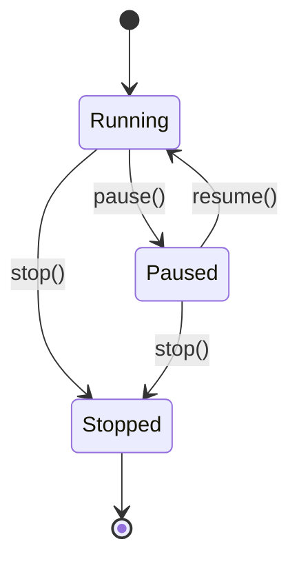

> 🌐 [English](../../architecture/concurrency.md) · **Español**

# Concurrencia

`loom` ejecuta el núcleo del simulador sobre **hilos**, no sobre asyncio. El
event loop de asyncio está reservado para el servidor FastAPI. Este documento
explica el inventario de hilos, la primitiva `PauseGate` que los mantiene
cohesionados, y el ciclo de vida de un paquete desde `send_to` hasta su entrega.

---

## Inventario de hilos

Por proceso del simulador, además del event loop de asyncio:

| Propietario | Cantidad | Iniciado por | Cuerpo del loop |
|---|---|---|---|
| `Interface` | 1 por interface (host + router) | `Interface.__init__` | `_pkt_loop` — desencolar de `_in_queue`, luego verificar el gate, despachar a `_device.handle_packet` |
| `Network` / `Link` (`_FabricBase`) | 1 por fabric | `_FabricBase.__init__` | `_pkt_loop` — verificar el gate, desencolar de `_in_queue`, llamar a `_dispatch_packet` |
| `LinkStateProtocol` | 1 por router | `LinkStateProtocol.__init__` | `_protocol_loop` — esperar en `_wake_event`/`Scheduler`, despachar hello/lsa-refresh/max-age-sweep |

Todos los hilos son **daemons** (`daemon=True`). La salida del proceso los
termina incondicionalmente; el cierre limpio se realiza a través de `AS.stop()`.

Ningún hilo worker retiene el GIL por mucho tiempo. En cada iteración,
el hilo se bloquea en un `queue.Queue.get`, en `gate.wait_or_stop` (dentro de
`wait_for_gate`), o en `_wake_event.wait`. El GIL se libera durante los tres.

---

## El `PauseGate`

```python
class PauseGate:
    def __init__(self):
        self._running = threading.Event()
        self._running.set()           # default: running
        self._stopped = threading.Event()
```

Un gate de dos estados (running/paused) más una señal de stop absorbente. Tres
métodos públicos manejan las transiciones:

- `pause()` — limpia `_running`.
- `resume()` — establece `_running`.
- `stop()` — establece `_stopped` **y** establece `_running` (para que cualquier hilo
  bloqueado en `_running.wait` se despierte y pueda observar `_stopped`).

Los workers **no** llaman a `gate.wait_or_stop()` directamente. En cambio,
llaman a la función auxiliar de nivel de módulo `wait_for_gate(gate, stop_event)`
de `entities/clock.py`:

```python
def wait_for_gate(gate, stop_event, poll=_PAUSE_POLL_INTERVAL) -> bool:
    """Block until the gate is RUNNING, or until the caller's stop event fires.

    Returns True  — gate is running (or absent): caller should proceed.
    Returns False — gate was stopped, or stop_event was set: caller should exit.

    When paused, polls every poll seconds and re-checks stop_event each time,
    so stop() is noticed within one poll interval rather than after the full
    join timeout.
    """
    if gate is None:
        return True
    while not stop_event.is_set():
        running, stopped = gate.wait_or_stop(timeout=poll)
        if stopped:
            return False        # AS gate stopped
        if running:
            return True         # gate resumed — proceed
        # (False, False): timeout while paused — re-check stop_event
    return False                # stop_event was set by caller's stop()
```

`wait_for_gate` es la primitiva canónica de gate para todos los workers de
paquetes y para la verificación del gate en el protocol loop. `PauseGate.sleep`
no es utilizado por ningún worker loop; su único llamador es la espera
entre sondeos del comando ping (`server/command/host.py`), que duerme entre sondeos.

Mapa de ciclo de vida:



El `AS` posee exactamente un `PauseGate`. Cada hilo worker del AS hace gate
sobre la misma instancia. Así es como `SimState.pause()` congela la
*simulación completa* — plano de datos y protocolo de ruteo — de forma atómica.

---

## Ciclo de vida de un paquete

Un `UserMessage` enviado desde `h1` a `h3` fluye a través de colas e hilos
de la siguiente manera. Códigos de color: `[q]` = límite de cola, `[t]` = cambio de hilo.

```
Caller thread                                  Per-interface / per-fabric daemons
─────────────                                  ──────────────────────────────────

h1.send_message_to(msg, h3.address)
    │ packet = Datagram(src=h1, dst=h3, payload=msg)
    │ dst_addr = gateway  (off-link destination)
    │
    ▼
h1.iface.send_to(packet, dst=gw)
    │ frame = Frame(src=h1.iface, dst=gw, payload=packet)
    │ EventTracer._broadcast({"kind":"packet", ...})
    │ self._out_queue.put(frame)          ← [q] frame -> lan1._in_queue
    │
[t]─────────────────────────────────────►  lan1._pkt_loop wakes
                                              │ wait_for_gate(...) → running
                                              │ self._dispatch_unicast(frame, dst=gw)
                                              │ self._interfaces[gw].receive(frame)
                                              │   self._in_queue.put(frame)   ← [q] frame -> r1.eth0._in_queue
                                              │
[t]─────────────────────────────────────►  r1.eth0._pkt_loop wakes
                                              │ dequeued frame; wait_for_gate(...) → running
                                              │ r1.handle_packet(payload, self)
                                              │   dst != iface.address → _handle_forwarding(packet)
                                              │   packet.decrement_ttl()
                                              │   match = routing_table.match(h3.address)
                                              │   out_iface, next_hop = match.interface(), match.next_hop()
                                              │   if next_hop is NullAddress: next_hop = packet.destination()
                                              │   out_iface.send_to(packet, next_hop)
                                              │     frame' = Frame(src=r1.eth1, dst=h3, payload=packet)
                                              │     self._out_queue.put(frame')   ← [q] frame' -> lan2._in_queue
                                              │
[t]─────────────────────────────────────►  lan2._pkt_loop wakes  → h3.iface._in_queue
[t]─────────────────────────────────────►  h3.iface._pkt_loop wakes
                                              │ h3.handle_packet(payload, self)
                                              │   dst == iface.address → _handle_message(UserMessage)
                                              │   EventTracer.message_received(...)
```

Tres colas se encuentran en el camino: `h1.iface→lan1`, `lan1→r1.eth0`,
`r1.eth1→lan2`, `lan2→h3.iface`. Cada una es un `queue.Queue` (sin límite).
El flujo involucra cuatro cambios de hilo y una búsqueda en la tabla de ruteo.

**Interposición NAT:** cuando un router se ubica en el límite entre una red
privada y una pública, NAT puede reescribir direcciones durante el paso de
forwarding — no se involucran hilos adicionales. En el camino de salida, si la
dirección de origen es privada y la interface de egreso elegida es pública, el
origen se reescribe a la dirección pública del router y la traducción se registra
en la tabla NAT del router. En el camino de entrada, antes de la verificación
habitual del destino, si el destino entrante coincide con una traducción registrada,
el destino se reescribe de vuelta al host privado original y el paquete reingresa
al forwarding normalmente. La tabla NAT es por router y está protegida por un
único lock; cuando alcanza su capacidad, la entrada menos recientemente utilizada
se desaloja — no existe expiración basada en tiempo. La clave de traducción utiliza
la **clave de flujo de conversación** (`payload.flow_key()` — un UUID estable
a través de las reescrituras NAT) para que flujos concurrentes de dos hosts
privados con secuencias que colisionan no colisionen en la entrada NAT — ver
[nat.md](nat.md).

**Comportamiento al pausar:** si el gate cambia a paused entre cualquier par de
hilos de esta cadena, el frame permanece encolado y el hilo receptor se bloquea
en la siguiente llamada a `wait_for_gate`. No se pierden frames; no se emiten
eventos `packet` mientras está pausado; al reanudar se continúa desde donde se
pausó.

Hay un sutil re-encolado en `_FabricBase._pkt_loop` para mantener los frames
pausados visibles en `_in_queue`:

```python
try:
    packet = self._in_queue.get(timeout=0.05)
except queue.Empty:
    continue
if packet is None:
    self._stopped = True
    continue
if self._gate is not None and not self._gate.is_running():
    # Gate flipped to paused between the wait_for_gate above and the dequeue:
    # put the packet back so it stays observable in the queue.
    self._in_queue.put(packet)
    continue
```

Esto mantiene la profundidad de la cola honesta para las herramientas que la
inspeccionan (p. ej., los tests).

### Diferencias entre el loop de Interface y el de fabric

`Interface._pkt_loop` y `_FabricBase._pkt_loop` usan **órdenes opuestos de
gate/desencolar**:

- `Interface._pkt_loop` — **desencolar-luego-gate**: se bloquea primero en
  `queue.get()`, luego llama a `wait_for_gate` antes de despachar. Sin
  re-encolado al pausar; el frame desencolado se mantiene en una variable local.
- `_FabricBase._pkt_loop` — **gate-luego-desencolar**: llama primero a
  `wait_for_gate`, luego hace un `queue.get` con timeout corto. Al pausar entre
  los dos, vuelve a encolar el frame para mantener la profundidad de la cola precisa.

---

## Stop event por worker y orden stop-antes-de-sentinel

Cada `Interface` y `_FabricBase` posee un **`_stop_event` por worker**
(`threading.Event`) junto al `PauseGate` compartido. Los dos juntos
brindan a los workers tres caminos independientes para salir:

1. **Señal de stop del gate** — `PauseGate.stop()` despierta `gate.wait_or_stop`
   dentro de `wait_for_gate`; el wrapper retorna `False` y el loop sale.
2. **`_stop_event` por worker** — `wait_for_gate` consulta `stop_event.is_set()`
   en cada ciclo de pausa, de modo que un worker *pausado* detecta `stop()` dentro
   de un `_PAUSE_POLL_INTERVAL` (0,1 s) sin que el gate deba reanudar primero.
3. **Sentinel `None` en la cola** — `Interface.stop()` y
   `_FabricBase.stop()` colocan `None` en `_in_queue` para despertar a un worker
   bloqueado en `queue.get`.

**Orden crítico:** `stop()` establece `_stop_event` **antes** de colocar
el sentinel `None`:

```python
# Interface.stop() and _FabricBase.stop() both follow this pattern:
self._stop_event.set()          # (1) workers parked on wait_for_gate will see this
self._in_queue.put(None)        # (2) wakes workers blocked on queue.get
```

Este orden garantiza que un worker pausado (bloqueado dentro de `wait_for_gate`)
vea el flag de stop en su próxima consulta en lugar de esperar a que el gate
reanude primero. Sin esto, `stop()` sobre una simulación pausada quedaría
colgado hasta que se llamara `resume()`.

---

## Mutex de editor y atomicidad de edición en vivo

`SimState` posee un `threading.Lock` llamado `_edit_lock` que serializa
las mutaciones de topología sin importar qué hilo o endpoint las inicie.

Tres operaciones adquieren `_edit_lock` antes de hacer cualquier trabajo:

| Operación | Guard de estado |
|---|---|
| `SimState.edit(patch)` (`POST /sim/edit`) | Requiere `running`; devuelve error `409` en caso contrario |
| `SimState.resume(patch)` (`POST /sim/resume`) | Requiere `paused`; devuelve error `409` en caso contrario |
| `SimState.stop()` (`POST /sim/stop`) | Cualquier estado → `idle` |

Dentro de `edit` y `resume`, el orden adquirir-antes-de-validar es:

```
_edit_lock acquired
  → validate every op (abort on first failure, release lock, return 400)
  → apply every op in sequence
  → broadcast topology_changed event
_edit_lock released
```

Esto es **validar-todo-luego-aplicar-todo**: o la totalidad del parche se
aplica o nada se aplica. Dos llamadas concurrentes a `POST /sim/edit` no pueden
intercalar sus operaciones.

`resume` y `stop` también toman `_edit_lock` antes de llamar a
`PauseGate.resume()` / `PauseGate.stop()`. El orden siempre es
`_edit_lock` → `_lock` (el lock de la máquina de estados dentro de `SimState`):
nunca `_lock` → `_edit_lock`, o un deadlock es posible.

### Snapshot en lectura en el hot path de despacho

Tanto los caminos de despacho de `Network` como de `Link` iteran sobre las
interfaces adjuntas con:

```python
for iface in list(self._interfaces.values()):
    ...
```

La llamada a `list(...)` toma un snapshot de los valores del dict. Una `edit`
concurrente que agregue o quite una interface no provocará nunca un
`RuntimeError: dictionary changed size during iteration`. Los frames en tránsito
hacia una interface que se quite concurrentemente simplemente se descartan en su
destino — un artefacto transitorio aceptable.

El snapshot funciona porque `list()` está implementado en C y drena la vista de
valores en un único paso de nivel C ininterrumpido antes de retornar. Un loop
Python-level `for x in d.values():` no tiene esta protección: CPython lanza
`RuntimeError` cuando la versión interna de un dict cambia entre dos llamadas
sucesivas a `__next__` sobre el mismo iterador, independientemente del tamaño
del dict. El wrapper `list(...)` es por tanto estructuralmente necesario, no
cosmético.

### Orden de detach en la eliminación

`_apply_op` para `remove_host` y `remove_router` sigue un orden estricto:

**`remove_host`:**

1. **Desadjuntar la interface de su fabric** (`host.network().remove_interface(addr)`)
   antes de detener el hilo de la interface. Esto garantiza que el dispatch loop
   del fabric ya no pueda encolar frames en la interface después de que se haya
   señalado al hilo que detenga.
2. **Detener el hilo de la interface** (`host.interface().stop()`).

**`remove_router`:**

1. **Detener primero el hilo del protocolo de ruteo** (`router.stop()`). Esto
   inunda un LSA de retiro para que los vecinos purguen el router inmediatamente,
   y detiene el hilo del protocolo antes de que se desadjunte alguna interface.
2. **Por cada interface: desadjuntar de su fabric, luego detener el hilo de la
   interface.** `iface.network().remove_interface(iface.address())` garantiza que
   el dispatch loop del fabric ya no pueda encolar frames en esa interface;
   `iface.stop()` luego señala al hilo que salga.
3. **Eliminar el router del dict del AS.**

**`remove_network`:**

`remove_network` solo se permite cuando la red no tiene interfaces adjuntas
(lo impone `_validate_op`). Por tanto, simplemente detiene el hilo del fabric
y elimina — sin nada que desadjuntar.

El invariante clave es **detach-before-stop-interface-thread**: eliminar una
interface de su fabric antes de detener el hilo de la interface garantiza que el
dispatch loop no pueda encolar un frame huérfano en una cola cuyo consumidor ya
ha salido.

---

## Cierre

`AS.stop()` es el camino ordenado:

1. `self._gate.stop()` — establece `_stopped` y `_running`. Cualquier worker
   bloqueado en `_running.wait` (dentro de `wait_for_gate`) se despierta y
   observa stop en su próxima verificación.
2. Por cada red: `Network.stop()` → por cada interface adjunta:
   `Interface.stop()` (que establece `_stop_event` y luego coloca `None` en
   el `_in_queue` de la interface) → colocar `None` en el `_in_queue` del fabric.
3. Por cada link: igual que para las redes.
4. Por cada router: `LinkStateProtocol.stop()` establece `_stop_event`, establece
   `_wake_event` (despertando inmediatamente un protocol loop en espera), y hace
   join del hilo del protocolo.

El sentinel `None` es la señal universal de "drenar y salir" para los
consumidores de cola. Combinado con el `_stop_event` por worker y la señal de
stop del gate, da tres formas independientes para que un worker sepa que es
momento de salir — importante porque un worker puede estar bloqueado en la cola,
en `wait_for_gate`, o dormido dentro de `_wake_event.wait` en cualquier momento.

---

## Protocol loop y `_wake_event`

`LinkStateProtocol._protocol_loop` no usa `gate.sleep` ni un atributo
`keepalive` periódico. En cambio, maneja tres timers con nombre a través de
un `Scheduler` y se bloquea en un `_wake_event` por instancia:

```python
def _protocol_loop(self):
    gate = self._router.gate()
    # Initial tick: hello + LSA at t≈0 (unjittered).
    now = time.monotonic()
    if not wait_for_gate(gate, self._stop_event):
        return
    self._safe_tick_initial(now)
    self._schedule_initial_deadlines()

    while not self._stopped:
        now = time.monotonic()
        wait_for = max(0.0, self._scheduler.next_deadline() - now)
        self._wake_event.wait(timeout=wait_for)
        self._wake_event.clear()
        if self._stopped:
            break
        if not wait_for_gate(gate, self._stop_event):
            break
        now = time.monotonic()
        for name in self._scheduler.elapsed(now):
            self._dispatch(name, now)
```

En cada iteración el loop duerme hasta que se dispara el próximo timer
programado, o hasta que `_wake_event` se establece con anticipación. Dos
llamadores establecen `_wake_event`:

- **`set_timers()`** — para que un cambio de configuración de timer en vivo
  surta efecto en la próxima iteración del loop en lugar de esperar al timer
  anterior.
- **`stop()`** — para que un loop en espera salga inmediatamente en lugar de
  dormir hasta el próximo vencimiento.

`_dispatch` enruta cada nombre de timer vencido a uno de tres manejadores:

| Nombre del timer | Manejador | Qué hace |
|---|---|---|
| `hello` | `_emit_hello_on_up_interfaces` | Broadcast Hello en cada interface activa |
| `lsa_refresh` | `_emit_lsa_on_up_interfaces` | Emitir LSA local + saliente en cada interface activa |
| `maxage_check` | `_sweep_dead_and_expired` | Purgar vecinos muertos y LSAs vencidos; recomputar SPF si hubo cambios |

Después del tick inicial sin jitter, cada timer se reprograma con jitter por
tick en `[0.75·T, 1.25·T]` a través del `Scheduler`.

---

## Reinicios idempotentes

`LinkStateProtocol.start` es idempotente sobre un hilo en ejecución y
limpia explícitamente tanto `_stopped` como `_stop_event` antes de reiniciar:

```python
self._stopped = False
self._stop_event.clear()
if self._protocol_thread is not None and self._protocol_thread.is_alive():
    return                            # idempotent on running
self._protocol_thread = threading.Thread(...)
self._protocol_thread.start()
```

El clear-before-check es importante: el ciclo de carga/start de SimState
(el Parser construye routers → `load_from_session` los detiene → `/sim/start`
los inicia) recorre este camino cada vez, y sin el clear, el hilo observaría
`_stopped=True` obsoleto en su próximo retorno de `_wake_event` y saldría
silenciosamente.

Esta es una clase de bug real que el proyecto encontró y corrigió; el comentario
en `LinkStateProtocol.start` explica la trampa.

---

## ¿Por qué hilos y no asyncio?

El núcleo del simulador usa hilos en toda su extensión. Cada `Interface` y cada
`Network` es conceptualmente una pieza autónoma en movimiento, y `queue.Queue` +
`threading.Event` brindaron las primitivas adecuadas sin un event loop.

Cuando se agregó la web UI, el event loop de asyncio entró en escena **solo
para el límite de red**. El puente es `server/events.py`:

```python
self._loop.call_soon_threadsafe(self._enqueue, q, event)
```

Los hilos worker emiten eventos, el event loop de asyncio los distribuye a
WebSockets. No hay código asíncrono en el simulador, ni `asyncio.Lock`, ni
`asyncio.run_in_executor`. Agregar async al núcleo del simulador requeriría
reescribir `PauseGate` y cada `_pkt_loop`; no hay beneficio a la escala del
simulador.

La desventaja de los hilos es que **un suscriptor con mal comportamiento o una
cola atascada puede colgar todo el AS**. Las capas defensivas son:

- `EventTracer._broadcast_instance` toma un snapshot de los suscriptores bajo
  un breve lock de instancia (`_sub_lock`), libera el lock, luego distribuye
  — un suscriptor con mal comportamiento no puede detener el broadcast, y el
  lock no se mantiene durante la distribución.
- `EventBus.emit` de manera similar toma un snapshot de `_queues` bajo su lock
  de instancia antes de liberar e iterar — el lock no se mantiene mientras se
  encola en las colas individuales de WebSocket.
- `_FabricBase._pkt_loop` e `Interface._pkt_loop` envuelven el despacho
  en `try/except Exception` + logging — un manejador con bugs no mata al worker.
- El `EventBus` impone un límite de 1000 eventos por cola; en caso de
  desbordamiento descarta el evento más antiguo e incrementa `overflow_count`.
  Un consumidor de WebSocket lento no ancla la memoria.

---

## Características de escalabilidad

`loom` está construido para la enseñanza, no para la carga. La arquitectura
con hilos es honesta a pequeña escala y predecible en cómo degrada a gran
escala. El número de hilos crece linealmente con el tamaño de la topología:

```
threads ≈ H + R·K + N + L + R + 1
        (host)  (router)  (fabric)  (protocol thread)  (asyncio loop)
```

La mayoría de los hilos están limitados por I/O y liberan el GIL en
`queue.Queue.get()` o `threading.Event.wait()`, por lo que los hilos inactivos
no tienen casi ningún costo — aproximadamente 8 KB de stack cada uno en Linux.
El cuello de botella **no es el número de hilos en sí**; es la serialización
a través de locks compartidos y la ejecución single-threaded de bytecode Python
por parte de CPython.

### Límites prácticos

Umbrales aproximados contra CPython 3.11 en Linux, con el protocolo de ruteo
en el intervalo hello predeterminado de 10 s:

| Tamaño de topología | Hilos | Qué funciona | Qué empieza a fallar |
|---|---|---|---|
| ≤100 routers | ≤1000 | Convergencia en segundos | Nada |
| ~500 routers (~25 ASes a escala del ejemplo) | ~2500 | La simulación sigue corriendo | `EventTracer._broadcast` y `EventBus.emit` se saturan bajo sus locks de suscriptor / cola; los consumidores de WebSocket ven lag |
| ~1000+ routers | >5000 | El protocolo de ruteo sigue convergiendo, lentamente | La serialización JSON de WebSocket ancla una CPU |
| ~5000+ routers | >25000 | No viable con hilos + GIL | Los dispatch loops necesitarían migrar a asyncio |

Estas son estimaciones de cota superior. Reducir el intervalo hello a
1 s aproximadamente reduce a la mitad el tamaño de topología útil en cada
nivel — el tráfico del protocolo (que domina el tráfico de paquetes) escala
inversamente con el intervalo.

### Orden de cuellos de botella

A medida que el tamaño de la topología crece, los puntos de bloqueo aparecen
en este orden:

1. **Distribución del event bus.** `EventTracer._broadcast` mantiene un breve
   lock de instancia para tomar un snapshot de los suscriptores, luego lo libera
   antes de distribuir. `EventBus.emit` de manera similar mantiene su lock solo
   para tomar un snapshot del conjunto de colas. Con cientos de eventos de
   paquetes por segundo × cada suscriptor de WebSocket, el trabajo de snapshot +
   encolado por cola se serializa.
2. **Contención de cola por fabric.** Cada `_FabricBase._in_queue` es un único
   `queue.Queue` compartido por todas las interfaces adjuntas. En una LAN ocupada
   con muchos dispositivos, el lock de la cola se vuelve caliente.
3. **GIL en el despacho.** `device.handle_packet` y `RoutingTable.match`
   son trabajo de bytecode Python. A unos pocos miles de paquetes por segundo
   agregados entre todos los routers, CPython no puede mantener el ritmo en un
   solo núcleo.
4. **Número de hilos bruto.** Linux pthread + CPython toleran cómodamente
   ~10k hilos; más allá de eso, el propio `pthread_create` se vuelve lento.
