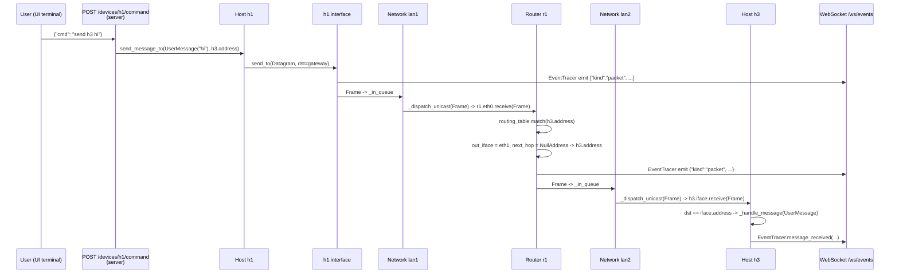
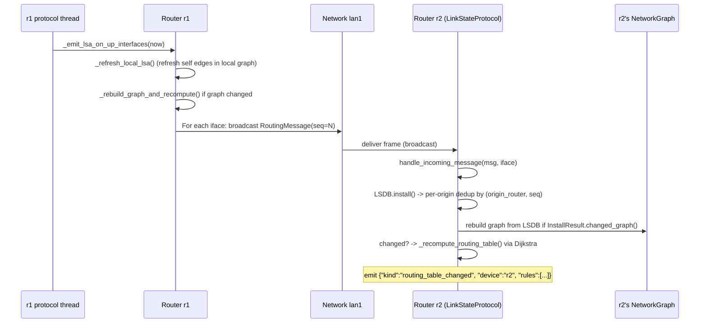
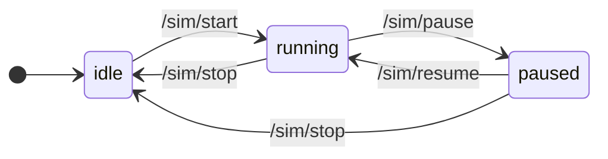
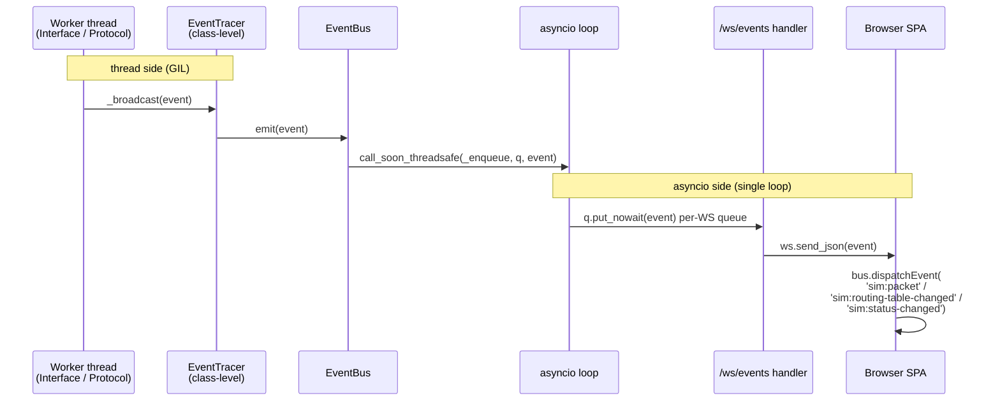

> 🌐 [English](../../architecture/overview.md) · **Español**

# Descripción general de la arquitectura

> **Alcance:** loom es deliberadamente solo L3. No hay L2 (MAC/ARP/STP)
> ni L4 (TCP/UDP/puertos). El simulador existe para hacer observable la
> convergencia de ruteo y el forwarding, no para modelar una pila de red
> completa.

`loom` se divide en cuatro capas que cooperan entre sí, cada una con una
responsabilidad clara y una interfaz estrecha con sus vecinas.

```
┌─────────────────────────────────────────────────────────────────┐
│                Web SPA  (web/, native ES modules)               │
│                                                                 │
│  app.js · state.js · canvas.js · inspector.js · terminals.js    │
│  packets.js · packetstore.js · packetspanel.js · sim.js         │
│  yaml-io.js · utils.js · (see web-spa.md for the full map)      │
│                                                                 │
│  State + cross-component events flow through `bus`              │
│  (EventTarget singleton in state.js).                           │
└──────────────────────────────┬──────────────────────────────────┘
                               │   HTTP (REST: /sim, /topology,
                               │             /devices)
                               │   WebSocket (events from server)
┌──────────────────────────────▼──────────────────────────────────┐
│             FastAPI server (src/server/, async)                 │
│                                                                 │
│  routes/    sim.py · topology.py · devices.py · files.py · ws.py │
│  command/   dispatch.py · host.py · router.py                   │
│  state.py   SimState (idle/running/paused) — owns the AS        │
│  events.py  EventBus — bridges worker threads to asyncio        │
│  persistence.py  source.yaml → source.session.yaml clone        │
└──────────────────────────────┬──────────────────────────────────┘
                               │   Python calls (synchronous,
                               │     cross-thread via PauseGate)
┌──────────────────────────────▼──────────────────────────────────┐
│        Simulator core (src/entities/, src/routing/, threaded)   │
│                                                                 │
│  AS  Router  Host  Network  Link  Interface  Address  Packet    │
│  PauseGate   EventTracer                                        │
│  LinkStateProtocol (loom-OSPF; abstract base: RoutingProtocol)  │
│  + LSDB → NetworkGraph (Dijkstra)                               │
│                                                                 │
│  One daemon thread per Interface, one per Network/Link, one     │
│  protocol thread per Router. All gate on PauseGate.             │
└──────────────────────────────┬──────────────────────────────────┘
                               │   parses, validates
┌──────────────────────────────▼──────────────────────────────────┐
│                Parser + Validator (src/parser/)                 │
│                                                                 │
│  Parser.parse()  →  AS  (or raises ParsingException)            │
│  SystemValidator: address, network, link, device, host          │
└─────────────────────────────────────────────────────────────────┘
                               ▲
                               │ reads
                       samples/sample.yaml
                       (or LOOM_TOPOLOGY)
```

## Modelo de proceso / hilos

Hay un único proceso Python. Dentro de él:

- Un event loop de asyncio (Uvicorn + FastAPI). Gestiona todo el I/O HTTP
  y WebSocket.
- Un **`PauseGate`** perteneciente a la instancia `AS`. Cada hilo worker
  del simulador bloquea en él una vez por iteración del loop.
- Hilos daemon creados por el núcleo del simulador:

  | Propietario | Cantidad | Propósito |
  |---|---|---|
  | `Interface` | 1 por interface | Vacía frames entrantes, los despacha a su dispositivo |
  | `Network` / `Link` (`_FabricBase`) | 1 por fabric | Vacía frames enviados al fabric, los despacha a los peers |
  | `LinkStateProtocol` | 1 por router | flood periódico de Hello/LSA + recálculo SPF |

El escalado de hilos para una topología con H hosts, R routers, N LANs,
L links y un promedio de K interfaces por router es aproximadamente:

```
threads ≈ H                           (one Interface thread per host)
        + R · K                       (Interface threads on routers)
        + N + L                       (one fabric thread per network and link)
        + R                           (one protocol thread per router)
        + 1                           (asyncio loop)
```

Para la topología de ejemplo (H=3, R=3, K=3, N=3, L=1): alrededor de 19 hilos
más el event loop de asyncio. Ver [`concurrency.md`](concurrency.md#características-de-escalabilidad)
para conocer dónde esta curva empieza a ser un problema.

## Flujo de datos: un host envía un mensaje

Cuando `h1` envía un `UserMessage` a `h3` (topología de ejemplo), el mensaje
atraviesa todas las capas:



Dos cosas a tener en cuenta:

1. **Cada evento de paquete llega al WebSocket**, incluso cuando a la SPA solo
   le interesa un subconjunto. `EventTracer._broadcast` es no bloqueante —
   las excepciones de los suscriptores se capturan y se registran para que
   un suscriptor defectuoso no pueda detener al resto.
2. **La decisión de forwarding ocurre enteramente dentro de `Router`**. El
   fabric (`Network`/`Link`) solo sabe cómo despachar un frame a sus peers;
   no hace ruteo. `Router._handle_forwarding` ejecuta longest-prefix match
   contra su `RoutingTable`, decrementa el TTL y entrega el siguiente frame
   a la interface elegida.

Ver [`packets.md`](packets.md) para los tipos de paquetes, y
[`routing-protocol.md`](routing-protocol.md) para saber cómo se puebla la
tabla de ruteo en primer lugar.

## Flujo de datos: convergencia de ruteo

Cuando la simulación comienza (o cualquier router arranca), `LinkStateProtocol._protocol_loop`
hace un tick de forma inmediata y luego sigue cadencias independientes de
hello y refresh (ambas ajustables en tiempo real desde la barra de herramientas;
ver [`routing-protocol.md`](routing-protocol.md) para más detalles):



El flood es **deduplicado en el lado receptor** por router de origen:
`LSDB.install()` rastrea el último número de secuencia visto para cada origen
y descarta mensajes con `seq <= last_seen_seq`. Los mensajes nuevos se
re-floodean por **todas las interfaces excepto** aquella por la que llegaron.

Las tablas de ruteo solo se recomputan cuando el grafo cambia efectivamente:
`_rebuild_graph_and_recompute` llama a `_recompute_routing_table` únicamente
cuando `InstallResult.changed_graph()` es verdadero.
**Conservar ese guard** al editar el protocolo; sin él, las tablas de ruteo
cambian en cada tick del protocolo.

## Máquina de estados: SimState

La capa web agrega un ciclo de vida sobre el núcleo del simulador. Reside en
`src/server/state.py`:



(`/topology` y `/topology/reset` también se aceptan en estado idle y no
cambian el estado — ver las reglas a continuación.)

Reglas aplicadas por `SimState`:

- **`load_from_session`** detiene el AS anterior (si existe) y parsea el
  archivo de sesión con `start_routing=False`, de modo que los routers existen
  pero sus hilos de protocolo no han arrancado — esperan a que se llame a
  `start()`.
- **`start`** reanuda el gate e inicia el hilo de protocolo de cada router.
- **`pause`** pausa el gate. Los frames en tránsito permanecen en cola; los
  hilos bloquean en `wait_or_stop`. No se pierde ningún frame.
- **`resume`** aplica un parche opcional (`add_*` / `remove_*` /
  `update_cost`) de forma atómica — dos fases, **validar todo → aplicar todo** —
  y reanuda el gate.
- **`stop`** descarta el AS por completo y vuelve a `idle`. El siguiente
  `start` requiere cargar una topología.

Ver [`server-api.md`](server-api.md) para el formato de wire y
[`concurrency.md`](concurrency.md) para saber qué hace realmente
`PauseGate.pause()` sobre los hilos worker.

## Plomería de eventos

Los eventos fluyen **hacia afuera** del núcleo del simulador a través del bus
pub/sub de nivel de clase de `EventTracer`:



`EventBus` es un fan-out thread-safe: cada conexión WebSocket tiene su propia
`asyncio.Queue`, con capacidad máxima de 1000 eventos. En caso de overflow,
se descarta el evento **más antiguo** y `overflow_count` se incrementa. El bus
se crea al arrancar la aplicación y se comparte durante todo el ciclo de vida
del proceso.

Tipos de eventos emitidos actualmente:

- `packet` — cada frame que sale de una interface (`Interface.send_to`)
- `routing_table_changed` — cada recálculo (`LinkStateProtocol._recompute_routing_table`)
- `sim_state` — cada transición de estado (`SimState.start/pause/resume/stop`)
- `device_state_changed` — router detenido o reanudado (`Router.halt` / `Router.resume`)
- `interface_state_changed` — interface activada o desactivada (`Interface._emit_state`)
- `lsdb_changed` — LSDB actualizado con un nuevo LSA (`LinkStateProtocol`); emitido pero actualmente no consumido por la SPA
- `neighbor_state_changed` — estado de adyacencia modificado (`LinkStateProtocol._broadcast_neighbor_state_changed`)
- `ping_result` — un echo reply ICMP o timeout (`Host.ping`)
- `topology_changed` — topología mutada mediante una edición en vivo (`SimState.edit`)
- `nat` — un router realizó NAT de origen o destino (`Router._apply_source_nat` / `_reverse_inbound_nat`)
- `nat_table_changed` — la tabla NAT de un router fue mutada (`Router._apply_source_nat`)
- `router_intercept` — un router respondió a un echo ICMP dirigido a una de sus propias IPs (`Router._reply_to_ping`)

## Qué no aparece en este diagrama

Algunos elementos no aparecen arriba deliberadamente porque no encajan en una
capa de forma limpia:

- **`EventTracer.register_message_event`** permite a un caller observar el ciclo
  de vida de un único mensaje (`on_sent` / `on_received` / `on_forwarded`)
  registrando callbacks identificados por la identidad del mensaje. Los
  consumidores que desean un flujo broadcast usan el bus de eventos WebSocket.
- **`Host.ping`** hace su propia sincronización de hilos: un `threading.Event`
  por flujo más un dict `_pending_pings`, despertado por el `PingReply`
  correspondiente. El RTT se obtiene como `time.monotonic() - request_ts`.
- **`Router._handle_forwarding`** **no** lanza excepción al expirar el TTL —
  registra una advertencia y devuelve `None`, descartando el paquete
  silenciosamente.

Para profundizar, ir a:

- [`entities.md`](entities.md) — cada clase en `src/entities/`.
- [`routing-protocol.md`](routing-protocol.md) — flooding + Dijkstra.
- [`concurrency.md`](concurrency.md) — hilos, gates, colas.
- [`parser.md`](parser.md) — YAML → AS.
- [`server-api.md`](server-api.md) — referencia HTTP / WS.
- [`web-spa.md`](web-spa.md) — el mapa de módulos de la SPA.
