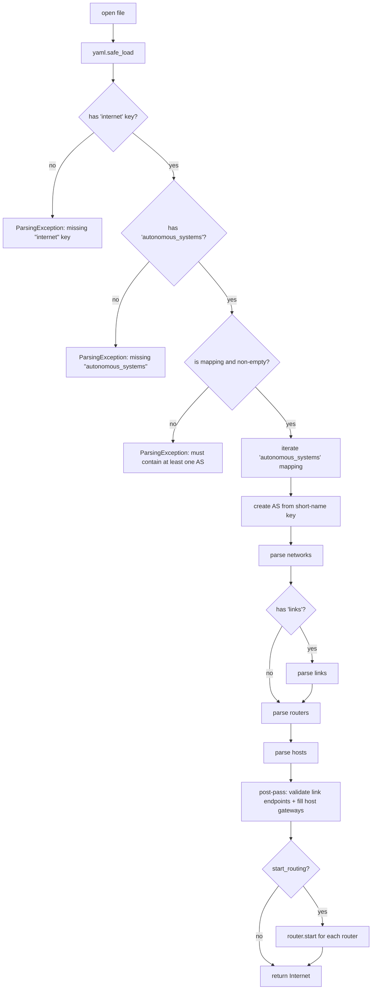

> 🌐 [English](../../architecture/parser.md) · **Español**

# Parser y Validador

El cargador YAML y el validador estructural viven en `src/parser/`. Son el
único camino desde la topología en disco hasta una instancia viva de `Internet`
— todo lo demás en el código base asume que la topología ya está bien formada.

```
parser/
├── parser.py      # Parser — Parser(filename).parse() -> Internet
├── validator.py   # SystemValidator (address, network, link, device, host)
├── exception.py   # ParsingException
└── __init__.py
```

## Forma del nivel superior

El parser espera un documento YAML con una clave obligatoria, `internet:`.
Dentro de ella, un campo opcional `name:` etiqueta la instancia de internet, y
`autonomous_systems:` es un mapeo donde cada clave es el nombre corto del AS.
El layout literal:

```yaml
internet:
  name: loom                 # optional; defaults to 'loom'
  autonomous_systems:
    main:                    # AS short name — the mapping key
      asn: 65000             # optional; reserved for BGP, ignored today
      networks:              # required, may be empty {} (but rarely is)
        lan1: "10.0.0.0/24"
      links:                 # optional
        p2p1: "10.0.0.0/30"
      routers:               # optional (no routers = no routing)
        r1:
          interfaces:
            eth0:
              network: lan1
              address: "10.0.0.1"
              cost: 5
      hosts:                 # optional
        h1:
          network: lan1
          address: "10.0.0.10"
          gateway: "10.0.0.1"
```

El wrapper `internet:` existe para que los archivos YAML del simulador sean
inmediatamente distinguibles de YAML arbitrario y para que futuras extensiones
(links inter-AS, peering BGP) puedan agregar nuevas entradas de nivel superior
sin romper los parsers. El nombre corto del AS es la clave del mapeo bajo
`autonomous_systems:` — no hay un campo `name:` separado dentro de cada bloque
de AS. Cualquier futuro emisor debe producir la misma forma.

## Bloques opcionales `config:`

Dos bloques de configuración opcionales extienden el esquema del nivel superior:

### `internet.config`

Un mapeo arbitrario colocado directamente bajo `internet:`:

```yaml
internet:
  config:
    packet_duration_ms: 2400
    theme: dark
  autonomous_systems: ...
```

El parser valida que el valor sea un mapeo (`dict`), luego llama a
`internet.set_config(config)` para almacenarlo textualmente en el objeto
`Internet`. El backend no interpreta las claves — las almacena de forma opaca
y las re-emite sin cambios en la serialización. Cualquier consumidor de la
topología puede definir sus propias claves aquí.

### `<as>.config.protocol`

Un bloque por AS que establece los timers del protocolo link-state para todos
los routers de ese AS:

```yaml
autonomous_systems:
  main:
    config:
      protocol:
        hello_interval: 5           # seconds; positive number
        lsa_refresh_interval: 15    # seconds; positive number
    networks: ...
```

Reglas de parsing (impuestas por `_parse_protocol_config`):

- `config:` y `config.protocol:` deben ser cada uno un mapeo cuando están presentes.
- `hello_interval` y `lsa_refresh_interval` son ambos requeridos cuando se
  especifica cualquiera de los dos — especificar solo uno lanza `ParsingException`.
- Ambos valores deben ser números positivos (int o float); los booleanos se
  rechazan explícitamente.
- Si están presentes, `_parse_protocol_config` retorna el dict de configuración
  validado, que `_parse_single_as` almacena en el `AS` a través de
  `system.set_protocol_config(protocol_config)`. Después de que `_parse_routers`
  completa, `_parse_single_as` llama a
  `router.protocol().set_timers(**protocol_config)` para cada router.
  Esto ocurre independientemente del flag `start_routing`.
- `dead_interval` (3 × hello) y `max_age` (2 × refresh) permanecen derivados
  de los timers y no se leen ni se escriben en el YAML.

## Flujo de `Parser.parse()`

`Parser(filename).parse()` retorna una instancia de **`Internet`** que contiene
uno o más objetos `AS`. (No un `AS` a secas — el wrapper `Internet` mantiene
el gate, la configuración y el contenedor multi-AS.)



Un error en cualquier paso lanza `ParsingException` con un mensaje descriptivo.
La topología está **parcialmente construida** en ese punto — ya se han lanzado
hilos para redes/links — pero se espera que el llamador (el `SimState` de
FastAPI) llame a `internet.stop()` y la descarte.
No hay rollback dentro del parser.

Tres notas:

1. **`Parser.parse(start_routing=True)` inicia el protocolo de cada router** por
   defecto. La capa del servidor opta por no hacerlo: llama a
   `Parser(...).parse(start_routing=False)` porque la semántica `idle` exige
   que los routers esperen a un `/sim/start` explícito antes de difundir su
   primer Hello. Iniciar y luego detener generaría una condición de carrera
   con el tick inicial y filtraría eventos `packet` en el event bus mientras la
   simulación todavía está en `idle`.
   (`load_from_session` también pasa `start_routing=False` por la misma razón —
   los routers se construyen pero sus hilos de protocolo no se inician.)
2. **Hosts en un link** se parsean *después* del link mismo, pero el peer del
   link puede no estar adjunto todavía (en el caso de dos hosts en el mismo
   link). El parser recolecta `hosts_on_links = [(host, explicit_gw_or_None), ...]`
   durante el paso de hosts, luego resuelve los gateways en `_post_pass_links`
   una vez que todos los endpoints están adjuntos.
3. **El costo por defecto es 1.** Omitir `cost:` en una interface de router
   da `cost=1`; un `cost:` explícito debe ser un entero **positivo** (≥1) —
   `0` y no-enteros se rechazan. El validador no requiere que los costos sean
   únicos o distintos.

## Parsing de direcciones

Cada campo con forma de dirección se parsea mediante `_parse_net_address` (para
prefijos) o directamente mediante `Address(...)` (para hosts), con
`SystemValidator.validate_address` imponiendo la sintaxis dotted-quad y los
rangos de octetos antes de que se ejecute el constructor de `Address`.

Un `NetworkAddress("10.1.2.3/24")` se **canonicaliza** en la construcción —
el parser recibe `10.1.2.0/24` de vuelta, independientemente de lo que haya
escrito el usuario. Esto hace que la igualdad de prefijos (`==`) y las pruebas
de prefijo-dentro-de-prefijo sean correctas incluso cuando el usuario escribe
accidentalmente un bit de host establecido.

## Redes

`_parse_networks` recorre el mapeo `networks:`. Para cada entrada:

1. Parsear y validar la dirección CIDR.
2. Construir un `Network(name, address, gate=system.gate())` — esto ya lanza
   el hilo daemon del fabric.
3. Validar unicidad (sin nombre duplicado, sin dirección duplicada).
4. Registrar en el AS.

Una validación fallida aborta el parsing mediante `ParsingException`. El hilo
ya lanzado será limpiado por `internet.stop()` del llamador.

## Links

`_parse_links` refleja las redes, con una verificación extra: `Link.__init__`
rechaza máscaras distintas de `/30` y `/31`, lanzando `ValueError`. El parser
captura el `ValueError` y lo re-lanza como `ParsingException` para un tipo de
error uniforme.

Reglas del validador (`LinkValidator`):

- La máscara debe ser `/30` o `/31` (misma verificación que el constructor —
  doble seguridad).
- El nombre no debe colisionar con el nombre de una red.
- El nombre no debe colisionar con el nombre de otro link.

El post-pass (`_post_pass_links`) luego impone **exactamente dos endpoints**
por link, lanzando si un link queda con 0 o 1 interfaces después de que el
parsing completa.

## Routers

`_parse_routers` itera el mapeo `routers:`. Para cada router:

1. Requiere un bloque `interfaces:` (no hay routers de cero interfaces implícitos).
2. Para cada interface:
   - `network:` / `link:` mutuamente exclusivos (debe tener exactamente uno).
   - Resolver a la instancia real de `Network` / `Link` (lanzar si no se encuentra).
   - Validar la dirección.
   - Parsear el `cost:` opcional (por defecto 1, debe ser un entero positivo ≥1).
   - Construir un `Interface(...)`, adjuntar al fabric, adjuntar al router.
3. Validar el router ensamblado mediante `DeviceValidator`:
   - La dirección de cada interface debe ser válida para su fabric mediante
     `net.is_valid_host_address(addr)` — rechaza la dirección de red, la
     dirección de broadcast, y cualquier dirección fuera del prefijo.
   - No dos interfaces de ningún router/host comparten una dirección en el mismo fabric.

## Hosts

`_parse_hosts` es similar pero dividido en dos fases:

**Fase 1 — parsing directo y validación parcial** (por host):

1. `network:` / `link:` mutuamente exclusivos.
2. Resolver el fabric; validar la dirección.
3. Parsear el `gateway:` opcional:
   - En un `Network`: aplicar inmediatamente como `Address(gw_str)`.
   - En un `Link`: almacenar el string literal; el post-pass validará
     contra el peer del link.
4. Verificaciones de dirección-en-fabric:
   - En un `Link`: la dirección debe satisfacer tanto `link.contains_address(addr)` como
     `link.is_valid_host_address(addr)`.
   - En un `Network`: `network.contains_address(addr)`, más
     `HostValidator.validate` para la verificación de gateway-en-red.
5. Construir el `Host`, adjuntar su interface al fabric, registrar en el AS.

**Fase 2 — post-pass de link** (`_post_pass_links`):

1. Afirmar que cada link tiene exactamente dos endpoints.
2. Para cada host-en-link:
   - Encontrar la interface peer mediante `link.peer_of(host.interface())`.
   - Si el usuario suministró un `gateway:` explícito, debe coincidir con
     la IP del peer; de lo contrario, `ParsingException`.
   - Establecer el gateway del host a la dirección del peer.

Por esto las declaraciones de host-en-link funcionan sin especificar un gateway
— el parser lo completa una vez que el peer es conocido. Un gateway explícito
está permitido (y validado) por claridad, pero nunca es requerido en un link.

## Validadores

`SystemValidator` es una fachada delgada sobre cinco validadores concretos. Cada
uno retorna un `ValidationResult` (`valid()` o `invalid(reason)`):

| Validador | Qué verifica |
|---|---|
| `AddressValidator` | Sintaxis dotted-quad, rango de octetos `[0, 255]`, sin octetos con cero al inicio |
| `NetworkValidator` | Sin nombre duplicado; sin CIDR público duplicado (los CIDRs privados pueden repetirse para NAT); sin superposición de contenencia de prefijos con ninguna red existente |
| `LinkValidator` | Máscara `/30` o `/31`; sin colisión de nombre con redes u otros links; sin superposición de contenencia de prefijos con ningún fabric existente |
| `DeviceValidator` | La dirección de cada interface pasa `net.is_valid_host_address` (rechaza red + broadcast); no dos interfaces comparten una dirección en el mismo fabric |
| `HostValidator` | Hereda `DeviceValidator`, luego verifica `gateway in network` |

### Validaciones adicionales

Más allá de la tabla de validadores, el parser impone varias reglas directamente:

- **Verificación de tipo de `asn`** (`_parse_single_as`): si `asn:` está presente
  debe ser un entero no negativo; los booleanos se rechazan explícitamente.
  Omitir `asn:` está permitido (por defecto silencioso).
- **Nombres de dispositivo duplicados** (`_check_no_duplicate_device_names`): un
  nombre de host que duplica un nombre de router lanza `ParsingException`
  porque `AS.device()` resuelve los hosts primero, haciendo al router
  inaccesible por nombre.
- **Guards de `autonomous_systems`**: `autonomous_systems:` debe estar presente
  en el bloque `internet:`, debe ser un mapeo, y debe contener al menos un AS.
- **Rechazo de bits de host establecidos** (`_parse_net_address`): un CIDR de red
  donde la porción de host es no-cero (p. ej. `10.0.0.5/24`) se rechaza.
  `NetworkAddress` limpia silenciosamente los bits de host internamente, por lo
  que el parser compara la forma canónica contra la entrada cruda y lanza si
  difieren.
- **Rechazo de octetos con cero al inicio** (`AddressValidator`): los octetos con
  ceros al inicio (p. ej. `010.0.0.1`) se rechazan por no canónicos y
  potencialmente ambiguos.
- **Verificación de superposición de subred por contenencia + exención de
  duplicado exacto** (`NetworkValidator._overlap_checks`): una superposición
  estricta de contenencia de prefijos (A ⊂ B o B ⊂ A, excluyendo duplicados
  exactos) siempre se rechaza — es ambigua para el ruteo por longest-prefix-match.
  Los duplicados exactos (`A == B`) siguen lógica separada: se permiten para
  CIDRs privados (soportando el patrón multi-tenant NAT donde dos redes internas
  reutilizan el mismo bloque RFC 1918) pero se rechazan para CIDRs públicos.

`DeviceValidator._addr_already_used` recorre todos los routers y todos los hosts
para verificar direcciones duplicadas en el mismo fabric. Con unos pocos cientos
de dispositivos esto es suficientemente rápido en la práctica; es proporcional al
número de dispositivos en el AS por llamada de validación.

## Errores y fixtures

Todos los errores se presentan como `ParsingException` con un mensaje que incluye
el nombre de la entidad infractora y la razón subyacente — p. ej.
`r1: eth0: address already in use by r2`, `lan2: invalid netmask 99`,
`p2p1: link CIDR must be /30 or /31, got /28`.

La suite de tests ejecuta `Parser.parse()` contra **fixtures YAML deliberadamente
inválidos** bajo `test/resources/`:

- `invalid_host_address.yaml`, `invalid_netmask.yaml`,
  `invalid_router_address.yaml`, ... — afirman el mensaje del validador
  correspondiente.
- `link_three_endpoints.yaml`, `link_one_endpoint.yaml`,
  `link_no_endpoints.yaml`, `link_too_wide.yaml`, ... — afirman errores
  específicos de link.
- `missing_as.yaml`, `no_networks.yaml` — afirman errores estructurales.

**La mayoría de los fixtures bajo `test/resources/` están intencionalmente
rotos** — existen para afirmar que el parser los rechaza con el mensaje correcto.
No deben "corregirse". Los nuevos modos de error del parser/validador deben agregarse
como fixtures adicionales referenciados desde `test/test_parser.py`.

## Dónde se llama al parser

| Llamador | Qué hace a continuación |
|---|---|
| `src/server/state.py:load_from_session` | Parsea el archivo de sesión con `start_routing=False` — los routers se construyen pero sus hilos de protocolo no se inician, imponiendo la semántica `idle` hasta que se llame a `/sim/start` |
| `src/server/state.py:load_from_text` | Parsea el YAML entrante en un archivo temporal; en caso de éxito reemplaza atómicamente el archivo de sesión e intercambia la topología en vivo |
| `src/server/state.py:reset_session` | Re-clona el archivo fuente, luego re-parsea con `start_routing=False` |

Nada más parsea YAML. `GET /topology` retorna el estado en vivo re-serializado
a través de `SimState._dump_yaml()` cuando hay una topología cargada, o el
archivo de sesión crudo cuando no la hay.
