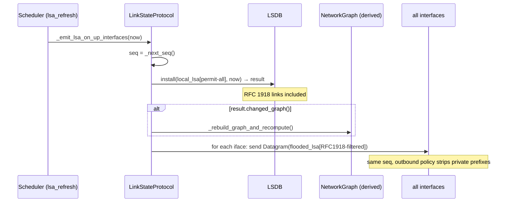
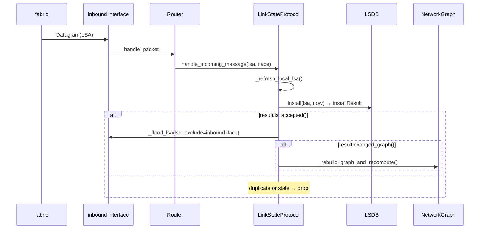

> 🌐 [English](../../architecture/routing-protocol.md) · **Español**

# loom-OSPF — ruteo link-state simplificado

`loom` implementa un protocolo de ruteo link-state modelado deliberadamente
siguiendo la mecánica central de OSPF, pero descartando la maquinaria de
protocolo que no tiene sentido en un simulador de área única y sin broadcast.
El protocolo vive en `src/routing/`; los módulos centrales son `lsa.py`,
`lsdb.py`, `hello.py`, `neighbor.py`, `scheduler.py` y `protocol.py` (el
paquete también contiene `messages.py`, `graph.py`, `policy.py` y
`exception.py`).

---

## Descripción general

El protocolo se llama **loom-OSPF** para señalar la herencia. Lo que modela:

- **Link-State Advertisements (LSAs)** por router que describen las redes
  directamente conectadas y sus costos.
- **Flooding con números de secuencia** para propagar LSAs a través del AS.
- Un **protocolo Hello** para la detección de liveness bidireccional entre
  routers adyacentes en un fabric compartido.
- Una **LSDB** (base de datos link-state) como vista canónica de la topología;
  el `NetworkGraph` y las tablas de ruteo se derivan de ella.
- **Edad de LSA + purga por max-age** para la detección implícita de fallos
  (sin keepalive → LSA obsoleto → grafo podado).
- **Retiro gracioso** al apagarse: un LSA sin links se inunda a los pares antes
  de que el router salga, de modo que lo purguen inmediatamente en lugar de
  esperar al max-age.
- **Jitter de timers** para evitar flooding simultáneo al reiniciar.

Lo que deliberadamente **no** modela (ver [Lo que se omite deliberadamente](#lo-que-se-omite-deliberadamente)):

- Áreas, ABRs, links virtuales, áreas stub/NSSA.
- Elección de DR/BDR en redes broadcast.
- OSPFv3 / IPv6.
- Estados de adyacencia OSPF completos — el estado terminal de loom-OSPF es `TWO_WAY`.
- Handshake de sincronización LSDB DBD/LSR/LSU.
- LSAs externas (Tipo 5).
- ECMP / multipath, autenticación.

---

## Protocolo wire

Todos los mensajes de protocolo son subclases de `RoutingMessage` (en `lsa.py`),
que a su vez hereda de `entities.packet.Message`. Existen dos tipos de mensaje
concretos:

### `LSA`

Un LSA lleva la vista propia de un router sobre sus propios links
directamente conectados. Campos:

| Campo | Tipo | Propósito |
|---|---|---|
| `_origin` | `Router` | El router que originó este anuncio |
| `_seq` | `int` | Contador de secuencia monotónicamente creciente por router |
| `_links` | `dict[NetworkAddress, int]` | Prefijo → costo para cada link anunciado |
| `_is_withdrawal` | `bool` | Si es `True`, este es un LSA de retiro sin links |

Métodos clave: `is_newer_than(other)` (comparación de seq), `has_same_links_as(other)`
(igualdad de diccionario de links), `LSA.withdrawal(router, seq)` (constructor para
LSA de apagado).

### `Hello`

Un Hello lleva liveness desde una interface, listando todos los vecinos no-DOWN
actualmente escuchados en ese fabric. Campos:

| Campo | Tipo | Propósito |
|---|---|---|
| `_originator` | `Router` | El router que envía el Hello |
| `_neighbors_heard` | `list[Router]` | Routers escuchados en este fabric en el último dead interval |

Los Hellos se **construyen por interface** y no se comparten entre interfaces.

### `Datagram`

Tanto los LSAs como los Hellos se transportan dentro de un `Datagram` (en
`messages.py`). `Datagram` es un `Packet` (frame portador), no un
`RoutingMessage`; agrega una dirección de origen y destino por emisión (broadcast
de fabric). El mismo objeto `LSA` puede ser transportado por muchos `Datagram` —
uno por interface de salida — sin mutación.

---

## Modelo de número de secuencia

loom-OSPF usa un **único contador monotónico por router** (`LinkStateProtocol._seq`,
incrementado por `_next_seq()`). Cada emisión de LSA — ciclo de refresh o
re-flood — lleva el valor actual. No hay contador por interface; el esquema
anterior por interface era una deuda de diseño y se ha eliminado.

El método `install()` del LSDB es la compuerta de aceptación. Compara contra
una **marca de agua alta persistente por origen** (`_last_seq[origin]`), no
contra el LSA actualmente almacenado:

```python
if last_seq is not None and lsa.seq() <= last_seq:
    return InstallResult.rejected()
```

Los empates y repeticiones se rechazan, por lo que un router nunca puede
retroceder su número de secuencia en vuelo. La marca de agua alta se retiene
incluso después de que el LSA de un origen es **purgado** (por un retiro o
expiración de max-age) — esto es lo que hace que los retiros sean idempotentes.
Sin ella, un retiro elimina la misma entrada que de otro modo se usaría para
comparar, por lo que cada copia re-inundada parece nueva y se re-inunda
indefinidamente; en una topología con caminos paralelos entre dos routers, un
retiro y el posterior re-anuncio circularían indefinitamente (una tormenta de LSA).

Un router también descarta cualquier LSA entrante que lo nombre **a sí mismo**
como origen (`_handle_incoming_lsa` retorna temprano cuando `lsa.origin() is self._router`):
tal LSA es un eco del propio flooding del router reflejado de vuelta por otra
red, y instalarlo/re-inundarlo alimentaría la misma tormenta. El LSA local es
propiedad exclusiva del camino de refresh/anuncio.

`has_same_links_as` es una verificación de igualdad de diccionario en los mapas
`_links`. El LSDB la usa para decidir si un LSA aceptado realmente cambió el grafo:
- Aceptado + mismos links → `InstallResult.accepted(changed_graph=False)` → sin
  recómputo SPF, sin reconstrucción de tabla de ruteo. Esto mantiene silenciosa
  una red en estado estable aunque cada router inunde en el intervalo de refresh.
- Aceptado + links distintos → `InstallResult.accepted(changed_graph=True)` →
  activa el recómputo SPF.

---

## Originando un flood de LSA

`_emit_lsa_on_up_interfaces` se ejecuta en cada tick del timer `lsa_refresh`.
Usa **dos instancias de LSA con el mismo número de secuencia** en una sección
de lock atómica:



El patrón de dos LSA existe porque el ruteo local a través de redes RFC 1918
debe funcionar (un router reenvía sus propios paquetes hacia LANs privadas
directamente conectadas usando el grafo local), pero esos prefijos privados no
deben filtrarse hacia los pares. El `local_lsa` se construye con política
permit-all para que todas las redes directamente conectadas aparezcan en el LSDB
y el grafo; el `flooded_lsa` se construye con `RFC1918_OUTBOUND` (elimina
10.0.0.0/8, 172.16.0.0/12, 192.168.0.0/16) antes de enviarse por cualquier
interface.

Al iniciar, `_protocol_loop` llama a `_safe_tick_initial` antes del primer
disparo del timer (t ≈ 0), de modo que los routers vecinos se conocen
inmediatamente en lugar de esperar un intervalo de refresh completo.

---

## Protocolo Hello

`_emit_hello_on_up_interfaces` se ejecuta en cada tick del hello-timer. Para
cada interface activa construye un `Hello` que lista todos los vecinos no-DOWN
actualmente escuchados en ese fabric, luego lo envía como Datagram broadcast.

### Máquina de estados de vecinos

Cada par `(interface, peer)` tiene un `NeighborState`:

```
         heard Hello         peer listed us
  DOWN ──────────────► INIT ───────────────► TWO_WAY
         (any)                (bidirectional)
                                │
         dead interval expires  │
  DOWN ◄────────────────────────┘ (or last hello too old)
```

| Estado | Significado |
|---|---|
| `DOWN` | Sin Hello reciente del par (o nunca escuchado) |
| `INIT` | Se escuchó el Hello del par; el par aún no nos incluyó en su lista de vecinos |
| `TWO_WAY` | Se escuchó el Hello del par; el par nos listó → adyacencia bidireccional confirmada |

El estado se deriva (no se almacena) de los timestamps en `Neighbor.state()`:
- `_last_hello_at` se actualiza en cada Hello recibido de este par.
- `_peer_acked_at` se actualiza cuando un Hello recibido nos lista en su
  `neighbors_heard`.
- Ambos deben ser más recientes que hace `dead_interval` segundos para `TWO_WAY`.

`NeighborTable.record_hello` devuelve un `NeighborTransition` cuando el estado
cambia, o `None` cuando es estable. Una transición a `DOWN` purga inmediatamente
el LSA de ese par del LSDB y activa un recómputo SPF.

Los Hellos admiten **múltiples pares por interface** — un único fabric puede tener
varios routers, cada uno rastreado independientemente bajo su propia clave
`(iface_name, peer)` en `NeighborTable`.

---

## LSDB y grafo

`LSDB` es el almacén canónico de topología. El LSA actual de cada origen se
guarda como par `(lsa, installed_at)` en `_by_origin`. `NetworkGraph` es siempre
una vista derivada:

```python
graph = lsdb.build_graph(eligible_origins)
```

`build_graph` siempre incluye el LSA propio del router local (si está presente),
luego agrega cada origen en `eligible_origins`.

### Modelo de costo (pseudonodo OSPF)

Los costos de interface son **solo de salida**: un costo `N` en la interface
`eth_i` del router R significa "enviar un paquete por `eth_i` hacia la subred S
adjunta cuesta N." No hay costo de entrada correspondiente.

`build_graph` codifica esto con dos aristas dirigidas por link de LSA:

- `R → S` con peso = costo de interface anunciado por R
- `S → R` con peso = 0

La arista inversa de peso cero modela el "pseudonodo" OSPF: una vez que un
paquete está en una subred multi-acceso, llegar a cualquier router adjunto a
esa subred es gratuito — el costo ya fue pagado por quien puso el frame en el
wire. Sin esto, un único hop `R₁ → S → R₂` contaría doble (salida de `R₁` +
salida de `R₂`) y los costos asimétricos de link se comportarían incorrectamente.

Una consecuencia que vale la pena conocer: con costos de link **simétricos**
(ambos extremos con el mismo valor), cambiar solo un lado de un link modifica
el costo en esa dirección únicamente. Cambiar el costo de interface de v de 4
a 6 afecta `v → t` (ahora 6) pero no `t → v` (sigue siendo 4). Para aumentar
el costo simétricamente, actualizar ambos endpoints.

### Propagación de cambios en links locales

`Router.update_interface(name, cost)` muta el costo de la interface y luego
llama a `proto.local_links_changed()` en cada protocolo. `LinkStateProtocol`
sobreescribe esto para re-emitir un LSA fresco, instalarlo localmente
(recomputando SPF si los links realmente cambiaron) e inundarlo por cada
interface inmediatamente — las mismas acciones que realizaría un tick
programado de `lsa_refresh`, pero sin esperar al timer. Sin esto, un cambio
de costo impulsado por el usuario solo se propagaría en el siguiente refresh
periódico (hasta `lsa_refresh_interval + jitter` después — hasta 1.25 ×
`lsa_refresh_interval` ≈ 37.5 s con los valores predeterminados).

El deadline periódico de `lsa_refresh` se restablece a `now + lsa_refresh_interval`
tras una emisión manual, de modo que una ráfaga de ediciones se colapsa en
una cadencia de refresh en lugar de una cola de flooding periódico idéntico.

### Filtro de elegibilidad del grafo

El conjunto de elegibilidad lo calcula `_rebuild_graph_and_recompute` en
`protocol.py` usando un clasificador de tres estados basado en la vista de la
capa Hello de cada origen:

| Clasificación del origen | Elegibilidad | Fundamento |
|---|---|---|
| TWO_WAY-directo (en `bidirectional_peers`) | Siempre elegible | Adyacencia bidireccional confirmada |
| Directo-no-TWO_WAY (en `_neighbor_table.all()` ∖ `bidirectional_peers`) | Excluido | Vecino directo pero aún no completamente adyacente — asimétrico, bloqueado en INIT |
| No directo (nunca se observó un Hello de este origen) | Elegible si ≥1 adyacencia TWO_WAY existe | LSA multi-hop inundado por un par de confianza |

La rama "no directa" es la crítica para la convergencia multi-hop: si r1
tiene una adyacencia TWO_WAY con r2, y r2 inunda el LSA de r3 a r1, r1
incluirá a r3 en su grafo aunque nunca haya intercambiado un Hello con r3
directamente. Sin esta extensión, solo los routers directamente adyacentes
contribuirían al grafo y una cadena r1—r2—r3 nunca convergiría completamente
en r1.

Si no existe ninguna adyacencia TWO_WAY (conjunto `bidi` vacío), `eligible_origins`
está vacío — ningún LSA remoto se confía hasta que al menos una adyacencia
esté verificada.

**Desviación del RFC 2328.** El OSPF real usa admisión basada en el inundador:
un LSA se instala cuando un vecino en estado `Full` (el inundador) lo entrega,
independientemente del estado de adyacencia propio del origen. loom-OSPF hace
lo inverso — clasifica por origen en lugar de por inundador. Esto es más
permisivo, pero aceptable porque el simulador no tiene amenaza de inyección
de LSA adversarial, la escala de simulación es pequeña (un grafo transitoriamente
obsoleto se corrige en el siguiente flooding genuino), y el enfoque por origen
naturalmente maneja la ausencia de handshake ExStart/Exchange/Loading/Full de
loom-OSPF.

---

## Recepción de un LSA



Puntos clave:

- `_refresh_local_lsa()` se llama primero para asegurar que los propios links
  del router local estén en el LSDB antes de cualquier cálculo de elegibilidad.
- El re-flood ocurre en `is_accepted()` — incluyendo LSAs aceptados pero con
  los mismos links. El `seq` del LSA ha avanzado, por lo que los pares de aguas
  abajo lo aceptarán; sin re-inundar un bump nunca recibirían el nuevo número
  de secuencia y sus entradas del LSDB expirarían.
- El recómputo SPF ocurre solo en `changed_graph()`, manteniendo silenciosa una
  red en estado estable.
- `_flood_lsa` reenvía el **mismo objeto LSA** (origen + seq + links intactos)
  por cada interface excepto por la que llegó. Esto es lo que hace funcionar la
  deduplicación del flooding: cada router de aguas abajo ve el mismo par
  `(origin, seq)` y lo rechaza tras la primera aceptación.

---

## Edad de LSA y purga por max-age

loom-OSPF no implementa el campo de edad por segundo en el LSA de OSPF. En su
lugar el LSDB almacena un timestamp de reloj de pared (`installed_at`) en el
momento de la instalación.

**El barrido por max-age** se ejecuta en el timer `maxage_check` (misma cadencia
que `lsa_refresh`). `_sweep_dead_and_expired` llama a `lsdb.expired_origins(max_age,
now)`:

```python
[
    origin for origin, (_, installed_at) in _by_origin.items()
    if now - installed_at > max_age
]
```

Cualquier origen no local cuyo último LSA sea más antiguo que `max_age = 2 × refresh`
se purga y el grafo se reconstruye. La propia entrada del router local está
exenta de la purga (se refresca a sí mismo en cada tick de `lsa_refresh`).

**Cómo se mapea la liveness al max-age**: si un router deja de inundar (caída,
partición de red, o parada sin retiro), su LSA expira dentro de `max_age`. El
`max_age = 60s` predeterminado (con `refresh = 30s`) significa que un router
fallido se detecta dentro de dos ciclos de refresh.

El **dead interval** es una señal separada (más corta) en la capa Hello:
`dead_interval = 3 × hello_interval = 30s` por defecto. Un vecino que deja de
enviar Hellos pasa a `DOWN` dentro del dead interval, su LSA se purga del LSDB
y el grafo se reconstruye — mucho antes de que dispare el max-age.
En conjunto, la detección dead basada en Hello es el camino rápido; el max-age
es la red de seguridad.

---

## Retiro gracioso al apagar

`LinkStateProtocol.stop()` llama a `_flood_withdrawal()` antes de activar el
flag de parada:

```python
lsa = LSA.withdrawal(self._router, seq=self._next_seq())
# flood out every interface
```

Un LSA de retiro tiene `is_withdrawal=True` y no lleva links. Lleva un número
de secuencia como cualquier otro LSA y está sujeto a la misma compuerta de
aceptación: un retiro cuyo seq no es más reciente que la marca de agua alta
del origen se rechaza (y no se re-inunda). Cuando un retiro *es* aceptado,
`lsdb.install` elimina el origen de `_by_origin` y registra el seq del retiro
como nueva marca de agua alta. El `InstallResult` devuelve
`accepted(changed_graph=True)` si el origen estaba presente, activando un
recómputo SPF inmediato en cada router receptor. El flooding se propaga
normalmente a través de `_flood_lsa`.

En comparación con esperar el max-age (hasta 60s), el retiro da a los pares
una convergencia casi instantánea tras un apagado limpio.

---

## Admin-down y crash

loom-OSPF distingue dos formas en que un router o interface puede quedar
no disponible: gracioso (iniciado por admin) y crash (fallo silencioso). Ambos
convergen al mismo estado down; difieren solo en cómo los pares se enteran.

### Gracioso: deshabilitar interface y halt de router

**Deshabilitar interface** (`disable_interface(name, graceful=True)`) pone el
flag `is_up()` de la interface en `False`. Una interface down descarta tráfico
en ambas direcciones (ni `_pkt_loop` ni el fabric reenviarán frames a través
de ella) y se excluye del LSA de salida. El protocolo re-emite inmediatamente
un LSA fresco vía `local_links_changed()`, de modo que los pares reciben una
lista de links actualizada en milisegundos — sin esperar el próximo refresh
programado.

**El halt del router** llama a `disable_interface` en cada interface (poniendo
cada `is_up()` en `False`) y luego inunda un LSA de retiro (idéntico al apagado
gracioso: `is_withdrawal=True`, sin links). Los routers receptores purgan el
origen del LSDB y recomputan SPF inmediatamente.

**Resume** vuelve a habilitar todas las interfaces (pone `is_up()` en `True`
nuevamente) y re-anuncia los links del router vía un Hello + LSA flood frescos
(`announce()`). Dado que los Hellos del par se descartaron mientras el router
estaba down, cualquier adyacencia que el router aún rastree en una interface
re-habilitada está obsoleta; `announce()` primero **olvida esos registros de
vecinos** (`NeighborTable.clear_on`) para que el Hello de retorno del par
impulse una transición genuina `DOWN→…→TWO_WAY`. Esa transición es la que
reactiva el recómputo SPF una vez que la adyacencia se restablece — sin esto
un registro `TWO_WAY` obsoleto absorbería silenciosamente el Hello de retorno
y la propia tabla de ruteo del router reanudado nunca reconvergiría. El hilo
de protocolo **nunca se detiene** durante halt o resume — solo cambian los
flags `is_up()`. Esto significa que no hay overhead de jitter de reinicio;
el router vuelve a la topología en el próximo ciclo de flooding.

### Crash (fallo silencioso)

Un crash (`POST /devices/{name}/fail`, opcionalmente limitado a una interface)
pone `is_up()` en `False` sin ningún anuncio LSA. Los pares no pueden
distinguirlo de una partición de red en el momento en que ocurre.

Dos mecanismos de detección se activan independientemente:

- **Hello dead interval** (`dead_interval = 3 × hello_interval`, por defecto 30s):
  un vecino que deja de enviar Hellos pasa a `DOWN`, su LSA se purga del LSDB
  y se recomputa SPF.
- **LSA max-age** (`max_age = 2 × lsa_refresh_interval`, por defecto 60s): el
  LSA del router caído expira durante el barrido por max-age, activando la misma
  purga del LSDB y el recómputo SPF.

El dead interval se dispara primero (asumiendo las proporciones predeterminadas),
haciendo de la capa Hello el camino rápido para la detección de crashes.

### Crash vs. gracioso: invariantes clave

| Propiedad | Gracioso | Crash |
|---|---|---|
| Flag `is_up()` limpiado | Sí | Sí |
| LSA de retiro inundado | Sí (halt) / LSA parcial (deshabilitar iface) | No |
| Hilo de protocolo detenido | Nunca | Nunca |
| Estado down serializado | No (solo en runtime) | No (solo en runtime) |
| Activador de convergencia en pares | Inmediato (al recibir LSA) | Dead interval / max-age |

El hilo de protocolo nunca se detiene en ningún caso — esta es una decisión
de diseño explícita para que `resume` no requiera reinicio de hilo, y para
que el protocolo pueda re-anunciar links en el momento en que `is_up()` vuelve
a `True`.

Crash y gracioso son **bifurcaciones en el momento de transición**, no estados
almacenados. Una vez que un router está down, el LSDB y las tablas de ruteo
se ven idénticos independientemente de cómo llegó a ese estado.

---

## Modelo de timers y jitter

`_protocol_loop` maneja tres timers independientes vía una instancia de
`Scheduler`. El loop se estaciona en
`_wake_event.wait(timeout=time_to_next_deadline)` y despacha los timers que
han expirado al despertar:

| Nombre del timer | Intervalo predeterminado | Derivado de | Propósito |
|---|---|---|---|
| `hello` | 10s | predeterminado de producción | Emitir Hellos; barrer vecinos muertos |
| `lsa_refresh` | 30s | predeterminado de producción | Emitir flood LSA; refrescar entrada propia en LSDB |
| `maxage_check` | 30s | `= lsa_refresh` | Purgar LSAs remotos expirados |

Relaciones derivadas (proporciones fijas, no ajustables por separado):

```
dead_interval   = 3 × hello_interval
max_age         = 2 × lsa_refresh_interval
```

**Jitter**: `Scheduler.elapsed` reprograma cada timer disparado tomando el
próximo deadline de `[0.75 × base, 1.25 × base]` (la convención IS-IS). Esto
desincroniza los routers que arrancan al mismo instante, evitando flooding
simultáneo en topologías grandes.

Para pruebas que requieren timing determinístico, `Scheduler` acepta
`jitter_range=(1.0, 1.0)`.

El endpoint `POST /sim/protocol_config` expone
`hello_interval` y `lsa_refresh_interval` como los dos parámetros ajustables.
El método `set_timers` recalcula todos los valores derivados y despierta el
loop de protocolo inmediatamente para que la nueva cadencia tome efecto sin
esperar la expiración del deadline anterior.

---

## Pausa / resume

`_protocol_loop` respeta el `PauseGate` de todo el AS antes de cada tick:

```python
running, stopped = gate.wait_or_stop()
if stopped:
    break
if not running:
    continue          # paused — re-park without ticking
```

Pausar la simulación congela los Hellos, el flooding de LSA, el barrido de
vecinos muertos y las verificaciones de max-age. No se producen ráfagas de
actividad de recuperación al reanudar; el siguiente tick del timer es
simplemente el primer evento tras la reanudación.

---

## Dónde buscar en el código

| Tema | Archivo | Símbolo |
|---|---|---|
| Tipos de mensaje wire | `src/routing/lsa.py` | `RoutingMessage`, `LSA` |
| Mensaje Hello | `src/routing/hello.py` | `Hello` |
| Portador Datagram | `src/routing/messages.py` | `Datagram` |
| Instalación + purga LSDB | `src/routing/lsdb.py` | `LSDB.install`, `LSDB.expired_origins` |
| LSDB → grafo | `src/routing/lsdb.py` | `LSDB.build_graph` |
| Máquina de estados de vecinos | `src/routing/neighbor.py` | `Neighbor.state`, `NeighborTable` |
| Deadlines de timer + jitter | `src/routing/scheduler.py` | `Scheduler` |
| Loop de protocolo | `src/routing/protocol.py` | `LinkStateProtocol._protocol_loop` |
| Originación de LSA | `src/routing/protocol.py` | `_emit_lsa_on_up_interfaces` |
| Originación de Hello | `src/routing/protocol.py` | `_emit_hello_on_up_interfaces` |
| Recepción de LSA | `src/routing/protocol.py` | `_handle_incoming_lsa` |
| Recepción de Hello | `src/routing/protocol.py` | `_handle_incoming_hello` |
| Filtro de elegibilidad | `src/routing/protocol.py` | `_rebuild_graph_and_recompute` |
| SPF + tabla de ruteo | `src/routing/protocol.py` | `_recompute_routing_table` |
| Flood de retiro | `src/routing/protocol.py` | `_flood_withdrawal` |
| Dijkstra | `src/routing/graph.py` | `NetworkGraph._shortest_paths` |

---

## Lo que se omite deliberadamente

loom-OSPF es una simplificación fiel, no una implementación completa del RFC 2328.
Los siguientes aspectos están fuera del alcance y no se planean sin un caso de
uso concreto:

- **Áreas OSPF / ABRs / ruteo jerárquico** — todo el AS es una sola área plana.
- **Elección DR / BDR** — las redes loom son punto a punto (Links `/30` o `/31`)
  o pequeños fabrics LAN donde una elección no aporta valor.
- **OSPFv3 / IPv6** — loom modela solo IPv4.
- **Estado de adyacencia completo (ExStart / Exchange / Loading / Full)** — loom-OSPF
  no tiene handshake de sincronización LSDB DBD/LSR/LSU. `TWO_WAY` es el estado
  terminal.
- **LSAs externas (Tipo 5)** — la alcanzabilidad entre AS corresponde a un
  componente BGP futuro.
- **ECMP / multipath** — la tabla de ruteo almacena una regla por prefijo de
  destino; no se rastrean múltiples caminos de igual costo.
- **Autenticación** — la autenticación de mensajes MD5/HMAC-SHA no está implementada.
- **Links virtuales** — loom no tiene área backbone; los links virtuales no tienen
  sentido.
- **Campo de edad por segundo en el LSA** — loom usa timestamps de reloj de pared
  en el momento de la instalación, no la edad en el lugar por segundo de OSPF. La
  diferencia observable es que loom no puede propagar la edad restante a través de
  hops como lo hace OSPF, pero esto importa solo en redes muy grandes donde el
  retardo de propagación entre routers es significativo comparado con el max-age.
