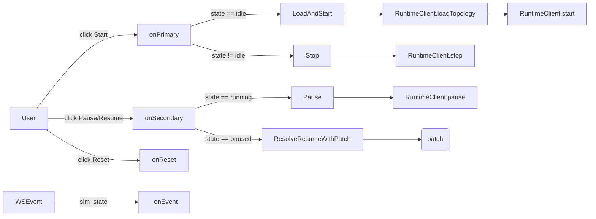

> 🌐 [English](../../architecture/web-spa.md) · **Español**

# Web SPA

La SPA es módulos ES planos — sin framework, sin bundler. Todo el cliente
se distribuye desde `web/` como activos estáticos y es cargado por `index.html`.

```
web/
├── index.html           # ~355 líneas de markup + <script type="module" src="app.js">
├── styles.css           # todo el CSS
├── favicon.svg
├── app.js               # entrypoint: imports, wire(), init(), DOMContentLoaded
├── state.js             # objeto de estado + persistencia + bus EventTarget + ejemplo
├── canvas.js            # renderizado SVG, drag, pan/zoom, tema, layout
├── inspector.js         # nav izquierdo + panel derecho, renombrar/duplicar/eliminar, menú contextual
├── terminals.js         # ventanas emergentes de terminal por dispositivo
├── packets.js           # animación de paquetes + tooltips
├── packetstore.js       # PacketStore — registro en tránsito, historial de hops, caché NAT, contadores #N
├── packetspanel.js      # panel Packets — botón en barra de herramientas, montado dentro de #inspector, renderizado de filas, halo hover
├── packettypes.js       # constantes de tipo de paquete (USER_TYPES, CHATTER_TYPES, mapa type→label)
├── sim.js               # máquina de estados Sim + RuntimeClient + dispatcher WS
├── yaml-io.js           # importar / exportar YAML
├── preflight.js         # validateTopology() — verificación de completitud antes de Start
├── modal.js             # confirmModal() — diálogo de confirmación basado en promesas
├── protocolpopover.js   # popover de configuración de timers de protocolo (inputs hello/lsa_refresh + Apply)
├── file-picker.js       # diálogo de selección de archivo de importación (drag-and-drop + explorar)
└── utils.js             # helpers DOM (el, escapeHtml, toast, ...)
```

La intención de la división es un módulo por responsabilidad, con la coordinación
entre componentes fluyendo a través del `bus` (ver abajo) en lugar de llamadas
directas de renderizado entre módulos.

## El bus de eventos

`state.js` exporta un singleton:

```js
export const bus = new EventTarget();
```

Toda reacción entre componentes fluye a través de él. El contrato tiene dos
lados:

- **Mutaciones de estado + re-renderizados entre componentes → bus.** Cuando `inspector.js`
  renombra un dispositivo, muta `state` y despacha
  `state:topology-changed`; `canvas.js` y el inspector se
  re-renderizan en respuesta.
- **Consultas síncronas + helpers DOM → importaciones directas.** `canvas.lookupDeviceNode`,
  `utils.el`, `utils.escapeHtml` se importan directamente porque son
  de solo lectura y no tienen efectos secundarios.

El contrato se aplica por convención, no por herramientas. No reintroducir
llamadas directas de renderizado entre módulos.

La SPA es un **consumidor** de los hechos difundidos por el backend. Los eventos `sim:*`
listados a continuación son traducidos desde los kinds de eventos WS del backend
(`interface_state_changed`, `device_state_changed`, `ping_result`, etc.)
por `sim.js _onEvent`. Nombrar las formas wire del backend dentro de la SPA está
bien y es esperado — la SPA es el suscriptor principal de esos hechos.

### Kinds de eventos

| Evento | Emitido por | Consumido por | Disparador |
|---|---|---|---|
| `state:topology-changed` | `inspector`, `state`, `app` | `canvas`, `inspector` | Cualquier mutación de redes/links/hosts/routers/display |
| `state:topology-loaded` | `state` (loadSample/clearTopology), `yaml-io` (importYaml) | `canvas` (fitView), `inspector` | Reemplazo completo de topología |
| `state:selection-changed` | `canvas`, `inspector`, menú contextual | `inspector` | El usuario seleccionó un nodo |
| `sim:status-changed` | `sim` | `inspector`, `terminals`, `packets`, `packetstore` | La simulación transitó (idle/running/paused). Detail: `{status}`. |
| `sim:packet` | `sim` (desde WS) | `packets` | El servidor emitió un evento de paquete |
| `sim:routing-table-changed` | `sim` (desde WS) | `inspector` (re-fetch de rutas si está seleccionado) | El servidor emitió un cambio de ruta |
| `sim:interface-state-changed` | `sim` (desde WS `interface_state_changed`) | `canvas` (gris en arista), `inspector` (re-renderizar botones de interface) | Una interface de router fue subida o bajada. Detail: `{device, iface, up}`. |
| `sim:device-state-changed` | `sim` (desde WS `device_state_changed`) | `canvas` (gris en nodo) | Un router fue detenido o reanudado. Detail: `{device, up}`. |
| `sim:ping-result` | `sim` (desde WS `ping_result`) | `terminals` (mostrar línea en terminal del remitente) | Llegó una respuesta ICMP echo (o timeout). Detail: `{device, dst, seq, rtt_ms}`. `rtt_ms` es `null` ante timeout. |
| `sim:nat` | `sim` (desde WS) | renderizador de tooltip de paquete | Un router realizó NAT de origen o destino en un paquete. Outbound lleva `{router, direction, original_src, rewritten_src, dst, flow_id, payload_id}`; inbound lleva `{router, direction, rewritten_dst, original_dst, src, flow_id, payload_id}`. `flow_id` es el UUID de conversación (mismo valor que `flow` en el evento `packet`, y mismo valor con el que se indexa la tabla NAT del router). |
| `sim:nat-table-changed` | `sim` (desde WS) | `inspector` (panel de tabla NAT) | La tabla NAT de un router fue mutada. Lleva `{device}` en detail; el snapshot completo se refleja en `state.natTables[device]` para que el inspector lo renderice. |
| `sim:neighbor-state-changed` | `state` (`applyNeighborStateChanged`, llamado desde `sim._onEvent`) | `inspector` (re-renderizado de sección Neighbors) | El estado de adyacencia de un vecino del router cambió. Detail: `{device, iface, peer, state}`. |
| `sim:router-intercept` | `sim` (desde WS `router_intercept`) | `packets` (decoración de tooltip) | Un router respondió a un echo ICMP dirigido a una de sus propias IPs. Detail: el evento WS crudo. Se dispara justo antes del paquete de respuesta coincidente para que `packets.js` pueda almacenar en caché por `payload_id` y anotar el tooltip de la respuesta. |
| `sim:topology-changed` | `sim` (desde WS `topology_changed`) | `sim` (auto-listener dispara resync mediante `sim:topology-import-requested`) | Una mutación de topología fue confirmada por el servidor. Detail: `{ops}`. Distinto de `state:topology-changed`, que refleja mutaciones locales. |
| `sim:packet-arrived` | `packets` (fin de animación) | `packetstore` | Una animación de paquete se completó en su dispositivo destino. Detail: `{payloadId, device}`. Impulsa la promoción del último hop en el store. |
| `packets:list-changed` | `packetstore` (con debounce ~50ms) | `packetspanel` | El conjunto en tránsito o reciente del store mutó. El panel se re-renderiza al recibirlo. |
| `packets:chatter-badges-changed` | `packetspanel` | `packets` | El estado de expansión del grupo chatter cambió; los puntos chatter activos agregan/eliminan sus badges `#R*`. |
| `packets:dot-appeared` | `packets` (tras appendChild) | `packetstore` | Un nuevo punto de paquete fue agregado a la capa del canvas. Detail: `{payloadId}`. Impulsa el filtro de visibilidad del panel — las filas permanecen ocultas hasta que su punto está en pantalla. |
| `packets:chatter-pin` | `packets` (al confirmar para animar) | `packetstore` | Esta emisión chatter va a animar, por lo que el timer de fallback de su fila se cancela y `sim:packet-arrived` se encarga de la limpieza. Detail: `{key}` (clave chatter compuesta). |
| `canvas:terminal-requested` | `canvas` (doble click en un nodo de dispositivo) | `terminals` | El usuario hizo doble click en un dispositivo; abrir o enfocar su terminal. Detail: `{name}`. |
| `canvas:contextmenu-requested` | `canvas` (click derecho en un nodo o en el fondo del canvas) | `inspector` | Abrir el menú contextual en la posición del puntero. Detail: `{clientX, clientY, target, world}`. |
| `canvas:contextmenu-close-requested` | `canvas` (pointerdown en el fondo) | `inspector` | Cerrar el menú contextual abierto. |
| `ui:import-requested` | `inspector` (botón Import en barra de herramientas) | `app.js` | El usuario hizo click en Import; `app.js` abre el diálogo de selección de archivo. |
| `sim:yaml-export-requested` | `sim.onPrimary` | `app.js` | Sim necesita el YAML actual para cargarlo antes de iniciar |
| `sim:topology-import-requested` | `sim.onReset` | `app.js` | Sim recibió reset; refrescar canvas desde el YAML del servidor |
| `view:changed` | `canvas` | (ninguno actualmente — reservado para el futuro) | Pan/zoom |

El evento `sim:yaml-export-requested` usa un patrón de solicitud/respuesta síncrono:
el listener muta `event.detail.yaml` antes de que el dispatch retorne. Este es
un puente temporal hacia las funciones `exportYaml`/`importYaml` locales del módulo
hasta que se desacoplen completamente del canvas.

## Forma del estado (`web/state.js`)

```js
export const state = {
  asName: 'test_as',
  asn: 65000,                 // número AS (persistido)
  networks: { /* name -> { cidr, x, y, w? } */ },
  links:    { /* name -> { cidr, x, y } */ },
  hosts:    { /* name -> { network?, link?, address, gateway?, x, y } */ },
  routers:  { /* name -> { x, y, interfaces: { ifn -> { network?, link?, address, cost } } } */ },
  selection: { kind, name } | null,
  view: { x, y, k },        // pan + zoom
  display: { showCosts, showIfaces },
  ui: { packetsPanelOpen, showChatter },  // estado de panel/toggle persistido
  config: { packet_duration_ms },         // persistido; ida y vuelta vía internet.config
  protocol: { hello_interval, lsa_refresh_interval }, // persistido; vía AS config.protocol
  sourceName: null,           // nombre base del último archivo YAML importado (persistido)
  // transient — no persistido
  downInterfaces: { /* device -> Set<ifaceName> */ },
  haltedDevices:  { /* device -> true */ },
  natTables:      { /* device -> NatEntry[] */ },       // desde eventos WS nat_table_changed
  neighborsByDevice: { /* device -> { iface -> { peer -> {state,…} } } */ }, // desde neighbor_state_changed
};
```

Notas:

- Un host tiene **`network:` o `link:`**, nunca ambos. Lo mismo en cada
  interface de router. La restricción refleja el esquema YAML y el parser.
- Las coordenadas de red `(x, y)` marcan el centro del rail LAN; la
  longitud del eje principal del rail es `w` (por defecto `RAIL_DEFAULT_WIDTH = 180`).
- La persistencia es `localStorage[STORAGE_KEY = 'loom.topology.v5']` —
  serializado con un debounce de 200 ms tras cada llamada a `markDirty()`.
- `asn`, `ui`, `config`, `protocol` y `sourceName` son persistidos.
- El `SAMPLE` incluido es el fallback de primer uso de la SPA cuando el
  almacenamiento local está vacío.
- `downInterfaces`, `haltedDevices`, `natTables` y `neighborsByDevice`
  son **transitorios** — nunca se escriben en `localStorage`.
  Ver [Caché de estado admin-down / crash](#caché-de-estado-admin-down--crash) más abajo.

## La máquina de estados Sim (`web/sim.js`)

La SPA refleja la máquina `idle / running / paused` del servidor. Dos
rutas de escritura:



`Sim.patch` acumula operaciones mientras está pausado. Cuando el usuario hace click en
**Resume**, `reconcilePatch(patch)` reescribe los ops `add_*` encolados para
tomar los **últimos** valores de `state` (de modo que una red que fue agregada
y luego renombrada llegue al patch con su nombre actual), y descarta cualquier op
cuyo objetivo fue eliminado antes del resume. La lista reconciliada se envía a
`POST /sim/resume`.

Cuando el WebSocket reporta un cambio de `sim_state`, la SPA lo refleja
localmente y dispara `sim:status-changed` para que el canvas y el inspector puedan
actualizar su estado de lock.

## Edición de topología en vivo (`applyEdit`)

`inspector.js` enruta las mutaciones de topología a través de `applyEdit(op)`, que
se comporta de forma diferente según el estado actual de la simulación:

- **Running** — `applyEdit` envía el op inmediatamente a `POST /sim/edit`
  como un patch de un solo op. En caso de éxito el servidor difunde un evento
  `topology_changed`; en caso de falla la SPA resincroniza desde el servidor
  (GET `/topology`) para corregir cualquier divergencia. Eliminar una LAN en uso mientras
  se está en ejecución se bloquea localmente con un toast antes de que siquiera
  se intente el POST.
- **Paused** — `applyEdit` acumula el op en `Sim.patch` como antes
  (sin cambios). El patch se aplica atómicamente al hacer Resume mediante
  `POST /sim/resume`.
- **Idle** — las mutaciones van directamente al `state` local; ninguna llamada
  al servidor hasta el próximo Start.

Los botones de barra de herramientas **+ Add LAN / Host / Router** permanecen habilitados mientras
se está en ejecución, por lo que se pueden agregar nuevas entidades al canvas durante la simulación.

### Adds pendientes diferidos

Una entidad recién agregada (red, link, host o router) puede tener una
dirección/CIDR incompleta o inválida cuando aparece por primera vez en el canvas.
En ese caso `applyEdit` retiene la llamada a `POST /sim/edit` y deja
la entidad en estado **pending** — visible localmente pero aún no confirmada
en el AS en ejecución. La confirmación se dispara automáticamente en cuanto la
dirección/CIDR se vuelve válida, usando los mismos validadores que el inspector
usa para el resaltado de campos:

- **`validateAddressOnFabric(addr, fabricKind, fabricName, selfRef, st)`** para
  direcciones de host e interfaces de router.
- **`isValidNetworkCidr(cidr)`** e **`isValidLinkCidr(cidr)`** para
  los CIDRs del fabric.

Estas funciones viven en `utils.js` y son compartidas entre el resaltado de campos
en tiempo real del inspector y el gate de confirmación de edición en vivo — de modo que
"válido suficiente para resaltar en verde" y "válido suficiente para confirmar" son el mismo
predicado.

### Resync por topology-changed

Cuando el WebSocket entrega un evento `topology_changed` (desde cualquier
edición exitosa, ya sea local o desde otro cliente), la SPA llama a
`importYaml` contra una respuesta fresca de `GET /topology`. El resync preserva:

- **Posiciones de nodos** — las coordenadas en `state.networks`, `state.hosts`
  y `state.routers` se mezclan de vuelta en la topología importada, de modo que
  el canvas no salta.
- **Selección** — `state.selection` se restaura si la entidad seleccionada
  todavía existe tras el resync.
- **Viewport** — `state.view` (pan + zoom) no cambia.

Una edición en vivo rechazada (HTTP 400 desde `POST /sim/edit`) dispara el mismo
camino de resync para asegurar que el estado local permanezca consistente con el servidor.

Nota: el re-direccionamiento de interfaces y la reasignación de host/red **no**
están soportados mediante edición en vivo; esas operaciones requieren un ciclo completo
de Stop → edit → Start.

## Canvas (`web/canvas.js`)

Basado en SVG, con tres sistemas de coordenadas:

- **World** — las coordenadas canónicas almacenadas en `state` (cada nodo
  tiene `x, y`).
- **View** — coordenadas world con `state.view` (pan + zoom) aplicado;
  esto es lo que ve el usuario.
- **Screen** — coordenadas view trasladadas por el bounding rectangle del SVG
  (para cálculos de eventos de mouse).

Helpers: `screenToWorld`, `worldToView`, `applyView`. Los handlers de pan/zoom
en `wireCanvas` mantienen la coordenada world enfocada fija bajo el cursor al hacer zoom.

El drag funciona en dos modos:

- **Drag de nodo único** — el `(x, y)` del nodo enfocado se actualiza en cada
  pointermove; `markDirty()` aplica debounce a la persistencia. Esta es una
  **operación solo del cliente**: los cambios de posición nunca se envían al servidor y el AS
  en ejecución no se ve afectado. El drag de nodo único está permitido en todos los estados
  de simulación (idle, running, paused). Las etiquetas del punto medio de links P2P siguen
  la misma regla y también son arrastrables en todos los estados.
  - **Guard de reasignación (solo en running):** si el puntero se suelta sobre un
    *fabric diferente* (una red o link al que el dispositivo no está actualmente adjunto)
    mientras la simulación está en ejecución, el canvas muestra una señal roja/punteada
    bloqueada en el fabric destino y el nodo vuelve a su última posición válida.
    Reasignar un dispositivo a una red o link diferente requiere un ciclo completo
    de Stop → edit → Start.
- **Pan** — `state.view.x / y` se actualiza; `applyView()` re-aplica la
  transformación sin re-renderizar los nodos.

Los toggles `state.display.showCosts` y `showIfaces` cambian qué
etiquetas se renderizan alrededor de los interfaces de router. Ambos se persisten en
`localStorage`.

Los links P2P se renderizan como aristas directas entre dispositivos (la etiqueta del punto
medio del link es un indicador arrastrable). Las LANs se renderizan como un rail con
tapas en los extremos y marcas en cada interface adjunto; la longitud del rail es
editable mediante un handle en cada extremo.

## Inspector (`web/inspector.js`)

El panel derecho renderiza un único panel editable por nodo seleccionado — sin
pestañas. Para los routers el panel incluye tanto la lista de interfaces como la
tabla de ruteo actual; para los hosts incluye la membresía a red/link y el gateway
por defecto; para redes y links muestra solo el nombre y el CIDR.

La tabla de ruteo se obtiene mediante `GET /devices/{name}/routes` al
seleccionar y se vuelve a obtener ante `sim:routing-table-changed` si este dispositivo
está actualmente seleccionado.

Para un router seleccionado, el panel también renderiza:

- **Neighbors** (`renderNeighborSection`) — muestra el estado de adyacencia por
  interface/vecino, obtenido de `state.neighborsByDevice`. Se actualiza
  incrementalmente ante `sim:neighbor-state-changed` sin re-renderizar
  todo el panel.
- **NAT** (`Inspector.refreshNAT`) — muestra la tabla NAT actual obtenida
  de `GET /devices/{name}/nat-table`, renderizada al seleccionar y
  re-obtenida ante `sim:nat-table-changed` para el router seleccionado. También
  se refresca ante `sim:status-changed` mientras hay un router seleccionado.

El menú contextual (click derecho en cualquier nodo) permite renombrar, duplicar
o eliminar el objetivo con los prompts apropiados. Mientras la simulación está
`running`, las mutaciones se bloquean con un toast — el usuario debe pausar primero.

## Terminals (`web/terminals.js`)

Un doble click en un host o router abre una ventana emergente de terminal flotante.
Cada terminal:

- Hace POST a `/devices/{name}/command`.
- Renderiza la línea de respuesta (`ok` / `error`) línea por línea.
- Soporta `Ctrl+L` para limpiar y `Ctrl+D` para cerrar cuando el prompt está
  vacío.
- Persiste posición y tamaño en `localStorage` (por dispositivo).

Múltiples terminales pueden estar abiertos al mismo tiempo; el simulador emite eventos `packet`
de forma idéntica para cualquier caller, por lo que un `ping` desde un terminal se muestra
en el canvas como las animaciones esperadas.

## Packets (`web/packets.js`)

Escucha eventos `sim:packet` y programa animaciones SVG por frame.
`PacketAnim.DURATION_MS` (ajustable desde la barra de herramientas, 200–5000 ms) controla el
tiempo de animación por hop. El toggle `chatter` (`PacketAnim.muted = true`)
filtra `type === "routing_flood"` fuera de la cola de animación.

Cada animación en vuelo resuelve las posiciones de sus endpoints por nombre de dispositivo en
cada frame de animación (`rAF`), de modo que los puntos siguen a sus nodos de origen y destino
mientras se arrastran. Esto aplica tanto al chatter de ruteo (floods Hello/LSA
en LANs) como al tráfico de usuario — mover un nodo durante la animación no
deja el punto huérfano ni mal posicionado.

El color/ícono del paquete proviene del campo `type` del evento:

| Tipo | Visual |
|---|---|
| `user_datagram` | Punto sólido (color por defecto) |
| `routing_flood` | Punto hueco (color chatter) |
| `ping_request` | Punto sólido con ícono de flecha saliente |
| `ping_reply` | Punto sólido con ícono de flecha entrante |
| `unknown` | Punto sólido, gris |

Cada animación de paquete también crea un pequeño elemento `<text class="packet-badge">` hermano
al punto, mostrando el id numérico (`#N` para tráfico de usuario, `#R*` para chatter de ruteo)
asignado por `packetstore.js`. El badge viaja con el punto mediante el mismo paso de escritura
`setPacketAnchor` y se elimina en `finish()`. Los badges de chatter solo se renderizan cuando
`<body data-chatter-badges="on">` está activo, lo que el panel alterna al expandir/contraer el
grupo chatter y señala mediante `packets:chatter-badges-changed`.

### El flooding de LSA se secuencia por hop

El simulador procesa `LSA-receive → re-flood` con latencia de wire efectivamente cero, por lo que
sin secuenciación el punto de origen y cada re-flood subsiguiente viajarían por los cables
concurrentemente — visualmente confuso en cualquier topología con más de dos routers.
`PacketAnim` mantiene el árbol de flooding visible reteniendo cada re-flood hasta que su
hop entrante haya llegado visualmente al re-flooder:

- El campo `originator` en el `payload` del evento `packet` (agregado en `_summarize_payload`)
  permite a la SPA clasificar cada emisión como origen (`evt.src.device === payload.originator`)
  vs re-flood.
- Las emisiones de origen se reproducen de inmediato.
- Los re-floods se encolan en `PacketAnim._lsaPending` indexados por `"payload_id|sender"`.
- Cuando el `finish()` de un punto LSA se ejecuta, `_markLSAArrivedOnFabric` recorre
  cada router que escucha en el fabric del punto (excluyendo al remitente), marca
  `"payload_id|listener"` en `_lsaArrivedAt` y vacía la cola pendiente correspondiente.
- Un re-flood cuyo listener ya llegó (porque el punto terminó antes de que se despachara
  el evento de re-flood) se reproduce de inmediato al despachar.
- Cada re-flood encolado también arma un fallback acotado (`_scheduleRefloodFallback`,
  ~3× la duración por hop). Si el inbound que debería liberarlo se descarta (silenciado,
  o geometría sobre la que nunca animó) y nunca se dispara ninguna llegada, el fallback
  lo fuerza a renderizar para que de todas formas anime y se limpie su fila en el store,
  en lugar de quedar varado en `_lsaPending`.
- Los conjuntos de llegada/pendiente se limpian ante `sim:status-changed` → `idle`
  para que una nueva ejecución de simulación comience limpia.

Dos reglas de soporte mantienen esto correcto:

- **El throttle de animación chatter se indexa por identidad del mensaje, no solo por `(device, network)`.**
  `_chatterAllowed` se indexa por `"device:network:payload_id"` para que un router
  re-floodeando varios LSAs *distintos* por una interface en una ráfaga de convergencia
  anime cada uno; solo se colapsan las verdaderas repeticiones del *mismo* mensaje
  (el auto-reflooding del protocolo de vuelta por la interface de origen).
- **Al pasar a idle se limpia el canvas.** El handler `sim:status-changed → idle` incrementa
  `PacketAnim._gen`, resetea los mapas de secuenciador/throttle y vacía `#packet-layer`.
  El incremento de generación importa porque un fan-out de difusión multi-fase en vuelo
  al momento del stop captura la generación cuando inicia y aborta sus fases posteriores
  si cambió — de lo contrario generaría nuevos clones en la capa recién limpiada y los
  dejaría colgados.

La caché NAT que antes vivía aquí se movió a `packetstore.js` para que el tooltip y el panel
consulten la misma fuente.

## Packet store (`web/packetstore.js`)

Un registro singleton de los paquetes que el simulador está animando actualmente, más un
pequeño ring de los entregados recientemente. Se suscribe a `sim:packet`, `sim:packet-arrived`,
`sim:nat`, `sim:status-changed`, `packets:chatter-pin` y `packets:dot-appeared`. Emite
`packets:list-changed` (con debounce ~50 ms) para que el panel Packets pueda re-renderizar
tras ráfagas.

Forma:

```js
export const PacketStore = {
  inFlight:      Map<payload_id, PacketRow>,                         // tráfico de usuario (datagrams, pings)
  chatter:       Map<"pid|dev|iface|net", ChatterRow>,               // floods de ruteo, clave compuesta
  recent:        PacketRow[],                                        // FIFO cap 10, solo tráfico de usuario
  natByPayload:  Map<payload_id, NatHop[]>,                          // movido desde packets.js (era _natByPayloadId)
  _nextUserId:   1,                                                  // monótono; se reinicia al detener la simulación
  _nextChatterId: 1,                                                 // monótono independiente
};
```

- Una fila de tráfico de usuario pasa de `inFlight` → `recent` cuando se dispara el `sim:packet-arrived`
  correspondiente al último hop (`evt.dst.address === payload_dst`). Un `sim:packet-arrived` con
  `device: null` señala una caída en tránsito; la fila obtiene `status = 'dropped'` y se desaloja
  a `recent` de inmediato.
- Las filas chatter se indexan por una cadena compuesta `"payload_id|srcDev|srcIface|network"` para que
  N emisiones del mismo `RoutingMessage` (una por interface de router) obtengan cada una una fila
  de store, badge y hit-target de halo hover distintos. Una fila chatter sale del mapa `chatter`
  en su `sim:packet-arrived` y no entra en `recent`. Su ciclo de vida lo posee la animación: cuando
  `PacketAnim` confirma que va a animar una emisión despacha `packets:chatter-pin`, que cancela el
  timer de fallback de la fila para que un re-flood diferido por varios hops (que se renderiza bien
  después de un presupuesto fijo) conserve su id `#R` y su fila en el panel hasta que realmente
  llegue. El timer de fallback solo recupera filas cuyo paquete nunca anima (p. ej. silenciado)
  — un pin que llega antes de que se cree la fila se recuerda para que el timer nunca se inicie.
- Los contadores se reinician a 1 ante `sim:status-changed → idle`. Persisten a través de pause/resume.
- Mientras está pausado, `_scheduleEmit()` se suprime y las eliminaciones por TTL de chatter se
  difieren a `_pendingChatterDeletes`; ambos se vacían al reanudar para que el panel permanezca
  congelado durante una pausa.
- La caché NAT vive aquí para que tanto el panel como el tooltip de `packets.js` consulten la
  misma fuente. `PacketStore.natFor(payloadId)` devuelve la lista (o `[]`).
- `PacketStore.idFor(evt)` resuelve el id numérico usado como texto de badge en el canvas.

## Panel Packets (`web/packetspanel.js`)

El panel que lista los paquetes en vuelo y la actividad reciente. Conecta el botón `tb-packets`
de la barra de herramientas y monta el panel dentro del slot `#inspector`. Cuando está abierto,
establece `data-packets-open` en el host del inspector; una regla CSS
(`#inspector[data-packets-open] > *:not(#packets-panel) { display: none }`) oculta cada hijo
que no sea el panel — incluyendo los hijos insertados por un re-renderizado posterior del inspector.
Dado que `inspector.js` usa `innerHTML =` para re-renderizar ante `state:selection-changed` y
`state:topology-changed` (lo que destruye el hijo `#packets-panel`), `packetspanel.js` se
suscribe a esos mismos eventos y re-agrega el panel cuando está abierto. El estado abierto/cerrado
se persiste bajo `state.ui.packetsPanelOpen`.

Tres secciones, renderizadas desde `PacketStore`:

- **En vuelo — tráfico de usuario.** Una fila por `payload_id`. Expandir para ver historial de hops + líneas NAT.
- **En vuelo — chatter de ruteo.** Resumen colapsado por defecto. Expandir activa `<body data-chatter-badges="on">`
  y despacha `packets:chatter-badges-changed`, para que `packets.js` agregue etiquetas de texto `#R*`
  a los puntos chatter que ya están en medio de la animación. Contraer lo revierte. Cada fila en
  la lista expandida representa un `RoutingMessage` lógico (un `payload_id`), agregado a través de
  todas sus N emisiones de interface mediante `PacketStore.visibleChatterGroups()`. El conteo de
  emisiones se muestra como `×N`. Los puntos del canvas conservan sus claves compuestas únicas
  (`payload_id|dev|iface|net`); la fila de grupo lleva `data-emission-keys` (lista de claves
  compuestas separadas por espacio) para que el hover resalte todos los puntos pertenecientes al grupo.
- **Recientes.** Las últimas diez filas de tráfico de usuario entregadas, FIFO. El chatter de ruteo
  se excluye de esta sección para mantenerla legible.

Al pasar el cursor sobre una fila se agrega la clase `halo` al punto del canvas correspondiente
(identificado por `dot.dataset.payloadId`). Para las filas de grupo chatter, todos los puntos de
emisión (listados en `data-emission-keys`) reciben el halo simultáneamente.

El panel se re-renderiza ante cada evento `packets:list-changed`; se evita el layout costoso
re-renderizando todo el body innerHTML en cada tick (el panel es pequeño).

## Caché de estado admin-down / crash

### La caché

`state.js` mantiene dos campos transitorios que rastrean qué routers e
interfaces el backend reportó como no operativos:

```js
state.downInterfaces  // { [device]: Set<ifaceName> }
state.haltedDevices   // { [device]: true }
```

Estos se pueblan mediante dos funciones llamadas directamente por `sim.js _onEvent`:

- **`applyInterfaceStateChanged(ev)`** — recibe el evento WS `interface_state_changed`
  traducido (`{device, interface, up}`). Agrega el nombre de la interface a
  `downInterfaces[device]` cuando `up` es false; lo elimina cuando `up` es true.
- **`applyDeviceStateChanged(ev)`** — recibe el evento WS `device_state_changed`
  traducido (`{device, up}`). Establece `haltedDevices[device] = true` cuando `up` es false;
  elimina la clave cuando `up` es true.

Los consumidores consultan la caché mediante dos predicados exportados:

```js
isInterfaceDown(device, iface)  // → boolean
isDeviceHalted(device)          // → boolean
```

La caché **no se persiste** en `localStorage` — vive solo en
memoria durante la duración de la SPA activa. Al pasar la simulación a idle o hacer reset,
`resetDownState()` limpia ambos mapas. Al recargar la página o reconectar el WS,
la caché se re-deriva mediante `recoverDownState()` (ver abajo).

### Recuperación tras recarga (`recoverDownState` + `recoverNATState`)

Dado que los eventos WS no se pueden reproducir, una carga de página fresca o una
reconexión WS dejaría la caché vacía y el canvas sin grises aunque algunos dispositivos
estén detenidos o tengan interfaces caídas. `sim.js` exporta `recoverDownState()`,
que se llama de forma fire-and-forget desde `Sim.refreshState()` cada vez que se detecta
que la simulación está en ejecución:

1. Itera cada router en `state.routers`.
2. Para cada uno, llama a `GET /devices/{name}/interfaces` (mediante
   `RuntimeClient.deviceInterfaces`), que devuelve `{halted, interfaces: [{name, up}, …]}`.
3. Llama a `applyDeviceStateChanged` y `applyInterfaceStateChanged` para
   cada resultado, poblando la caché como si los eventos WS hubieran llegado
   normalmente.

Los errores transitorios (dispositivo desaparecido, problema de red) se omiten
silenciosamente para que un dispositivo inaccesible no aborte el recorrido.

`sim.js` también exporta `recoverNATState()`, llamado junto a
`recoverDownState()` desde `Sim.refreshState()`. Itera cada router, obtiene
`GET /devices/{name}/nat-table` y aplica el resultado mediante `_applyNATTableChange`
— el mismo camino usado por los eventos WS `nat_table_changed` en vivo —
para que el panel NAT del inspector esté actualizado tras una reconexión.
Los errores de fetch por router se omiten silenciosamente.

### Oscurecimiento del canvas

`canvas.js` aplica una clase CSS `.down` para atenuar los dispositivos detenidos e
interfaces caídas de dos formas:

- **En el renderizado completo** (`renderCanvas`): `isDeviceHalted` / `isInterfaceDown`
  se consultan de la caché para cada nodo y arista; un resultado verdadero
  agrega `.down` a la lista de clases del elemento antes de que se agregue.
  Las aristas de spoke de LAN se ponen grises si la interface está caída; las aristas de
  links P2P se ponen grises si alguna de las interfaces de los endpoints está caída.
- **Incrementalmente**, mediante dos listeners del bus:
  - `sim:device-state-changed` → alterna `.down` en el nodo SVG del router
    mediante `lookupDeviceNode(device).classList.toggle('down', !up)`.
  - `sim:interface-state-changed` → encuentra el elemento SVG de arista para el
    par `(device, iface)` afectado y alterna `.down` en él.

Las reglas CSS en `styles.css`:

```css
.canvas .node.down { opacity: .45; filter: grayscale(1); }
.canvas .edge.down { opacity: .35; stroke-dasharray: 4 4; }
```

Un ícono de router detenido se atenúa a escala de grises; la arista de una interface
caída se convierte en una línea punteada tenue.

## Controles de administración de router

### Menú contextual (Halt / Crash / Resume)

Cuando la simulación está en ejecución y el usuario hace click derecho en un nodo de router,
`inspector.js` agrega acciones de administración al menú contextual:

- **Halt router (graceful)** — hace POST de `halt` mediante
  `RuntimeClient.deviceCommand(name, 'halt')`, que envía
  `POST /devices/{name}/command { cmd: "halt" }`. El router se detiene
  limpiamente antes de caer.
- **Crash router** — hace POST a `POST /devices/{name}/fail` (sin argumento de interface)
  mediante `RuntimeClient.fail(name)`. Simula una falla abrupta
  sin teardown graceful.
- **Resume router** — se muestra en lugar de Halt/Crash cuando
  `isDeviceHalted(name)` es true. Hace POST de `resume` mediante
  `RuntimeClient.deviceCommand(name, 'resume')`.

Los tres ítems son mutuamente excluyentes: un router no detenido muestra Halt +
Crash; un router detenido muestra solo Resume.

### Controles por interface en el inspector (Disable / Fail / Enable)

Para un router seleccionado mientras la simulación está en ejecución (`isTopologyLocked()`),
cada fila de interface en el inspector muestra botones de acción cuya etiqueta
depende del estado de caída actual:

- Interface **up**: botones **Disable** + **Fail**.
  - **Disable** — envía `ifconfig <iface> down` mediante
    `RuntimeClient.deviceCommand(name, 'ifconfig <iface> down')`, que
    baja la interface graciosamente (un shutdown de administración limpio).
  - **Fail** — llama a `RuntimeClient.fail(name, iface)`, que hace POST a
    `POST /devices/{name}/fail { interface: "<iface>" }`. Simula una
    falla dura de interface.
- Interface **down**: solo botón **Enable**.
  - **Enable** — envía `ifconfig <iface> up`, restaurando la interface.

El panel del inspector se re-renderiza ante `sim:interface-state-changed` para el
router actualmente seleccionado, por lo que el toggle Disable ↔ Enable es inmediato.

## Streaming de ping en terminal

Cuando se ejecuta un comando `ping` en un terminal de dispositivo, el backend emite un
evento WS `ping_result` por cada respuesta ICMP echo (o timeout). `sim.js
_onEvent` traduce cada uno en un evento de bus `sim:ping-result`
(`{device, dst, seq, rtt_ms}`).

`terminals.js` se suscribe a `sim:ping-result` y agrega una línea de texto
por resultado al área de salida del terminal del **remitente** que esté abierto:

```
seq=1 10.1.0.2: time=1.23 ms
seq=2 10.1.0.2: timeout
```

La línea se agrega en vivo a medida que llegan los resultados, antes de que el comando
`ping` haya devuelto su resumen — esto brinda retroalimentación paso a paso para
pings de larga duración. Si el terminal del remitente no está abierto, el evento se
ignora silenciosamente. El resumen final de la respuesta al comando (totales
enviados/recibidos/estadísticas RTT) sigue imprimiéndose al final a través del
camino normal de respuesta de `POST /devices/{name}/command`.

## YAML I/O (`web/yaml-io.js`)

Exporta dos funciones:

- `exportYaml()` — serializa `state` a la forma YAML que espera el parser.
  Usada por el botón **Export** y por `Sim.onPrimary` al cargar antes de iniciar.
- `importYaml(text, hooks)` — parsea YAML a la forma de estado de la SPA y
  refresca el canvas mediante `hooks` (`ensurePositions`, `fitView`,
  `renderAll`). Usada por el botón **Import** y por `Sim.onReset`.

El parámetro hooks existe porque `yaml-io.js` es intencionalmente libre de DOM —
puede testearse con unit tests sin happy-dom. Los hooks son inyectados por `app.js`.

## Testing (vitest)

Cada módulo tiene un `*.test.js` co-ubicado que ejercita sus interfaces públicas:

- `utils.test.js` — `el`, `escapeHtml`, `toast`.
- `state.test.js` — persistencia, carga de ejemplos, eventos de mutación.
- `sim.test.js` — `RuntimeClient` (fetch + WS mockeados), transiciones de estado de `Sim`,
  casos borde de `reconcilePatch`.
- `canvas.test.js`, `inspector.test.js`, `packets.test.js` — tests a nivel DOM bajo happy-dom.
- `packetstore.test.js` — ciclo de vida del store, seguimiento de hops, cap FIFO, contador chatter,
  caché NAT, emisión con debounce (usa `vi.useFakeTimers()` para la verificación del debounce).
- `packetspanel.test.js` — toggle de barra de herramientas + persistencia, renderizado en vuelo,
  expansión/colapso de sección chatter, sección recientes, halo hover.

Los tests end-to-end en `e2e/spa.spec.js` corren contra un Chromium real y
un servidor FastAPI real (iniciado por `webServer` de Playwright).
