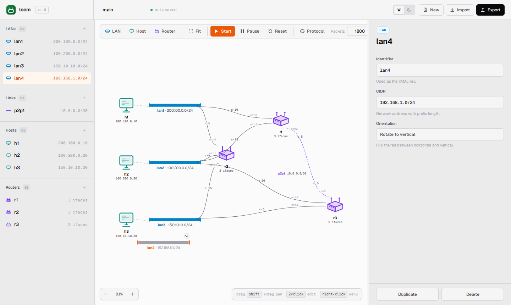
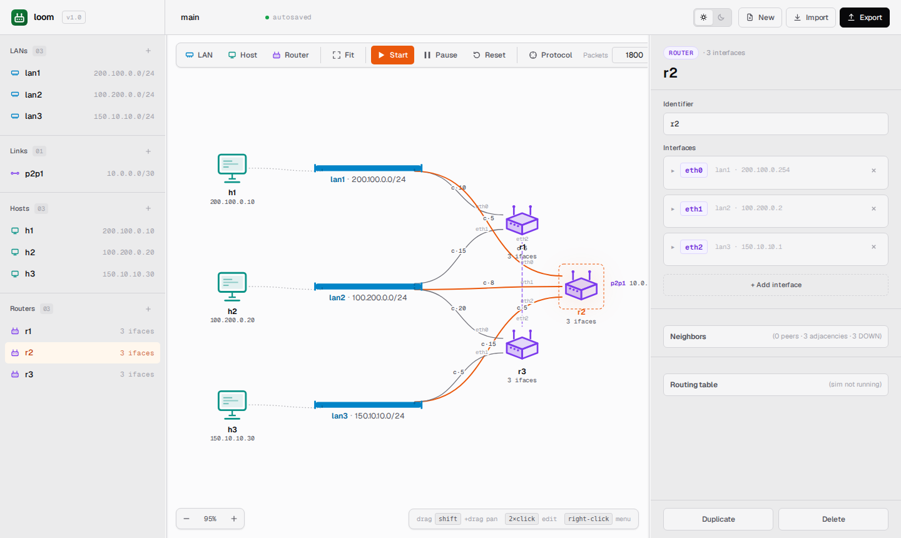

> 🌐 [English](../../user-guide/building-topologies.md) · **Español**

# Construir topologías

Una topología de `loom` se construye a partir de cuatro tipos de entidades:
**redes** (LANs multi-access), **links** (punto a punto), **hosts** y
**routers**. Esta guía recorre cada uno, tanto en el canvas como en YAML.

Cuando la simulación está en estado **idle** o **paused**, todas las operaciones
de agregar, renombrar, duplicar y eliminar están disponibles. Cuando está **running**,
se pueden agregar redes, links, hosts y routers directamente en el canvas — cada
nueva entidad se confirma en la simulación en vivo tan pronto como se completa
su dirección o CIDR (solo se permite completar la dirección de una nueva entidad
en vivo; cambiar la dirección de una interfaz existente requiere detener primero).
Renombrar, duplicar y editar direcciones en entidades existentes permanece
bloqueado mientras la simulación está en ejecución; pausar primero para esas
operaciones.

Si se prefiere usar YAML en lugar del canvas, ir a
[Formato YAML](yaml-format.md) para la referencia del esquema. Ambos enfoques
producen la misma topología — el SPA hace una vuelta completa a través del parser.

---

## Redes (LANs multi-access)

Una **red** es una LAN multi-access. Hosts y routers se conectan a través
de sus interfaces, y a cada interfaz se le asigna una dirección del prefijo de la red.

### Agregar una

Hacer click en **LAN** en la barra de herramientas (o presionar <kbd>N</kbd>).
Aparece un nuevo rail de red en el centro del canvas con un nombre provisional
y un prefijo `/24`.



Hacer click en el rail para seleccionarlo; se abre el inspector. Editar:

- **Name** — debe ser único entre redes **y** links. Se guarda automáticamente.
- **CIDR** — cualquier prefijo IPv4 válido. El parser lo canonicaliza
  (`10.1.2.3/24` se convierte en `10.1.2.0/24`). Dos redes no pueden compartir
  el mismo prefijo a menos que sea un rango privado RFC 1918 (`10.0.0.0/8`,
  `172.16.0.0/12` o `192.168.0.0/16`); los prefijos públicos deben ser
  únicos en toda la topología.

Múltiples usuarios pueden declarar CIDRs privados superpuestos — por ejemplo,
dos segmentos de red independientes pueden usar `192.168.1.0/24`. El tráfico
que se origina en una red privada y tiene como destino una dirección pública
es automáticamente source-NATed por el router de egreso, de modo que el lado
público ve la propia IP pública del router en lugar de la dirección privada del host.

### Conectar un dispositivo

Arrastrar un host o router cerca del rail y soltar. La interfaz se conecta
automáticamente y se le asigna la próxima IP libre en el prefijo. El inspector
muestra la dirección asignada — cambiarla si se desea una específica.

Un dispositivo puede conectarse a una red a través de **una o más interfaces**
(solo los routers, en la práctica — los hosts tienen exactamente una interfaz).

### Mover y redimensionar el rail

- Arrastrar el cuerpo del rail para trasladarlo.
- Arrastrar el handle en cualquiera de los extremos para alargar o acortar el rail.
  Hay una longitud mínima (aproximadamente el ancho de una etiqueta corta) y una
  longitud máxima (aproximadamente el ancho de la pantalla a zoom normal); el handle
  se ajusta a esos límites.

### Eliminar

Click derecho → **Delete**, o seleccionar y presionar <kbd>Delete</kbd>. Si algún
host o router todavía tiene una interfaz en esta red, el SPA bloquea la
eliminación con un toast. Eliminar o reubicar los dispositivos primero.

Mientras la simulación está en **paused**, la eliminación encola una operación;
la eliminación real del lado del servidor ocurre al hacer **Resume**.

---

## Hosts

Un **host** es un endpoint que puede enviar y recibir datagramas pero no puede
hacer forwarding. Cada host tiene exactamente **una interfaz**.

### Agregar uno

Hacer click en **Host** (o presionar <kbd>H</kbd>). Aparece un nuevo ícono de
host en el centro del canvas. Se pedirá (o el inspector mostrará) lo siguiente:

- **Name** — debe ser único entre hosts y routers.
- **Network** o **Link** — el fabric al que se conecta el host.
- **Address** — debe ser una IP utilizable dentro del prefijo del fabric elegido.
  Para links `/30`, la red y las IPs de broadcast están reservadas.
- **Gateway** (opcional):
  - En una red, una IP válida dentro de la misma red. Requerido si el host
    necesita alcanzar algo fuera del link.
  - En un link, **se completa automáticamente con la IP del peer**. Si se
    configura manualmente, debe coincidir con la del peer; los gateways que
    no coincidan son rechazados.

Soltar el host cerca del rail de una red para conectarlo a esa red, o cerca
de un extremo de un link para conectarlo allí.

### Configurar un gateway

Si el host está en una red, el inspector muestra un campo **Gateway**. Seleccionar
la IP del router que debe hacer forwarding del tráfico fuera de la red. Sin
un gateway, las llamadas a `ping`/`send` fuera del link fallan con
*"no route to host: no gateway configured."*

Si el host está en un link, el gateway es la IP del peer. No es necesario
escribirla — el parser la completa, y el inspector la muestra de solo lectura.

### ¿Hosts multi-homed?

No. `loom` modela deliberadamente los hosts como endpoints de una sola interfaz.
Si se necesita un dispositivo con múltiples interfaces, usar un router. El parser
rechazará un host YAML con múltiples interfaces; el SPA ni siquiera permite dibujarlo.

---

## Routers

Un **router** tiene una o más interfaces y ejecuta el protocolo de ruteo
link-state. Las interfaces pueden conectarse a redes, links punto a punto, o ambos.

### Agregar uno

Hacer click en **Router** (o presionar <kbd>R</kbd>). Aparece un nuevo router
en el centro del canvas con cero interfaces.

Abrir el inspector. La sección **Interfaces** del router muestra un botón
**+ Add interface**. Para cada interfaz:

- **Name** — único dentro de este router (`eth0`, `eth1`, ...).
- **Network** o **Link** — elegir uno; nunca ambos.
- **Address** — debe ser válida para el fabric elegido.
- **Cost** — la métrica que usa el protocolo de ruteo. Configurarla explícitamente:
  el valor predeterminado varía según cómo se creó la interfaz.
  Mayor = menos preferida. Enteros positivos.

Se puede conectar un router a tantas redes y links como se desee, siempre que
cada nombre de interfaz sea único dentro del router y no haya dos interfaces de
router en el mismo fabric con la misma dirección.



### Cambiar un costo

El inspector permite editar la columna **Cost** de forma inline. El cambio:

- Mientras está en **idle**, el cambio se guarda en el navegador y se aplicará
  la próxima vez que se cargue la topología.
- Mientras está **running**, la barra de herramientas deshabilita las ediciones
  directas de costo — pausar primero.
- Mientras está **paused**, el cambio de costo se encola. Al hacer **Resume**,
  el servidor lo aplica y el protocolo de ruteo lo toma en cuenta en el próximo
  flood de LSA.

También se puede editar un costo desde el terminal del router:

```
update_cost eth0 25
```

Esto evita el camino del inspector y actualiza el router directamente. Usar
cualquiera — ambos invocan la misma operación de actualización de costo en el backend.

### Eliminar

Click derecho → **Delete**. Eliminar un router del que dependen otros routers
para el ruteo hará que las rutas desaparezcan de los vecinos — esto es
intencional. Sus grafos seguirán referenciando al router eliminado hasta que
reciban un nuevo anuncio que no lo mencione (lo que, en este protocolo, ocurre
porque las aristas del router eliminado *no se re-anuncian*). En la práctica,
reiniciar o hacer reset para ver un estado limpio.

---

## Links punto a punto

Un **link** es un fabric `/30` o `/31` con exactamente **dos** endpoints.
Cualquier endpoint puede ser un router o un host (router–router, router–host
o host–host). Sin dominio de broadcast — los frames van directamente al peer.

### Agregar uno

Hay dos formas de crear un link directamente en la aplicación:

**Asistente con click derecho** — hacer click derecho en cualquier host o router
y elegir **New p2p link…**. Aparece un banner pidiendo seleccionar el otro
endpoint. Hacer click en el dispositivo peer en el canvas; el link se crea con
ambos endpoints conectados y aparece inmediatamente. El link comienza sin CIDR
— seleccionarlo y configurar el CIDR y las IPs de los endpoints en el inspector.

**Botón del inspector** — seleccionar un host o router en el inspector, encontrar
una interfaz cuyo tipo de fabric está configurado como **Link** y hacer click en
**+ New link** junto al selector de fabric. Se crea un nuevo link y la interfaz
se conecta a él; una segunda interfaz (en cualquier dispositivo) puede conectarse
después para completar el par.

También se pueden describir links en YAML e importar el archivo mediante
**Import → Browse local file…** si se prefiere crear la topología como texto.
Ver [Formato YAML](yaml-format.md) para el esquema.

### Reglas

- La máscara de red debe ser `/30` o `/31`. Cualquier otro valor es rechazado
  al parsear con *"link CIDR must be /30 or /31, got /N"*.
- Exactamente dos endpoints. El post-procesamiento del parser rechaza un link
  que queda con 0 o 1 endpoints (por ejemplo, al referenciar un dispositivo no
  declarado).
- Un link `/30` tiene dos direcciones de host utilizables (`.1` y `.2`); `.0`
  (red) y `.3` (broadcast) están reservadas.
- Un link `/31` tiene dos direcciones de host utilizables (`.0` y `.1`) — según
  RFC 3021.
- Un host en un link hereda automáticamente la IP del peer como su gateway.

### ¿Por qué solo `/30` y `/31`?

Una LAN multi-access ya tiene su propio modelo en `loom` — con semántica de
broadcast. Un link punto a punto es la **excepción** que permite conectar dos
dispositivos sin un bus LAN entre ellos. Cualquier prefijo más grande que `/30`
sería ambiguo: ¿es una LAN con dos hosts o un link? El parser resuelve la
cuestión restringiendo los links a los dos prefijos que tienen una interpretación
limpia de punto a punto.

### Reutilización de IPs entre links

Dos links paralelos pueden reutilizar el mismo `/30` sin afectar la entrega.
Un link entrega cada frame al endpoint que no es el remitente — no busca el
destino por dirección — por lo que las colisiones entre links no relacionados
no generan interferencias. Esto hace que copiar y pegar una topología de laboratorio
pequeña sea seguro.

---

## Un recorrido completo

Para construir la topología de ejemplo desde cero:

1. **LAN** tres veces. Renombrar y configurar CIDRs:
   - `lan1` → `200.100.0.0/24`
   - `lan2` → `100.200.0.0/24`
   - `lan3` → `150.10.10.0/24`
2. **Host** tres veces. Conectar y asignar direcciones:
   - `h1` en `lan1` con `200.100.0.10`, gateway `200.100.0.1`
   - `h2` en `lan2` con `100.200.0.20`, gateway `100.200.0.2`
   - `h3` en `lan3` con `150.10.10.30`, gateway `150.10.10.1`
3. **Router** tres veces. Conectar interfaces:
   - `r1`: eth0 en `lan1` (`200.100.0.1`, costo 10), eth1 en `lan2`
     (`100.200.0.1`, costo 15).
   - `r2`: eth0 en `lan1` (`200.100.0.254`, costo 5), eth1 en `lan2`
     (`100.200.0.2`, costo 8), eth2 en `lan3` (`150.10.10.1`, costo 15).
   - `r3`: eth0 en `lan2` (`100.200.0.10`, costo 20), eth1 en `lan3`
     (`150.10.10.10`, costo 5).
4. Agregar el link `p2p1: "10.0.0.0/30"` usando **New p2p link…**: click derecho en
   `r1`, elegir **New p2p link…**, luego hacer click en `r3` en el canvas. Seleccionar
   el nuevo link y configurar su CIDR a `10.0.0.0/30`. Luego configurar los costos en
   el inspector:
   - `r1.eth2` en `p2p1` (`10.0.0.1`, costo 5)
   - `r3.eth2` en `p2p1` (`10.0.0.2`, costo 5)

Hacer click en **Export**, elegir carpeta y nombre de archivo en el diálogo de
guardado, y el archivo guardado debería tener el contenido de `samples/sample.yaml`
(salvo los metadatos de coordenadas, que el SPA almacena localmente).

---

## Errores de validación

Al hacer click en **Start** o importar YAML, el servidor ejecuta el validador
completo. Fallos comunes:

| Error | Significado |
|---|---|
| `missing "internet" key at YAML root` | El YAML de nivel superior no tiene una clave `internet:`. |
| `missing "autonomous_systems" in internet block` | El bloque `internet:` no contiene un mapeo `autonomous_systems:`. |
| `<dev>: <iface>: declares both network and link` | Una sola interfaz solo puede conectarse a un fabric. |
| `<dev>: <iface>: address already in use by <other>` | Dos interfaces en el mismo fabric comparten una IP. |
| `<host>: gateway address not in host network` | La IP del gateway no está dentro de la subred del host. |
| `<host>: gateway mismatch: expected X, got Y` | El host está en un link y el gateway explícito no coincide con la IP del peer. |
| `<link>: link CIDR must be /30 or /31, got /N` | Los links deben ser `/30` o `/31`. |
| `<link>: link must have exactly two endpoints (got N)` | Un link tiene 0, 1, 3 o más endpoints. |
| `<link>: invalid address for link <name>` | En `/30`, se intentó usar `.0` o `.3`. |
| `<dev>: <iface>: invalid cost` | El costo no es un entero. |

El diálogo de error cita la entidad problemática por nombre — el parser tiene
cuidado de mostrar suficiente contexto para encontrar la línea en el YAML
o la entidad en el canvas.
