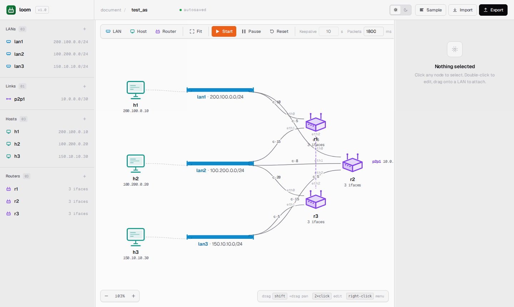
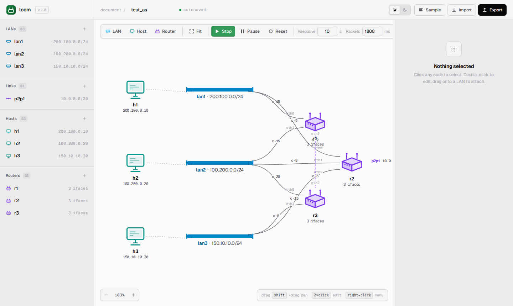
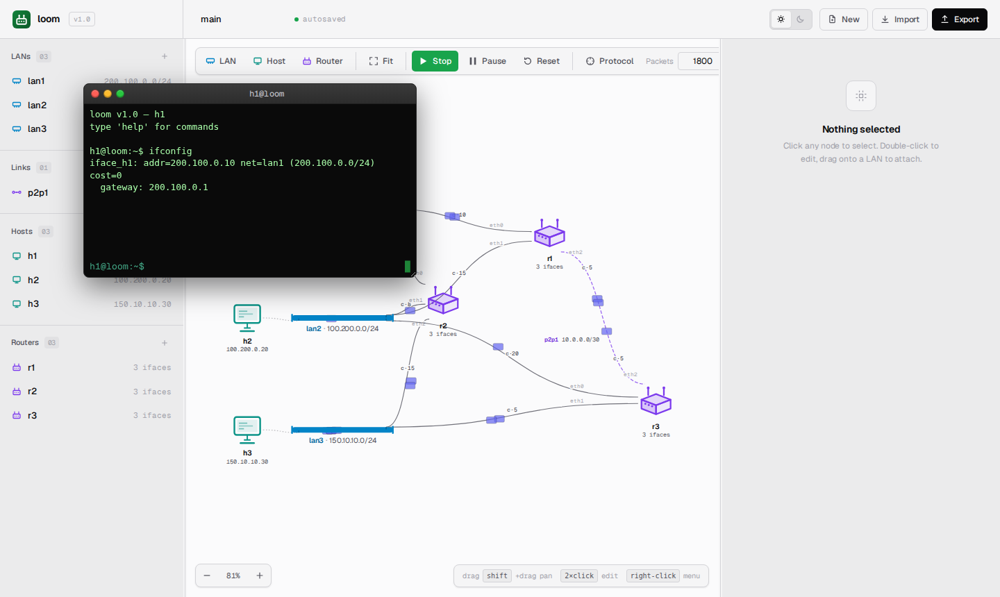
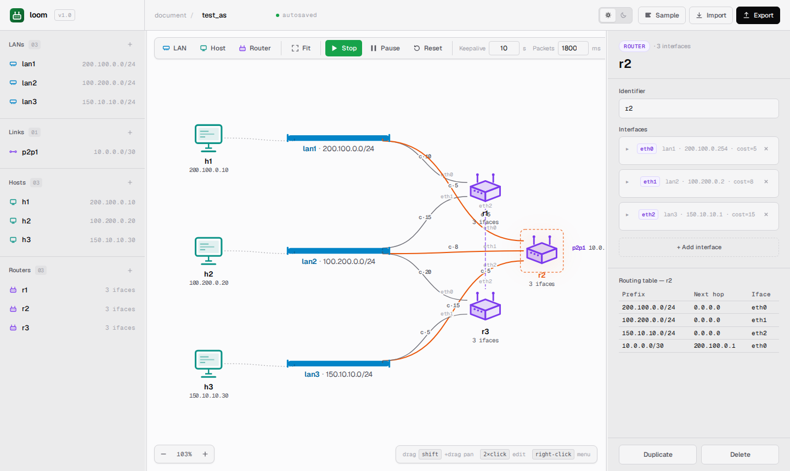

> 🌐 [English](../../user-guide/getting-started.md) · **Español**

# Primeros pasos

Esta guía lleva al usuario desde un clon reciente hasta una simulación en vivo con un ping entre dos hosts. Se asume Python 3.11 o superior.

## Alcance

`loom` es un simulador de conceptos de ruteo: modela L3 (forwarding IPv4,
direccionamiento, tablas de ruteo, convergencia link-state) y **solo** L3.
No hay L2 (sin direcciones MAC, ARP, STP, VLANs) ni L4 (sin
TCP/UDP, sin puertos, sin retransmisiones, sin control de congestión). Los frames son
sobres abstractos; los payloads son subclases de `Message` entregadas intactas.

Si se necesita una simulación de mayor fidelidad — capturas de paquetes, protocolos
reales o un stack de red del kernel — se puede considerar [ns-3](https://www.nsnam.org/),
[mininet](https://mininet.org/), [Containerlab](https://containerlab.dev/)
o [GNS3](https://www.gns3.com/).

## Instalación

```bash
git clone git@gitlab.com:lukius/netrouting.git
cd netrouting

python -m venv .venv
source .venv/bin/activate
pip install -r requirements.txt
```

`loom` tiene cuatro dependencias de ejecución y no requiere ningún prerequisito
del sistema más allá de Python. No hay base de datos que configurar, ni
broker de mensajes, ni claves de API que provisionar.

## Ejecutar la interfaz web

El punto de entrada predeterminado inicia el servidor FastAPI y sirve el SPA:

```bash
cd src
python loom.py
```

Se debería ver:

```
INFO:     Started server process [...]
INFO:     Application startup complete.
INFO:     Uvicorn running on http://127.0.0.1:8000 (Press CTRL+C to quit)
```

Abrir [http://127.0.0.1:8000](http://127.0.0.1:8000). El canvas aparece
pre-poblado con la topología de ejemplo incluida — tres hosts (`h1`,
`h2`, `h3`), tres redes (`lan1`, `lan2`, `lan3`), tres routers (`r1`,
`r2`, `r3`) y un link punto a punto `/30` (`p2p1`) entre `r1` y `r3`:



El estado de la página — pan, zoom, topología actual, tema y
estados de los botones de la barra de herramientas — se persiste en `localStorage`.
Al recargar, se retoma desde donde se estaba.

## Presionar Start

Hacer click en el botón verde **Start** de la barra de herramientas (o presionar <kbd>Space</kbd>).

Lo que ocurre, en orden:

1. El SPA serializa el canvas actual a YAML y lo envía por POST a
   `/topology`.
2. El servidor parsea, valida y construye un nuevo sistema autónomo.
3. El POST a `/sim/start` reanuda la simulación e inicia el protocolo de
   ruteo de cada router.
4. En unos pocos cientos de milisegundos, los paquetes del protocolo de
   ruteo comienzan a propagarse por el canvas — son los pequeños puntos
   huecos ("chatter").
5. A medida que los routers convergen, sus pestañas **Routes** se completan.
   El botón **Pause** aparece en la barra de herramientas y los botones
   **Add** se deshabilitan (no se puede modificar una topología en ejecución).



Si no se ve el chatter, hacer click en el botón **Chatter** de la barra de
herramientas — este silencia las animaciones del protocolo de ruteo.

## El primer ping

Hacer doble click en `h1` para abrir su terminal. La ventana emergente tiene este aspecto:



Escribir:

```
ifconfig
```

Se verá la interfaz única del host (`iface_h1`), su dirección
(`200.100.0.10`), la red a la que pertenece (`lan1`) y su gateway
(`200.100.0.1`).

Ahora hacer ping a `h3`:

```
ping h3
```

Salida:

```
seq=0 150.10.10.30: time=12.34 ms
--- h3 ping statistics ---
1 sent, 1 received, 0% loss
```

En el canvas, se debería ver un paquete animándose desde `h1` hasta `r1` (el
gateway predeterminado), a través del link `/30` hacia `r3`, y luego hacia `h3`,
seguido de la respuesta trazando el camino inverso. Probar con un host
inexistente:

```
ping h99
```

```
ping: invalid destination: h99
```

O una dirección routable que no existe:

```
ping 200.100.0.99
```

Expira tras los 3 segundos predeterminados e imprime:

```
seq=0 200.100.0.99: timeout
--- 200.100.0.99 ping statistics ---
1 sent, 0 received, 100% loss
```

## Inspeccionar una tabla de ruteo

Hacer click en cualquier router del canvas — por ejemplo `r2`. El panel derecho
muestra las interfaces del router y su tabla de ruteo actual:



Cada fila es una regla: un prefijo de destino, la dirección IP del next hop (o
`0.0.0.0` si está directamente conectado) y el nombre de la interfaz de salida. La
tabla se actualiza automáticamente cada vez que cambia la tabla del router (por
la llegada de una actualización de ruteo, una edición de costo o un parche de topología).

## Detener la simulación

Hacer click en el botón rojo **Stop** (que reemplaza a **Start**) o presionar <kbd>Space</kbd>.
La simulación vuelve al estado `idle`: los routers detienen sus threads del protocolo
de ruteo y los botones **Add** del canvas se vuelven a habilitar.

También se puede **pausar** (presionar <kbd>P</kbd>) — eso congela toda la
simulación sin descartarla. Mientras está en pausa, se pueden agregar o quitar
dispositivos o actualizar costos; las ediciones se acumulan como una lista de
parches y se aplican atómicamente al hacer click en **Resume**. Ver
[Ejecutar simulaciones](running-simulations.md) para el ciclo de vida completo.

## Qué hacer a continuación

- [Interfaz web](web-ui.md) — recorrido completo de la barra de herramientas, el canvas, el inspector y los terminales.
- [Construir topologías](building-topologies.md) — agregar redes, hosts, routers y links punto a punto propios.
- [Formato YAML](yaml-format.md) — escribir topologías a mano o importarlas; entender cómo el SPA guarda y reanuda.

## Resolución de problemas

**"Address already in use" en el puerto 8000.** Otro proceso de `loom` ya está
en ejecución, o algún otro servicio ocupa el puerto. Se puede cerrarlo o
iniciar en un puerto diferente: `LOOM_PORT=8765 python loom.py`.

**El canvas está vacío al cargar por primera vez.** La topología de ejemplo debería
cargarse automáticamente; si no lo hace, hacer click en **Import topology…** en el
estado vacío y seleccionar `sample.yaml` de la lista.

**Los paquetes no se animan.** Verificar que la simulación esté en estado `running`
(no en pausa o idle), y que el toggle **Chatter** no esté silenciando todos los
paquetes. El campo **Packet speed** controla la velocidad de animación (en
milisegundos por hop, 200–5000).

**Las tablas de ruteo siguen vacías.** El primer Hello ocurre casi de inmediato,
pero la convergencia tarda algunos intervalos de Hello en topologías con múltiples
hops. Reducir el **Hello interval** a `1` s en la ventana emergente **Protocol**
para acelerar el descubrimiento de vecinos durante la exploración.

**Un cambio en el YAML no tomó efecto.** El SPA sirve desde
`<source>.session.yaml`, no desde el archivo fuente editado en disco. Hacer click
en **Reset** en la barra de herramientas para re-clonar la fuente, o reiniciar
`loom.py`. La fuente se configura mediante `LOOM_TOPOLOGY` (por defecto `samples/sample.yaml`).
