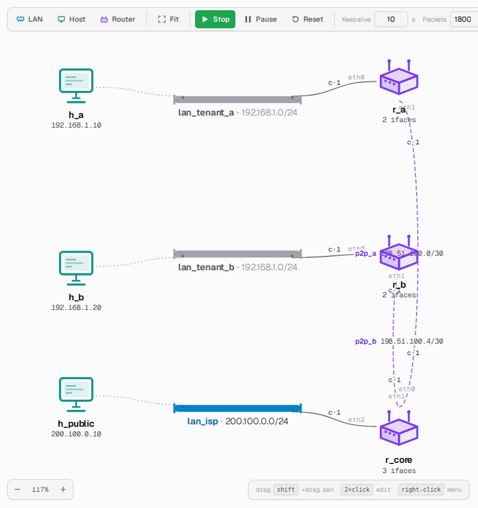
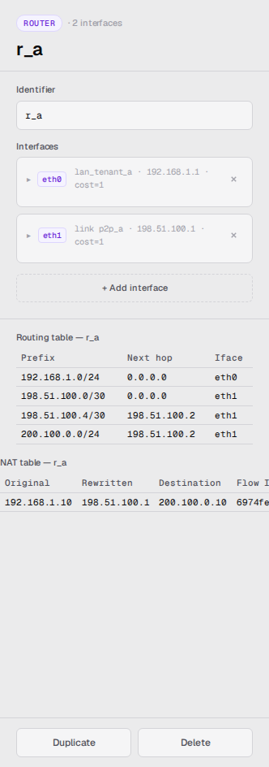

> 🌐 [English](../../user-guide/nat-and-private-lans.md) · **Español**

# NAT y LANs privadas

Una topología puede tener dos clases de LANs:

- **Públicas** — con direcciones a las que puede rutear cualquiera dentro del
  AS.
- **Privadas** — rangos RFC 1918 (`10.0.0.0/8`, `172.16.0.0/12`,
  `192.168.0.0/16`). Los hosts de una LAN privada son alcanzables únicamente a
  través de su router gateway, y su dirección no es visible para el resto del
  AS.

Esta página explica cómo reconocer las LANs privadas en el _canvas_, cómo llega
su tráfico a destinos públicos y cómo inspeccionar lo que hace el router
gateway.

## Reconocer una LAN privada

Las LANs privadas se dibujan en un **tono neutro atenuado**, y la etiqueta de la
interface del router que oficia de gateway se atenúa igual. Las LANs públicas se
dibujan con el color de acento habitual. Esta señal visual marca el límite del
NAT de un vistazo.

Los ejemplos de esta página salen de **`multi_tenant_nat.yaml`**, incluido junto
a `sample.yaml`: dos LANs de inquilinos que comparten deliberadamente
`192.168.1.0/24`, cada una detrás de su propio router, que se encuentran en una
LAN pública de ISP. Se lo puede cargar desde **Import** →
`multi_tenant_nat.yaml` para seguir los ejemplos.



Es válido tener dos LANs privadas que compartan el mismo CIDR (por ejemplo,
`192.168.1.0/24` de los dos lados): el simulador permite esa superposición
mientras cada una siga detrás de su propio router gateway. Las LANs públicas, en
cambio, no pueden superponerse.

## Salir de una LAN privada

Cuando un host de una LAN privada hace ping a un destino público, su router
gateway le **reescribe la dirección de origen** con la dirección pública del
propio router. El resto del AS ve esa dirección pública; la respuesta vuelve al
router, que restituye la dirección privada original y se la entrega al host.

Al pausar la simulación y **pasar el cursor sobre un paquete animado**, el
_tooltip_ muestra la traducción, por ejemplo:

```
NAT @ r_a: 192.168.1.10 → 198.51.100.1
```

Esto funciona en ambos sentidos:
- En el tramo de **ida**, se reescribe el origen cuando el paquete sale de la
  LAN privada.
- En el tramo de **vuelta**, se reescribe el destino cuando el paquete vuelve a
  entrar a la LAN privada.

## Inspeccionar la tabla NAT

Hacer click en el router que está entre una LAN privada y una pública. Debajo
del panel de la tabla de ruteo, un panel de **tabla NAT** lista todas las
traducciones activas, de la más vieja a la más nueva:

- **Original** — el host privado que inició la conversación.
- **Rewritten** — la dirección pública a la que el router lo tradujo.
- **Destination** — la dirección pública con la que el host está hablando.
- **Flow ID** — un identificador por conversación, recortado para que entre en
  la columna; pasar el cursor por encima muestra el valor completo.



El panel se actualiza en el momento en que la animación del paquete llega al
router, de modo que el estado de la tabla se mantiene en sincronía con lo que se
ve en el _canvas_.

La tabla está **acotada**: cuando se llena, se descarta la entrada usada menos
recientemente. No hay vencimiento por tiempo, así que las entradas persisten
mientras se las siga usando.

## Dos hosts, un mismo destino

Cada ping recibe internamente su propio identificador de conversación, de manera
que dos hosts de la misma LAN privada que hagan ping al mismo destino público en
simultáneo obtienen cada uno su propia fila en la tabla NAT. Sus respuestas se
traducen de vuelta de manera independiente y llegan al host correcto.

## Reglas de topología

- Un host privado no puede salir de la LAN privada si su router gateway no tiene
  al menos una interface pública.
- La traducción se aplica a las conversaciones que inicia el lado privado. Si se
  hace ping a un host privado *desde* uno público cuyo gateway es ese mismo
  router, la respuesta vuelve intacta, desde el host al que se le escribió: un
  router no traduce entre dos redes que tiene conectadas.
- Dos hosts privados en LANs privadas distintas que comparten el mismo CIDR no
  pueden alcanzarse por dirección: cada uno cree que el otro vive en su propia
  LAN (y por lo tanto intenta una entrega dentro de la misma LAN), pero la
  dirección no está ahí.
- Los routers no anuncian sus prefijos privados a sus vecinos, con lo cual el
  protocolo de ruteo se mantiene limpio entre inquilinos. Sí anuncian que están
  *conectados* a esas LANs y links, que es una afirmación distinta: una red
  privada transporta perfectamente el tráfico destinado a otro lado, pero nadie
  que no esté sobre ella puede nombrarla como destino.

Para conocer las herramientas de la SPA en torno al NAT, ver
[web-ui.md](web-ui.md). Para el modelo arquitectónico y las decisiones de
diseño, ver [la página de arquitectura de NAT](../architecture/nat.md).
