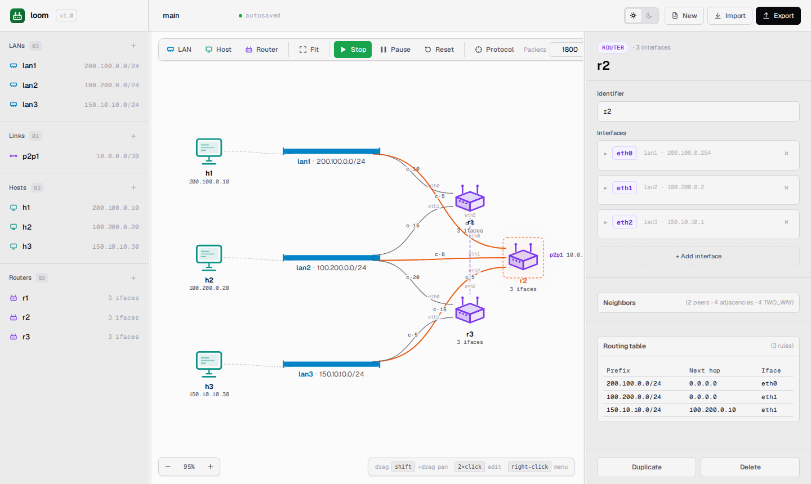

> 🌐 [English](../../user-guide/routing-tables.md) · **Español**

# Tablas de ruteo, vecinos y costos

Esta guía explica qué contiene la tabla de ruteo de un router, cómo inspeccionarla
y cómo el protocolo link-state **loom-OSPF** la construye.

Una explicación más breve del protocolo desde la perspectiva del usuario está incluida
aquí; el análisis detallado se encuentra en
[`docs/architecture/routing-protocol.md`](../architecture/routing-protocol.md).
Para ajustar los intervalos de Hello y de refresco de LSA, usar el botón **Protocol**
en la barra de herramientas — ver [Web UI: configuración de Protocol](web-ui.md#configuración-del-protocolo).

## Cómo aparecen las rutas

Al presionar **Start**, cada router comienza a hacer flooding de anuncios link-state
en cada interface, una vez por intervalo de refresco de LSA (por defecto 30 s,
ajustable en vivo mediante el popover de **Protocol**). Cada anuncio lista los pares
`(prefijo, costo)` directamente conectados del router.

Un router que recibe un anuncio:

1. Re-hace flooding del anuncio por cada otra interface.
2. Actualiza su vista local del grafo de red.
3. Si el grafo cambió, recalcula los caminos más cortos de Dijkstra desde sí mismo
   hacia cada prefijo conocido.
4. Reescribe su tabla de ruteo a partir del resultado de los caminos.

Todo el ciclo es **observable**: cada reconstrucción de la tabla de ruteo emite un
evento `routing_table_changed`, y la sección de tabla de ruteo de la SPA se
re-renderiza casi de inmediato.

## Inspeccionar una tabla de ruteo

### Desde la SPA

Hacer click en un router en el canvas. En el panel derecho, el inspector muestra
las interfaces del router y la tabla de ruteo actual juntas — sin necesidad de cambiar
de pestaña.



Columnas:

- **Prefix** — la red de destino (un CIDR IPv4).
- **Next hop** — la IP del router siguiente, o `0.0.0.0` si el destino está
  directamente conectado.
- **Iface** — cuál de las interfaces de este router reenvía el tráfico para este
  prefijo.

La tabla se **reconstruye desde cero** en cada cambio de grafo relevante — se verán
filas aparecer, desaparecer o moverse entre interfaces a medida que el protocolo
converge o se modifican costos.

### Desde un terminal

Hacer doble click en el router para abrir un terminal. Escribir:

```
route
```

```
prefix               next_hop        iface
200.100.0.0/24       0.0.0.0         eth0
100.200.0.0/24       0.0.0.0         eth1
150.10.10.0/24       100.200.0.10    eth1
```

Esta es la tabla de `r2` en la topología de ejemplo. `lan1` y `lan2` están
directamente conectadas (`0.0.0.0`). `lan3` (`150.10.10.0/24`) se reenvía
a `r3` (`100.200.0.10`) vía `eth1` — aunque `r2` tiene su propio `eth2` en `lan3`
(costo 15), el camino por `lan2` hasta `r3` (costo 8 + 5 = 13) es más barato.
loom calcula las rutas puramente a partir de los caminos más cortos de Dijkstra y
no da preferencia automática a las redes directamente conectadas, por lo que gana el
camino indirecto de menor costo.

El link punto a punto `p2p1` (`10.0.0.0/30`) no aparece en la tabla de `r2` en
absoluto: es un rango privado (RFC 1918), y los routers no anuncian prefijos privados
a sus vecinos, por lo que `r2` nunca aprende una ruta hacia él. Solo `r1` y `r3`,
que están directamente en `p2p1`, tienen una ruta a ese prefijo.

`0.0.0.0` como next hop significa que el prefijo está directamente conectado.

## Qué significa `0.0.0.0`

El simulador usa `0.0.0.0` como centinela que significa *"el destino está en una red
directamente conectada."*

Cuando un paquete coincide con una regla cuyo next hop es `0.0.0.0`:

- El **destino L3** del paquete es también su **next-hop L2** (el router que reenvía
  construye el frame de salida dirigido al destino final, no a otro router).
- Eso entrega el paquete via la LAN/link local directamente al destino.

Cuando se ve `0.0.0.0` en una tabla de ruteo, se está viendo **entrega directa**,
no un fallo del protocolo de ruteo.

## Costos y cómo definen los caminos

Cada interface de router tiene un **costo** — una métrica entera positiva. El
protocolo de ruteo calcula los caminos más cortos de Dijkstra ponderados por estos
costos.

El costo es el costo **del lado de transmisión** de la interface desde la que se
origina el anuncio. Entonces, en la topología de ejemplo, `eth0` de `r1` (en `lan1`)
tiene costo 10, lo que significa *"enviar por `r1.eth0` cuesta 10"*. El router que
recibe el anuncio registra esa arista como `r1 ↔ lan1` con peso 10.

Para sesgar el tráfico hacia un camino:

1. Abrir el terminal del router de origen.
2. `update_cost <iface> <new_cost>`.

Ejemplo: desincentivar el ruteo a través de `r1` en `lan1`:

```
# r1's terminal
update_cost eth0 100
```

O desde el panel inspector del router (la lista de Interfaces tiene editores de
**Cost** en línea). Ambos caminos invocan la misma operación de actualización de
costo en el backend.

El cambio se propaga en el próximo flooding de LSA. Dentro de un intervalo de
refresco de LSA por hop, cada router tiene el nuevo grafo y ha recalculado sus rutas.

## Convergencia

El tiempo de convergencia está dominado por dos factores:

1. **Intervalo de refresco de LSA.** Los nuevos routers o los costos modificados solo
   hacen flooding una vez por intervalo. Un intervalo de 30 s significa que cada hop
   puede tomar hasta 30 s para propagarse.
2. **Diámetro de la red.** Un cambio en un extremo de una cadena de N hops tarda hasta
   N intervalos de refresco en llegar al otro extremo, en el peor caso (el "next hop"
   controla la propagación del flooding según su propio cronograma).

En la topología de ejemplo (diámetro 3), la convergencia con el intervalo de refresco
de LSA por defecto de 30 s tarda hasta ~90 s después de un cambio. Bajar el
**LSA refresh interval** en el popover de **Protocol** a 1 s hace que el mismo cambio
converja en menos de 3 s.

El protocolo **detecta fallos**. Si un router deja de enviar mensajes de
descubrimiento de vecinos (por ejemplo, porque falló), sus vecinos notan el silencio.
Después de tres intervalos consecutivos perdidos — el **dead interval**, igual a 3 ×
el intervalo de Hello (por defecto 30 s) — la adyacencia se marca como caída.
Después de dos intervalos completos de refresco de LSA — el timer de **max-age**
(por defecto 60 s) — el anuncio del router caído se purga del grafo de red y cada
router recalcula sus rutas automáticamente.

Con los intervalos por defecto de 10 s para Hello y 30 s para refresco de LSA, el
ciclo completo desde el fallo hasta la reconvergencia toma del orden de decenas de
segundos (hasta 30 s para declarar al vecino caído, luego hasta 60 s para que el
anuncio obsoleto expire). Bajar los intervalos en el popover de **Protocol** permite
ver la convergencia en pocos segundos.

## Vecinos

### Desde el terminal

Un router puede listar sus **vecinos directamente conectados** — otros routers en la
misma LAN o link.

En el terminal:

```
neighbors
```

```
  r1     via lan1     (200.100.0.1)  cost=10
  r1     via lan2     (100.200.0.1)  cost=15
  r3     via lan2     (100.200.0.10) cost=20
  r3     via lan3     (150.10.10.10) cost=5
```

(Esos son los vecinos de `r2` en la topología de ejemplo — `r1` y `r3`,
conectados a través de varias LAN diferentes a distintos costos.)

Cada fila es una **adyacencia** — un fabric compartido, una interface, un
costo. Un router puede tener múltiples adyacencias con el mismo vecino si
comparten más de un fabric.

El comando neighbors es una vista de solo lectura del grafo local del router. Se
actualiza cuando se unen nuevos routers — pero solo después de que llegue su primer
anuncio. Si un router no muestra vecinos, puede ser que:

- No tenga routers peers (solo está conectado a hosts), o
- No haya completado un ciclo de Hello todavía (esperar un intervalo).

### Desde el inspector

Hacer click en un router en el canvas. La sección **Neighbors** del inspector
(debajo de la tabla de ruteo) muestra cada interface y el estado de adyacencia con
cada peer en esa interface:

| Estado | Significado |
|---|---|
| **TWO_WAY** | Bidireccional — ambos routers se han escuchado mutuamente su Hello y se han listado como vecinos. Las rutas se intercambian normalmente. |
| **INIT** | Unidireccional — este router escuchó un Hello del peer, pero el Hello del peer todavía no listó a este router. Normalmente es un estado transitorio que se resuelve dentro de un intervalo de Hello. |
| **DOWN** | Se esperaba el peer (hay otro router conectado a la misma LAN o link) pero no llegó ningún Hello reciente. Se muestra luego de un fallo o si transcurrió el dead interval del peer. |
| **no other routers** | La interface solo conecta a hosts — no hay nada con qué hacer peering. Esto es normal para una interface stub. |

La línea resumen (por ejemplo, *2 peers · 3 adjacencies · 2 TWO_WAY · 1 DOWN*)
permite ver de un vistazo si el router convergió completamente o todavía espera que
un peer se levante.

## Leer un camino

Cuando se ejecuta `ping h1 → h3` en la topología de ejemplo, los routers en el
camino se pueden inferir a partir de sus tablas de ruteo:

- `h1` (en `lan1`, gateway `200.100.0.1`) envía el paquete a `r1.eth0`.
- `r1.route` dice `150.10.10.0/24 → 10.0.0.2 / eth2` (vía el link a
  `r3`, camino más barato).
- `r3.route` dice `150.10.10.0/24 → 0.0.0.0 / eth1` (directamente
  conectado).
- `r3.eth1` (`150.10.10.10`) entrega a `h3` en `lan3`.

La animación de paquetes en el canvas sigue el mismo camino. Si se sube el costo de
`r1.eth2` a 99, el próximo ping luego de la reconvergencia se ruteará por `r2`
(vía las LAN), y la animación en el canvas cambiará visiblemente de camino.

## Sorpresas comunes

**"Mi ruta apareció y desapareció."** Un evento `routing_table_changed`
se dispara en **cada** recálculo, incluidos los estados intermedios transitorios
durante la convergencia. Si se observa con atención durante las primeras rondas de
flooding link-state, se puede ver cómo las rutas se estabilizan en dos o tres
pasadas — el protocolo está aprendiendo el grafo un flooding a la vez.

**"Los costos no son simétricos."** No se requiere que lo sean. Cada
interface tiene su propio costo; que `r1.eth0` cueste 10 y `r2.eth0` cueste 5
significa que el triángulo `r1 ↔ lan1 ↔ r2` tiene dos pesos diferentes según la
dirección (10 desde el lado de r1, 5 desde el lado de r2). La búsqueda de Dijkstra
elige el camino más barato asimétrico.

**"¿Por qué mi camino no usa el hop más corto obvio?"** Hay que mirar todos los
costos intermedios, no solo el link directo. El *conteo de hops* más corto no es
necesariamente el *costo de camino* más corto. La topología de ejemplo tiene esta
propiedad: `r1 → r3` directamente por `p2p1` cuesta 5+5=10, pero
`r1 → r2 → r3` por `lan1 + lan2` puede costar menos dependiendo de los costos.

**"Mi tabla de ruteo está vacía."** O el simulador todavía no procesó el primer tick
(esperar un momento para el primer tick de protocolo), o el router no tiene routers
peers (verificar con `neighbors`). Un router aislado igual obtiene reglas `0.0.0.0`
para sus redes directamente conectadas la primera vez que procesa un tick; una tabla
vacía realmente significa *cero* redes conectadas.
