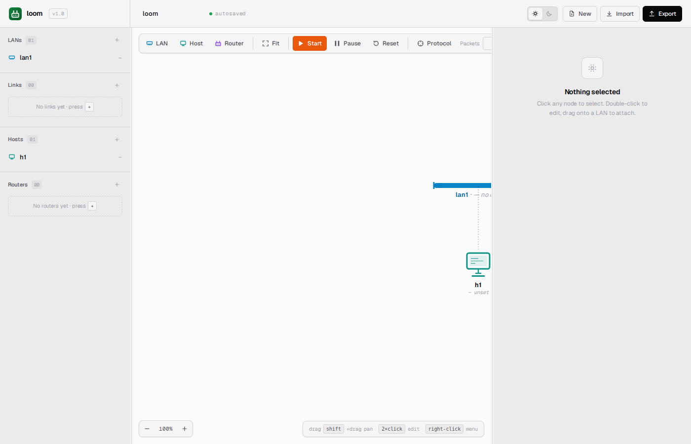
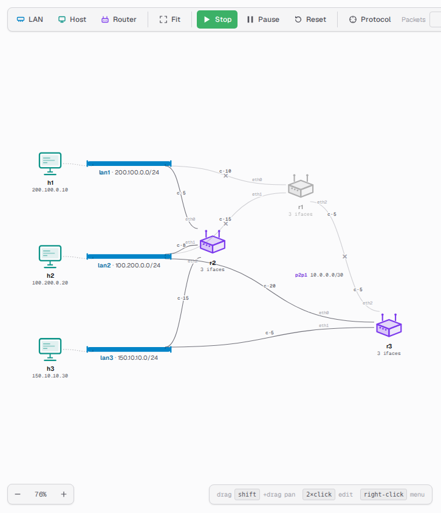
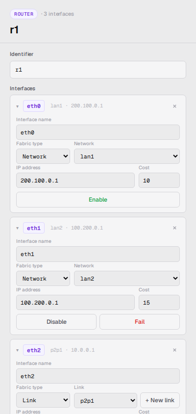

> 🌐 [English](../../user-guide/running-simulations.md) · **Español**

# Ejecutar simulaciones

Una vez construida (o cargada) una topología, la simulación tiene un ciclo de
vida: se inicia, corre, se pausa, se reanuda y en algún momento se detiene. Esta
guía explica cada transición y qué se puede hacer sin riesgo en cada paso.

## Estados

```
                  Start                     Pause
     ┌──────┐  ──────────►  ┌─────────┐  ──────────►  ┌────────┐
     │ idle │               │ running │               │ paused │
     └──────┘  ◄──────────  └─────────┘  ◄──────────  └────────┘
        ▲          Stop                     Resume         │
        └────────────────────── Stop ──────────────────────┘
```

- **idle**: no hay nada simulándose y el _canvas_ queda libre para editar.
- **running**: todos los dispositivos están activos y el protocolo de ruteo
  está corriendo.
- **paused**: todo queda congelado donde está, y las ediciones se van
  encolando hasta reanudar.

La barra de herramientas refleja esto: los botones **Start/Stop** y
**Pause/Resume** siempre muestran lo que la simulación está haciendo realmente,
y no lo último que se haya presionado.

## Start

Hacer click en **Start** (o presionar <kbd>Space</kbd>). Lo que ocurre, en
orden:

1. Se revisa el _canvas_ en busca de elementos incompletos: toda LAN y todo link
   necesitan un rango, cada host una red y una dirección, y cada interface de
   router una dirección. Si falta algo, el inicio se cancela, un mensaje en
   lenguaje llano indica qué corregir y se selecciona el elemento en cuestión
   para poder ir directo a él.
2. La topología terminada se entrega al simulador, que la construye y levanta
   cada dispositivo. Si el simulador rechaza algo que la revisión del _canvas_ no
   detectó, el inicio se cancela y el motivo aparece en pantalla.
3. Cada router arranca su protocolo de ruteo y el _chatter_ empieza a cruzar el
   _canvas_.



Si la topología ya estaba cargada (por ejemplo, se detuvo la simulación y se la
quiere volver a iniciar con la misma), el _canvas_ simplemente se envía otra vez
sin cambios. En cualquier caso, se actualiza el **archivo de sesión**: esa es la
copia de trabajo que lee el simulador, mantenida aparte del archivo cargado
originalmente para que este último nunca se modifique. Ver
[Formato YAML](yaml-format.md#flujo-de-guardado-y-reanudación) para saber dónde
vive.

**Durante la ejecución:**

- Los botones **LAN**, **Host** y **Router** siguen habilitados. Una **LAN o un
  link punto a punto** se suman a la red en vivo apenas se les da un rango
  válido; un valor incompleto o inválido queda pendiente hasta terminarlo, y si
  se pausa antes de hacerlo, pasa a la cola de ediciones pendientes y se aplica
  al hacer **Resume**. En ambos casos, la selección y la vista actual se
  conservan tras la actualización.
- Los **hosts y routers** se pueden soltar en el _canvas_ durante la ejecución,
  pero no se los puede *conectar*: el selector de red queda inerte y arrastrarlos
  sobre una LAN se rechaza. Quedan sueltos hasta pausar o detener la simulación
  y conectarlos ahí.
- **Arrastrar cualquier nodo o etiqueta de link** permite reubicarlo en el
  _canvas_: hosts, routers, redes y las etiquetas del punto medio de los links
  punto a punto se pueden mover libremente mientras la simulación corre. Es un
  cambio puramente visual, que no afecta a la simulación en curso. Las
  animaciones de los paquetes en vuelo acompañan a los nodos al moverlos.
  Intentar arrastrar un host o un router hacia *otra* red o link durante la
  ejecución muestra una señal roja de bloqueo sobre el destino y devuelve el
  nodo a su lugar al soltarlo; para reasignar un dispositivo a otra red hay que
  detener la simulación primero.
- Click derecho → **Rename / Duplicate / Delete** está bloqueado en el _canvas_.
- Los campos editables del inspector quedan de solo lectura (redireccionar una
  interface o reasignar un host a otra red exige pausar o detener primero).
- El botón **Protocol** está activo, así que se pueden reajustar en vivo los
  intervalos de Hello y de refresco de LSA.
- Click derecho sobre un router → **Halt router (graceful)**, **Crash router** o
  **Resume router** para dejarlo fuera de línea o traerlo de vuelta sin detener
  la simulación. Un router detenido o caído se ve atenuado en el _canvas_.
- Con un router seleccionado, los botones **Disable / Fail / Enable** que
  aparecen junto a cada interface en el inspector permiten controlarlas
  individualmente. La arista de una interface caída se convierte en un cable
  gris sólido con una pequeña ✕ en su punto medio, bien distinguible de un link
  punto a punto (punteado). El tráfico dirigido a una interface caída se
  descarta justo donde entraría al link: el paquete sale del origen y se
  desvanece en lugar de llegar al dispositivo.





**Los primeros pings pueden perderse mientras la red converge.** Después de
hacer click en Start, conviene darles unos segundos a los routers para que
intercambien rutas antes de hacer ping. Hasta que todos hayan escuchado a sus
vecinos, algunos paquetes se van a descartar, sobre todo entre hosts de redes
distintas. Si el primer ping expira, esperar un momento y volver a intentarlo.
(El intervalo de Hello por defecto es de 10 s; se puede bajar el **Hello
interval** a 1 s en la ventana emergente **Protocol** para que los vecinos se
descubran más rápido).

Para ver cómo la salida de un ping va apareciendo en la terminal, y cómo un ping
con cuenta permite observar el tráfico rerutearse en medio de la secuencia, ver
el comando `ping` en [Terminales](terminals.md).

## Pause

Hacer click en **Pause** (o presionar <kbd>P</kbd>). Cada dispositivo se detiene
donde está, en el siguiente punto en que hacerlo sea seguro.

Efectos observables en el _canvas_:

- Las animaciones de paquetes se congelan (los frames en vuelo quedan detenidos
  sobre el cable).
- Los mensajes periódicos Hello y LSA del protocolo de ruteo se detienen.
- El botón **Pause** pasa a ser **Resume**.

La pausa es además el complemento natural del panel de paquetes (ver
[Interfaz web](web-ui.md)): con las animaciones congeladas es muy fácil leer la
correspondencia entre insignias y filas.

**Durante la pausa se puede editar lo siguiente:**

- Agregar una LAN, un host o un router.
- Duplicar una LAN, un host, un router o un link.
- Eliminar cualquiera de los anteriores.
- Actualizar el costo de una interface.
- Editar nombres y direcciones (con las mismas reglas de unicidad y validez que
  rigen en cualquier otro momento).

Cada cambio se refleja como un contador en la etiqueta del botón **Resume**:
*Resume (3 edits)*. Todos se van encolando en el _canvas_, y nada llega a la
simulación hasta reanudarla.

Durante la pausa no hay ningún **Start** para presionar, porque la simulación ya
está cargada. El botón principal dice **Stop**, y funciona: desarma la
simulación y devuelve todo a `idle`. Hay que tener en cuenta que también
descarta las ediciones que hubiera pendientes en la cola.

## Resume

Hacer click en **Resume**. Las ediciones encoladas primero se cotejan con el
_canvas_ tal como está en ese momento: cada una se envía con sus valores
actuales (una LAN agregada y luego renombrada se envía con el nombre nuevo) y se
descarta todo lo que se haya eliminado mientras tanto.

Después se aplican todas juntas, en un esquema de todo o nada:

- Si una sola edición es inválida, **no se aplica ninguna**. La simulación sigue
  en pausa, un mensaje indica cuál es el problema y la cola se conserva para
  poder corregirlo y reanudar de nuevo.
- Si no, todas las ediciones se aplican en orden y la simulación continúa desde
  donde había quedado, conservando el estado de ruteo que ya tenía construido.

Estos son los mensajes que pueden aparecer y su significado:

| Mensaje | Qué ocurrió |
|---|---|
| `duplicate_name` | El nombre ya está tomado por otra entidad. |
| `address_in_use` | Otra interface de host o router en esa red ya tiene esta IP. |
| `network_in_use` | Una LAN que se eliminó todavía tiene un host o un router conectado. |
| `network_not_found` | Un host o un router hace referencia a una LAN que la simulación no tiene. |
| `interface_not_found` | Una edición de costo nombra una interface que ese router no tiene. |
| `invalid_cost` | El costo tiene que ser un número positivo. |

Que la cola se coteje primero contra el _canvas_ es lo que hace que la secuencia
"pausar → agregar → renombrar → reanudar" se sienta natural: uno piensa en la
forma que quiere darle a la red, y no en las ediciones individuales que lo
llevaron hasta ahí.

## Stop

Hacer click en **Stop** (o presionar <kbd>Space</kbd> otra vez). La simulación
se desarma: cada red, link, router e interface se apaga de manera ordenada, la
simulación se descarta y el estado vuelve a `idle`.

Qué sobrevive:

- El **archivo de sesión**, o sea, la copia de trabajo de la topología. El
  siguiente Start vuelve a leerlo. Ver
  [Formato YAML](yaml-format.md#flujo-de-guardado-y-reanudación) para saber
  dónde vive.
- Todo lo que está en el _canvas_. Al hacer Stop y luego Start sin tocar la
  topología, todo queda igual que antes.
- Las terminales abiertas en pantalla. Como siguen apuntando a una simulación
  que ya no existe, los comandos que se escriban en ellas fallan con *no
  topology loaded*. Conviene cerrarlas y volver a abrirlas después del próximo
  Start para tener una sesión limpia.

Las ediciones hechas en `idle` (después de detener y antes del próximo inicio)
existen únicamente en el _canvas_ hasta presionar Start, que entrega la
topología entera de una sola vez.

## Reset

Hacer click en **Reset** (habilitado solo en `idle`). Esto:

1. Elimina el archivo de sesión, es decir, la copia de trabajo de la topología.
2. Vuelve a clonar desde el archivo original (`samples/sample.yaml` por defecto,
   o aquel al que apunte `LOOM_TOPOLOGY`).
3. Vuelve a parsear ese original para armar un sistema autónomo nuevo.
4. Reemplaza el _canvas_ con la topología recién cargada.

Conviene usar Reset cuando la sesión se alejó demasiado del original y se quiere
volver atrás. El archivo original **nunca se modifica**: Reset descarta
solamente la copia de trabajo.

## Ajustar los intervalos del protocolo

Hacer click en **Protocol** en la barra de herramientas abre la ventana
emergente de configuración del protocolo, con dos campos ajustables:

- **Hello interval**: cada cuánto envían los routers sus mensajes de
  descubrimiento de vecinos (10 s por defecto). Más bajo significa detectar y
  declarar vivos a los vecinos más rápido; más alto, menos ruido pero más
  demora en detectar vecinos nuevos.
- **LSA refresh interval**: cada cuánto vuelven los routers a anunciar su
  estado de enlace completo (30 s por defecto). Más bajo significa reanuncios
  más frecuentes y convergencia más rápida ante un cambio; más alto, un _canvas_
  más tranquilo.

Los cambios se aplican a todos los routers apenas se hace click en **Apply**. El
nuevo valor toma efecto en el próximo límite de intervalo de cada router, así
que la demora máxima es el valor del intervalo *anterior*.

Para acelerar la convergencia inicial mientras se explora, conviene bajar el
**Hello interval** a 1 s. Para que una simulación en ejecución reanuncie rutas
de manera más agresiva, bajar el **LSA refresh interval**. Llevar cualquiera de
los dos a 1 s hace que el protocolo genere _chatter_ visible en el _canvas_, a
razón de aproximadamente un ciclo por segundo.

## Idle, paused y running

| Acción | Idle (simulación sin iniciar) | Paused (simulación cargada) | Running |
|---|---|---|---|
| Dónde vive la edición | En el _canvas_, guardada en el navegador | En el _canvas_, más la cola de ediciones pendientes | Aplicada de inmediato a la simulación en ejecución |
| Cuándo la ve la simulación | En el próximo **Start**, junto con toda la topología | Al hacer **Resume**, en lote | Apenas se completa cada una |
| Qué se valida | Toda la topología, al hacer Start | Cada edición, al hacer Resume | Cada edición, a medida que se completa |
| Si falla | El inicio se cancela y no se carga nada | Se rechaza el Resume y se conserva la cola para poder corregirla | La edición se rechaza y el _canvas_ vuelve a lo que tiene la simulación |
| Impacto en la convergencia | Los routers arrancan desde cero | Se preserva el estado de ruteo existente y se incorporan las aristas nuevas | Las LANs y links nuevos se incorporan sin interrupción |

Para prototipar ("¿funciona este CIDR?"), alcanza con editar en `idle` y
presionar Start: el parser responde en segundos. Para probar convergencia
incremental ("¿qué pasa si levanto una LAN nueva *mientras corre*?"), conviene
agregarla en vivo, sin pausar. Todo lo que implique conectar un dispositivo,
como un router nuevo sumándose a una LAN existente, requiere pausar: se hacen
juntos los cambios relacionados y se reanuda de manera atómica.

## Consejos

- **Bajar el Hello interval mientras se explora.** Los 10 s por defecto son
  realistas, pero lentos para el descubrimiento de vecinos. Conviene bajarlo a
  1 s mientras se investiga y restaurarlo después, para tener un _canvas_ más
  tranquilo.
- **Pausar antes de una tanda de ediciones.** Así los cambios relacionados se
  aplican todos juntos, lo que sale más barato que iniciar y detener por cada
  uno.
- **Usar Reset, y no Stop+Start, cuando la sesión quedó rara.** Stop apenas
  descarga el AS, mientras que Reset descarta la sesión y vuelve a empezar desde
  el archivo original.
- **El archivo de sesión vive fuera del proyecto.** Se guarda en un directorio
  temporal y no junto al original, de modo que el árbol de fuentes queda limpio
  y un archivo original de solo lectura sigue funcionando. Ambos archivos son
  YAML plano y se pueden comparar con un diff; ver
  [Formato YAML](yaml-format.md#flujo-de-guardado-y-reanudación) para la
  ubicación exacta.
