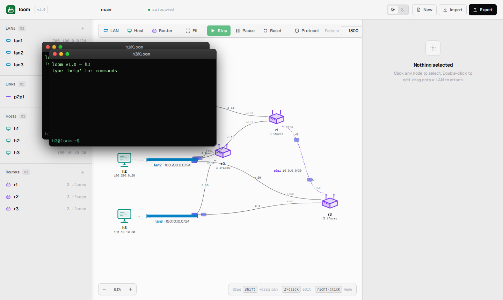
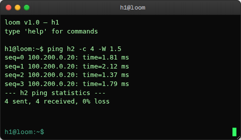

> 🌐 [English](../../user-guide/terminals.md) · **Español**

# Terminales

Cada host y cada router de `loom` tiene su terminal, que es la vía para
interactuar con un dispositivo en particular. Por ejemplo, se le puede preguntar
a un host qué tiene en sus interfaces o pedirle que haga ping a otro
dispositivo; o bien consultar la tabla de ruteo de un router y ajustar sus
costos, entre otras acciones.

## Abrir y cerrar una terminal

- **Abrir.** Hacer doble click en cualquier host o router del _canvas_. Se abre
  una ventana emergente con el nombre del dispositivo como título.
- **Cerrar.** Hacer click en la **X** de la ventana, o presionar
  <kbd>Ctrl+D</kbd> con el prompt vacío.
- **Varias terminales.** Se pueden abrir tantas como se quiera, y cada una es
  independiente.
- **Posición y tamaño.** Arrastrar la barra de título para moverla y las
  esquinas para redimensionarla. Ambas cosas se persisten por dispositivo.



## Teclado

| Tecla | Acción |
|---|---|
| <kbd>Enter</kbd> | Enviar el comando escrito |
| <kbd>Ctrl+L</kbd> | Limpiar el área de salida |
| <kbd>Ctrl+D</kbd> | Cerrar la terminal (solo con el prompt vacío) |
| <kbd>↑</kbd> / <kbd>↓</kbd> | Recorrer el historial de comandos |
| <kbd>Tab</kbd> | Completado de comandos (básico) |

La terminal no se queda con los atajos normales del navegador salvo que el
prompt tenga el foco, así que <kbd>Ctrl+R</kbd> sigue recargando la página.

## Conjunto de comandos

Los comandos disponibles dependen de si la terminal pertenece a un host o a un
router. Ambos tipos comparten `ifconfig`, `route` y `help`.

Todos los ejemplos que siguen están tomados de la **topología de ejemplo
incluida**: tres hosts (`h1`, `h2`, `h3`), tres LANs (`lan1`, `lan2`, `lan3`),
tres routers (`r1`, `r2`, `r3`) y el link `p2p1` entre `r1` y `r3`. Es lo que
muestra el _canvas_ en la primera visita; ver
[Primeros pasos](getting-started.md) para una imagen. Puede cargarse en
cualquier momento desde **Import** → `sample.yaml` para seguir los ejemplos.

### Comunes a hosts y routers

#### `ifconfig`

Muestra la configuración de las interfaces.

```
ifconfig
```

En un **host** (una interface más un gateway opcional):

```
iface_h1: addr=200.100.0.10 net=lan1 (200.100.0.0/24) cost=0
  gateway: 200.100.0.1
```

En un **router** (una línea por interface, sin línea de gateway):

```
eth0: addr=200.100.0.1 net=lan1 (200.100.0.0/24) cost=10 up
eth1: addr=100.200.0.1 net=lan2 (100.200.0.0/24) cost=15 up
eth2: addr=10.0.0.1 net=p2p1 (10.0.0.0/30) cost=5 up
```

Cada línea termina en `up` o `down`, según el estado administrativo actual de
esa interface. Se cambia con `ifconfig <iface> up|down`.

El costo en la interface de un host siempre es `0`: los costos son un concepto
del protocolo de ruteo y solo tienen sentido en los routers.

#### `route`

En un **router**, vuelca la tabla de ruteo. Esta es la de `r2`, una vez que la
red se estabilizó:

```
route
```

```
prefix               next_hop        iface
200.100.0.0/24       0.0.0.0         eth0
100.200.0.0/24       0.0.0.0         eth1
150.10.10.0/24       100.200.0.10    eth1
```

Un next hop `0.0.0.0` significa que el destino está directamente conectado sobre
la interface indicada. A `lan3` se llega por `r3` (`100.200.0.10` en `eth1`) y no
por la propia `eth2` de `r2`, porque el camino que pasa por `lan2` hasta `r3` es
más barato (costo 8+5=13) que el link directo de `r2` a `lan3` (costo 15).
[Tablas de ruteo](routing-tables.md) explica en detalle cómo leer una tabla y
muestra esta misma en el inspector.

Ejecutar `route` antes de que la red se estabilice devuelve `0.0.0.0` en todos
los next hop: un router arranca conociendo solamente aquello a lo que está
directamente conectado, y las rutas aprendidas como la de arriba van apareciendo
a medida que llegan los anuncios.

En un **host**, muestra el gateway por defecto configurado.

```
route
```

```
gateway: 200.100.0.1
```

Si no hay ningún gateway configurado:

```
gateway: (none)
```

#### `help`

Lista los comandos disponibles según el tipo de dispositivo.

```
# host:
available: ifconfig, send <dst> <msg>, ping <dst> [-W t] [-c n] [-i s], route, set_gateway <ip>, help
terminal: clear, Ctrl+L (clear), Ctrl+D (close)

# router:
available: route, update_cost <iface> <cost>, ifconfig [<iface> up|down], halt, resume, neighbors, help
terminal: clear, Ctrl+L (clear), Ctrl+D (close)
```

---

### Comandos exclusivos de hosts

#### `send <dst> <message>`

Envía un mensaje de datos desde este host hacia `<dst>`, que puede ser un nombre
de host (resuelto mediante la tabla de hosts del AS) o una IP literal.

```
send h2 hello
```

```
sent 5 bytes to 100.200.0.20
```

También admite comillas (la terminal usa el mismo estilo de comillas que una
shell, así que un mensaje de varias palabras puede ir entre comillas dobles):

```
send h2 "hello world"
```

```
sent 11 bytes to 100.200.0.20
```

El host de destino recibe el mensaje en silencio: por defecto no aparece ninguna
notificación de "mensaje recibido" en la interfaz web.

#### `ping <dst> [-W <segundos>] [-c <cantidad>] [-i <segundos>]`

Envía un echo request y espera la respuesta (con un timeout por defecto de 3 s).

```
ping h3
```

```
seq=0 150.10.10.30: time=12.34 ms
--- h3 ping statistics ---
1 sent, 1 received, 0% loss
```

Para cambiar el timeout:

```
ping h3 -W 0.5
```

Si el destino es inalcanzable (nadie responde el ping):

```
seq=0 200.100.0.99: timeout
--- 200.100.0.99 ping statistics ---
1 sent, 0 received, 100% loss
```

Errores:

```
ping h2: no route to host: no gateway configured
```

Esto ocurre cuando el destino está fuera de la red local y el host no tiene
ningún gateway configurado.

`ping` mide el tiempo de ida y vuelta con un reloj monótono, así que los RTT
reflejan el tiempo real que le llevó al simulador hacer pasar el paquete por la
topología. Con un simulador ocupado (mucho _chatter_ de ruteo o varios flujos de
ping en paralelo), lo esperable en topologías chicas son RTT de un solo dígito
en milisegundos.

La opción `-c <cantidad>` envía esa cantidad de sondeos. La terminal los manda
**de a uno**, esperando que termine de animarse la ida y vuelta de cada sondeo
antes de mandar el siguiente, y haciendo luego una pausa de un segundo entre
ellos (igual que el `ping` real). Cada línea de respuesta aparece a medida que
la respuesta vuelve por el _canvas_, y al final se imprime una línea de resumen:

```
ping h2 -c 4 -W 1.5
```

```
seq=0 100.200.0.20: time=3.21 ms
seq=1 100.200.0.20: time=2.88 ms
seq=2 100.200.0.20: time=3.05 ms
seq=3 100.200.0.20: time=2.94 ms
--- h2 ping statistics ---
4 sent, 4 received, 0% loss
```



Como el sondeo siguiente no se envía hasta que terminó la animación del
anterior, esa pausa es una ventana real para modificar la topología en medio de
la secuencia y ver el efecto del cambio. Basta con deshabilitar una interface (o
detener un router) que esté sobre la ruta durante la pausa: el siguiente sondeo
sale de cero, con lo cual, una vez que la red reconvergió, viaja por la ruta
recalculada y su animación sigue ese camino nuevo.

La opción `-i <segundos>` regula la pausa: conviene alargarla si hace falta más
tiempo para editar, o usar `-i 0` para enviar cada sondeo apenas termina el
anterior (siempre de a uno, pero sin pausa):

```
ping h3 -c 8 -i 2
```

La pausa termina de inmediato al detener la simulación.

Las respuestas aparecen de a una, a medida que llegan, así que no hay que
esperar a que termine toda la corrida para ver resultados. Si se cierra la
terminal en medio de la secuencia, los resultados restantes se descartan en
silencio.

#### `set_gateway <ip>`

Actualiza el gateway por defecto del host.

```
set_gateway 200.100.0.254
```

```
gateway set to 200.100.0.254
```

El nuevo gateway debe estar dentro de la red del host; si no:

```
gateway 10.0.0.1 not in host network
```

En los hosts que están sobre un **link** `/30` o `/31`, el gateway es la IP del
peer y lo configura automáticamente el parser. En esos casos `set_gateway` está
permitido pero no tiene sentido: si se quiere otro peer, hay que cambiar el
cableado del link.

---

### Comandos exclusivos de routers

#### `update_cost <iface> <cost>`

Fija el costo de una interface. El valor nuevo se propaga en el siguiente
_flood_ de LSA.

```
update_cost eth0 25
```

```
cost of eth0 set to 25
```

`<cost>` debe ser un entero positivo.

```
update_cost eth0 -5
```

```
cost must be positive
```

```
update_cost eth9 1
```

```
r1: invalid interface eth9
```

#### `neighbors`

Lista los routers vecinos directamente conectados.

```
neighbors
```

```
  r1     via lan1     (200.100.0.1)  cost=10
  r1     via lan2     (100.200.0.1)  cost=15
  r3     via lan2     (100.200.0.10) cost=20
  r3     via lan3     (150.10.10.10) cost=5
```

Esta vista se arma a partir del grafo local del protocolo, de manera que solo
muestra los vecinos de los que este router *escuchó hablar*. Un vecino nuevo
puede demorar hasta un intervalo de Hello en aparecer acá.

Si el router no tiene routers pares, o todavía no completó su primer intercambio
de Hello:

```
(no neighbors yet)
```

#### `halt`

Deja al router fuera de línea de manera ordenada: inunda un LSA de retiro para
que los vecinos lo saquen de sus grafos de inmediato y después deja de hacer
forwarding.

```
halt
```

```
r1 halted
```

#### `resume`

Vuelve a poner en línea un router detenido. Reanuncia sus links y retoma el
forwarding.

```
resume
```

```
r1 resumed
```

#### `ifconfig <iface> up|down`

Levanta o baja una única interface, sin detener el router entero. Bajar una
interface retira ese link de los anuncios del protocolo de ruteo de manera
ordenada, y volver a levantarla lo reanuncia.

```
ifconfig eth0 down
```

```
eth0 down
```

```
ifconfig eth0 up
```

```
eth0 up
```

---

## Comando no encontrado

Un comando desconocido lo informa y no cambia nada:

```
foo bar
```

```
unknown command: foo
```

No hay pipes ni redirecciones al estilo de una shell: cada comando es una línea
y una respuesta, que se muestra tal cual.

Las comillas funcionan como en una shell común, así que `send h2 "hello world"`
entrega un solo mensaje y no dos palabras sueltas.

Para ver cómo llega al dispositivo una línea escrita en la terminal, o para
ejecutar los mismos comandos desde afuera del navegador, el formato está
documentado en
[la referencia de la API del servidor](../../architecture/server-api.md#post-devicesnamecommand).

## Después de un Stop

Las terminales quedan abiertas después de un Stop, pero ya no hay ninguna
simulación detrás, así que cualquier comando responde:

```
ping h3
```

```
[error] no topology loaded
```

Al hacer click en **Start**, el mismo comando vuelve a funcionar: misma
terminal, misma posición de la ventana. No hace falta reabrir nada.
