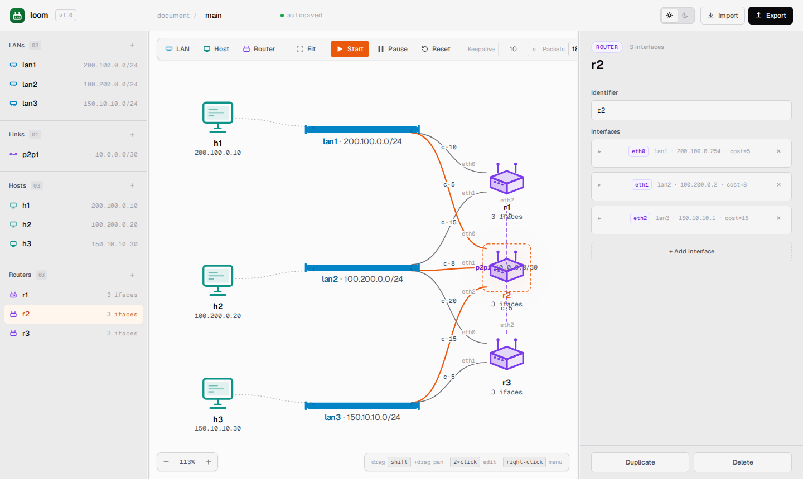
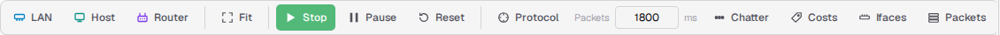
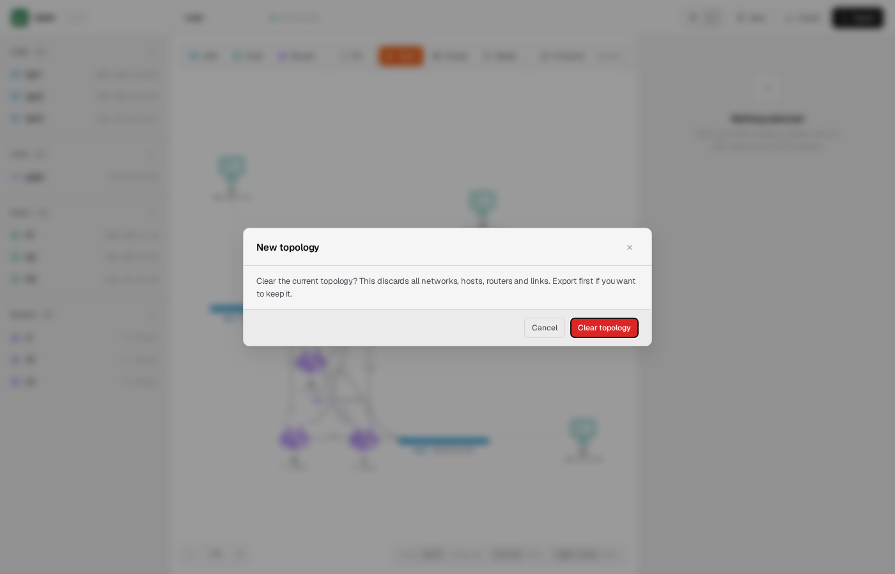
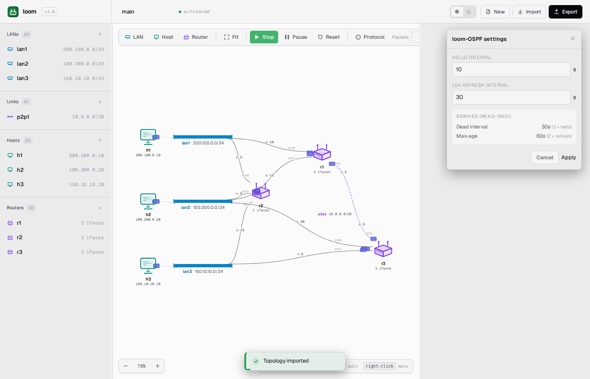
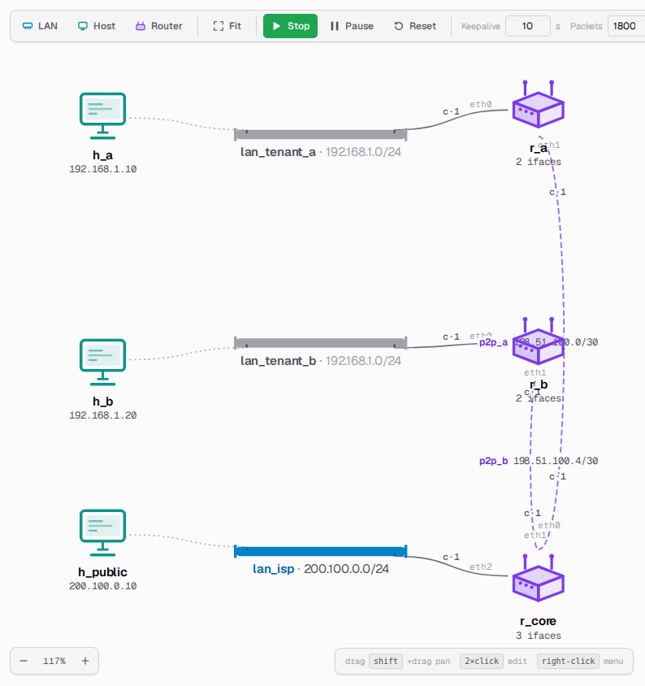
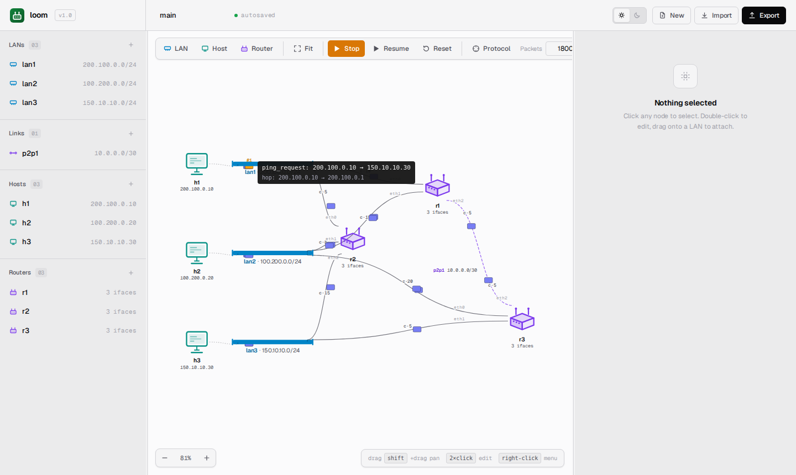
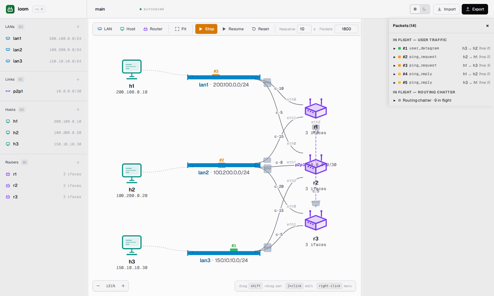
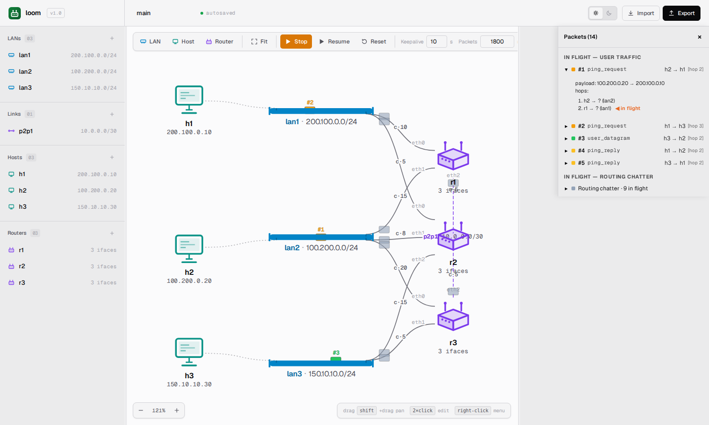
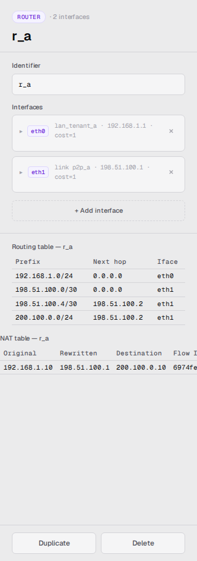
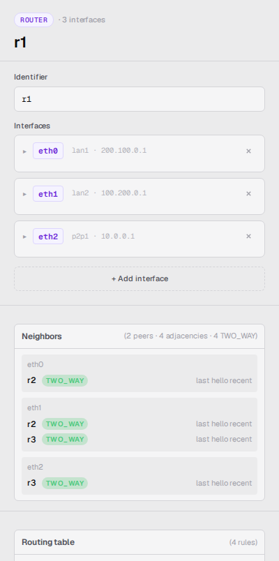

> 🌐 [English](../../user-guide/web-ui.md) · **Español**

# La interfaz web

Este es un recorrido guiado del SPA. Se cubre cada elemento interactivo,
organizado por región.

## Disposición

```
┌────────────────────────────────────────────────────────────────────────┐
│  Toolbar (always visible)                                              │
├──────────┬───────────────────────────────────┬─────────────────────────┤
│          │                                   │                         │
│  Left    │            Canvas                 │   Right pane            │
│  nav     │            (SVG, drag/pan/zoom)   │   (Inspector)           │
│          │                                   │                         │
└──────────┴───────────────────────────────────┴─────────────────────────┘
```

Ambos paneles laterales son redimensionables: arrastrar los separadores
verticales entre ellos. Los anchos se persisten entre recargas.



## Barra de encabezado

La franja en la parte superior de la página contiene los controles a nivel de proyecto:

| Control | Función |
|---|---|
| **Project name** | Nombre de la topología, editable. Se persiste; va y viene en el YAML. |
| **Save indicator** | Muestra `autosaved` durante la operación normal y `saving…` brevemente después de un cambio. |
| **Theme toggle** | Cambiar entre **Light** y **Dark** — se persiste entre recargas. |
| **New** | Limpiar la topología actual y comenzar desde un canvas vacío. Pide confirmación primero, y detiene la simulación si hay una en ejecución. |
| **Import** | Abrir un selector que lista las topologías de ejemplo incluidas; hacer click en una para cargarla, o usar **Browse local file…** para seleccionar cualquier archivo `.yaml` del equipo. |
| **Export** | Abrir el diálogo de guardado del navegador para elegir carpeta y nombre de archivo para la topología actual. El nombre sugerido se deriva del último archivo cargado — el sufijo `.session` se elimina para que el nombre no crezca en cada vuelta (por ejemplo, un archivo guardado como `sample.session.yaml` y re-exportado sugiere `sample.yaml`). Por defecto usa `topology.yaml` cuando no hay nada cargado. |

## Barra de herramientas del canvas

La barra de herramientas está sobre el canvas. De izquierda a derecha:

| Control | Función |
|---|---|
| **LAN** (<kbd>N</kbd>) | Agregar un rail de red en el centro del canvas. Deshabilitado mientras la simulación está en ejecución. |
| **Host** (<kbd>H</kbd>) | Agregar un host. Deshabilitado mientras la simulación está en ejecución. |
| **Router** (<kbd>R</kbd>) | Agregar un router. Deshabilitado mientras la simulación está en ejecución. |
| **Fit** (<kbd>F</kbd>) | Ajustar la topología al canvas visible. |
| **Start / Stop** (<kbd>Space</kbd>) | Alternar entre idle y en ejecución. |
| **Pause / Resume** (<kbd>P</kbd>) | Alternar entre en ejecución y en pausa. La etiqueta muestra cuántos cambios pendientes hay en cola mientras está en pausa. |
| **Reset** | Solo en idle: descartar la sesión y re-clonar desde el YAML fuente. |
| **Protocol** | Abrir la ventana emergente de configuración del protocolo (intervalo de Hello e intervalo de refresco de LSA). Habilitado mientras haya una topología cargada o en ejecución. |
| **Packets [speed] ms** | Establece la duración de animación por hop en milisegundos (200–5000). La etiqueta en pantalla muestra **Packets** con un campo numérico y la unidad **ms**. |
| **Chatter** | Silenciar o activar las animaciones de los paquetes del protocolo de ruteo. |
| **Costs** | Mostrar u ocultar las etiquetas de costo en cada interfaz de router. |
| **Ifaces** | Mostrar u ocultar las insignias de nombre y cantidad de interfaces. |
| **Packets** | Abrir el panel de paquetes que lista todos los paquetes en tránsito, con una insignia numérica en cada uno. Expandir una fila para ver el historial de hops y las traducciones NAT ocurridas en el camino. |



### Empezar desde cero

**New** borra toda la topología para poder construir una desde cero. Como
esto descarta todo lo que hay en el canvas, pide confirmación primero — exportar
la topología actual antes si se desea conservarla. Confirmar deja el canvas
vacío, listo para agregar la primera red.



### Configuración del protocolo

Hacer click en **Protocol** en la barra de herramientas para abrir la ventana emergente
de configuración del protocolo. Esto controla los dos parámetros de temporización
de loom-OSPF para la simulación en ejecución:

- **Hello interval** — con qué frecuencia cada router envía un Hello a sus
  vecinos para declararse activo (segundos, 1–300).
- **LSA refresh interval** — con qué frecuencia cada router rebroadcastea su
  anuncio link-state completo (segundos, 1–900).

Dos valores derivados se muestran de solo lectura junto a los campos:

- **Dead interval** — tres veces el intervalo de Hello. Un vecino que no
  responde por este tiempo se considera inalcanzable.
- **Max age** — dos veces el intervalo de refresco de LSA. Un LSA más antiguo
  que este valor expira de la base de datos de estados de enlace.

Presionar **Apply** para enviar los nuevos valores a la simulación en ejecución.
El cambio toma efecto en el próximo ciclo del timer del protocolo — no se requiere reinicio.



Para la mecánica subyacente, ver
[`docs/architecture/routing-protocol.md`](../architecture/routing-protocol.md).

### Atajos de teclado

| Tecla | Acción |
|---|---|
| <kbd>Space</kbd> | Start / Stop |
| <kbd>P</kbd> | Pause / Resume |
| <kbd>N</kbd> | Agregar red |
| <kbd>H</kbd> | Agregar host |
| <kbd>R</kbd> | Agregar router |
| <kbd>F</kbd> | Ajustar vista |
| <kbd>Esc</kbd> | Limpiar selección / cerrar menú contextual |
| <kbd>Delete</kbd> | Eliminar el nodo seleccionado |

Los atajos están **deshabilitados** mientras un campo de texto o textarea tiene
el foco (para que escribir en un terminal no active accidentalmente **Router**),
y mientras se mantiene presionada alguna tecla modificadora (para que <kbd>Ctrl+R</kbd>
siga siendo la recarga del navegador).

## Canvas

El canvas es un SVG con tres sistemas de coordenadas (mundo / vista /
pantalla). Se interactúa con él a través de tres gestos:

- **Click en un nodo** — lo selecciona. El inspector se completa a la derecha.
- **Arrastrar un nodo** — lo mueve. Las coordenadas se persisten.
- **Arrastrar el canvas vacío** — hace pan. El pan/zoom también se persiste.
- **Scroll en el canvas** — hace zoom alrededor del cursor.
- **Click derecho en un nodo** — abre el menú contextual (renombrar, duplicar,
  eliminar).
- **Doble click en un host o router** — abre su terminal en ventana emergente.

### Qué se ve

- Los **hosts** aparecen como íconos de estación de trabajo.
- Los **routers** aparecen como íconos de cubo.
- Las **LANs (redes de acceso múltiple)** aparecen como rails horizontales o verticales
  con extremos y un tick por interfaz conectada. Arrastrar el handle del rail
  para alargarlo; arrastrar el cuerpo del rail para moverlo.
- Los **links punto a punto** aparecen como aristas directas entre los dos
  extremos, con una etiqueta de punto medio arrastrable que lleva el nombre
  del link y el CIDR.
- Las **etiquetas de interfaz** (cuando **Interfaces** está activado) muestran
  el nombre y la dirección de la interfaz en cada punto de conexión.
- Las **etiquetas de costo** (cuando **Costs** está activado) muestran la métrica
  en cada interfaz de router.

La selección se indica con un anillo de resaltado alrededor del nodo.

### Redes privadas

Las redes cuyo CIDR cae en un rango privado RFC 1918 (`10.0.0.0/8`, `172.16.0.0/12`
o `192.168.0.0/16`) se renderizan en un **tono neutro atenuado** en lugar del
color de acento predeterminado. El mismo atenuado se aplica a las etiquetas de
interfaz en el lado del router de esas redes. La pista visual permite identificar
el límite NAT de un vistazo: atenuado = detrás de NAT, en color = ruteado directamente.



Los hosts, las aristas y los íconos de router conservan la saturación completa — solo
el rail de la red y sus etiquetas de interfaz del lado del router cambian de tono.
El estilo de selección y hover se aplica igualmente, por lo que una red privada
seleccionada sigue claramente resaltada.

Ver [NAT y redes privadas](nat-and-private-lans.md) para saber cómo el tráfico
cruza ese límite y cómo inspeccionar la tabla NAT del router de egreso.

### Pan y zoom

| Gesto | Función |
|---|---|
| Arrastrar espacio vacío | Pan |
| Rueda del mouse | Zoom alrededor del cursor |
| Botón **Reset view** o <kbd>F</kbd> | Ajustar topología al canvas |
| Botones **+** / **−** | Zoom discreto alrededor del centro del canvas |

## Animaciones de paquetes

Cada datagrama que atraviesa un fabric se dibuja como un pequeño rectángulo
de color que viaja entre sus extremos. El color codifica el tipo de paquete
— `user_datagram`, `routing_flood`, `ping_request`,
`ping_reply` — y el toggle **Chatter** de la barra de herramientas filtra
los paquetes del protocolo de ruteo cuando se quiere un canvas más tranquilo.

### Inspeccionar el contenido de los paquetes

#### Pausar y pasar el cursor

**Pausar la simulación y luego pasar el cursor sobre cualquier punto de paquete
congelado — aparece un tooltip con el contenido del paquete.** Pausar congela las
animaciones de paquetes en vuelo en su lugar, de modo que el canvas funciona
efectivamente como un depurador paso a paso.

El tooltip muestra:

- El **tipo de paquete** (`user_datagram` / `routing_flood` /
  `ping_request` / `ping_reply` / `unknown`).
- Los **endpoints originales** de la conversación — el origen y destino L3
  tal como estaban cuando se creó el paquete.
- Una segunda línea **`hop:`**, solo cuando el segmento de animación actual
  es entre direcciones que difieren de los endpoints originales — es decir,
  cuando un router está haciendo forwarding de un datagrama a través de un fabric.
  Los paquetes de un solo hop y broadcast no muestran esta línea.



Esta es la operación de depuración canónica cuando se trata de rastrear a dónde
va realmente el tráfico: pausar, pasar el cursor sobre cada punto congelado en
orden y leer el recorrido por hop. Mientras la simulación está en ejecución, los
paquetes se mueven demasiado rápido para que el tooltip se pose sobre el punto
con fiabilidad — pausar primero.

#### Panel de paquetes

Para rastrear múltiples paquetes a la vez — o para mantener el contexto mientras
la simulación sigue en ejecución — hacer click en **Packets** en la barra de herramientas.
Un panel se desliza desde la derecha mostrando:

- **In flight — user traffic.** Una fila por paquete que actualmente cruza la red,
  con una insignia numérica (`#1`, `#2`, …). La misma insignia aparece sobre el punto
  correspondiente en el canvas, de modo que una fila y su paquete siempre están
  vinculados visualmente. Expandir una fila para ver el historial de hops del paquete
  y las traducciones NAT ocurridas en el camino.
- **In flight — routing chatter.** Los paquetes del protocolo de ruteo se resumen
  en una sola línea por defecto para mantener la lista legible. Expandir el resumen
  para ver cada uno individualmente con su propia insignia `#R1`, `#R2`, … y una
  etiqueta **Hello** / **LSA** para que el tipo de mensaje sea claro de un vistazo
  — útil cuando se enseña cómo el protocolo propaga actualizaciones. El flooding de
  LSA se realiza por etapas hop a hop: la emisión del originador se anima primero;
  cada re-flood posterior solo comienza a moverse una vez que el hop entrante ha
  llegado visualmente al re-flooder, de modo que el flood se propaga hacia afuera
  por la topología en lugar de que todos los puntos aparezcan a la vez.
- **Recent.** Los últimos diez paquetes de tráfico de usuario que han completado
  su recorrido, descartando el más antiguo primero. Se aplica el mismo comportamiento
  de expandir para ver detalles.

El panel funciona igual mientras la simulación está en pausa — las insignias
congeladas están sobre los cables junto a las filas del panel, facilitando la
lectura de la correspondencia entre insignia y fila.





### Anotaciones NAT

Los paquetes que cruzaron un hop NAT muestran la traducción en su tooltip.
Pausar la simulación y pasar el cursor sobre el paquete para ver líneas como
`NAT @ r_a: 192.168.1.10 → 198.51.100.1`. Seleccionar el router de egreso
en el inspector abre un panel de tabla NAT con las entradas activas — cada fila
muestra el origen privado original, el origen público reescrito, el destino y el
flow ID. La tabla crece a medida que fluye el tráfico; las entradas están
limitadas por desalojo de las menos utilizadas recientemente.



Ver [NAT y redes privadas](nat-and-private-lans.md) para el flujo de trabajo completo.

## Panel izquierdo (navegación)

El panel izquierdo lista todas las entidades agrupadas por tipo — redes, links,
hosts, routers. Hacer click en un nombre para seleccionar; click derecho para el
menú contextual. El mismo modelo de selección que el canvas; ambos se mantienen
sincronizados.

El indicador de **Save state** — `autosaved` durante la operación normal,
`saving…` por un breve momento tras una mutación — está en la **barra de
encabezado**, junto al nombre de proyecto editable.

## Panel derecho (inspector)

El inspector renderiza **un panel por nodo seleccionado**, con secciones
que varían según el tipo de nodo. Todo el panel es visible a la vez — no
hay pestañas que cambiar.

Para todo tipo de nodo:

- **Identifier / name** — editable. Los cambios de nombre se validan
  para unicidad.
- **Properties** — dirección, membresía en red/link, gateway (solo hosts).
- **Duplicate / Delete** — al final del panel. Duplicate clona el nodo
  con un nuevo nombre; Delete lo elimina.

Secciones específicas por tipo:

| Selección | Secciones adicionales |
|---|---|
| Red | (solo CIDR) |
| Link | (solo CIDR) |
| Host | Tipo de fabric, red/link, IP, gateway predeterminado |
| Router | Lista de interfaces (una fila por interfaz, expandible) + Tabla de ruteo |

### Inspector de router

Para un router seleccionado, el inspector incluye tanto la lista de interfaces
(nombre · red · dirección · costo, más `+ Add interface`) **como** la tabla de
ruteo actual. La tabla de ruteo se actualiza automáticamente al seleccionar el
router y cada vez que llega una actualización de ruteo para ese dispositivo.
Columnas: prefijo, next hop, interfaz.

Una ruta directamente conectada muestra `0.0.0.0` como next hop — ese es el
valor centinela del simulador que significa "entregar al destino del paquete
en esta interfaz". Ver [Tablas de ruteo](routing-tables.md) para interpretar esto.

El inspector del router también muestra una sección **Neighbors** que lista,
por interfaz, cada vecino descubierto y su estado de adyacencia
(`TWO_WAY`, `INIT` o `DOWN`). La línea de resumen cuenta los routers vecinos
únicos, las adyacencias totales y un desglose por estado — ver
[Conteos de neighbors](#conteos-de-neighbors) más abajo para la diferencia entre
vecinos y adyacencias.



### Conteos de neighbors

Un router completamente convergido muestra por ejemplo
`(2 peers · 4 adjacencies · 4 TWO_WAY)`; un router que todavía está
ajustándose o con algunos links inalcanzables podría mostrar
`(2 peers · 4 adjacencies · 3 TWO_WAY · 1 INIT)`. Los dos conteos
miden cosas distintas:

- **Peers** — la cantidad de *routers vecinos distintos* que este router
  ha descubierto, independientemente de cuántas redes o links compartidos
  tengan.
- **Adjacencies** — una entrada por interfaz desde la que un vecino es
  alcanzable. Dos routers que comparten `lan1` y `lan2` cuentan como
  **un peer / dos adyacencias**, porque cada red forma su propia adyacencia.

Los totales `TWO_WAY`, `INIT` y `DOWN` son estados por adyacencia
(los peers y las adyacencias no son estados). Los conteos de estado que
son cero se omiten para mantener la línea compacta.

Una interfaz conectada a un fabric donde ningún otro router está conectado
(un stub — por ejemplo, una red que sirve solo a hosts) se muestra como
`— no other routers` y *no* se cuenta como adyacencia `DOWN`: no hay nada
al otro extremo con quien establecer vecindad, por lo que marcarlo como DOWN
sería engañoso. Una interfaz que *debería* tener un vecino pero no ha escuchado
ninguno todavía (o cuyos Hellos del vecino se han detenido) es el caso DOWN
real y contribuye al conteo.

## Terminales

Hacer doble click en cualquier host o router para abrir un terminal flotante.
Cada terminal es una ventana emergente autónoma con:

- Una barra de título con el nombre del dispositivo.
- Un área de salida con scroll.
- Un prompt con `#`.
- Handles para arrastrar y mover, y handles en las esquinas para redimensionar.

La posición y el tamaño se persisten por dispositivo.

Teclado dentro de un terminal:

| Tecla | Acción |
|---|---|
| <kbd>Enter</kbd> | Enviar el comando escrito |
| <kbd>Ctrl+L</kbd> | Limpiar el área de salida |
| <kbd>Ctrl+D</kbd> | Cerrar el terminal (cuando el prompt está vacío) |
| <kbd>↑</kbd> / <kbd>↓</kbd> | Historial de comandos |

Se pueden tener varios terminales abiertos a la vez. Los comandos y sus
salidas están aislados por terminal; nada se comparte.

Para el conjunto completo de comandos, ver [Terminales](terminals.md).

## Menú contextual (click derecho)

Hacer click derecho en un nodo del canvas o en el panel de navegación abre
el menú contextual.

### En cualquier nodo

| Ítem | Comportamiento |
|---|---|
| **Edit** | Selecciona el nodo y enfoca el inspector, listo para renombrar o cambiar propiedades (equivalente a hacer doble click). |
| **Duplicate** | Clonar el nodo con un nuevo nombre; útil para routers. Deshabilitado mientras la simulación está en ejecución. |
| **Delete** | Eliminar el nodo. Ver [Comportamiento de Delete mientras la simulación está en ejecución](#comportamiento-de-delete-mientras-la-simulación-está-en-ejecución) más abajo. |

### En una red

| Ítem | Comportamiento |
|---|---|
| **Add host here** | Crear un nuevo host y conectarlo a esta red en la posición del cursor. |
| **Add router here** | Crear un nuevo router y conectarlo a esta red en la posición del cursor. |

### En un host

| Ítem | Comportamiento |
|---|---|
| **New p2p link…** | Abrir el asistente de creación de links para conectar este host directamente a otro dispositivo mediante un link punto a punto. |
| **Move to LAN…** | Mover la interfaz de este host a una red distinta (el submenú lista las redes disponibles). |
| **Detach from LAN** | Desconectar este host de su red actual sin eliminarlo. |

### En un router

| Ítem | Comportamiento |
|---|---|
| **New p2p link…** | Abrir el asistente de creación de links para conectar este router directamente a otro dispositivo mediante un link punto a punto. |
| **Connect to LAN…** | Agregar una nueva interfaz en este router conectada a una red existente (el submenú lista las redes que no están ya conectadas). |

### En el canvas vacío

Hacer click derecho en espacio vacío ofrece accesos directos para crear una red,
host o router en la posición del cursor, ajustar la vista o importar una topología.

El menú se cierra haciendo click en cualquier lugar fuera de él o presionando <kbd>Esc</kbd>.

### Comportamiento de Delete mientras la simulación está en ejecución

| Tipo de nodo | Durante la ejecución |
|---|---|
| **Host** | Eliminado inmediatamente (edición en vivo). |
| **Router** | Eliminado inmediatamente (edición en vivo). |
| **LAN (sin uso)** | Eliminada inmediatamente (edición en vivo). |
| **LAN (con dispositivos conectados)** | Bloqueado — desconectar o eliminar los dispositivos primero. |
| **Link** | Bloqueado — detener la simulación primero. |

### Acciones de administración del router (durante la ejecución)

Cuando la simulación está en ejecución, hacer click derecho en un **router** agrega
tres ítems extra sobre el grupo de mutación de topología:

- **Halt router (graceful)** — detiene el router limpiamente antes de
  dejarlo fuera de línea.
- **Crash router** — falla abruptamente el router sin ningún proceso de cierre,
  simulando un crash físico.
- **Resume router** — se muestra en lugar de los dos anteriores cuando el router
  ya está detenido; lo vuelve a poner en línea.

Un router detenido o crasheado se muestra atenuado en el canvas (oscurecido y
desaturado). Los routers vecinos detectan la pérdida mediante timeouts de Hello
y actualizan sus tablas de ruteo en consecuencia.

### Controles por interfaz (inspector del router, durante la ejecución)

Con un router seleccionado, la lista de interfaces del inspector muestra botones
de acción junto a cada interfaz:

- **Disable** — bajar la interfaz de forma ordenada (apagado administrativo).
- **Fail** — fallar la interfaz de forma abrupta (sin proceso de cierre).
- **Enable** — volver a habilitar una interfaz deshabilitada.

La arista en el canvas de una interfaz caída se convierte en un cable gris
sólido con una pequeña ✕ en su punto medio — distinto del estilo de línea
discontinua usado para los links punto a punto activos. Los paquetes dirigidos
a una interfaz caída se descartan al entrar al link (salen del origen y se
desvanecen antes de llegar al dispositivo). El botón alterna entre Disable/Fail
y Enable según cambia el estado de la interfaz.

## Indicadores de estado

- **Save state** (barra de encabezado, junto al nombre del proyecto): `autosaved` / `saving…`.
- **Sim state** es implícito en la barra de herramientas — la etiqueta del botón
  Start cambia entre **Start** / **Stop**, y la etiqueta de Pause cambia entre
  **Pause** / **Resume (N edits)**.
- **Connection banner**: si el WebSocket se desconecta, una franja amarilla
  aparece en la parte inferior — *"connection lost — retrying"*. La reconexión
  es automática (backoff exponencial, máximo 8 s).
