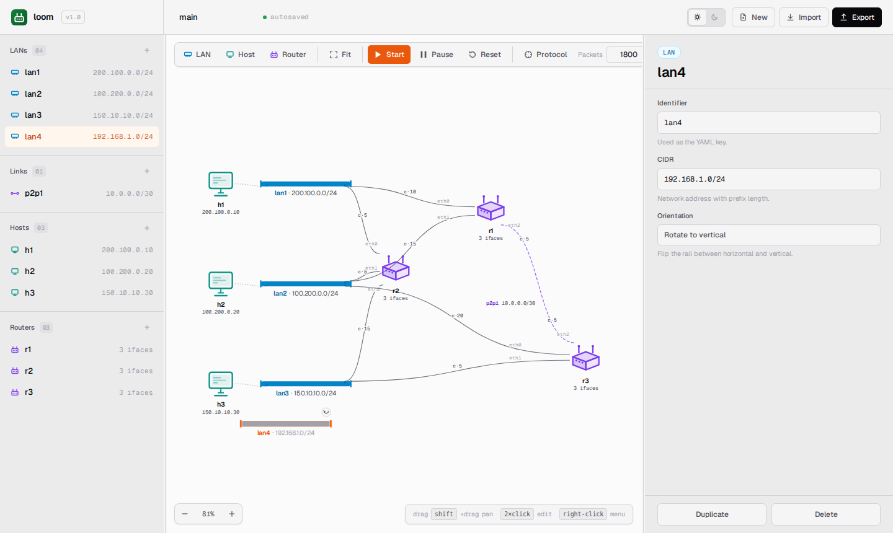
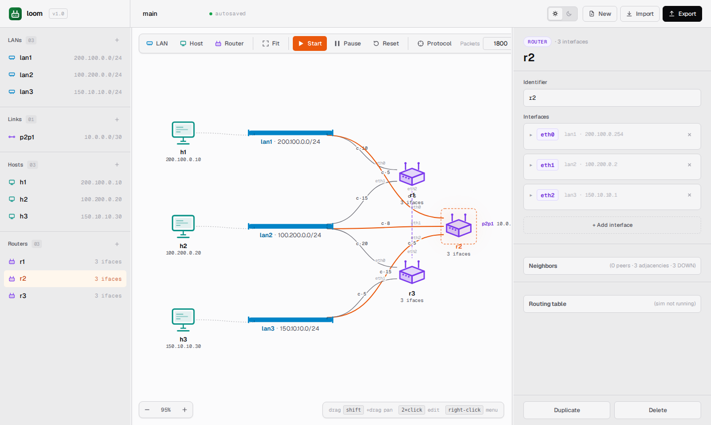

# Building Topologies

A `loom` topology is built from four kinds of entities: **networks**
(multi-access LANs), **links** (point-to-point), **hosts**, and
**routers**. This guide walks through each, on the canvas and in YAML.

The sim must be **idle** or **paused** before you can add or remove
devices. While running, the toolbar's **Add** buttons are disabled and
the context-menu mutations are blocked.

If you want to use raw YAML rather than the canvas, jump to
[YAML format](yaml-format.md) for the schema reference. The two
approaches produce the same topology — the SPA round-trips through the
parser.

---

## Networks (multi-access LANs)

A **network** is a multi-access LAN. Hosts and routers attach through
their interfaces, and each interface is assigned an address from the
network's prefix.

### Add one

Click **LAN** in the toolbar (or press <kbd>N</kbd>). A new network
rail appears at the canvas center with a placeholder name and a `/24`
prefix.



Click the rail to select; the inspector opens. Edit:

- **Name** — must be unique among networks **and** links. Auto-saved.
- **CIDR** — any valid IPv4 prefix. Canonicalized by the parser
  (`10.1.2.3/24` becomes `10.1.2.0/24`). Two LANs may not share the
  same prefix.

### Attach a device

Drag a host or router near the rail and drop. The interface attaches
automatically and is assigned the next free IP in the prefix. The
inspector shows the assigned address — change it if you want a specific
one.

A device can attach to a LAN through **one or more interfaces** (only
routers, in practice — hosts have exactly one interface).

### Move and resize the rail

- Drag the rail body to translate.
- Drag the handle at either end to lengthen or shorten the rail (range:
  `RAIL_MIN_WIDTH = 100` to `RAIL_MAX_WIDTH = 800` SVG units).

### Delete

Right-click → **Delete**, or select and press <kbd>Delete</kbd>. If any
host or router still has an interface on this LAN, the SPA blocks the
deletion with a toast. Remove or re-home the devices first.

While **paused**, the deletion queues an op; the actual server-side
removal happens on **Resume**.

---

## Hosts

A **host** is an endpoint that can send and receive datagrams but cannot
forward. Each host has exactly **one interface**.

### Add one

Click **Host** (or press <kbd>H</kbd>). A new host icon appears at the
canvas center. You will be prompted (or the inspector will surface) for:

- **Name** — must be unique across hosts and routers.
- **Network** or **Link** — the fabric the host attaches to.
- **Address** — must be a usable IP inside the chosen fabric's prefix.
  For `/30` links, the network and broadcast IPs are reserved.
- **Gateway** (optional):
  - On a LAN, a valid IP inside the same LAN. Required if the host
    needs to reach anything off-link.
  - On a link, **auto-filled to the peer's IP**. If you set it
    manually, it must match the peer; mismatched gateways are rejected.

Drop the host near a LAN's rail to attach to that LAN, or near a link
endpoint to attach there.

### Set a gateway

If the host is on a LAN, the inspector shows a **Gateway** field. Pick
the IP of the router that should forward off-network traffic. Without
a gateway, off-link `ping`/`send` calls fail with
*"no route to host: no gateway configured."*

If the host is on a link, the gateway is the peer's IP. You don't have
to type it — the parser fills it in, and the inspector displays it
read-only.

### Multi-homed hosts?

No. `loom` deliberately models hosts as single-interface endpoints.
If you need a multi-interface device, use a router. The parser will
reject a YAML host with multiple interfaces; the SPA won't even let you
draw it.

---

## Routers

A **router** has one or more interfaces and runs the link-state routing
protocol. The interfaces can attach to LANs, point-to-point links, or
both.

### Add one

Click **Router** (or press <kbd>R</kbd>). A new router appears at the
canvas center with zero interfaces.

Open the inspector. The router's **Interfaces** section shows an
**+ Add interface** button. For each interface:

- **Name** — unique within this router (`eth0`, `eth1`, ...).
- **Network** or **Link** — pick one; never both.
- **Address** — must be valid for the chosen fabric.
- **Cost** — the metric the routing protocol uses. Defaults to 1.
  Higher = less preferred. Positive integers.

You can connect a router to as many LANs and links as you want, as long
as each interface name is unique within the router and no two router
interfaces on the same fabric share an address.



### Change a cost

The inspector lets you edit the **Cost** column inline. The change:

- While **idle**, mutates `state` and persists to `localStorage`. Will
  apply the next time the topology is loaded.
- While **running**, the toolbar disables direct cost edits — pause
  first.
- While **paused**, queues an `update_cost` op. On **Resume**, the
  server applies it and the routing protocol picks it up on the next
  keepalive.

You can also edit a cost from the router terminal:

```
update_cost eth0 25
```

That bypasses the inspector path and updates the router directly. Use
either — both invoke the same backend cost-update operation.

### Delete

Right-click → **Delete**. Removing a router that other routers depend
on for routing will cause routes to disappear from peers — this is
intentional. Their graphs will still reference the dead router until
they receive a new advertisement that doesn't mention it (which, in
this protocol, happens by the dead router's edges *not* being
re-advertised). In practice, restart or reset to see clean state.

---

## Point-to-point links

A **link** is a `/30` or `/31` fabric with exactly **two** endpoints.
Either endpoint can be a router or a host (router–router, router–host,
or host–host). No broadcast domain — frames go directly to the peer.

### Add one

There is no toolbar button for links: they're created **implicitly** by
attaching two interfaces to a fabric whose YAML is declared under
`links:`. The most common way to add a link via the canvas:

1. Add the link via **Import YAML** with a small snippet, or
2. Edit a router interface's network/link membership in the inspector.

The dedicated **Add link** affordance is on the roadmap; for now, the
canonical path is YAML edit + import. See [YAML format](yaml-format.md)
for examples.

### Rules

- Mask must be `/30` or `/31`. Anything else is rejected at parse time
  with *"link CIDR must be /30 or /31, got /N"*.
- Exactly two endpoints. The parser's post-pass rejects a link left
  with 0 or 1 endpoints (e.g. by referencing an undeclared device).
- A `/30` link has two usable host addresses (`.1` and `.2`); `.0`
  (network) and `.3` (broadcast) are reserved.
- A `/31` link has two usable host addresses (`.0` and `.1`) — per
  RFC 3021.
- A host on a link inherits the peer's IP as its gateway
  automatically.

### Why `/30` and `/31` only?

Because a multi-access LAN has its own model in `loom` (the `Network`
class with broadcast semantics). A point-to-point link is the
**exception** that allows two devices to be wired without a LAN bus
between them. Any prefix bigger than `/30` would be ambiguous: is it a
LAN with two hosts, or a link? The parser settles the question by
restricting links to the two prefixes that have a clean point-to-point
interpretation.

### Cross-link IP reuse

Two parallel links may reuse the same `/30` without affecting delivery.
The `Link` fabric resolves peers **structurally** (the interface whose
address is not the frame's source), not by address lookup. This makes
copy-pasting a small lab topology safe.

---

## A complete walkthrough

To build the sample topology from scratch:

1. **LAN** three times. Rename and set CIDRs:
   - `lan1` → `200.100.0.0/24`
   - `lan2` → `100.200.0.0/24`
   - `lan3` → `150.10.10.0/24`
2. **Host** three times. Attach and address:
   - `h1` on `lan1` with `200.100.0.10`, gateway `200.100.0.1`
   - `h2` on `lan2` with `100.200.0.20`, gateway `100.200.0.2`
   - `h3` on `lan3` with `150.10.10.30`, gateway `150.10.10.1`
3. **Router** three times. Attach interfaces:
   - `r1`: eth0 on `lan1` (`200.100.0.1`, cost 10), eth1 on `lan2`
     (`100.200.0.1`, cost 15).
   - `r2`: eth0 on `lan1` (`200.100.0.254`, cost 5), eth1 on `lan2`
     (`100.200.0.2`, cost 8), eth2 on `lan3` (`150.10.10.1`, cost 15).
   - `r3`: eth0 on `lan2` (`100.200.0.10`, cost 20), eth1 on `lan3`
     (`150.10.10.10`, cost 5).
4. Add the link `p2p1: "10.0.0.0/30"` via Import YAML (the simplest
   way today), then assign:
   - `r1.eth2` on `p2p1` (`10.0.0.1`, cost 5)
   - `r3.eth2` on `p2p1` (`10.0.0.2`, cost 5)

Click **Export** and you should get back exactly the contents of
`samples/sample.yaml` (modulo coordinate metadata, which the SPA stores
locally).

---

## Validation errors

When you click **Start** or import YAML, the server runs the full
validator. Common failures:

| Error | What it means |
|---|---|
| `missing "as" key` | Top-level YAML doesn't have `as:`. |
| `<dev>: <iface>: declares both network and link` | A single interface can attach to only one fabric. |
| `<dev>: <iface>: address already in use by <other>` | Two interfaces on the same fabric share an IP. |
| `<host>: gateway address not in host network` | Gateway IP isn't inside the host's subnet. |
| `<host>: gateway mismatch: expected X, got Y` | The host is on a link and the explicit gateway doesn't match the peer's IP. |
| `<link>: link CIDR must be /30 or /31, got /N` | Links must be `/30` or `/31`. |
| `<link>: link must have exactly two endpoints (got N)` | A link has 0, 1, 3+ endpoints. |
| `<link>: invalid address for link <name>` | On `/30`, you tried to use `.0` or `.3`. |
| `<dev>: <iface>: invalid cost` | Cost isn't an integer. |

The error dialog quotes the offending entity by name — the parser is
careful to surface enough context that you can find the line in YAML
or the entity on the canvas.
