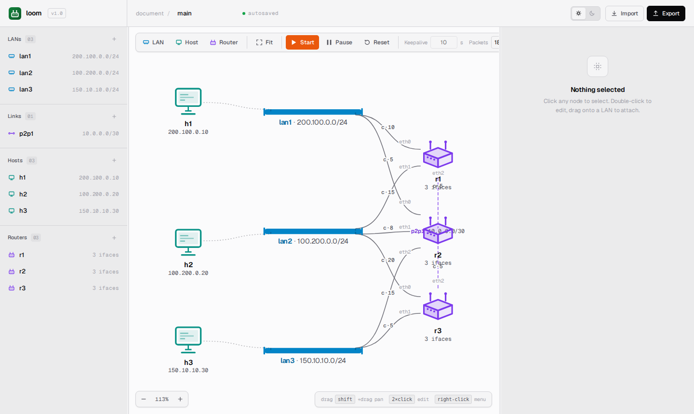
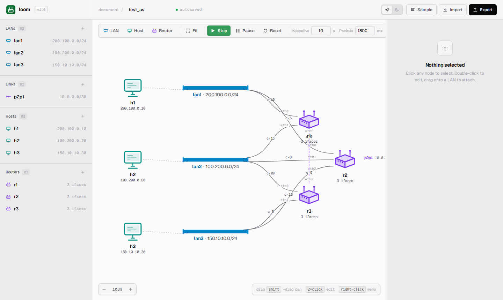
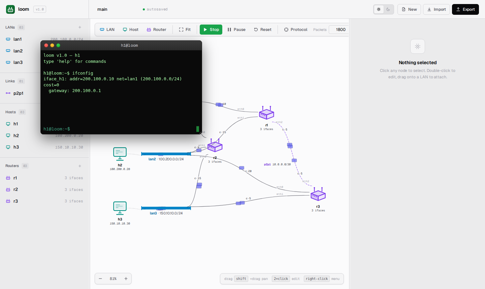
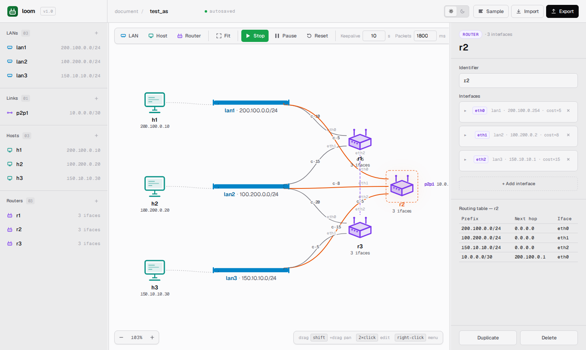

# Getting Started

This guide takes you from a fresh clone to a live simulation with a ping
between two hosts. It assumes Python 3.11 or newer.

## Scope

`loom` is a routing-concepts simulator: it models L3 (IPv4 forwarding,
addressing, routing tables, link-state convergence) and **only** L3.
There is no L2 (no MAC addresses, ARP, STP, VLANs) and no L4 (no
TCP/UDP, no ports, no retransmits, no congestion control). Frames are
abstract envelopes; payloads are `Message` subclasses delivered intact.

If you need higher-fidelity simulation — packet captures, real
protocols, or a kernel network stack — look at [ns-3](https://www.nsnam.org/),
[mininet](https://mininet.org/), [Containerlab](https://containerlab.dev/),
or [GNS3](https://www.gns3.com/) instead.

## Install

```bash
git clone git@gitlab.com:lukius/netrouting.git
cd netrouting

python -m venv .venv
source .venv/bin/activate
pip install -r requirements.txt
```

`loom` has four runtime dependencies and no system-level prerequisites
beyond Python itself. There's no database to set up, no message broker,
no API keys to provision.

## Run the web UI

The default entry point starts the FastAPI server and serves the SPA:

```bash
cd src
python loom.py
```

You should see:

```
INFO:     Started server process [...]
INFO:     Application startup complete.
INFO:     Uvicorn running on http://127.0.0.1:8000 (Press CTRL+C to quit)
```

Open [http://127.0.0.1:8000](http://127.0.0.1:8000). The canvas pops up
pre-populated with the bundled sample topology — three hosts (`h1`,
`h2`, `h3`), three LANs (`lan1`, `lan2`, `lan3`), three routers (`r1`,
`r2`, `r3`), and one `/30` point-to-point link (`p2p1`) between `r1` and
`r3`:



The page state — pan, zoom, current topology, theme, and toolbar
toggles — is persisted to `localStorage`. Reload and you'll be back where
you were.

## Press Start

Click the green **Start** button in the toolbar (or press <kbd>Space</kbd>).

What happens, in order:

1. The SPA serializes the current canvas to YAML and POSTs it to
   `/topology`.
2. The server parses, validates, and constructs a fresh autonomous
   system.
3. POST `/sim/start` resumes the simulation and starts every router's
   keepalive.
4. Within a few hundred milliseconds, routing-protocol packets start
   flooding across the canvas — those are the small hollow dots
   ("chatter").
5. As routers converge, their **Routes** tabs fill in. The toolbar's
   **Pause** button appears and the **Add** buttons disable (you cannot
   mutate a running topology).



If you don't see chatter, click the **Chatter** toolbar button — it
mutes the routing-protocol animations by default in some sessions.

## Your first ping

Double-click `h1` to open its terminal. The popup looks like this:



Type:

```
ifconfig
```

You'll see the host's single interface (`iface_h1`), its address
(`200.100.0.10`), the network it belongs to (`lan1`), and its gateway
(`200.100.0.1`).

Now ping `h3`:

```
ping h3
```

Output:

```
ping h3 (150.10.10.30): time=12.34 ms
```

On the canvas, you should see a packet animate from `h1` to `r1` (the
default gateway), across the `/30` link to `r3`, and onward to `h3`,
followed by the reply tracing the inverse path. Try a non-existent
host:

```
ping h99
```

```
ping h99: invalid destination: h99
```

Or a routable address that doesn't exist:

```
ping 200.100.0.99
```

Times out after the default 3 seconds and prints:

```
ping 200.100.0.99: timeout after 3.00 s
```

## Inspect a routing table

Click any router on the canvas — say `r2`. The right pane shows the
router's interfaces and current routing table together:



Each row is one rule: a destination prefix, the next-hop IP (or
`0.0.0.0` if directly connected), and the outgoing interface name. The
table auto-refreshes whenever the router's table changes (because of a
keepalive arriving, a cost edit, or a topology patch).

## Stop the simulation

Click the red **Stop** button (Start replaced) or press <kbd>Space</kbd>.
The simulation returns to `idle`: routers stop their keepalive threads,
the canvas's **Add** buttons re-enable.

You can also **pause** (press <kbd>P</kbd>) — that freezes the entire
simulation without dropping it. While paused, you can add/remove devices
or update costs; edits accumulate as a patch list and are applied
atomically when you click **Resume**. See
[Running simulations](running-simulations.md) for the full lifecycle.

## Where to next

- [Web UI](web-ui.md) — full tour of the toolbar, canvas, inspector, and
  terminals.
- [Building topologies](building-topologies.md) — add your own LANs,
  hosts, routers, and point-to-point links.
- [YAML format](yaml-format.md) — write topologies by hand or import
  them; understand how the SPA saves and resumes.
- [Shell CLI](shell-cli.md) — the legacy `cmd.Cmd` REPL.

## Troubleshooting

**"Address already in use" on port 8000.** Another `loom` process is
already running, or another service holds the port. Either kill it or
launch with a different port: `LOOM_PORT=8765 python loom.py`.

**The canvas is empty on first load.** The sample topology should load
automatically; if it doesn't, click **Import topology…** in the empty
state and pick `sample.yaml` from the list.

**Packets don't animate.** Make sure the sim is `running` (not paused or
idle), and that the **Chatter** toggle isn't muting all packets. The
**Packet speed** field controls the animation speed (in milliseconds per
hop, 200–5000).

**Routing tables stay empty.** The first keepalive happens almost
immediately, but convergence still takes a few keepalive intervals on
multi-hop topologies. Drop the **Refresh** field to `1` to speed
convergence during exploration.

**A change to the YAML didn't take effect.** The SPA serves from
`<source>.session.yaml`, not the source you edited on disk. Click
**Reset** in the toolbar to re-clone the source, or restart `loom.py`.
The source is named via `LOOM_TOPOLOGY` (default `samples/sample.yaml`).
