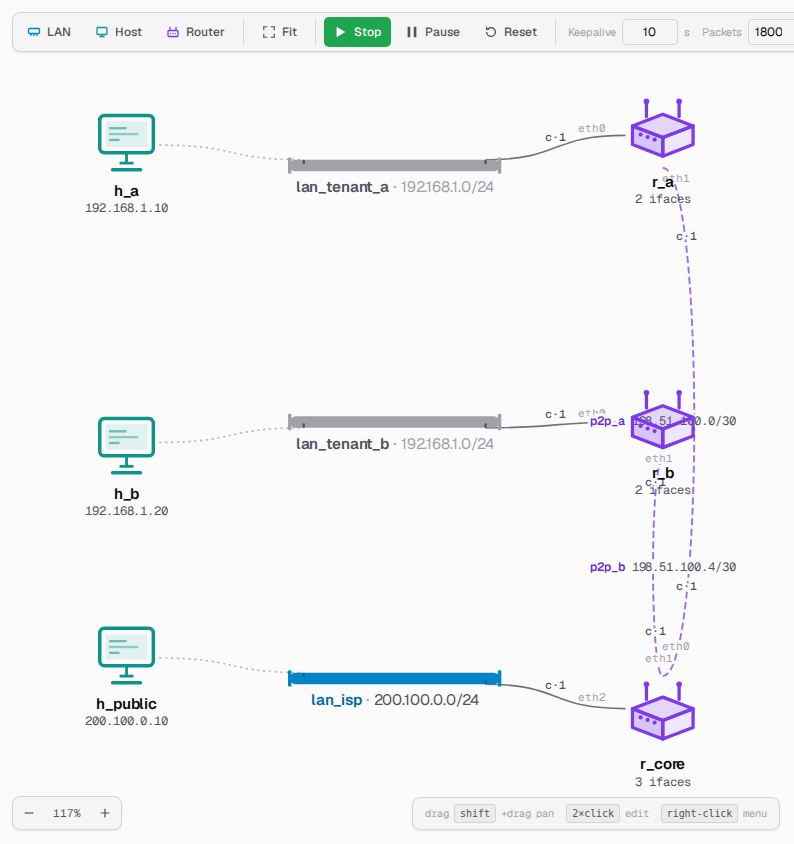
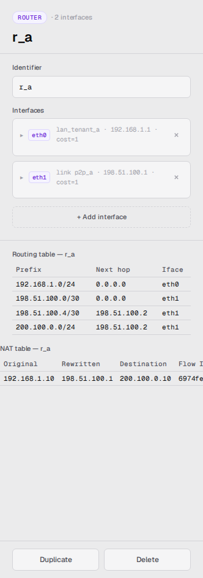

> 🌐 **English** · [Español](../es/user-guide/nat-and-private-lans.md)

# NAT and private LANs

A topology can have two kinds of LANs:

- **Public** LANs — addresses anyone in the AS can route to.
- **Private** LANs — RFC 1918 ranges (`10.0.0.0/8`, `172.16.0.0/12`,
  `192.168.0.0/16`). Hosts on a private LAN are reachable only through
  their gateway router; their address is not visible to the rest of
  the AS.

This page covers how to recognize private LANs on the canvas, how
their traffic reaches public destinations, and how to inspect what
the gateway router is doing.

## Spotting a private LAN

Private LANs render in a **muted neutral tone**. Their gateway-side
interface label on the router is muted to match. Public LANs render in
the regular accent color. The visual cue marks the NAT boundary at a
glance.



You can drop two private LANs that share the same CIDR (e.g.
`192.168.1.0/24` on both sides) — the simulator allows the overlap as
long as both stay behind their own gateway router. Public LANs may not
overlap.

## How traffic leaves a private LAN

A host on a private LAN that pings a public destination has its
**source address rewritten** by its gateway router to the router's
public address. The rest of the AS sees the public address; the reply
comes back to the router, which restores the original private address
and delivers it to the host.

When you pause the simulation and **hover an animated packet**, the
tooltip shows the translation, e.g.:

```
NAT @ r_a: 192.168.1.10 → 198.51.100.1
```

This works in both directions:
- On the **forward** leg, the source is rewritten as the packet leaves
  the private LAN.
- On the **reply** leg, the destination is rewritten as the packet
  re-enters the private LAN.

## Inspecting the NAT table

Click the router that sits between a private and a public LAN. Below
the routing-table panel, an **NAT table** panel lists every active
translation, oldest first:

- **Original** — the private host that initiated the conversation.
- **Rewritten** — the public address the router translated it to.
- **Destination** — the public address the host is talking to.
- **Flow ID** — a per-conversation identifier; truncated for the
  column, hover for the full value.



The panel updates the moment the packet animation reaches the router
(not when the host fires it), so the table state stays in sync with
what you see on the canvas.

The table is **bounded**: when it fills, the least-recently-used entry
is evicted. There is no time-based expiry — entries persist as long
as they're being used.

## Why two pings from the same LAN can both be NATed at once

Each ping gets its own conversation identifier under the hood, so two
hosts on the same private LAN pinging the same public destination at
the same time each get their own row in the NAT table. Their replies
are reverse-translated independently and arrive back at the right
host.

## Topology rules that keep this honest

- A private host cannot leave the private LAN unless its gateway
  router has at least one public interface.
- Two private hosts on different private LANs that share the same CIDR
  cannot reach each other by address — each thinks the other lives on
  its own LAN (same-LAN delivery), but the address isn't there.
- Routers do not advertise their private prefixes to peers, so the
  routing protocol stays clean across tenants.

For the SPA's tooling around NAT (event bus, inspector panel) see
[web-ui.md](web-ui.md). For the architectural model and design
decisions, see [the NAT architecture page](../architecture/nat.md).
