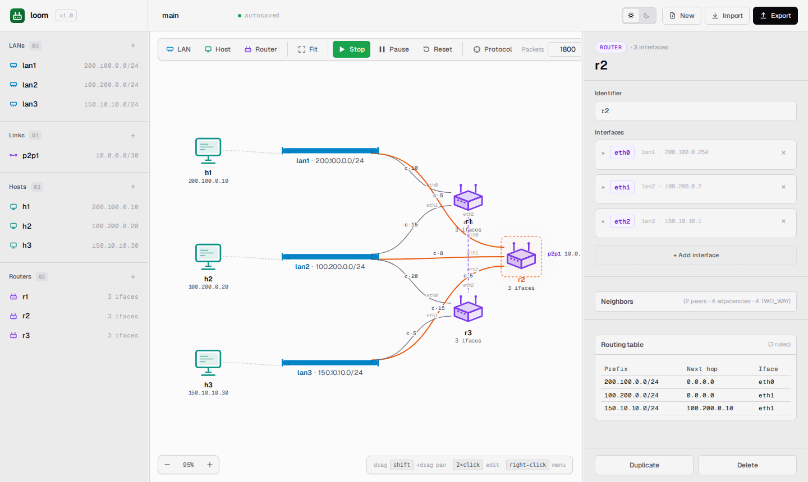

# Routing Tables, Neighbors, and Costs

This guide explains what's in a router's routing table, how to inspect
it, and how the **loom-OSPF** link-state protocol gets it there.

A briefer explanation of the protocol from the user's perspective is
inline here; the deep dive lives in
[`docs/architecture/routing-protocol.md`](../architecture/routing-protocol.md).
To tune Hello and LSA-refresh intervals, use the **Protocol** button in
the toolbar — see [Web UI: Protocol settings](web-ui.md#protocol-settings).

## How routes appear

When you press **Start**, every router begins flooding link-state
advertisements (`RoutingMessage`s) on every interface, once per
keepalive interval (default 10 s, live-tunable). Each advertisement
lists the router's directly-connected `(prefix, cost)` pairs.

A receiving router:

1. Re-floods the advertisement out of every other interface.
2. Updates its local view of the network graph.
3. If the graph changed, recomputes Dijkstra shortest paths from itself
   to every known prefix.
4. Rewrites its routing table from the path output.

The whole cycle is **observable**: each routing-table rebuild emits a
`routing_table_changed` event, and the SPA's routing-table section
re-renders almost immediately.

## Inspecting a routing table

### From the SPA

Click a router on the canvas. In the right pane, the inspector shows
the router's interfaces and the current routing table together — no
tab to switch.



Columns:

- **Prefix** — the destination network (an IPv4 CIDR).
- **Next hop** — the IP of the next-hop router, or `0.0.0.0` if the
  destination is directly connected.
- **Interface** — which of this router's interfaces forwards traffic
  for this prefix.

The table is **rebuilt from scratch** on every relevant graph change —
you'll see rows appear, disappear, or move between interfaces as the
protocol converges or as you mutate costs.

### From a terminal

Double-click the router to open a terminal. Type:

```
route
```

```
prefix               next_hop        iface
200.100.0.0/24       0.0.0.0         eth0
100.200.0.0/24       0.0.0.0         eth1
150.10.10.0/24       150.10.10.1     eth2
10.0.0.0/30          0.0.0.0         eth2
```

The columns match the SPA's inspector routing-table section.
`0.0.0.0` for next hop means the prefix is directly connected.

## What `0.0.0.0` means

The simulator uses `0.0.0.0` as a sentinel meaning *"the destination
is on a directly connected network."*

When a packet matches a rule whose next hop is `0.0.0.0`:

- The packet's **L3 destination** is also its **L2 next-hop** (the
  forwarding router builds the outbound frame addressed to the final
  destination, not to another router).
- That delivers the packet via the local LAN/link directly to the
  destination.

When you see `0.0.0.0` in a routing table, you're seeing **direct
delivery**, not a routing-protocol failure.

## Costs and how they shape paths

Every router interface has a **cost** — a positive integer metric. The
routing protocol computes Dijkstra shortest paths weighted by these
costs.

The cost is the **transmit-side** cost of the interface that the
advertisement originates from. So in the sample topology, `r1`'s
`eth0` (on `lan1`) has cost 10, meaning *sending out `r1.eth0` costs
10*. The receiving router records that edge as `r1 ↔ lan1` with
weight 10.

To bias traffic toward a path:

1. Open the originating router's terminal.
2. `update_cost <iface> <new_cost>`.

Example: discourage routing through `r1` on `lan1`:

```
# r1's terminal
update_cost eth0 100
```

Or from the router's inspector panel (the Interfaces list has inline
**Cost** editors). Either path invokes the same backend cost-update
operation.

The change propagates on the next keepalive flood. Within one
keepalive interval per hop, every router has the new graph and has
recomputed its routes.

## Convergence

Convergence time is dominated by two factors:

1. **Keepalive interval.** New routers / changed costs only flood once
   per interval. A 10 s interval means each hop can take up to 10 s to
   propagate.
2. **Network diameter.** A change at one end of an N-hop chain takes up
   to N keepalives to reach the other end, in the worst case (the
   "next hop" gates flood propagation on its own schedule).

In the sample topology (diameter 3), convergence at 10 s keepalive
takes up to ~30 s after a change. Drop the **Refresh** field to 1 s and
the same change converges in under 3 s.

There is **no failure detection** in `loom`. If you delete a router
while the sim is running (only possible while paused), the other
routers stop hearing it — but their graphs still reference the dead
router until *some other* change forces a recompute that drops it.
This is intentional: the simulator is for teaching link-state
mechanics, not for modeling failures.

## Neighbors

A router can list its **directly-connected neighbors** — other routers
on the same LAN or link.

In the terminal:

```
neighbors
```

```
  r1     via lan1     (200.100.0.1)  cost=10
  r1     via lan2     (100.200.0.1)  cost=15
  r3     via lan2     (100.200.0.10) cost=20
  r3     via lan3     (150.10.10.10) cost=5
```

(That's `r2`'s neighbors in the sample topology — `r1` and `r3`,
connected via several different LANs at different costs.)

Each row is one **adjacency** — one shared fabric, one interface, one
cost. A router may have multiple adjacencies with the same neighbor if
they share more than one fabric.

The neighbors command is a read-only view of the router's local view
of the network. It updates as new routers join — but only after their
first advertisement has arrived. If a router shows no neighbors,
either:

- It has no router peers (you wired it only to hosts), or
- It hasn't completed a keepalive cycle yet (give it one interval).

## Reading a path

When you `ping h1 → h3` in the sample topology, the routers in the
path can be inferred from their routing tables:

- `h1` (on `lan1`, gateway `200.100.0.1`) sends the packet to `r1.eth0`.
- `r1.route` says `150.10.10.0/24 → 10.0.0.2 / eth2` (via the link to
  `r3`, cheapest path).
- `r3.route` says `150.10.10.0/24 → 0.0.0.0 / eth1` (directly
  connected).
- `r3.eth1` (`150.10.10.10`) delivers to `h3` on `lan3`.

The packet animation on the canvas follows the same path. If you raise
`r1.eth2`'s cost to 99, the next ping after re-convergence will route
through `r2` instead (via the LANs), and the canvas animation will
visibly switch paths.

## Common surprises

**"My route just appeared and disappeared."** A `routing_table_changed`
event fires on **every** recompute, including transient intermediate
states during convergence. If you watch closely during the first
keepalive cycle, you can see routes settle in two or three passes —
the protocol is learning the graph one flood at a time.

**"Costs aren't symmetrical."** They aren't required to be. Each
interface has its own cost; `r1.eth0` cost 10 and `r2.eth0` cost 5
means the `r1 ↔ lan1 ↔ r2` triangle has two different weights
depending on the direction (10 from r1's side, 5 from r2's side). The
Dijkstra search picks the asymmetric cheapest path.

**"Why doesn't my path use the obvious shortest hop?"** Look at all the
intermediate costs, not just the direct link. The shortest *hop count*
isn't necessarily the shortest *path cost*. The sample topology has
this property: `r1 → r3` directly over `p2p1` costs 5+5=10, but
`r1 → r2 → r3` over `lan1 + lan2` can cost less depending on costs.

**"My routing table is empty."** Either the simulator hasn't ticked yet
(give it one keepalive interval), or the router has no router peers
(check `neighbors`). A standalone router still gets `0.0.0.0` rules for
its directly-connected networks the first time it ticks; an empty
table really means *zero* networks attached.
