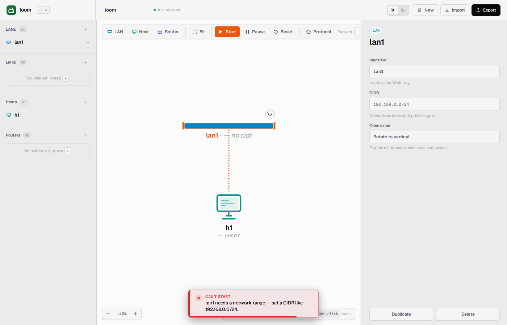
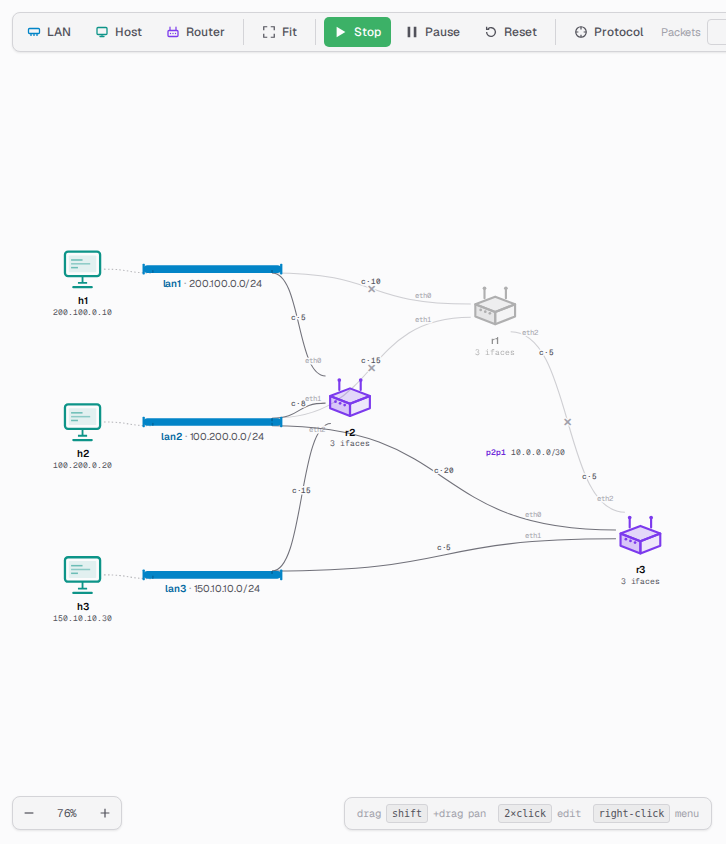
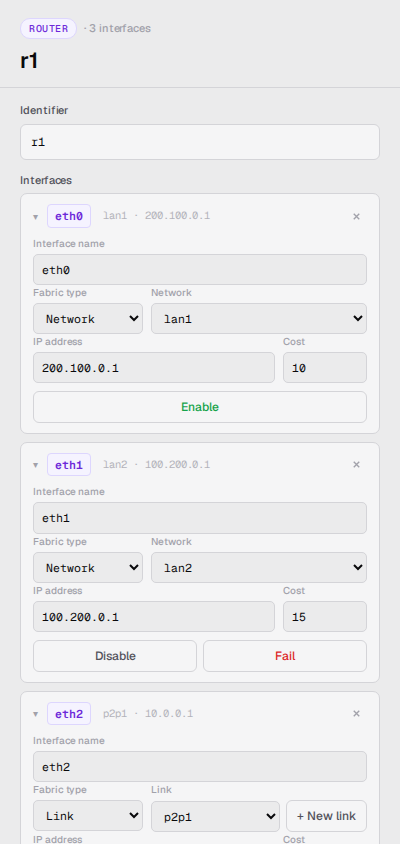

> 🌐 **English** · [Español](../es/user-guide/running-simulations.md)

# Running Simulations

Once you've built (or loaded) a topology, the simulation has a lifecycle: it
starts, runs, pauses, resumes, and eventually stops. This guide explains
each transition and what's safe at each step.

## States

```
                  Start                     Pause
     ┌──────┐  ──────────►  ┌─────────┐  ──────────►  ┌────────┐
     │ idle │               │ running │               │ paused │
     └──────┘  ◄──────────  └─────────┘  ◄──────────  └────────┘
        ▲          Stop                     Resume         │
        └────────────────────── Stop ──────────────────────┘
```

- **idle** — nothing is simulated; the canvas is yours to edit freely.
- **running** — every device is alive and the routing protocol is ticking.
- **paused** — everything frozen where it stands; your edits queue up and
  land when you resume.

The toolbar mirrors this: the **Start/Stop** and **Pause/Resume** buttons
always reflect what the simulation is actually doing, not what you last
clicked.

## Start

Click **Start** (or press <kbd>Space</kbd>). What happens, in order:

1. The canvas is checked for anything unfinished — every LAN and link needs
   a range, every host a network and an address, every router interface an
   address. If something is missing, Start is aborted, a plain-English
   message names what to fix, and the item in question is selected so you
   can go straight to it.
2. The finished topology is handed to the simulator, which builds it and
   brings every device up. If the simulator rejects something the canvas
   check didn't catch, Start is aborted and the reason appears on screen.
3. Every router starts its routing protocol, and chatter begins crossing
   the canvas.



If the topology was already loaded (e.g. you stopped and want to start
again with the same one), the canvas is simply sent again unchanged.
Either way the **session file** is brought up to date — that's the working
copy the simulator reads, kept separate from the file you originally
loaded so your own file is never written to. See
[YAML format](yaml-format.md#save-and-resume-workflow) for where it lives.

**While running:**

- **Add LAN / Host / Router** stay enabled. A **LAN or point-to-point
  link** joins the live network the moment you give it a valid range; an
  incomplete or invalid value stays pending until you finish it, and if
  you pause before finishing, it carries over into the pending edits and
  lands on **Resume** instead. Your selection and viewport survive the
  update either way.
- **Hosts and routers** can be dropped on the canvas while running, but
  they cannot be *attached*: the network picker is inert and a drag onto
  a LAN is refused. They sit unattached until you pause or stop and wire
  them up there.
- **Drag any node or link label** to reposition it on the canvas —
  hosts, routers, networks, and p2p link midpoint labels can all be
  moved freely while the sim runs. Repositioning is purely visual and
  does not affect the running simulation. In-flight packet animations
  follow nodes as you move them. Trying to drag a host or router onto a
  *different* network or link while running shows a red blocked cue on
  the target and snaps the node back on release — to reassign a device
  to a different network, stop the sim first.
- Right-click → **Rename / Duplicate / Delete** in the canvas is
  blocked.
- The inspector's editable fields are read-only (interface
  re-addressing and host/network reassignment require pausing or
  stopping first).
- The **Protocol** button is active — you can re-tune the Hello and
  LSA-refresh intervals live.
- Right-click a router → **Halt router (graceful)**, **Crash router**, or
  **Resume router** to take a router offline or bring it back, without
  stopping the sim. A halted/crashed router grays out on the canvas.
- Select a router → use the **Disable / Fail / Enable** buttons next
  to each interface in the inspector to control individual interfaces.
  A downed interface's edge turns into a solid gray wire with a small ✕
  at its midpoint, so it's clearly distinct from a (dashed) point-to-point
  link. Traffic sent toward a downed interface is dropped where it would
  enter the link — you'll see the packet leave the source and fade out
  instead of reaching the device.






**First pings may drop while the network converges.** After you click
Start, give the routers a few seconds to exchange routes before pinging.
Until all routers have heard from their neighbors, some packets — especially
between hosts on different networks — will be dropped. If your first ping
times out, wait a moment and try again. (The default Hello interval is
10 s; lower the **Hello interval** in the **Protocol** popover to 1 s if
you want neighbors to be discovered faster.)

For how ping output streams into a terminal, and how a counted ping lets
you watch traffic reroute mid-sequence, see the `ping` command in
[Terminals](terminals.md).

## Pause

Click **Pause** (or press <kbd>P</kbd>). Every device stops where it
stands, at the next point where stopping is safe.

Effects, observable in the canvas:

- Packet animations freeze (in-flight frames stay parked on the wire).
- The routing protocol's periodic Hello and LSA messages stop.
- The **Pause** button becomes **Resume**.

Pause is also the natural pairing with the Packets panel (see [Web UI](web-ui.md)) — frozen animations make the badge-to-row mapping easy to read.

**While paused, you can edit:**

- Add a LAN, host, or router.
- Duplicate a LAN, host, router, or link.
- Delete any of the above.
- Update an interface cost.
- Edit names and addresses (the same uniqueness and validity rules apply
  as anywhere else).

Each change appears in the **Resume** button label as a counter:
*Resume (3 edits)*. They queue up on the canvas; nothing reaches the
simulation until you resume.

While paused there is no **Start** to press — the simulation is already
loaded. The main button reads **Stop**, and it works: it tears the
simulation down and returns you to `idle`. Be aware that it also throws
away any edits still sitting in the queue.

## Resume

Click **Resume**. Your queued edits are first squared against the canvas
as it stands now: each is sent with its current values — a LAN you added
and then renamed goes out under the new name — and anything you deleted
in the meantime is dropped.

They are then applied together, all or nothing:

- If a single edit is invalid, **none** of them are applied. The
  simulation stays paused, a message names the problem, and your queue is
  kept so you can fix it and resume again.
- Otherwise every edit lands in order and the simulation carries on from
  where it left off, keeping the routing state it had already built.

Messages you may see, and what each one means:

| Message | What happened |
|---|---|
| `duplicate_name` | The name is already taken by another entity. |
| `address_in_use` | Another host or router interface on that network already holds this IP. |
| `network_in_use` | A LAN you deleted still has a host or router attached to it. |
| `network_not_found` | A host or router refers to a LAN the simulation doesn't have. |
| `interface_not_found` | A cost edit names an interface that router doesn't have. |
| `invalid_cost` | A cost has to be a positive number. |

Squaring the queue against the canvas first is what makes "pause → add →
rename → resume" feel natural: you think about the shape you want, not
about the individual edits that got you there.

## Stop

Click **Stop** (or press <kbd>Space</kbd> again). The simulation is torn
down: every network, link, router, and interface shuts down in an orderly
way, the simulation is discarded, and the state returns to `idle`.

What survives:

- The **session file** — the working copy of your topology. The next
  Start re-reads it. See
  [YAML format](yaml-format.md#save-and-resume-workflow) for where it
  lives.
- Everything on the canvas. Stop and Start without touching the topology
  and you're right back where you were.
- The terminals on screen — they still refer to a simulation that no
  longer exists, so commands typed into them fail with *no topology
  loaded*. Close and re-open the terminal after the next Start for a
  clean session.

Edits you make while idle — after a stop, before the next start — exist
only on the canvas until you press Start, which hands the whole topology
over at once.

## Reset

Click **Reset** (only enabled when idle). This:

1. Deletes the session file — the working copy of your topology.
2. Re-clones from the source file (`samples/sample.yaml` by default, or
   whatever `LOOM_TOPOLOGY` points at).
3. Re-parses the source into a fresh autonomous system.
4. The canvas is replaced with the freshly loaded topology.

Use Reset when the session has drifted from the source and you want to
roll back. Your source file is **never modified** — Reset discards only
the working copy.

## Tuning the protocol intervals

Click **Protocol** in the toolbar to open the Protocol settings popover.
Two fields are tunable:

- **Hello interval** — how often routers send neighbor-discovery messages
  (default 10 s). Lower = neighbors detected and declared alive more quickly;
  higher = quieter, but slower to detect new neighbors.
- **LSA refresh interval** — how often routers re-advertise their full
  link-state (default 30 s). Lower = routes re-advertise more frequently,
  faster convergence after a change; higher = quieter canvas.

Changes are applied to every router the moment you click **Apply**. The new
value takes effect at the next interval boundary on each router, so the
maximum lag is the *previous* interval's value.

To speed up initial convergence when exploring: lower the **Hello interval**
to 1 s. To make a running simulation re-advertise routes more aggressively:
lower the **LSA refresh interval**. Dropping either to 1 s makes the protocol
visibly chatter on the canvas at roughly one cycle per second.

## Edits while idle vs. paused vs. running: a comparison

| Action | Idle (sim not started) | Paused (sim is loaded) | Running |
|---|---|---|---|
| Where the edit lives | On the canvas, saved in the browser | On the canvas, plus the queue of pending edits | Applied to the running simulation right away |
| When the simulation sees it | On the next **Start**, with the whole topology | On **Resume**, as a batch | As soon as you complete each one |
| Checked | Whole topology, on Start | Each edit, on Resume | Each edit, as you complete it |
| If it fails | Start aborts; nothing is loaded | Resume refused; your queue is kept so you can fix it | The edit is refused and the canvas snaps back to what the simulation has |
| Convergence impact | Routers start from scratch | Existing routing state is preserved; new edges feed in | New LANs and links feed in with zero downtime |

If you're prototyping ("does this CIDR work?"), idle edits + Start are
fine — the parser tells you within seconds. If you're testing
incremental convergence ("what happens when I bring up a new LAN *while
running*?"), add it live without pausing. Anything that involves
attaching a device — a new router joining an existing LAN — needs a
pause: make the related changes together and resume atomically.

## Tips

- **Lower the Hello interval when exploring.** The default 10 s is
  realistic but slow for neighbor discovery. Drop it to 1 s while you're
  poking, then restore it when you want a quieter canvas.
- **Pause before bulk edits.** Related changes then land together in one
  go, which is cheaper than starting and stopping for each one.
- **Use Reset, not Stop+Start, when the session has gotten weird.**
  Stop just unloads the AS; Reset throws the session away and starts
  from the source.
- **The session file lives outside your project.** It is kept in a
  temporary directory, not next to the source, so your source tree stays
  clean and a read-only source file still works. Both files are plain
  YAML and can be diffed — see
  [YAML format](yaml-format.md#save-and-resume-workflow) for the exact
  location.
