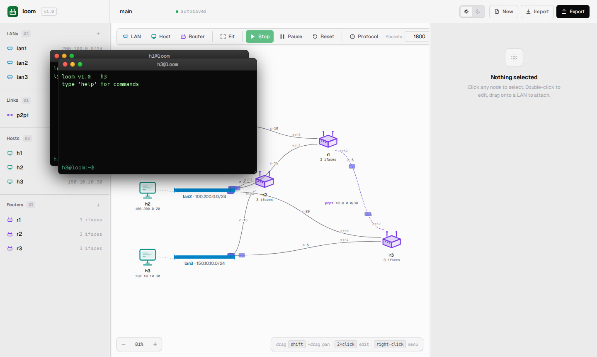
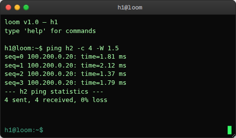

# Terminals

Every host and router in `loom` has a terminal. The terminal is the way
you interact with a single device: ask it what's on its interfaces,
send a datagram, ping, view its routing table, tweak its costs, or set
a default gateway.

## Opening and closing a terminal

- **Open.** Double-click any host or router on the canvas. A popup
  opens with the device's name as its title.
- **Close.** Click the **X** on the popup, or press <kbd>Ctrl+D</kbd>
  when the prompt is empty.
- **Multiple terminals.** Open as many as you want. Each is independent.
- **Position and size.** Drag the title bar to move; drag the corners
  to resize. Position and size persist per device.



## Keyboard

| Key | Action |
|---|---|
| <kbd>Enter</kbd> | Submit the typed command |
| <kbd>Ctrl+L</kbd> | Clear the output area |
| <kbd>Ctrl+D</kbd> | Close the terminal (only when the prompt is empty) |
| <kbd>↑</kbd> / <kbd>↓</kbd> | Walk command history |
| <kbd>Tab</kbd> | Command completion (basic) |

The terminal does not eat normal browser shortcuts unless the prompt
has focus, so <kbd>Ctrl+R</kbd> is still page reload.

## Command set

The available commands depend on whether the terminal is attached to a
host or to a router. Both kinds share `ifconfig`, `route`, and `help`.

### Common to hosts and routers

#### `ifconfig`

Show interface configuration.

```
ifconfig
```

For a **host** (one interface plus an optional gateway):

```
iface_h1: addr=200.100.0.10 net=lan1 (200.100.0.0/24) cost=0
  gateway: 200.100.0.1
```

For a **router** (one line per interface, no gateway line):

```
eth0: addr=200.100.0.1 net=lan1 (200.100.0.0/24) cost=10
eth1: addr=100.200.0.1 net=lan2 (100.200.0.0/24) cost=15
eth2: addr=10.0.0.1 net=p2p1 (10.0.0.0/30) cost=5
```

Cost on a host's interface is always `0` — costs are a routing-protocol
concept and only matter on routers.

#### `route`

On a **router**: dump the routing table.

```
route
```

```
prefix               next_hop        iface
200.100.0.0/24       0.0.0.0         eth0
100.200.0.0/24       0.0.0.0         eth1
150.10.10.0/24       150.10.10.1     eth2
10.0.0.0/30          0.0.0.0         eth2
```

`0.0.0.0` next-hop means the destination is directly connected on the
listed interface.

On a **host**: show the configured default gateway.

```
route
```

```
gateway: 200.100.0.1
```

If no gateway is configured:

```
gateway: (none)
```

#### `help`

List the commands available for this device kind.

```
# host:
available: ifconfig, send <dst> <msg>, ping <dst> [-W t] [-c n], route, set_gateway <ip>, help

# router:
available: route, update_cost <iface> <cost>, ifconfig, neighbors, help
```

---

### Host-only commands

#### `send <dst> <message>`

Send a `UserMessage` from this host to `<dst>`. `<dst>` can be a
hostname (resolved via the AS host table) or a literal IP.

```
send h2 hello
```

```
sent 5 bytes to 100.200.0.20
```

Or with quoting (the terminal uses `shlex.split`, unlike the legacy
shell which uses a single-token split):

```
send h2 "hello world"
```

```
sent 11 bytes to 100.200.0.20
```

The destination host receives a `UserMessage` event (visible to event
subscribers; the SPA doesn't surface a "message received" notification
by default).

#### `ping <dst> [-W <seconds>] [-c <count>]`

Send a `PingRequest` and wait for a `PingReply` (default timeout 3 s).

```
ping h3
```

```
ping h3 (150.10.10.30): time=12.34 ms
```

Override the timeout:

```
ping h3 -W 0.5
```

If unreachable:

```
ping h99: timeout after 3.00 s
```

Errors:

```
ping h2: no route to host: no gateway configured
```

— happens when the destination is off-link and the host has no gateway
configured.

`ping` uses the simulator's `time.monotonic()` clock — RTTs reflect
the actual wall-clock time the simulator took to thread the packet
through the topology. With a busy simulator (lots of routing chatter
or many ping flows running in parallel), expect single-digit
millisecond RTTs on tiny topologies.

Use `-c <count>` to send that many probes one after another, waiting
for each reply before sending the next. Each reply line appears in the
terminal as it arrives, so you can watch the route quality change in
real time — for example, while halting or disabling something
mid-sequence. A summary line prints at the end:

```
ping h2 -c 4 -W 1.5
```

```
seq=0 time=3.21 ms
seq=1 time=2.88 ms
seq=2 time=3.05 ms
seq=3 time=2.94 ms
--- h2 ping statistics ---
4 sent, 4 received, 0% loss
```



#### `set_gateway <ip>`

Update the host's default gateway.

```
set_gateway 200.100.0.254
```

```
gateway set to 200.100.0.254
```

The new gateway must be inside the host's network, else:

```
set_gateway: gateway 10.0.0.1 not in host network
```

For hosts on a `/30` or `/31` **link**, the gateway is the peer's IP
and is set automatically by the parser. `set_gateway` for those hosts
is allowed but pointless — change the link wiring if you want a
different peer.

---

### Router-only commands

#### `update_cost <iface> <cost>`

Set an interface's cost. The new value propagates via the next
keepalive flood.

```
update_cost eth0 25
```

```
cost of eth0 set to 25
```

`<cost>` must be a positive integer.

```
update_cost eth0 -5
```

```
cost must be positive
```

```
update_cost eth9 1
```

```
r1: invalid interface eth9
```

#### `neighbors`

List directly-connected router neighbors.

```
neighbors
```

```
  r1     via lan1     (200.100.0.1)  cost=10
  r1     via lan2     (100.200.0.1)  cost=15
  r3     via lan2     (100.200.0.10) cost=20
  r3     via lan3     (150.10.10.10) cost=5
```

The view is built from the router's local protocol graph, so it only
shows neighbors this router has *heard about*. A new neighbor takes
one keepalive interval to appear here.

If the router has no router peers, or hasn't completed its first
keepalive cycle:

```
(no neighbors yet)
```

---

## Command not found

Unknown commands echo back with the same `ok: false` envelope as
errors:

```
foo bar
```

```
unknown command: foo
```

There is no shell-level pipe or redirection — each command is one
line, one request to `/devices/{name}/command`, one response rendered
verbatim.

## What's happening under the hood

Each command sends:

```
POST /devices/{name}/command
{ "cmd": "<line>" }
```

The server splits the line with `shlex.split`, dispatches to
`server/command/host.py` or `server/command/router.py` based on the
device type, calls the matching `cmd_<name>(device, args, as_obj)`, and
returns:

```json
{ "ok": true, "output": "..." }
```

The full per-device command set is in
[`server-api.md`](../architecture/server-api.md#post-devicesnamecommand).

## When the sim is idle or stopped

Terminals stay open after a Stop, but commands sent to a stopped sim
return `409 no topology loaded`:

```
ping h3
```

```
no topology loaded
```

Click **Start** and the same command works again — same terminal, same
window position. Nothing needs to be reopened.
