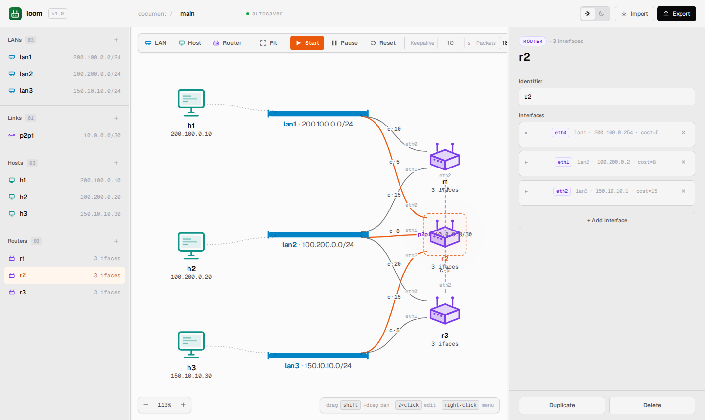
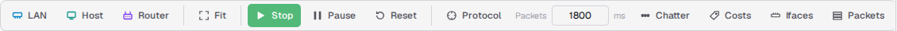
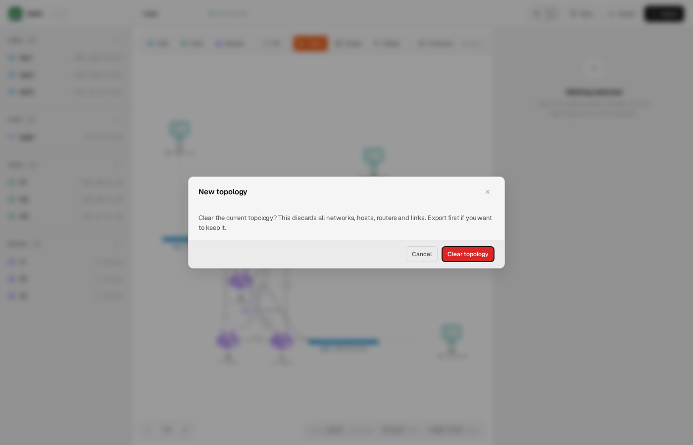
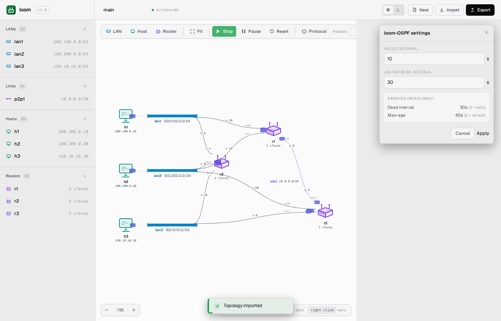
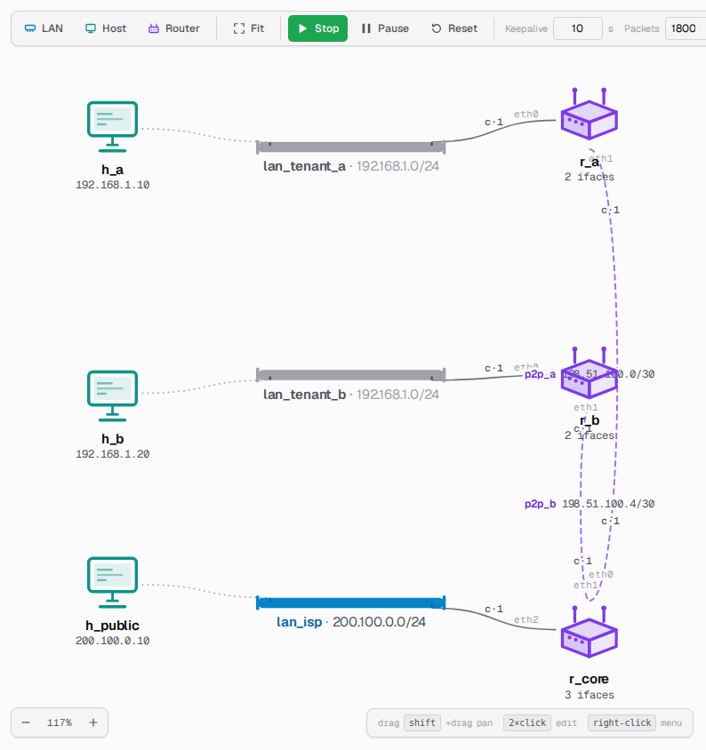
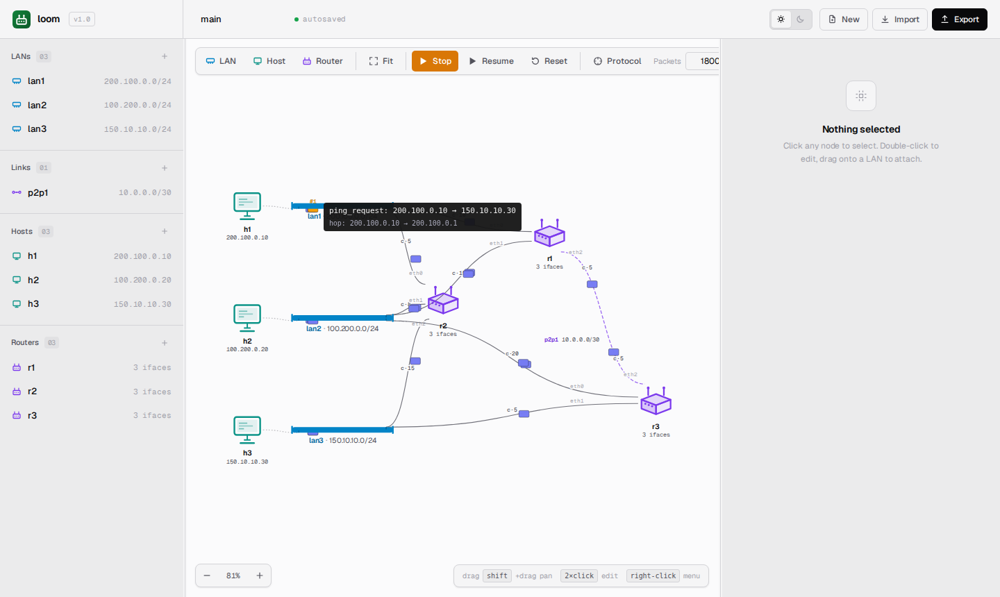
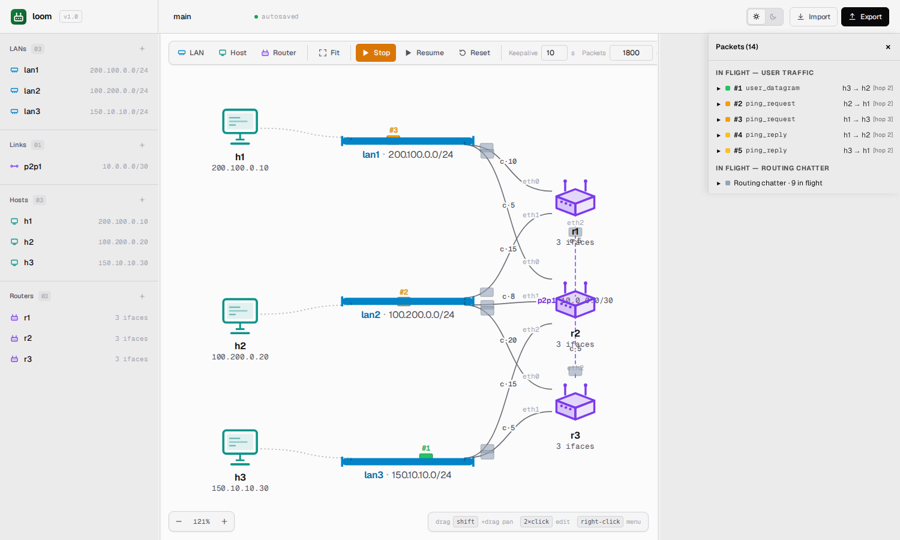
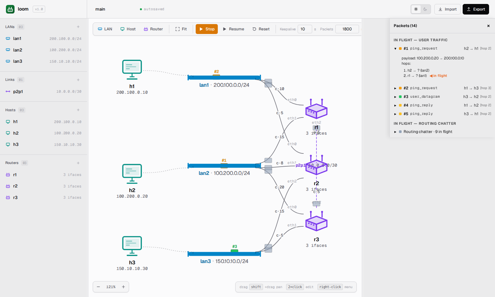
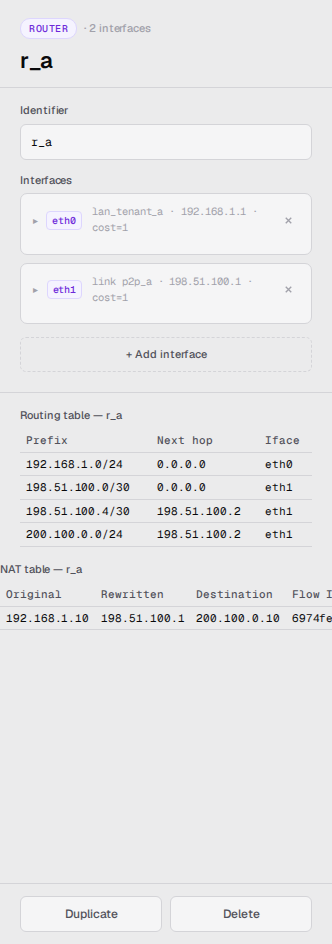
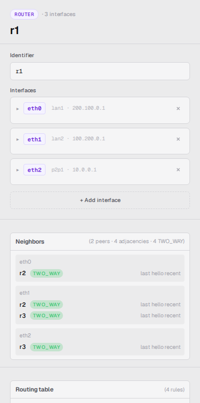

> 🌐 **English** · [Español](../es/user-guide/web-ui.md)

# The Web UI

This is a guided tour of the SPA. Every clickable affordance is covered
here, organized by region.

## Layout

```
┌────────────────────────────────────────────────────────────────────────┐
│  Toolbar (always visible)                                              │
├──────────┬───────────────────────────────────┬─────────────────────────┤
│          │                                   │                         │
│  Left    │            Canvas                 │   Right pane            │
│  nav     │            (SVG, drag/pan/zoom)   │   (Inspector)           │
│          │                                   │                         │
└──────────┴───────────────────────────────────┴─────────────────────────┘
```

Both side panes are resizable: drag the vertical splitters between
them. The widths persist across reloads.



## Header bar

The strip at the very top of the page holds project-level controls:

| Control | What it does |
|---|---|
| **Project name** | Editable topology name. Persisted; round-trips to/from YAML. |
| **Save indicator** | Shows `autosaved` during normal operation and `saving…` briefly after a change. |
| **Theme toggle** | Switch between **Light** and **Dark**. The choice persists across reloads. |
| **New** | Clear the current topology and start from an empty canvas. Asks for confirmation first, and stops the simulation if one is running. |
| **Import** | Open a picker listing the built-in sample topologies; click one to load it, or use **Browse local file…** to pick any `.yaml` on your computer. |
| **Export** | Open the browser's save dialog so you can pick a folder and filename for the current topology. The suggested name is derived from the file you last loaded. Falls back to `topology.yaml` when nothing is loaded. |

## Canvas toolbar

The toolbar sits above the canvas. From left to right:

| Control | What it does |
|---|---|
| **LAN** (<kbd>N</kbd>) | Add a network rail at the canvas center. Available at any time; give it a range while running and it joins the live network. |
| **Host** (<kbd>H</kbd>) | Add a host. Available at any time, but a host added while running stays unattached until you pause or stop (see below). |
| **Router** (<kbd>R</kbd>) | Add a router. Same as **Host**: it lands on the canvas, but gains interfaces only once you pause or stop. |
| **Fit** (<kbd>F</kbd>) | Fit the topology to the visible canvas. |
| **Start / Stop** (<kbd>Space</kbd>) | Toggle between idle and running. |
| **Pause / Resume** (<kbd>P</kbd>) | Toggle between running and paused. The label shows how many pending changes are queued while paused. |
| **Reset** | Idle-only: discard the session and re-clone from the source YAML. |
| **Protocol** | Open the Protocol settings popover (Hello interval and LSA-refresh interval). Greyed out until you start; usable while running or paused. |
| **Packets [speed] ms** | Sets the per-hop animation duration in milliseconds (200–5000). The on-screen label reads **Packets** with a numeric input and the unit **ms**. |
| **Chatter** | Mute or unmute routing-protocol packet animations. |
| **Costs** | Show or hide link cost labels at each router interface. |
| **Ifaces** | Show or hide interface name and count badges. |
| **Packets** | Open the Packets panel listing all packets currently traveling, with a numeric badge on each. Expand a row to see its hop history and any NAT translations along the way. |



**What "available while running" means.** Nothing on this toolbar greys
out once the simulation starts, but the canvas still protects the live
network from half-finished devices. A LAN or a point-to-point link is
complete the moment it has a valid range, so it joins the simulation
immediately. A host or router is not complete until it is attached to
something, and attaching (dragging onto a LAN, picking a network in the
inspector, adding an interface) is refused while running: the LAN shows
a red cue and the node snaps back. Pause or stop, attach it there, and
the device joins on Resume or the next Start.

### Starting fresh

**New** wipes the whole topology so you can build one from scratch. Because
that discards everything on the canvas, it asks you to confirm first. Export
the current topology beforehand if you want to keep it. Confirming leaves you
on the empty canvas, ready to add your first LAN.



### Protocol settings

The **Protocol** button stays greyed out until you press Start. The
timers belong to a live simulation, so there is nothing to tune while
idle. Once the simulation is running (or paused), click **Protocol** to
open the settings popover. It controls the two loom-OSPF timing
parameters:

- **Hello interval**: how often each router sends a Hello to its
  neighbors to declare itself alive (seconds, 1–300).
- **LSA refresh interval**: how often each router rebroadcasts its full
  link-state advertisement (seconds, 1–900).

Two derived values are shown read-only alongside the inputs:

- **Dead interval**: three times the Hello interval. A neighbor silent
  for this long is considered unreachable.
- **Max age**: two times the LSA refresh interval. An LSA older than this
  is expired from the link-state database.

Press **Apply** to push the new values to the running simulation. The
change takes effect on the next protocol timer tick, no restart required.



For the underlying mechanics, see
[`docs/architecture/routing-protocol.md`](../architecture/routing-protocol.md).

### Keyboard shortcuts

| Key | Action |
|---|---|
| <kbd>Space</kbd> | Start / Stop |
| <kbd>P</kbd> | Pause / Resume |
| <kbd>N</kbd> | Add LAN |
| <kbd>H</kbd> | Add host |
| <kbd>R</kbd> | Add router |
| <kbd>F</kbd> | Fit view |
| <kbd>Esc</kbd> | Clear selection / close context menu |
| <kbd>Delete</kbd> | Delete the selected node |

Shortcuts are **disabled** while an input or textarea has focus (so
typing inside a terminal doesn't accidentally fire **Router**), and
while any modifier is held (so <kbd>Ctrl+R</kbd> remains the browser's
reload).

## Canvas

The canvas is an SVG with three coordinate systems (world / view /
screen). You interact with it through three gestures:

- **Click a node** selects it. The inspector populates on the right.
- **Drag a node** moves it. Coordinates are persisted.
- **Drag the empty canvas** pans. The pan/zoom is also persisted.
- **Scroll on the canvas** zooms about the cursor.
- **Right-click a node** opens the context menu (rename, duplicate,
  delete).
- **Double-click a host or router** opens its terminal popup.

### What you see

- **Hosts** appear as workstation icons.
- **Routers** appear as cube icons.
- **LANs (multi-access networks)** appear as horizontal or vertical
  rails with end caps and one tick per attached interface. Drag the
  rail's handle to lengthen it; drag the rail body to move it.
- **Point-to-point links** appear as direct edges between the two
  endpoints, with a draggable midpoint label that carries the link's
  name and CIDR.
- **Interface labels** (when **Interfaces** is on) show the interface
  name and address at each connection point.
- **Cost labels** (when **Costs** is on) show the metric at each router
  interface.

Selection is shown by a highlight ring around the node.

### Private LANs

Networks whose CIDR falls in an RFC 1918 private range (`10.0.0.0/8`, `172.16.0.0/12`,
or `192.168.0.0/16`) render in a **muted neutral tone** instead of the
default accent color. The same muting applies to the interface labels on
the router side of those LANs. The visual cue lets you spot the NAT
boundary at a glance: muted = behind NAT, in color = directly routed.



Hosts, edges, and router icons stay at full chroma; only the LAN rail and
its router-side iface labels change tone. Selection and hover styling
still apply on top, so a selected private LAN is still clearly highlighted.

See [NAT and private LANs](nat-and-private-lans.md) for how traffic
actually crosses that boundary and how to inspect the gateway router's
NAT table.

## Packet animations

Every datagram that traverses a fabric is drawn as a small colored
rectangle traveling between its endpoints. The color encodes the
packet type (`user_datagram`, `routing_flood`, `ping_request`,
`ping_reply`) and the toolbar's **Chatter** toggle filters out the
routing-protocol packets when you want a quieter canvas.

### Inspecting packet internals

#### Pause and hover

Pause the simulation, then hover the mouse over any frozen packet
dot: a tooltip pops up with the packet's internals. Pausing freezes
in-flight packet animations in place, so the canvas effectively becomes
a step-through debugger.

The tooltip shows:

- The **packet type** (`user_datagram` / `routing_flood` /
  `ping_request` / `ping_reply` / `unknown`).
- The **original endpoints** of the conversation: the L3 source and
  destination as they were when the packet was created.
- A second **`hop:`** line, only when the current animation segment is
  between addresses that differ from the original endpoints, i.e.
  when a router is forwarding a datagram across a fabric. Single-hop
  and broadcast packets don't show this line.



This is the canonical debugging move when you're trying to trace where
traffic is actually going: pause, hover each frozen dot in order, and
read off the per-hop trail. While the simulation is running, packets
move too fast for the tooltip to land on the dot reliably. Pause
first.

#### Packets panel

For tracking multiple packets at once, or for keeping context while the
simulation is still running, click **Packets** in the toolbar. A panel slides
in from the right showing:

- **In flight: user traffic.** One row per packet currently crossing the network, with a numeric badge (`#1`, `#2`, …). The same badge rides on the corresponding dot in the canvas, so a row and its packet are always paired by sight. Expand a row to see the packet's hop history and any NAT translations along the way.
- **In flight: routing chatter.** Routing-protocol packets are summarized on a single line by default to keep the list readable. Expand the summary to see each one individually with its own `#R1`, `#R2`, … badge and a **Hello** / **LSA** label so the message type is clear at a glance (handy when teaching how the protocol propagates updates). LSA flooding is staged per hop: the originator's emission animates first; each downstream re-flood only starts moving once its inbound hop has visually arrived at the re-flooder, so the flood ripples outward through the topology instead of all dots appearing at once.
- **Recent.** The last ten user-traffic packets that have completed, oldest dropped first. The same expand-for-detail behaviour applies.

The panel works just as well while the sim is paused: frozen badges sit on the wires alongside the panel rows, making the badge-to-row mapping easy to read.





### NAT annotations

Packets that crossed a NAT hop show the translation in their tooltip.
Pause the simulation and hover over the packet to see lines like
`NAT @ r_a: 192.168.1.10 → 198.51.100.1`. Selecting the egress router
in the inspector opens a NAT table panel listing live entries. Each row
shows the original private source, the rewritten public source, the
destination, and the flow ID (shortened to fit; hover it for the full
value). The table grows as traffic flows; entries are bounded by
least-recent-use eviction.



See [NAT and private LANs](nat-and-private-lans.md) for the broader
workflow.

## Left pane (navigation)

The left pane lists all entities grouped by type: networks, links,
hosts, routers. Click a name to select it; the **+** beside a section
heading adds a new entity of that type. The context menu lives on the
canvas, not here. Selection is shared with the canvas, so the two panes
always agree on what's selected.

The **Save state** indicator (`autosaved` under normal operation,
`saving…` for a brief moment after a mutation) sits in the **header
bar**, next to the editable project name.

## Right pane (inspector)

The inspector renders **one panel per selected node**, with sections
that vary by node type. The whole panel is visible at once, there are
no tabs to switch between.

For every node type:

- **Identifier / name**: editable. Renames are validated for
  uniqueness.
- **Properties**: address, network/link membership, gateway (hosts
  only).
- **Duplicate / Delete**: bottom of the panel. Duplicate clones the
  node with a new name; Delete removes it.

Type-specific sections:

| Selection | Extra sections |
|---|---|
| Network | CIDR, plus an **Orientation** button that flips the rail between horizontal and vertical |
| Link | (CIDR only) |
| Host | Fabric type, network/link, IP, default gateway |
| Router | Interfaces list (one row per interface, expandable), Neighbors, Routing table, and (once the router has translated something) a NAT table |

### Router inspector

For a selected router, the inspector includes both the interface list
(name · network · address · cost, plus `+ Add interface`) **and** the
current routing table. The routing table refreshes automatically when
you select the router and whenever a routing update arrives for this
device. Columns: prefix, next hop, interface.

A directly-connected route shows `0.0.0.0` as the next hop, that's
the simulator's sentinel value meaning "deliver to the packet's
destination on this interface." See [Routing tables](routing-tables.md)
for what to read into this.

The router inspector also shows a **Neighbors** section listing, per
interface, every discovered peer and its adjacency state
(`TWO_WAY`, `INIT`, or `DOWN`). The summary line counts unique peer
routers, total adjacencies, and a per-state breakdown; see
[Neighbor counts](#neighbor-counts) below for the difference between
peers and adjacencies.



### Neighbor counts

A fully-converged router shows e.g.
`(2 peers · 4 adjacencies · 4 TWO_WAY)`; a router still settling or
with some links unreachable might read
`(2 peers · 4 adjacencies · 3 TWO_WAY · 1 INIT)`. The two counts
measure different things:

- **Peers**: the number of *distinct neighbor routers* this router
  has discovered, regardless of how many shared LANs or links they meet
  on.
- **Adjacencies**: one entry per interface a peer is reachable from.
  Two routers that share both `lan1` and `lan2` count as **one peer /
  two adjacencies**, because each LAN forms its own adjacency.

The `TWO_WAY`, `INIT`, and `DOWN` totals are per-adjacency states
(peers and adjacencies are not states). State counts that are zero are
omitted to keep the line compact.

An interface attached to a fabric where no other router is connected
(a stub, e.g. a LAN serving only hosts) is shown as `no other routers`
and is *not* counted as a `DOWN` adjacency: there is nothing on the
other end to peer with, so flagging it as DOWN would be misleading. An
interface that *should* have a peer but hasn't heard one yet (or whose
peer's Hellos have stopped) is the real DOWN case and contributes to
the count.

## Terminals

Double-click any host or router to open a floating terminal. Each
terminal is a self-contained popup with:

- A title bar showing the device name.
- A scrollable output area.
- A prompt with `#`.
- Drag-to-move and drag-to-resize handles on the corners.

Position and size persist per device.

Keyboard inside a terminal:

| Key | Action |
|---|---|
| <kbd>Enter</kbd> | Submit the typed command |
| <kbd>Ctrl+L</kbd> | Clear the output area |
| <kbd>Ctrl+D</kbd> | Close the terminal (when the prompt is empty) |
| <kbd>↑</kbd> / <kbd>↓</kbd> | Command history |

Multiple terminals can be open at once. Commands and their output are
isolated per terminal; nothing is shared.

For the full command set, see [Terminals](terminals.md).

## Context menu (right-click)

Right-clicking a node on the canvas or in the nav pane opens the context menu.

### On any node

| Item | Behavior |
|---|---|
| **Edit** | Selects the node and focuses the inspector, ready to rename or change properties (equivalent to double-clicking). |
| **Duplicate** | Clone the node with a new name; useful for routers. Disabled while running. |
| **Delete** | Remove the node. See [Delete behavior while running](#delete-behavior-while-running) below. |

### On a LAN

| Item | Behavior |
|---|---|
| **Add host here** | Create a new host and attach it to this LAN at the cursor position. |
| **Add router here** | Create a new router and connect it to this LAN at the cursor position. |

### On a host

| Item | Behavior |
|---|---|
| **New p2p link…** | Open the link-creation wizard to wire this host directly to another device via a point-to-point link. |
| **Move to LAN…** | Move this host's interface to a different LAN (submenu lists available LANs). |
| **Detach from LAN** | Detach this host from its current LAN without deleting it. |

### On a router

| Item | Behavior |
|---|---|
| **New p2p link…** | Open the link-creation wizard to wire this router directly to another device via a point-to-point link. |
| **Connect to LAN…** | Add a new interface on this router connected to an existing LAN (submenu lists LANs not already attached). |

### On the empty canvas

Right-clicking empty space gives shortcuts to create a LAN, host, or router at
the cursor position, fit the view, or import a topology.

The menu is dismissed by clicking anywhere outside it or pressing <kbd>Esc</kbd>.

### Delete behavior while running

| Node type | While running |
|---|---|
| **Host** | Deleted immediately (live edit). |
| **Router** | Deleted immediately (live edit). |
| **LAN (unused)** | Deleted immediately (live edit). |
| **LAN (with attached devices)** | Blocked: detach or delete the devices first. |
| **Link** | Blocked: stop the simulation first. |

### Router admin actions (while running)

When the sim is running, right-clicking a **router** adds three extra
items above the topology-mutation group:

- **Halt router (graceful)**: quiesces the router cleanly before
  taking it offline.
- **Crash router**: abruptly fails the router with no teardown,
  simulating a hard crash.
- **Resume router**: shown in place of the above two when the router
  is already halted; brings it back online.

A halted or crashed router grays out on the canvas (dimmed and
desaturated). Neighboring routers detect the loss via Hello timeouts
and update their routing tables accordingly.

### Per-interface controls (router inspector, while running)

With a router selected, the inspector's interface list shows action
buttons next to each interface:

- **Disable**: bring the interface down gracefully (admin shutdown).
- **Fail**: hard-fail the interface (no teardown).
- **Enable**: re-enable a disabled interface.

A downed interface's canvas edge becomes a solid gray wire with a small
✕ at its midpoint, distinct from the dashed style used for live
point-to-point links. Packets headed for a downed interface are dropped
at the link entry (they leave the source and fade out rather than
reaching the device). The button flips between Disable/Fail and Enable as
the interface state changes.

## Status indicators

- **Save state** (header bar, next to the project name): `autosaved` / `saving…`.
- **Sim state** is implicit in the toolbar: the Start button label
  changes between **Start** / **Stop**, and the Pause label changes
  between **Pause** / **Resume (N edits)**.
- **Connection banner**: if the WebSocket disconnects, a yellow strip
  appears at the bottom, reading *"connection lost — retrying"*. Reconnection
  is automatic (exponential backoff, max 8 s).
